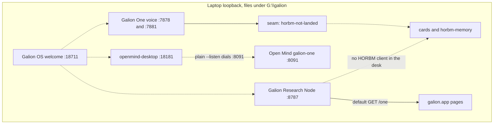

# Stack map

Read on 21 November 2026 from the commits in the table below. A claim in this file cites a path in one of those commits. **UNVERIFIED** means those trees do not show it. This file copies no secrets, tokens, or server addresses.

The operating system is named Galion OS. The repository is `galion-studio/galion-operating-system`.

## Decision

Launches for this work stay on the owner's laptop. The target is Rust processes bound to `127.0.0.1`, with laptop files and scripts under `G:\galion\`. The Titanaxe VPS is out. The owner says it expired.

Galion OS does not start the other pieces. `galion-init` keeps a boot plan in memory, refuses to run as PID 1, and does not fork or bind. `galion-welcome` is a separate binary. It binds the loopback interface on port 18711 and serves one HTML page. That page lists Galion units and says Open Mind, Research, and Voice are not on the machine until those units exist. Sources: `galion-init/src/welcome.rs` (`WELCOME_PORT`), `docs/PI5-SEED.md`, `docs/ARCHITECTURE.md`, all at `f6bfa929`.

`docs/ARCHITECTURE.md` is the earlier four-piece map (Galion OS, Galion Research, the Obsidian desktop, Galion Voice) and the Pi 5 notes. This file adds Galion App, HORBM, the desktop rows, and the laptop decision. The phase 2 reading of the same commits is [deep-dive/README.md](deep-dive/README.md). The symphony job still pins older commits (`b26ad02e` for `obsidian-open-mind`, `74f9a707` for `hermes-research`). Those pins are not the heads read here.

## Commits read

| Repository | Commit | What was read |
| --- | --- | --- |
| `galion-operating-system` | `f6bfa92900630fd41f0642238257ad796e2f2615` | Galion OS seed, site pages, architecture notes. Merge of PR 74. |
| `obsidian-open-mind` | `d7ddf67686fe3c847fcaf10f4ca1c582fbe50bcb` | Workspace, desktop, stack rows. Merge of PR 117. |
| `hermes-research` | `13ff29389c7d7528d7c3d3a667a7abb9e7153081` | Research desk. Merge of PR 39. |
| `galion-one-voice` | `c7179d1b6cd346aa6a9130e4694656143472b46b` | Voice workspace and `voice-stack/`. |
| `galion-knowledge` | `761a7f225304fc010379219e5b88c6669dd48f40` | HORBM cards, diagram, `horbm-memory`. Merge of PR 35. |
| `galion-app` | `1134affc3d16be75c7f47e4ac516263044e11412` | Private Next.js app. README and `src/app` directory listing. |
| `galion-console` | `22444544b167ad7ad5d47ed822da4737ce7eb1f9` | Private Next.js dashboard. README only. A different program from `crates/galion-console`. |

`galion-knowledge` `761a7f22` is also the revision named in `galion-one-voice` `voice-stack/pipeline-orchestrator/README.md`. An anonymous clone of `galion-infrastructure` was refused. Its contents are **UNVERIFIED**. `galion-agi-web` returned an empty repository.

The crate index in `obsidian-open-mind` was measured at `de7480e71ce98191d2ee11f018fa15be6c5a1707` (75 workspace packages). `main` has since moved to `d7ddf676`. This map did not re-run `cargo metadata`.

## 1. Obsidian Open Mind

Rust workspace for a CPU box. Short name in its README: Open Mind. Crate names are `openmind-*`. It is not the Obsidian note app.

Repository: `galion-studio/obsidian-open-mind` at `d7ddf676`. Root `Cargo.toml` is the workspace. `edge/openmind-node` is its own workspace and binary `omnode`. `docs/crate-index.md` at `de7480e` groups the members. The contract crate `openmind-schema` says the processor owns the loop and the schema is the desk contract (`crates/openmind-schema/src/lib.rs`).

Language and runtime: Rust. The README says a 1.83 toolchain failed on `galion-common` and a local desktop build used rustc 1.100.0. The root `Cargo.toml` has no `rust-version`, and the README says there is no `rust-toolchain.toml`.

Current state: the workspace builds crates. The desktop page does not start the stack. Several rows are marked planned in `crates/openmind-desktop/src/stack.rs`.

The directory `stack/` is a copy dated 2026-10-18 of files from a VPS (`stack/INDEX.md`). It is not the component list. `stack/hermes/SOUL.md` says the agent stays on a TitanAxe server.

## 2. Obsidian Desktop

The desktop binary is `openmind-desktop`, built from `crates/openmind-desktop` in the same repository and commit.

Page mode opens no socket. `--listen` binds `127.0.0.1:18181` (`DEFAULT_BIND` and `DEFAULT_PORT` in `crates/openmind-desktop/src/lib.rs`). It does not bind 18081. A console probe uses port 18080 (`probe.rs`). A non-loopback address is refused before the socket opens.

The page has ten rows, defined in `crates/openmind-desktop/src/stack.rs` at `d7ddf676`:

| Row | State in `stack.rs` |
| --- | --- |
| open-mind, command, files, voice | staged |
| galion-one, hermes, memory, nerve | planned |
| desk, console | staged |

The test named in the README is `stack::tests::open_mind_leads_and_nothing_is_live`. The page does not start those rows. `/one` and `/research` are entry pages in this binary. They are not the research desk and not Galion Voice. The page content-security policy is `connect-src 'self'` (`crates/openmind-desktop/src/page.rs`). Tests in that file assert those two entry pages contain no `https://` URL.

Plain `--listen` still dials `127.0.0.1:8091` (`DEFAULT_STACK` in `files.rs`). The `--stack off` help line says it does not open a client (`cli.rs`). The package step in `.github/workflows/release.yml` copies `galion-one`, `galion-desk`, `room`, `desk-hermes`, and `link-watch` when those binaries exist. `openmind-desktop` is not in that copy list. A separate workflow, `.github/workflows/openmind-desktop.yml`, builds the desktop.

## 3. The OpenMind stack

The stack is the Rust workspace plus the ten desktop rows. `docs/bind-defaults.md` at `d7ddf676` records the loopback ports below. Grouped from `docs/crate-index.md` at `de7480e` (the index was not remeasured on `d7ddf676`):

| Group | Crates | Port |
| --- | --- | --- |
| Contract | `openmind-schema`, `zagreb-time`, `openmind-config` | none |
| Desktop | `openmind-desktop` | listen `127.0.0.1:18181` with `--listen` |
| Galion One binary in this repo | `galion-one` | listen `127.0.0.1:8091`, mouth `127.0.0.1:8002` |
| Desk and room | `galion-desk`, `room` | desk `127.0.0.1:8646`; room `127.0.0.1:4020` only with `--listen` |
| Hermes crates | `hermes-rs`, `hermes-gateway`, `hermes-tools`, `desk-hermes`, `link-watch` | dial Hermes `http://127.0.0.1:8642`; link-watch also dials Ollama `http://127.0.0.1:11434` |
| Memory and nerve | `openmind-memory`, `openmind-nerve`, `nerve-client` | memory default 8420 (`crates/openmind-memory/src/config.rs`); nerve default `127.0.0.1:8670` (`NERVE_ADDR` in `crates/openmind-nerve/src/main.rs`) |
| Tuner | `tuner` | `127.0.0.1:8650` |
| Survival and sandbox | `openmind-survival`, `guardian-tick`, `openmind-sandbox` | no listen port recorded in the bind note |
| Persona relay | `persona-plex-relay` | scaffold; `plan.rs` prints `mode: SCAFFOLD` |
| Console UI | `console-ui`, `console-static` | probe 18080; alias binary `galion-console-serve` |
| Edge | `edge/openmind-node` | own workspace, binary `omnode` |
| Gaia crates | `gaia-*` in the index | many descriptions say dry-run or no network I/O |
| Boot and guard | `galion-boot`, `galion-guard` | `galion-guard` is described as a VPS SSH ban daemon |

`galion-one` here is ear, mind, and mouth. `deploy/galion-one.service` has no `[Install]` section, and a comment says it stays disabled until Slavik approves. The desktop row for it is planned. This binary is not the Galion One app in section 6.

A crate comment in `openmind-nerve` says the binary is live as `galion-nerve.service` on `127.0.0.1:8670`. This map did not probe a machine. The desktop nerve row is planned. `crates/openmind-nerve/src/config.rs` still has `KNOWN_PORTS_VPS` and rejects `0.0.0.0`.

## 4. Galion Research

PhD-level research desk for `research.galion.app`. Its README says it is separate from Galion One, has its own memory, and has no voice model.

Repository: `galion-studio/hermes-research` at `13ff2938`. Also on that history: PR 41, phone layout at 360px, commit `b161412f4304a604143ad310164b03fb6eb56ed0`.

Language and runtime: Node.js `>= 22` (`package.json` `engines`). The root `package.json` has no `dependencies` field. `e2e/package.json` has Playwright dev dependencies for tests. `npm start` runs `node src/server.js`. There is no Rust server in this repository.

Bind: `BIND_HOST = "127.0.0.1"` and `DEFAULT_PORT = 8787` in `src/server.js`. `PORT` changes the port only. The host argument cannot move the bind. Desk paths are `http://127.0.0.1:8787/research` and `/`. `GET /health` returns `{"ok":true,"service":"galion-research","bind":"127.0.0.1"}`.

`GET /one` redirects to `GALION_ONE_URL` when that value is an accepted origin, otherwise to `https://galion.app/one` (`oneTarget` in `src/server.js`). A loopback `http` origin is accepted. The default leaves the machine.

Hermes link (`src/hermes.js`): default URL `http://127.0.0.1:8642/v1/chat/completions`. Other hosts are refused. Attach when `GALION_LLM=hermes`, or when the URL is set and the mode is empty. Modes `canned`, `echo`, and `mock` stay off this client. The key comes from a file or the environment. Responses say the key is `set` or `none`. Default model `hermes-agent`. Default timeout 3000 ms, allowed range 50 to 95000. The desk does not start the gateway. The research README says the engine crates are still named `hermes-rs` and `hermes-gateway`. Those Rust crates are in `obsidian-open-mind`. They are not in this Node repository.

Uploads (`src/uploads.js`): any file, including a dotfile. No type list and no size cap. `EXCERPT_BYTES = 1024`. `HANDED_BYTES = 32 * 1024`. `GALION_UPLOAD_DIR` is used when it resolves outside the repo. Otherwise the directory is `tmpdir()/galion-research-uploads`. The turn hears the name, the size, and a short text prefix. The README says that prefix is not a citation.

Forwarding (`src/forward.js` and the README): `GALION_RESEARCH_URL`, or `GALION_VOICE_URL` when that is set, is the galion-one-voice origin for `/research/hermes`, `/research/history`, and `POST /research/ask`. `voiceTarget` keeps the forward only when `loopbackOrigin` accepts it. `loopbackOrigin` accepts `http` on a loopback host and refuses anything else. A unit test asserts `loopbackOrigin("https://galion.app")` is `refused`, and that `GALION_RESEARCH_URL=https://galion.app` sets `voice.forward` to null (`test/unit/forward.test.js`). The README still says to set `GALION_RESEARCH_URL` to `https://galion.app` for the live page. That sentence and the forward function disagree. `.env.example` leaves `GALION_RESEARCH_URL` commented out. `GALION_OPENMIND_URL` is a separate loopback origin. `OPENMIND_PORT` in `src/forward.js` is 18181. When the voice origin is unset or refused, the research engine on this machine answers. If that origin is down and Hermes does not answer, the README says the desk continues from local knowledge, marks the answer `Offline`, and leaves citations empty. The same paragraph says what this process already knows is the voice, the price, the palette, and the connection to Galion One. The README also says the desk does not invent a paper, a URL, a date, or a measurement. The prompt text with that rule is in `src/hermes.js`. `src/forward.js` comments that Cloudflare drops an origin reply after 100 seconds. That comment still assumes a public edge.

Laptop CI: `scripts/laptop-ci/research-e2e.ps1` is installed as `G:\galion\ci\research-e2e.ps1`, task `GalionResearchE2E`. It reads the mirror at `G:\galion\work\repos\hermes-research` and logs to `G:\galion\logs\ci\hermes-research-e2e.log`. It does not push. The deploy kit refuses `--execute`. The Pi 5 seed is one executable of the same desk (`docs/PI5-SEED.md` in that repo).

Ultra price copy of $220 / €220 is copy on the page. It is not a checkout. A search of this repository found no `horbm` string and no `galion-knowledge` string.

## 5. The Galion App

Two trees use the domain `galion.app`. The owner says Galion App and Galion One are the two apps currently in use. That sentence is the owner's statement. These git trees do not record which process is running on the laptop. Which process is on the laptop today is **UNVERIFIED**.

### Static pages in Galion OS

`site/` in `galion-operating-system` at `f6bfa929` is HTML and CSS for the domain. Preview: `python3 scripts/serve_site.py` at `http://127.0.0.1:8765/`. Paths include `/`, `/one/`, `/research/`, `/operating-system/`, `/voice/`, and `/labs/`. `site/index.html` titles the home page "Galion OS — free, open source, on your CPU" and says the system is planned and no OS image is published. Plus is labelled Galion One at $20. Ultra is labelled Galion Research at $220. Billing is not live. `paid_tiers` is false. This repository does not deploy and does not change DNS. `functions/api/region.js` only reads `CF-IPCountry`. The preview is Python, not Rust.

### Private Next.js app

`galion-studio/galion-app` at `1134affc` (20 January 2026, "docs: Add comprehensive README"). The README says Next.js 14, TypeScript, Tailwind, and Three.js, and says to open `http://localhost:4000`. `package.json` script `dev` is `next dev` with no `-p 4000`. A bind in `next.config` was not confirmed. Whether `next dev` listens on 4000 or on Next's default 3000 is **UNVERIFIED**.

The README example sets `NEXT_PUBLIC_API_URL=http://localhost:8000` and `NEXT_PUBLIC_WS_URL=ws://localhost:8000`. Which server listens on 8000 is **UNVERIFIED**. This map did not run the app.

`src/app` contains route directories including `about`, `actions`, `admin`, `agents`, `analytics`, `api`, `auth`, `billing`, `dashboard`, `docs`, `onboarding`, `pricing`, `sessions`, `settings`, `tools`, `usage`, `voice-pipeline-beta`, `voice-v5`, `voice-v54`, `welcome`, and `workspace3d`. `ARCHITECTURE.md` in that repo is titled "Galion.app V3 Frontend" and its footer says "Last Updated: December 2024 / Version 3.0". That document describes a voice pipeline, a WebSocket, an orb, billing, guest limits, and agent tools (email, calendar, payments, and others). Those are the document's design. This map did not execute them. `package.json` depends on `next` `^14.2.33`, `three`, `socket.io-client`, and `@aws-sdk/client-s3`. The README license line says private. The app is Node, not a Rust launcher.

`galion-agi-web` is an empty repository.

## 6. The Galion One app

Galion One, as the owner uses the name for the app in use, is `galion-studio/galion-one-voice` at `c7179d1b`. The root README title is "Galion Voice V2". Rust 1.85 or newer. `LOCKS.toml` records an 80 ms tick, 12.5 Hz, and 24 kHz. Consent starts denied. The README says nothing in the tree is deployed. V1 is the one-dot page, a heartbeat, and Piper, Flite, and Vosk. V2 is this program. V3 is later.

Root workspace members in `Cargo.toml`: `galion-tensor`, `galion-sideband`, `galion-openmind`, `galion-console`, `galion-render`, `galion-emotion`, `galion-mimi`, `galion-presence`, `galion-presence-eval`, `galion-heartbeat`, `galion-cascade`, `galion-asr-vosk`, `galion-student-backend`, `galion-ml-voice`, `galion-live-demo`, `galion-symphony`, `galion-consent`, `galion-cores`, `galion-clone-cbx`. The root workspace excludes `runtimes/galion-piper-rt` because it uses `ort`. Weights are gitignored. The root `repository` field points at `https://github.com/galion-studio/Galion-Voice-`. Whether that URL is a repository is **UNVERIFIED**.

`crates/galion-console` is a ratatui dev console. Its README says `cargo run -p galion-console`. It is not the end-user screen. The one-dot page is `scripts/run-v1-screen.sh`. Default `V1_SCREEN_ADDR` is `127.0.0.1:7878`. `V1_SCREEN_SECONDS` is 3600. `GALION_LLM=canned` is the documented local mode. `--mic live` is stubbed and exits 2. A feature `phone-turn` exists.

`crates/galion-openmind` is the voice-side seam to Obsidian Open Mind. `GALION_NERVE_URL` must be a numeric loopback address. The example is `http://127.0.0.1:8670`. The hostname `localhost` is refused. When the variable is unset, the seam posts nothing. Hermes is a side band. It is not on the 80 ms tick.

`crates/galion-ml-voice` `SpeechStack`: mode `auto` tries the clone child, then Piper A21, then Flite. `detect` does not download. `GALION_SPEECH` is `auto`, `clone`, `a21`, `flite`, or `off`.

### `voice-stack/`

Nested workspace `voice-stack/Cargo.toml`. It is not a member of the root workspace. `cargo test --workspace` at the repository root does not build it. Members: `contract`, `asr`, `audio-io`, `emotion-in`, `emotion-prosody`, `eval-golden`, `horbm-bridge`, `latency-harness`, `linux-package`, `local-server`, `one-dot-ui`, `pipeline-orchestrator`, `tts-piper-stream`. `vad` is excluded because it depends on `ort`. `rust-version` 1.85, edition 2021, version 0.0.1. `LOCKS` forbid adding `candle`, `ort`, `tract`, `burn`, `llama`, or `ggml` to workspace members.

`voice-stack/ARCHITECTURE.md` is a Swarm 16 design named Samantha. The file says it is not a latency result, and that crate `horbm` is not in this repository. Sectors are S01 through S16. The WebSocket protocol is `galion-samantha-ws/1`, bound to `127.0.0.1:7881` (`SAMANTHA_WS_ADDR` / `GALION_SAMANTHA_WS`). `0.0.0.0` is refused. Neighbour ports named in that design: 7878 one-dot, 7879 hard loop `GALION_HARD_ADDR`, 7880 clone `GALION_CBX_ADDR`, 8642 Hermes, 8766 nebula. Nebula is a different emotion-feed schema. It is not Samantha.

`voice-stack/local-server` serves the loopback UI, default `127.0.0.1:7881` (`src/bind.rs`). `GET /health` returns 200 and a JSON body whose `ok` field is `true` (`voice-stack/local-server/src/server.rs`). With no HORBM linked, the turn error is `brain-unlinked` and the mood source is `resting`. `voice-stack/local-server/PROTOCOL.md` says that resting pad is arousal 0.3, valence 0.25, dominance 0.5. `voice-stack/one-dot-ui` is the dot only. HORBM is not linked. The line is a mock. `voice-stack/pipeline-orchestrator` (package `galion-sam-orch`) does not link Piper, Vosk, Chatterbox, or `horbm`. `Brain::open` returns `Err("horbm is not linked; Brain::open stays in crate horbm")` (`src/samantha_traits.rs`). It does not call Hermes. It names galion-knowledge revision `761a7f225304fc010379219e5b88c6669dd48f40`.

`voice-stack/windows-install/README.md` is the owner machine. Large files go under `G:\galion\samantha`. The note says `C:` is not used for models, the Cargo registry, or build output. One-dot is `127.0.0.1:7878` via `dot_console_demo`. Companion `samantha-local.exe --addr 127.0.0.1:7881`. On Windows, Piper is the piper CLI because `galion-piper-rt` uses `dlopen`. Clone weights are not downloaded. `-DryRun` writes nothing. The installer does not touch tasks `GalionLaptopLink` or `GalionShellLink`.

Prior commits on this history: PR 221 Samantha clone `3c32425ad6417fc7910830880573b7b80974df10`; one-dot page `32a3932817dd5ac2b03a8ee09cc75f2900cc3482`; S09 orchestrator `dbca0c80df6c93804015b29d110d56e760d9ba80`, whose message says HORBM stays behind `ReplyEngine`.

### Name collisions

Three different programs use the console name. `crates/galion-console` in this voice repo is the ratatui console. `obsidian-open-mind` ships an alias binary `galion-console-serve`. `galion-studio/galion-console` at `22444544` is a private Next.js 14 dashboard. Its README says to open `http://localhost:3000` and lists analytics, a voice-pipeline monitor, workforce, PM2, PostgreSQL, a guardian, and email. Those are README claims. This map read the README and did not run the dashboard. The same README example points an API and a WebSocket at `localhost:8000`.

The marketing page `site/one/` in Galion OS is a third use of the Galion One name. It is not the voice binary.

## 7. HORBM

Written name in the repositories: HORBM. The owner said "HRRVM" on a voice call. A search of the five cloned trees found no `HRRVM` string. GitHub code search across the org returned zero hits and was `incomplete_results`, and that same search also missed HORBM, so the org search is not evidence. No second expansion for HRRVM is invented here.

Expansions that are in git:

- Plural, "Heuristic Open Retrieval Brain Models": `v2/src/horbm/interactive/horbm.json` lead, and `v2/docs/HORBM_INTERNAL.md`, in `galion-knowledge` at `761a7f22`.
- Singular, "Heuristic Open Retrieval Brain Model": `v2/src/horbm-layers.njk` in the same commit.

`v2/docs/HORBM_CARDS_OUTLINE.md` says HORBM is Galion's retrieval-based, non-LLM brain, and that the lane is `v2/data/cards/horbm/` only. The retrieval brain crate named `horbm` is not in `galion-knowledge` and not in `galion-one-voice`. `voice-stack/ARCHITECTURE.md` says crate `horbm` is not in that repository.

### What it reads

Cards on disk at `761a7f22`: 90 JSON files under `v2/data/cards/horbm`, and 1416 JSON files under `v2/data/cards/world`. `v2/docs/HORBM_INTERNAL.md` (note dated 18 November 2026) says the HORBM cards are a seed for how the brain talks, and that the note does not design the retriever, ranker, diary, or mouth. Card status in that note was `sourced - needs review` or `draft`. Nothing in that note was `published`. Categories named there: conversation, honesty, affect, persona, culture, safety, memory.

The Rust library that indexes cards is `v2/memory`, crate `horbm-memory` 0.1.0, `rust-version` 1.83, `rusqlite` bundled, binary `horbm-memory`. `v2/docs/MEMORY_STACK.md` says this crate is what HORBM and Galion Research search. A query returns at most four hits, split into memory and knowledge. A miss answers "I don't know". Knowledge is written by `import` and `rebuild` from card JSON. Core versus shard follows `claim_type` fact or strong evidence. Gap advice includes the string `ask_galion_research`. The same doc says the crate does not call an API model. Default database `./horbm-memory.sqlite`. Default knowledge directory `./horbm-knowledge`. The target size in that doc is about 50k to 200k cards, not 100 million. `v2/docs/CORE_PACK.md` says the core pack target is the owner's band, and the first tranches are hundreds of cards, not 50k.

The owner decision for this map: existing cards are read-only, core knowledge-base development is paused, and the core will be built later with external APIs. That decision is the owner's. No `paused` switch was found in the crate. `import` and `rebuild` still write an index. The external-API builder is not in the crate.

The V2 site is Eleventy 3. The README says V1, the Next.js app in `src/`, stays the live app until V2 is deployed. `cd v2 && npm run dev` uses port 3016. The deploy note says serve `v2/_site/` on `127.0.0.1:3015` and do not use `next start` for V2. `python3 serve.py` binds 3015. The truth gate is Rust, `v2/tools/truth-gate`, Rust 1.85 or newer. The diagram tool is Rust, `v2/tools/horbm-diagram`.

### The diagram

`v2/src/horbm/interactive/horbm.json` version 1.2.0, updated 19 November 2026. The interactive README says the numbers shipped that day are a starting snapshot, not a live formula, and that no agent or pull request was assigned. Chip status `B` means Built, `A` means Accepted, `R` means Recommended, `C` means If needed. "Built" on a chip is a label in this JSON. It is not a linked brain in `galion-one-voice`.

Center stack in that JSON, layer number and title, with the snapshot state:

| n | Title | Snapshot state |
| --- | --- | --- |
| 0 | North star (guide, not a step) | planned |
| 1 | Voice and senses | in progress |
| 2 | Persona and inner life | in progress |
| 3 | Empathy | planned |
| 4 | Dialogue manager and policy | in progress |
| 5 | Core chat engine | in progress |
| 6 | Skills | in progress |
| 7 | Memory and relationship | in progress |
| 8 | Knowledge and truth | in progress |
| 9 | Safety and ethics | planned |
| 10 | Evals and metrics | planned |
| 11 | Machines and infrastructure | in progress |

The lead calls this twelve layers. The objects above are `n` 0 through 11. The interactive admin board (`/horbm/interactive/admin/`) is read-only: no token and no edit control. That is the diagram board. It is not the card writer.

### How it plugs into Galion One and Research

Galion One, Samantha path: `voice-stack/horbm-bridge` package `galion-sam-horbm`. `ReplyEngine` stays on `FakeEngine` until `--features horbm`. The feature currently links `seam/horbm`. The bridge README says Cargo 1.83 resolves that optional path even when the feature is off, so a missing `../../horbm/crates/horbm/Cargo.toml` fails `cargo test`. `build.rs` warns if that landing `Cargo.toml` appears. `seam/horbm/src/lib.rs` `turn` returns an empty line and source `seam:horbm-not-landed`. The tick is empty. The README says `horbm` has no tick in the brief.

Environment names for a future open, from the bridge README, using the laptop paths already written there: `GALION_HORBM_MEMORY=G:\galion\horbm\memory.db`, `GALION_HORBM_KNOWLEDGE=G:\galion\horbm\knowledge`, `GALION_HORBM_CASES=G:\galion\horbm\cases`. When those are unset, `say` stays on `FakeEngine`. The same README's bash example uses `$HOME/galion/horbm/...`. That Linux home path is one of the defaults to change for the laptop rule. Measured numbers in that README are from a Linux rustc 1.83 box. They are not the Windows laptop, and they are not ASR, TTS, or HORBM retrieval times. One of those measurements is a pad at arousal 0.7, valence 0.55, dominance 0.5 after a `hey!` turn. That is a `FakeEngine` measurement, not a card retrieval.

`galion-openmind` does not call HORBM. It posts to nerve only when `GALION_NERVE_URL` is set.

Research: `hermes-research` has no call into `horbm-memory`. The sentence that HORBM and Galion Research search the same crate is in `galion-knowledge` `v2/docs/MEMORY_STACK.md`. The gap string `ask_galion_research` is in that knowledge repo. A persona card `horbm-persona-galion-research.json` is in the knowledge cards. The research server does not call it.

## How they fit

Solid lines are calls present in the source that was read. Dotted lines are a dial the desktop does not start as a process, an unlinked seam, or a launch Galion OS does not perform. `galion-welcome` does not start the other boxes. There is no Titanaxe box in this diagram. The Open Mind `galion-one` binary and the Galion One voice app are different programs.

## Localhost ports and processes

Listen means a binary in the cited tree binds the port. Dial means some other process calls it. Symphony stand-ins in `docs/PI5-SYMPHONY.md` of Galion OS are not these processes.

| Port | Process | Role | Evidence |
| --- | --- | --- | --- |
| 18711 | `galion-welcome` | listen, loopback | `galion-init/src/welcome.rs` at `f6bfa929` |
| 18181 | `openmind-desktop --listen` | listen | `crates/openmind-desktop/src/lib.rs` at `d7ddf676` |
| 18080 | console probe | dial from the desktop | `probe.rs`. The desktop does not bind it |
| 18081 | none | the desktop does not bind it | desktop README at `d7ddf676` |
| 8787 | `node src/server.js` | listen | `hermes-research` `src/server.js` at `13ff2938` |
| 7878 | one-dot screen | listen | `scripts/run-v1-screen.sh`, `V1_SCREEN_ADDR` at `c7179d1b` |
| 7879 | hard loop | named `GALION_HARD_ADDR` | `voice-stack/ARCHITECTURE.md` |
| 7880 | clone worker | named `GALION_CBX_ADDR` | same design note |
| 7881 | Samantha local server | listen | `voice-stack/local-server/src/bind.rs` |
| 8091 | `galion-one` in Open Mind | listen, desktop row planned | `docs/bind-defaults.md` |
| 8002 | `galion-one` mouth | listen | same bind note |
| 8646 | `galion-desk` | listen | same bind note |
| 8642 | Hermes gateway | dial from research and link-watch | `src/hermes.js`, bind note |
| 8420 | `openmind-memory` | listen when that binary runs | `crates/openmind-memory/src/config.rs` |
| 8670 | `openmind-nerve serve` | listen when a person runs it | `NERVE_ADDR` default |
| 8650 | `tuner` | listen | bind note |
| 4020 | `room --listen` | listen only with that flag | bind note |
| 11434 | Ollama | dial from desk and link-watch | bind note |
| 8765 | Galion OS site preview | listen, Python | `scripts/serve_site.py` |
| 8766 | nebula emotion feed | named neighbour, different schema | `voice-stack/ARCHITECTURE.md` |
| 3015 | knowledge V2 static | listen, `python3 serve.py` or a static server | `galion-knowledge` README |
| 3016 | knowledge V2 Eleventy dev | listen | `cd v2 && npm run dev` |
| 4000 | Galion App | README sentence only | `galion-app` README. The `dev` script sets no port. **UNVERIFIED** |
| 8000 | Galion App and Galion Console examples | README example for an API and a WebSocket | both private READMEs. **UNVERIFIED** |
| 3000 | Galion Console README | README says open this URL | `galion-console` README at `22444544` |

`horbm-memory` is a library and a CLI. It has no listen port in the files read here.

## Still pointed off the laptop

These files still name a Titanaxe host, a VPS, RunPod, ngrok, or cloudflared. Addresses from those files are not copied here. Each one needs a localhost and `G:\galion\` reading before it matches the decision above.

- `galion-one-voice` `docs/deploy/TITANAXE-VPS.md`
- `galion-one-voice` `docs/ops/PLAN-V5.md` (dry-run refuses `--execute`)
- `galion-one-voice` `docs/galion-voice-v2/symphony/STAGING.md`, `STAGING-CPU.md`, `PLAN-ULTRA.md`, `PLUS-ULTRA-RESEARCH.md`
- `galion-one-voice` research hardware-edge note under `docs/research/galion-voice-v2/domains/`
- `voice-stack/linux-package` unit comment that calls a 256M cap the Titanaxe demo (`galion-samantha.service`)
- `obsidian-open-mind` `stack/INDEX.md` and `stack/hermes/SOUL.md`
- `obsidian-open-mind` `docs/cortex/protected-hosts.md`, and the crates that test those host strings (`openmind-nerve`, `gaia-cortex`, `console-ui`)
- `obsidian-open-mind` `crates/galion-guard` (described as a VPS SSH ban daemon) and `persona-plex-relay` design notes (VPS relay, RunPod)
- `crates/openmind-nerve/src/config.rs` `KNOWN_PORTS_VPS`
- `hermes-research` `.env.example` `GALION_ONE_URL=https://galion.app/one`, the README line that names `https://galion.app` as the research origin, and the Cloudflare timeout comment in `src/forward.js`
- ngrok and cloudflared mentions in the voice plan docs and in the nerve tests
- staged tuner units that mention a trycloudflare URL: `obsidian-open-mind` `deploy/staged/tuner-publish.service` and `deploy/staged/tuner-quick.service`

Linux defaults in the same voice docs (`$XDG_DATA_HOME/galion`, `~/.local/share/galion`, `/opt/galion` unit paths) are a different layout from the laptop rule. Laptop paths written for this work stay under `G:\galion\`.

`galion-infrastructure` was not readable from an anonymous clone. Any Titan config in that repository is **UNVERIFIED**.

## Gaps to run all of it locally in Rust on G:\galion

1. The research desk is Node. `hermes-research` has no Rust server. `galion-init` does not start it.
2. Galion App in `galion-app` is Next.js. The galion.app pages in this repository are HTML plus a Python preview on 8765. Neither is a Rust launcher.
3. The knowledge V2 site is Eleventy, and `serve.py` is Python. `horbm-memory` is Rust and is not started by Galion OS.
4. The HORBM brain crate is not in any tree that was cloned. The bridge uses `FakeEngine` and `seam/horbm`. The feature path does not point at `galion-knowledge`. The voice stack does not fetch revision `761a7f22`.
5. The owner read-only and paused policy is not a crate switch. `horbm-memory import` and `rebuild` write an index. The crate does not call an API model, so the later external-API builder is still absent.
6. `hermes-research` does not call HORBM. `ask_galion_research` is a string in `galion-knowledge`, not a client in the research server.
7. `.env.example` sets `GALION_ONE_URL` to `https://galion.app/one`, and `GET /one` follows that default, so the browser leaves the machine. The README tells an operator to set `GALION_RESEARCH_URL` to `https://galion.app`, while `src/forward.js` refuses that origin and does not dial it. A localhost run needs a loopback `GALION_ONE_URL`, and a loopback voice origin if the forward is used.
8. The desktop does not start Galion One, Hermes, memory, or nerve. Plain `--listen` still dials 8091 unless `--stack off`.
9. Two Galion One binaries exist. The voice app is `galion-one-voice`. The Open Mind crate listens on 8091 and 8002, its unit has no `[Install]`, and its desktop row is planned.
10. Hermes on 8642, Ollama on 11434, nerve on 8670, and memory on 8420 are separate processes. The Galion OS seed does not start them. The welcome page shows Open Mind, Research, and Voice as not on the machine until units exist.
11. Titanaxe, VPS, RunPod, ngrok, and cloudflared assumptions remain in the files listed above.
12. Weights, the Piper pack, the Vosk model, clone refs, and the Samantha wav are not in git. The Windows install refuses to copy audio into the repo.
13. `voice-stack/vad` is excluded because it depends on `ort`. The root workspace excludes the Piper runtime for the same reason.
14. `galion-init` refuses PID 1 and does not fork, bind, or supervise. `--execute` exits 2 (`docs/ARCHITECTURE.md`).
15. Name collisions: three `galion-console` programs, two galion.app trees, and three uses of the Galion One name (voice app, Open Mind crate, `site/one/`).
16. Linux XDG, `~/.local/share/galion`, and `/opt/galion` defaults still sit beside the laptop rule `G:\galion\`.
17. Anonymous clone cannot see `galion-app` (read here through the GitHub API), `galion-infrastructure` (not read), or the old `galion-console` repo (README only).
18. The Open Mind crate index and README stamp `de7480e` and 75 packages. HEAD is `d7ddf676`. The symphony job still pins `b26ad02e` and `74f9a707`.
19. Research and voice dry-run deploy scripts refuse `--execute`. Nothing in those repos, as read here, changes DNS.
20. `galion-one-voice` root `Cargo.toml` `repository` is `https://github.com/galion-studio/Galion-Voice-`. Whether that repository exists is **UNVERIFIED**.

## UNVERIFIED

- The string HRRVM as a repository name or a code identifier.
- Which Galion App process and which Galion One process are running on the laptop. The "two apps in use" line is the owner's statement.
- The port a `galion-app` `next dev` process binds, and whether anything listens on port 8000.
- Behaviors described in `galion-app` `ARCHITECTURE.md` and in the `galion-console` README. The files were read. The apps were not run.
- Contents of `galion-infrastructure`.
- Whether `https://github.com/galion-studio/Galion-Voice-` is a repository.
- A current `cargo metadata` count of `obsidian-open-mind` packages on `d7ddf676`.
- Which external APIs the paused knowledge base will use later. The owner said external APIs. The crate names none.
