# Galion visual archive

Copies of Galion logos, marks, icons, splash and boot art, animations, and UI tones found in git history. The bytes are the blobs from the source commit. This folder does not redraw them.

The canonical `LICENSE` at the repository root is the Perpetual Open MIT licence, Copyright (c) 2026 Galion Labs. It is not changed by this archive. Each table names the licence of the repository the file came from. Files from `obsidian-open-mind` keep **Copyright (c) 3000 Galion / galion-studio** in the file where that notice was already written, and in the licence column.

Searched 21 November 2026. `galion-studio` is a GitHub user account, not an organisation. `gh repo list galion-studio --limit 500` and `GET /users/galion-studio/repos` returned the same 27 public repositories, sorted below by creation date. Private list was empty. Archived list was empty. The `galionlabs` organisation has no visible repositories. No GitHub account named Maciej Grajczyk was found. Commits by `maci.grajczyk@gmail.com` in the search index are in this repository only.

A second pass on 21 November 2026 read the private `galion-studio` repositories with the owner's GitHub account. The installation token used for the public search cannot see them. The owner asked for these drawings to be published in this public archive, under `private-<repo>/`.

## Counts

- Repositories searched: 27
- Repositories with files copied: 10
- Files copied: 734
- animation: 75
- banner: 77
- favicon: 34
- icon: 31
- image: 48
- lockup: 65
- logo: 189
- palette: 11
- splash: 133
- ui-sound: 22
- wordmark: 49

Private repositories, second pass: animation 11, favicon 18, icon 12, image 58, logo 28, palette 2, splash 1. Files copied: 130.

Timeline pass, September 2025 – February 2026: 400 files, 74.4 MB, under `timeline-2025/`. `galion-workspace3d` is 100 files. The file index is at the end of this page.

## Galion OS logo versions

Distinct drawings, oldest first. Size exports and the same SVG copied to a second path are in the repository tables, not repeated here as new versions. The 19 November wordmark is the same drawing as 9 November with path numbers cleaned.

Merlin Element (21 October 2024, `mmee`) is the earliest studio mark in the search. It is not a Galion OS logo. It is in the mmee table. Private Merlin drawings committed 6 November 2025 are in the magic-merlin-showcase table. They are later than that mmee mark. Cargen, Forge, Corpus Nova, and Galion Knowledge marks are product marks in their own tables.

| Date | Version | File | Preview |
|---|---|---|---|
| 2025-12-02 | **Initiative shield**. A shield split navy and cyan, with a white G. First Galion logo found in this search. | [`public/logo.webp`](galion-initiative-web/public/logo.webp) [`afc8ae1781`](https://github.com/galion-studio/galion-initiative-web/commit/afc8ae17819ef2a21cbd0966f4be9e099b2a5426) |  |
| 2025-12-08 | **Downloader check circle**. Indigo circle and a white check. First file named galion-logo.svg. Deleted the next day. | [`galion-v2/public/galion-logo.svg`](galion-universal-downloader/_history/2025-12-08-0afb30f389/galion-v2/public/galion-logo.svg) [`0afb30f389`](https://github.com/galion-studio/galion-universal-downloader/commit/0afb30f38925bf5b77051ac311076c1638cc58fe) |  |
| 2025-12-08 | **Downloader flame**. Orange flame in a ring. Replaced the check circle the same night. Deleted the next day. | [`galion-v2/public/galion-logo.svg`](galion-universal-downloader/_history/2025-12-08-7f2e4afe0a/galion-v2/public/galion-logo.svg) [`7f2e4afe0a`](https://github.com/galion-studio/galion-universal-downloader/commit/7f2e4afe0a5f04f2720d3252d5dd809b49c52dc4) |  |
| 2025-12-09 | **Downloader shield, first raster**. First PNG named as the official Galion logo. Replaced minutes later. | [`galion-v2/public/galion-logo.png`](galion-universal-downloader/_history/2025-12-09-466f750108/galion-v2/public/galion-logo.png) [`466f750108`](https://github.com/galion-studio/galion-universal-downloader/commit/466f7501088f8657b4f6e8fb50ebc09bc0c3c380) |  |
| 2025-12-09 | **Downloader shield**. Shield with a G and a downward arrow on a navy field. This is the file on the branch tip. Favicon and manifest icons are exports of this drawing. | [`galion-v2/public/galion-logo.png`](galion-universal-downloader/galion-v2/public/galion-logo.png) [`8f9449c065`](https://github.com/galion-studio/galion-universal-downloader/commit/8f9449c06559d9a7f87e7d9050ee5b4150f088d5) |  |
| 2025-12-28 | **App G**. White geometric G on black. The bar is cut as a notch. Last change of this drawing on galion-platform main. The same bytes are the galion-app logo and favicon, committed 20 January 2026. | [`favicon.svg`](private-galion-platform/Documents/project-nexus/frontend/galion-app/public/favicon.svg) [`4926cb345f`](https://github.com/galion-studio/galion-platform/commit/4926cb345f44c470cb6729999632ed9c2b6dc897) |  |
| 2025-12-28 | **Studio shield**. Navy shield with a G drawn in the same navy. galion-platform, and the galion-studio-app copy committed 20 January 2026. | [`logo-dark.svg`](private-galion-platform/Documents/project-nexus/frontend/galion-studio/public/logo-dark.svg) [`4926cb345f`](https://github.com/galion-studio/galion-platform/commit/4926cb345f44c470cb6729999632ed9c2b6dc897) |  |
| 2026-01-20 | **Docs orb**. Purple circle, a white ring, and a centre dot. galion-docs. | [`logo.svg`](private-galion-docs/static/img/logo.svg) [`3c9c71f4c7`](https://github.com/galion-studio/galion-docs/commit/3c9c71f4c733e1e7a95c0fa950eddb05b8ff3783) |  |
| 2026-10-18 | **Open Mind hex**. Faceted hex with a sky arc and a centre dot. The Obsidian Open Mind mark, captioned made by Galion. | [`brand/logo-mark.svg`](obsidian-open-mind/brand/logo-mark.svg) [`6f3c9ba000`](https://github.com/galion-studio/obsidian-open-mind/commit/6f3c9ba00015ffb939521f0be6ec735e15d1f108) |  |
| 2026-11-01 | **Orbit G**. An open orbit drawn as a G, bar pointing into a lit core. Hand-written SVG. Removed from the branch tip later. | [`brand/galion/galion-mark.svg`](obsidian-open-mind/_history/2026-11-01-ce580ef8b1/brand/galion/galion-mark.svg) [`ce580ef8b1`](https://github.com/galion-studio/obsidian-open-mind/commit/ce580ef8b1cb7de1d8d36c0c7c6c6c06c2ba513c) |  |
| 2026-11-01 | **Orbit G lockup**. The orbit G plus the word GALION and the line Obsidian Open Mind Stack, built in Rust. | [`brand/galion/galion-logo.svg`](obsidian-open-mind/_history/2026-11-01-ce580ef8b1/brand/galion/galion-logo.svg) [`ce580ef8b1`](https://github.com/galion-studio/obsidian-open-mind/commit/ce580ef8b1cb7de1d8d36c0c7c6c6c06c2ba513c) |  |
| 2026-11-01 | **Galion One home-screen icon**. 512 px PWA icon drawn from the orbit G. | [`crates/galion-one/pwa/icon-512.png`](obsidian-open-mind/_history/2026-11-01-cedc8dc2f2/crates/galion-one/pwa/icon-512.png) [`cedc8dc2f2`](https://github.com/galion-studio/obsidian-open-mind/commit/cedc8dc2f2cbe55ad69033308ec9bb8db4b88299) |  |
| 2026-11-09 | **OS maze mark**. Square spiral on obsidian. Branding V2. | [`docs/brand/marks/mark-maze.svg`](galion-operating-system/docs/brand/marks/mark-maze.svg) [`5e1efd7903`](https://github.com/galion-studio/galion-operating-system/commit/5e1efd7903fc4b088c87c208fbfd1fccab9eff7e) |  |
| 2026-11-09 | **OS one-dot mark**. One flat dot. Branding V2. The product surface of Galion Voice is this dot. | [`docs/brand/marks/mark-dot.svg`](galion-operating-system/docs/brand/marks/mark-dot.svg) [`5e1efd7903`](https://github.com/galion-studio/galion-operating-system/commit/5e1efd7903fc4b088c87c208fbfd1fccab9eff7e) |  |
| 2026-11-09 | **OS wordmark**. The word Galion in the light dot colour, for a dark ground. | [`docs/brand/marks/wordmark-on-dark.svg`](galion-operating-system/_history/2026-11-09-5e1efd7903/docs/brand/marks/wordmark-on-dark.svg) [`5e1efd7903`](https://github.com/galion-studio/galion-operating-system/commit/5e1efd7903fc4b088c87c208fbfd1fccab9eff7e) |  |
| 2026-11-09 | **OS lockup**. The one-dot beside the wordmark. | [`docs/brand/marks/lockup-on-dark.svg`](galion-operating-system/_history/2026-11-09-5e1efd7903/docs/brand/marks/lockup-on-dark.svg) [`5e1efd7903`](https://github.com/galion-studio/galion-operating-system/commit/5e1efd7903fc4b088c87c208fbfd1fccab9eff7e) |  |
| 2026-11-09 | **OS app icon**. Rounded square and a centre dot. The same drawing is the desktop icon and docs/brand/icons/icon-os.svg. | [`docs/brand/marks/icon-os.svg`](galion-operating-system/docs/brand/marks/icon-os.svg) [`5e1efd7903`](https://github.com/galion-studio/galion-operating-system/commit/5e1efd7903fc4b088c87c208fbfd1fccab9eff7e) |  |
| 2026-11-19 | **OS wordmark, same drawing**. Same outlines as 9 November. Path coordinates no longer carry a trailing .0. Lockup and the light wordmark were cleaned the same way. | [`docs/brand/marks/wordmark-on-dark.svg`](galion-operating-system/docs/brand/marks/wordmark-on-dark.svg) [`9511aadee2`](https://github.com/galion-studio/galion-operating-system/commit/9511aadee24970a6594251e1498bcf8bc372dec3) |  |
| 2026-11-21 | **OS icon, 1024 px**. Raster of the rounded-square OS icon, with a matching .ico. | [`docs/brand/icons/galion-os-icon-1024.png`](galion-operating-system/docs/brand/icons/galion-os-icon-1024.png) [`437579cb0c`](https://github.com/galion-studio/galion-operating-system/commit/437579cb0cf33a7fa436afe240524c5a43f4b3c9) | 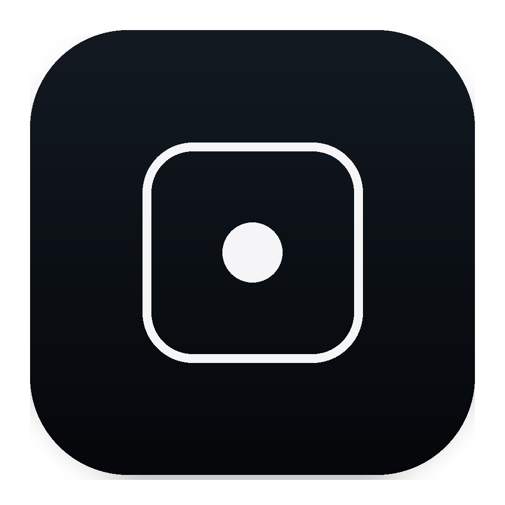 |

Product icons that share the 9 November Branding V2 set, and are not separate drawings of the wordmark: `icon-research.svg`, `icon-voice.svg`, `icon-one.svg`, `icon-labs.svg`, `favicon.svg`, the maze and dot tiles, and the light-ground wordmark and lockup. Desktop icons under `desktop/icons/hicolor/` and `site/assets/marks/` match `docs/brand/marks/` byte for byte where the names match.

## Repository tables

A historical row is an older blob of that path. It lives under `_history/<date>-<commit>/` so the branch-tip file keeps the original path.

### galion-operating-system

Licence: Perpetual Open MIT · Copyright (c) 2026 Galion Labs

| File | Type | Source | Date | Licence | Thumbnail |
|---|---|---|---|---|---|
| [dot.rs](galion-operating-system/desktop/boot/animations/dot.rs) | animation | `desktop/boot/animations/dot.rs` [`b5937b3411`](https://github.com/galion-studio/galion-operating-system/commit/b5937b341129a2513d8dfb0a3dd81a062b9b77c9) | 2026-11-21 | Perpetual Open MIT · Copyright (c) 2026 Galion Labs |  |
| [frame.rs](galion-operating-system/desktop/boot/animations/frame.rs) | animation | `desktop/boot/animations/frame.rs` [`b5937b3411`](https://github.com/galion-studio/galion-operating-system/commit/b5937b341129a2513d8dfb0a3dd81a062b9b77c9) | 2026-11-21 | Perpetual Open MIT · Copyright (c) 2026 Galion Labs |  |
| [host-splash.html](galion-operating-system/desktop/boot/animations/host-splash.html) | animation | `desktop/boot/animations/host-splash.html` [`b5937b3411`](https://github.com/galion-studio/galion-operating-system/commit/b5937b341129a2513d8dfb0a3dd81a062b9b77c9) | 2026-11-21 | Perpetual Open MIT · Copyright (c) 2026 Galion Labs |  |
| [om-rise.css](galion-operating-system/desktop/boot/animations/om-rise.css) | animation | `desktop/boot/animations/om-rise.css` [`b5937b3411`](https://github.com/galion-studio/galion-operating-system/commit/b5937b341129a2513d8dfb0a3dd81a062b9b77c9) | 2026-11-21 | Perpetual Open MIT · Copyright (c) 2026 Galion Labs |  |
| [one-dot-draw.js](galion-operating-system/desktop/boot/animations/one-dot-draw.js) | animation | `desktop/boot/animations/one-dot-draw.js` [`b5937b3411`](https://github.com/galion-studio/galion-operating-system/commit/b5937b341129a2513d8dfb0a3dd81a062b9b77c9) | 2026-11-21 | Perpetual Open MIT · Copyright (c) 2026 Galion Labs |  |
| [one-dot.css](galion-operating-system/desktop/boot/animations/one-dot.css) | animation | `desktop/boot/animations/one-dot.css` [`b5937b3411`](https://github.com/galion-studio/galion-operating-system/commit/b5937b341129a2513d8dfb0a3dd81a062b9b77c9) | 2026-11-21 | Perpetual Open MIT · Copyright (c) 2026 Galion Labs |  |
| [one-dot.html](galion-operating-system/desktop/boot/animations/one-dot.html) | animation | `desktop/boot/animations/one-dot.html` [`b5937b3411`](https://github.com/galion-studio/galion-operating-system/commit/b5937b341129a2513d8dfb0a3dd81a062b9b77c9) | 2026-11-21 | Perpetual Open MIT · Copyright (c) 2026 Galion Labs |  |
| [orb_engine.rs](galion-operating-system/desktop/boot/animations/orb_engine.rs) | animation | `desktop/boot/animations/orb_engine.rs` [`b5937b3411`](https://github.com/galion-studio/galion-operating-system/commit/b5937b341129a2513d8dfb0a3dd81a062b9b77c9) | 2026-11-21 | Perpetual Open MIT · Copyright (c) 2026 Galion Labs |  |
| [palette.rs](galion-operating-system/desktop/boot/animations/palette.rs) | animation | `desktop/boot/animations/palette.rs` [`b5937b3411`](https://github.com/galion-studio/galion-operating-system/commit/b5937b341129a2513d8dfb0a3dd81a062b9b77c9) | 2026-11-21 | Perpetual Open MIT · Copyright (c) 2026 Galion Labs |  |
| [spring.rs](galion-operating-system/desktop/boot/animations/spring.rs) | animation | `desktop/boot/animations/spring.rs` [`b5937b3411`](https://github.com/galion-studio/galion-operating-system/commit/b5937b341129a2513d8dfb0a3dd81a062b9b77c9) | 2026-11-21 | Perpetual Open MIT · Copyright (c) 2026 Galion Labs |  |
| [status-pulse.css](galion-operating-system/desktop/boot/animations/status-pulse.css) | animation | `desktop/boot/animations/status-pulse.css` [`b5937b3411`](https://github.com/galion-studio/galion-operating-system/commit/b5937b341129a2513d8dfb0a3dd81a062b9b77c9) | 2026-11-21 | Perpetual Open MIT · Copyright (c) 2026 Galion Labs |  |
| [capture.mjs](galion-operating-system/desktop/boot/cinematic/capture.mjs) | animation | `desktop/boot/cinematic/capture.mjs` [`73b62b1b18`](https://github.com/galion-studio/galion-operating-system/commit/73b62b1b183dc61de40d15b6f95ce0303836139a) | 2026-11-21 | Perpetual Open MIT · Copyright (c) 2026 Galion Labs |  |
| [check_motion.mjs](galion-operating-system/desktop/boot/cinematic/check_motion.mjs) | animation | `desktop/boot/cinematic/check_motion.mjs` [`73b62b1b18`](https://github.com/galion-studio/galion-operating-system/commit/73b62b1b183dc61de40d15b6f95ce0303836139a) | 2026-11-21 | Perpetual Open MIT · Copyright (c) 2026 Galion Labs |  |
| [cinematic.css](galion-operating-system/desktop/boot/cinematic/cinematic.css) | animation | `desktop/boot/cinematic/cinematic.css` [`73b62b1b18`](https://github.com/galion-studio/galion-operating-system/commit/73b62b1b183dc61de40d15b6f95ce0303836139a) | 2026-11-21 | Perpetual Open MIT · Copyright (c) 2026 Galion Labs |  |
| [cinematic.mjs](galion-operating-system/desktop/boot/cinematic/cinematic.mjs) | animation | `desktop/boot/cinematic/cinematic.mjs` [`73b62b1b18`](https://github.com/galion-studio/galion-operating-system/commit/73b62b1b183dc61de40d15b6f95ce0303836139a) | 2026-11-21 | Perpetual Open MIT · Copyright (c) 2026 Galion Labs |  |
| [index.html](galion-operating-system/desktop/boot/cinematic/index.html) | animation | `desktop/boot/cinematic/index.html` [`73b62b1b18`](https://github.com/galion-studio/galion-operating-system/commit/73b62b1b183dc61de40d15b6f95ce0303836139a) | 2026-11-21 | Perpetual Open MIT · Copyright (c) 2026 Galion Labs |  |
| [motion.mjs](galion-operating-system/desktop/boot/cinematic/motion.mjs) | animation | `desktop/boot/cinematic/motion.mjs` [`73b62b1b18`](https://github.com/galion-studio/galion-operating-system/commit/73b62b1b183dc61de40d15b6f95ce0303836139a) | 2026-11-21 | Perpetual Open MIT · Copyright (c) 2026 Galion Labs |  |
| [motion.py](galion-operating-system/desktop/boot/cinematic/motion.py) | animation | `desktop/boot/cinematic/motion.py` [`73b62b1b18`](https://github.com/galion-studio/galion-operating-system/commit/73b62b1b183dc61de40d15b6f95ce0303836139a) | 2026-11-21 | Perpetual Open MIT · Copyright (c) 2026 Galion Labs |  |
| [render_frames.py](galion-operating-system/desktop/boot/cinematic/render_frames.py) | animation | `desktop/boot/cinematic/render_frames.py` [`73b62b1b18`](https://github.com/galion-studio/galion-operating-system/commit/73b62b1b183dc61de40d15b6f95ce0303836139a) | 2026-11-21 | Perpetual Open MIT · Copyright (c) 2026 Galion Labs |  |
| [serve.py](galion-operating-system/desktop/boot/cinematic/serve.py) | animation | `desktop/boot/cinematic/serve.py` [`73b62b1b18`](https://github.com/galion-studio/galion-operating-system/commit/73b62b1b183dc61de40d15b6f95ce0303836139a) | 2026-11-21 | Perpetual Open MIT · Copyright (c) 2026 Galion Labs |  |
| [timeline.json](galion-operating-system/desktop/boot/cinematic/timeline.json) | animation | `desktop/boot/cinematic/timeline.json` [`73b62b1b18`](https://github.com/galion-studio/galion-operating-system/commit/73b62b1b183dc61de40d15b6f95ce0303836139a) | 2026-11-21 | Perpetual Open MIT · Copyright (c) 2026 Galion Labs |  |
| [index.html](galion-operating-system/desktop/boot/index.html) | splash | `desktop/boot/index.html` [`73b62b1b18`](https://github.com/galion-studio/galion-operating-system/commit/73b62b1b183dc61de40d15b6f95ce0303836139a) | 2026-11-21 | Perpetual Open MIT · Copyright (c) 2026 Galion Labs |  |
| [galion.plymouth](galion-operating-system/desktop/boot/plymouth/galion.plymouth) | splash | `desktop/boot/plymouth/galion.plymouth` [`2d286652b8`](https://github.com/galion-studio/galion-operating-system/commit/2d286652b8716f36f0c5db6a46145fcb5b346657) | 2026-11-21 | Perpetual Open MIT · Copyright (c) 2026 Galion Labs |  |
| [galion.script](galion-operating-system/desktop/boot/plymouth/galion.script) | animation | `desktop/boot/plymouth/galion.script` [`73b62b1b18`](https://github.com/galion-studio/galion-operating-system/commit/73b62b1b183dc61de40d15b6f95ce0303836139a) | 2026-11-21 | Perpetual Open MIT · Copyright (c) 2026 Galion Labs |  |
| [bar.png](galion-operating-system/desktop/boot/plymouth/images/bar.png) | splash | `desktop/boot/plymouth/images/bar.png` [`2d286652b8`](https://github.com/galion-studio/galion-operating-system/commit/2d286652b8716f36f0c5db6a46145fcb5b346657) | 2026-11-21 | Perpetual Open MIT · Copyright (c) 2026 Galion Labs |  |
| [bullet.png](galion-operating-system/desktop/boot/plymouth/images/bullet.png) | splash | `desktop/boot/plymouth/images/bullet.png` [`2d286652b8`](https://github.com/galion-studio/galion-operating-system/commit/2d286652b8716f36f0c5db6a46145fcb5b346657) | 2026-11-21 | Perpetual Open MIT · Copyright (c) 2026 Galion Labs |  |
| [cin-000.png](galion-operating-system/desktop/boot/plymouth/images/cin-000.png) | splash | `desktop/boot/plymouth/images/cin-000.png` [`73b62b1b18`](https://github.com/galion-studio/galion-operating-system/commit/73b62b1b183dc61de40d15b6f95ce0303836139a) | 2026-11-21 | Perpetual Open MIT · Copyright (c) 2026 Galion Labs |  |
| [cin-001.png](galion-operating-system/desktop/boot/plymouth/images/cin-001.png) | splash | `desktop/boot/plymouth/images/cin-001.png` [`73b62b1b18`](https://github.com/galion-studio/galion-operating-system/commit/73b62b1b183dc61de40d15b6f95ce0303836139a) | 2026-11-21 | Perpetual Open MIT · Copyright (c) 2026 Galion Labs |  |
| [cin-002.png](galion-operating-system/desktop/boot/plymouth/images/cin-002.png) | splash | `desktop/boot/plymouth/images/cin-002.png` [`73b62b1b18`](https://github.com/galion-studio/galion-operating-system/commit/73b62b1b183dc61de40d15b6f95ce0303836139a) | 2026-11-21 | Perpetual Open MIT · Copyright (c) 2026 Galion Labs |  |
| [cin-003.png](galion-operating-system/desktop/boot/plymouth/images/cin-003.png) | splash | `desktop/boot/plymouth/images/cin-003.png` [`73b62b1b18`](https://github.com/galion-studio/galion-operating-system/commit/73b62b1b183dc61de40d15b6f95ce0303836139a) | 2026-11-21 | Perpetual Open MIT · Copyright (c) 2026 Galion Labs |  |
| [cin-004.png](galion-operating-system/desktop/boot/plymouth/images/cin-004.png) | splash | `desktop/boot/plymouth/images/cin-004.png` [`73b62b1b18`](https://github.com/galion-studio/galion-operating-system/commit/73b62b1b183dc61de40d15b6f95ce0303836139a) | 2026-11-21 | Perpetual Open MIT · Copyright (c) 2026 Galion Labs |  |
| [cin-005.png](galion-operating-system/desktop/boot/plymouth/images/cin-005.png) | splash | `desktop/boot/plymouth/images/cin-005.png` [`73b62b1b18`](https://github.com/galion-studio/galion-operating-system/commit/73b62b1b183dc61de40d15b6f95ce0303836139a) | 2026-11-21 | Perpetual Open MIT · Copyright (c) 2026 Galion Labs |  |
| [cin-006.png](galion-operating-system/desktop/boot/plymouth/images/cin-006.png) | splash | `desktop/boot/plymouth/images/cin-006.png` [`73b62b1b18`](https://github.com/galion-studio/galion-operating-system/commit/73b62b1b183dc61de40d15b6f95ce0303836139a) | 2026-11-21 | Perpetual Open MIT · Copyright (c) 2026 Galion Labs |  |
| [cin-007.png](galion-operating-system/desktop/boot/plymouth/images/cin-007.png) | splash | `desktop/boot/plymouth/images/cin-007.png` [`73b62b1b18`](https://github.com/galion-studio/galion-operating-system/commit/73b62b1b183dc61de40d15b6f95ce0303836139a) | 2026-11-21 | Perpetual Open MIT · Copyright (c) 2026 Galion Labs |  |
| [cin-008.png](galion-operating-system/desktop/boot/plymouth/images/cin-008.png) | splash | `desktop/boot/plymouth/images/cin-008.png` [`73b62b1b18`](https://github.com/galion-studio/galion-operating-system/commit/73b62b1b183dc61de40d15b6f95ce0303836139a) | 2026-11-21 | Perpetual Open MIT · Copyright (c) 2026 Galion Labs |  |
| [cin-009.png](galion-operating-system/desktop/boot/plymouth/images/cin-009.png) | splash | `desktop/boot/plymouth/images/cin-009.png` [`73b62b1b18`](https://github.com/galion-studio/galion-operating-system/commit/73b62b1b183dc61de40d15b6f95ce0303836139a) | 2026-11-21 | Perpetual Open MIT · Copyright (c) 2026 Galion Labs |  |
| [cin-010.png](galion-operating-system/desktop/boot/plymouth/images/cin-010.png) | splash | `desktop/boot/plymouth/images/cin-010.png` [`73b62b1b18`](https://github.com/galion-studio/galion-operating-system/commit/73b62b1b183dc61de40d15b6f95ce0303836139a) | 2026-11-21 | Perpetual Open MIT · Copyright (c) 2026 Galion Labs |  |
| [cin-011.png](galion-operating-system/desktop/boot/plymouth/images/cin-011.png) | splash | `desktop/boot/plymouth/images/cin-011.png` [`73b62b1b18`](https://github.com/galion-studio/galion-operating-system/commit/73b62b1b183dc61de40d15b6f95ce0303836139a) | 2026-11-21 | Perpetual Open MIT · Copyright (c) 2026 Galion Labs |  |
| [cin-012.png](galion-operating-system/desktop/boot/plymouth/images/cin-012.png) | splash | `desktop/boot/plymouth/images/cin-012.png` [`73b62b1b18`](https://github.com/galion-studio/galion-operating-system/commit/73b62b1b183dc61de40d15b6f95ce0303836139a) | 2026-11-21 | Perpetual Open MIT · Copyright (c) 2026 Galion Labs |  |
| [cin-013.png](galion-operating-system/desktop/boot/plymouth/images/cin-013.png) | splash | `desktop/boot/plymouth/images/cin-013.png` [`73b62b1b18`](https://github.com/galion-studio/galion-operating-system/commit/73b62b1b183dc61de40d15b6f95ce0303836139a) | 2026-11-21 | Perpetual Open MIT · Copyright (c) 2026 Galion Labs |  |
| [cin-014.png](galion-operating-system/desktop/boot/plymouth/images/cin-014.png) | splash | `desktop/boot/plymouth/images/cin-014.png` [`73b62b1b18`](https://github.com/galion-studio/galion-operating-system/commit/73b62b1b183dc61de40d15b6f95ce0303836139a) | 2026-11-21 | Perpetual Open MIT · Copyright (c) 2026 Galion Labs |  |
| [cin-015.png](galion-operating-system/desktop/boot/plymouth/images/cin-015.png) | splash | `desktop/boot/plymouth/images/cin-015.png` [`73b62b1b18`](https://github.com/galion-studio/galion-operating-system/commit/73b62b1b183dc61de40d15b6f95ce0303836139a) | 2026-11-21 | Perpetual Open MIT · Copyright (c) 2026 Galion Labs |  |
| [cin-016.png](galion-operating-system/desktop/boot/plymouth/images/cin-016.png) | splash | `desktop/boot/plymouth/images/cin-016.png` [`73b62b1b18`](https://github.com/galion-studio/galion-operating-system/commit/73b62b1b183dc61de40d15b6f95ce0303836139a) | 2026-11-21 | Perpetual Open MIT · Copyright (c) 2026 Galion Labs |  |
| [cin-017.png](galion-operating-system/desktop/boot/plymouth/images/cin-017.png) | splash | `desktop/boot/plymouth/images/cin-017.png` [`73b62b1b18`](https://github.com/galion-studio/galion-operating-system/commit/73b62b1b183dc61de40d15b6f95ce0303836139a) | 2026-11-21 | Perpetual Open MIT · Copyright (c) 2026 Galion Labs |  |
| [cin-018.png](galion-operating-system/desktop/boot/plymouth/images/cin-018.png) | splash | `desktop/boot/plymouth/images/cin-018.png` [`73b62b1b18`](https://github.com/galion-studio/galion-operating-system/commit/73b62b1b183dc61de40d15b6f95ce0303836139a) | 2026-11-21 | Perpetual Open MIT · Copyright (c) 2026 Galion Labs |  |
| [cin-019.png](galion-operating-system/desktop/boot/plymouth/images/cin-019.png) | splash | `desktop/boot/plymouth/images/cin-019.png` [`73b62b1b18`](https://github.com/galion-studio/galion-operating-system/commit/73b62b1b183dc61de40d15b6f95ce0303836139a) | 2026-11-21 | Perpetual Open MIT · Copyright (c) 2026 Galion Labs | 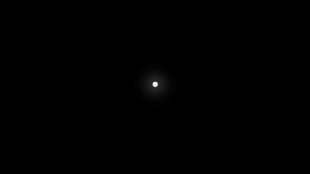 |
| [cin-020.png](galion-operating-system/desktop/boot/plymouth/images/cin-020.png) | splash | `desktop/boot/plymouth/images/cin-020.png` [`73b62b1b18`](https://github.com/galion-studio/galion-operating-system/commit/73b62b1b183dc61de40d15b6f95ce0303836139a) | 2026-11-21 | Perpetual Open MIT · Copyright (c) 2026 Galion Labs |  |
| [cin-021.png](galion-operating-system/desktop/boot/plymouth/images/cin-021.png) | splash | `desktop/boot/plymouth/images/cin-021.png` [`73b62b1b18`](https://github.com/galion-studio/galion-operating-system/commit/73b62b1b183dc61de40d15b6f95ce0303836139a) | 2026-11-21 | Perpetual Open MIT · Copyright (c) 2026 Galion Labs |  |
| [cin-022.png](galion-operating-system/desktop/boot/plymouth/images/cin-022.png) | splash | `desktop/boot/plymouth/images/cin-022.png` [`73b62b1b18`](https://github.com/galion-studio/galion-operating-system/commit/73b62b1b183dc61de40d15b6f95ce0303836139a) | 2026-11-21 | Perpetual Open MIT · Copyright (c) 2026 Galion Labs |  |
| [cin-023.png](galion-operating-system/desktop/boot/plymouth/images/cin-023.png) | splash | `desktop/boot/plymouth/images/cin-023.png` [`73b62b1b18`](https://github.com/galion-studio/galion-operating-system/commit/73b62b1b183dc61de40d15b6f95ce0303836139a) | 2026-11-21 | Perpetual Open MIT · Copyright (c) 2026 Galion Labs |  |
| [cin-024.png](galion-operating-system/desktop/boot/plymouth/images/cin-024.png) | splash | `desktop/boot/plymouth/images/cin-024.png` [`73b62b1b18`](https://github.com/galion-studio/galion-operating-system/commit/73b62b1b183dc61de40d15b6f95ce0303836139a) | 2026-11-21 | Perpetual Open MIT · Copyright (c) 2026 Galion Labs |  |
| [cin-025.png](galion-operating-system/desktop/boot/plymouth/images/cin-025.png) | splash | `desktop/boot/plymouth/images/cin-025.png` [`73b62b1b18`](https://github.com/galion-studio/galion-operating-system/commit/73b62b1b183dc61de40d15b6f95ce0303836139a) | 2026-11-21 | Perpetual Open MIT · Copyright (c) 2026 Galion Labs | 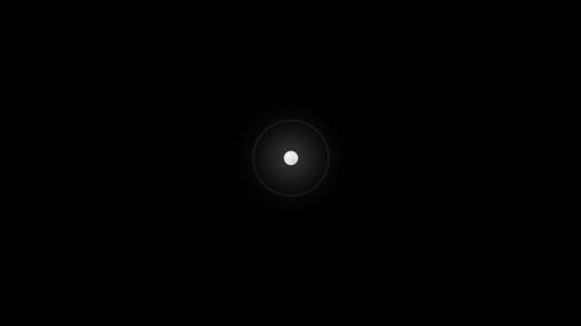 |
| [cin-026.png](galion-operating-system/desktop/boot/plymouth/images/cin-026.png) | splash | `desktop/boot/plymouth/images/cin-026.png` [`73b62b1b18`](https://github.com/galion-studio/galion-operating-system/commit/73b62b1b183dc61de40d15b6f95ce0303836139a) | 2026-11-21 | Perpetual Open MIT · Copyright (c) 2026 Galion Labs |  |
| [cin-027.png](galion-operating-system/desktop/boot/plymouth/images/cin-027.png) | splash | `desktop/boot/plymouth/images/cin-027.png` [`73b62b1b18`](https://github.com/galion-studio/galion-operating-system/commit/73b62b1b183dc61de40d15b6f95ce0303836139a) | 2026-11-21 | Perpetual Open MIT · Copyright (c) 2026 Galion Labs |  |
| [cin-028.png](galion-operating-system/desktop/boot/plymouth/images/cin-028.png) | splash | `desktop/boot/plymouth/images/cin-028.png` [`73b62b1b18`](https://github.com/galion-studio/galion-operating-system/commit/73b62b1b183dc61de40d15b6f95ce0303836139a) | 2026-11-21 | Perpetual Open MIT · Copyright (c) 2026 Galion Labs |  |
| [cin-029.png](galion-operating-system/desktop/boot/plymouth/images/cin-029.png) | splash | `desktop/boot/plymouth/images/cin-029.png` [`73b62b1b18`](https://github.com/galion-studio/galion-operating-system/commit/73b62b1b183dc61de40d15b6f95ce0303836139a) | 2026-11-21 | Perpetual Open MIT · Copyright (c) 2026 Galion Labs |  |
| [cin-030.png](galion-operating-system/desktop/boot/plymouth/images/cin-030.png) | splash | `desktop/boot/plymouth/images/cin-030.png` [`73b62b1b18`](https://github.com/galion-studio/galion-operating-system/commit/73b62b1b183dc61de40d15b6f95ce0303836139a) | 2026-11-21 | Perpetual Open MIT · Copyright (c) 2026 Galion Labs |  |
| [cin-031.png](galion-operating-system/desktop/boot/plymouth/images/cin-031.png) | splash | `desktop/boot/plymouth/images/cin-031.png` [`73b62b1b18`](https://github.com/galion-studio/galion-operating-system/commit/73b62b1b183dc61de40d15b6f95ce0303836139a) | 2026-11-21 | Perpetual Open MIT · Copyright (c) 2026 Galion Labs |  |
| [cin-032.png](galion-operating-system/desktop/boot/plymouth/images/cin-032.png) | splash | `desktop/boot/plymouth/images/cin-032.png` [`73b62b1b18`](https://github.com/galion-studio/galion-operating-system/commit/73b62b1b183dc61de40d15b6f95ce0303836139a) | 2026-11-21 | Perpetual Open MIT · Copyright (c) 2026 Galion Labs |  |
| [cin-033.png](galion-operating-system/desktop/boot/plymouth/images/cin-033.png) | splash | `desktop/boot/plymouth/images/cin-033.png` [`73b62b1b18`](https://github.com/galion-studio/galion-operating-system/commit/73b62b1b183dc61de40d15b6f95ce0303836139a) | 2026-11-21 | Perpetual Open MIT · Copyright (c) 2026 Galion Labs |  |
| [cin-034.png](galion-operating-system/desktop/boot/plymouth/images/cin-034.png) | splash | `desktop/boot/plymouth/images/cin-034.png` [`73b62b1b18`](https://github.com/galion-studio/galion-operating-system/commit/73b62b1b183dc61de40d15b6f95ce0303836139a) | 2026-11-21 | Perpetual Open MIT · Copyright (c) 2026 Galion Labs |  |
| [cin-035.png](galion-operating-system/desktop/boot/plymouth/images/cin-035.png) | splash | `desktop/boot/plymouth/images/cin-035.png` [`73b62b1b18`](https://github.com/galion-studio/galion-operating-system/commit/73b62b1b183dc61de40d15b6f95ce0303836139a) | 2026-11-21 | Perpetual Open MIT · Copyright (c) 2026 Galion Labs |  |
| [cin-036.png](galion-operating-system/desktop/boot/plymouth/images/cin-036.png) | splash | `desktop/boot/plymouth/images/cin-036.png` [`73b62b1b18`](https://github.com/galion-studio/galion-operating-system/commit/73b62b1b183dc61de40d15b6f95ce0303836139a) | 2026-11-21 | Perpetual Open MIT · Copyright (c) 2026 Galion Labs |  |
| [cin-037.png](galion-operating-system/desktop/boot/plymouth/images/cin-037.png) | splash | `desktop/boot/plymouth/images/cin-037.png` [`73b62b1b18`](https://github.com/galion-studio/galion-operating-system/commit/73b62b1b183dc61de40d15b6f95ce0303836139a) | 2026-11-21 | Perpetual Open MIT · Copyright (c) 2026 Galion Labs |  |
| [cin-038.png](galion-operating-system/desktop/boot/plymouth/images/cin-038.png) | splash | `desktop/boot/plymouth/images/cin-038.png` [`73b62b1b18`](https://github.com/galion-studio/galion-operating-system/commit/73b62b1b183dc61de40d15b6f95ce0303836139a) | 2026-11-21 | Perpetual Open MIT · Copyright (c) 2026 Galion Labs |  |
| [cin-039.png](galion-operating-system/desktop/boot/plymouth/images/cin-039.png) | splash | `desktop/boot/plymouth/images/cin-039.png` [`73b62b1b18`](https://github.com/galion-studio/galion-operating-system/commit/73b62b1b183dc61de40d15b6f95ce0303836139a) | 2026-11-21 | Perpetual Open MIT · Copyright (c) 2026 Galion Labs |  |
| [cin-040.png](galion-operating-system/desktop/boot/plymouth/images/cin-040.png) | splash | `desktop/boot/plymouth/images/cin-040.png` [`73b62b1b18`](https://github.com/galion-studio/galion-operating-system/commit/73b62b1b183dc61de40d15b6f95ce0303836139a) | 2026-11-21 | Perpetual Open MIT · Copyright (c) 2026 Galion Labs |  |
| [cin-041.png](galion-operating-system/desktop/boot/plymouth/images/cin-041.png) | splash | `desktop/boot/plymouth/images/cin-041.png` [`73b62b1b18`](https://github.com/galion-studio/galion-operating-system/commit/73b62b1b183dc61de40d15b6f95ce0303836139a) | 2026-11-21 | Perpetual Open MIT · Copyright (c) 2026 Galion Labs |  |
| [cin-042.png](galion-operating-system/desktop/boot/plymouth/images/cin-042.png) | splash | `desktop/boot/plymouth/images/cin-042.png` [`73b62b1b18`](https://github.com/galion-studio/galion-operating-system/commit/73b62b1b183dc61de40d15b6f95ce0303836139a) | 2026-11-21 | Perpetual Open MIT · Copyright (c) 2026 Galion Labs |  |
| [cin-043.png](galion-operating-system/desktop/boot/plymouth/images/cin-043.png) | splash | `desktop/boot/plymouth/images/cin-043.png` [`73b62b1b18`](https://github.com/galion-studio/galion-operating-system/commit/73b62b1b183dc61de40d15b6f95ce0303836139a) | 2026-11-21 | Perpetual Open MIT · Copyright (c) 2026 Galion Labs |  |
| [cin-044.png](galion-operating-system/desktop/boot/plymouth/images/cin-044.png) | splash | `desktop/boot/plymouth/images/cin-044.png` [`73b62b1b18`](https://github.com/galion-studio/galion-operating-system/commit/73b62b1b183dc61de40d15b6f95ce0303836139a) | 2026-11-21 | Perpetual Open MIT · Copyright (c) 2026 Galion Labs | 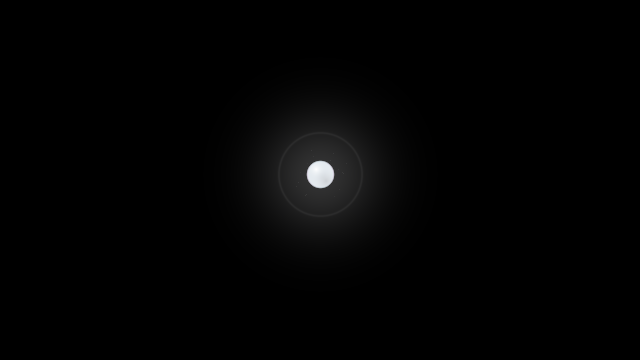 |
| [cin-045.png](galion-operating-system/desktop/boot/plymouth/images/cin-045.png) | splash | `desktop/boot/plymouth/images/cin-045.png` [`73b62b1b18`](https://github.com/galion-studio/galion-operating-system/commit/73b62b1b183dc61de40d15b6f95ce0303836139a) | 2026-11-21 | Perpetual Open MIT · Copyright (c) 2026 Galion Labs | 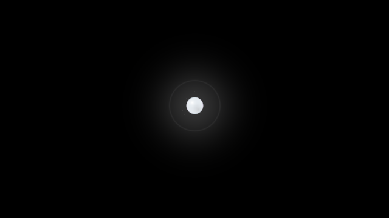 |
| [cin-046.png](galion-operating-system/desktop/boot/plymouth/images/cin-046.png) | splash | `desktop/boot/plymouth/images/cin-046.png` [`73b62b1b18`](https://github.com/galion-studio/galion-operating-system/commit/73b62b1b183dc61de40d15b6f95ce0303836139a) | 2026-11-21 | Perpetual Open MIT · Copyright (c) 2026 Galion Labs | 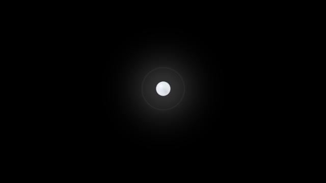 |
| [cin-047.png](galion-operating-system/desktop/boot/plymouth/images/cin-047.png) | splash | `desktop/boot/plymouth/images/cin-047.png` [`73b62b1b18`](https://github.com/galion-studio/galion-operating-system/commit/73b62b1b183dc61de40d15b6f95ce0303836139a) | 2026-11-21 | Perpetual Open MIT · Copyright (c) 2026 Galion Labs |  |
| [cin-048.png](galion-operating-system/desktop/boot/plymouth/images/cin-048.png) | splash | `desktop/boot/plymouth/images/cin-048.png` [`73b62b1b18`](https://github.com/galion-studio/galion-operating-system/commit/73b62b1b183dc61de40d15b6f95ce0303836139a) | 2026-11-21 | Perpetual Open MIT · Copyright (c) 2026 Galion Labs |  |
| [cin-049.png](galion-operating-system/desktop/boot/plymouth/images/cin-049.png) | splash | `desktop/boot/plymouth/images/cin-049.png` [`73b62b1b18`](https://github.com/galion-studio/galion-operating-system/commit/73b62b1b183dc61de40d15b6f95ce0303836139a) | 2026-11-21 | Perpetual Open MIT · Copyright (c) 2026 Galion Labs |  |
| [cin-050.png](galion-operating-system/desktop/boot/plymouth/images/cin-050.png) | splash | `desktop/boot/plymouth/images/cin-050.png` [`73b62b1b18`](https://github.com/galion-studio/galion-operating-system/commit/73b62b1b183dc61de40d15b6f95ce0303836139a) | 2026-11-21 | Perpetual Open MIT · Copyright (c) 2026 Galion Labs |  |
| [cin-051.png](galion-operating-system/desktop/boot/plymouth/images/cin-051.png) | splash | `desktop/boot/plymouth/images/cin-051.png` [`73b62b1b18`](https://github.com/galion-studio/galion-operating-system/commit/73b62b1b183dc61de40d15b6f95ce0303836139a) | 2026-11-21 | Perpetual Open MIT · Copyright (c) 2026 Galion Labs |  |
| [cin-052.png](galion-operating-system/desktop/boot/plymouth/images/cin-052.png) | splash | `desktop/boot/plymouth/images/cin-052.png` [`73b62b1b18`](https://github.com/galion-studio/galion-operating-system/commit/73b62b1b183dc61de40d15b6f95ce0303836139a) | 2026-11-21 | Perpetual Open MIT · Copyright (c) 2026 Galion Labs |  |
| [cin-053.png](galion-operating-system/desktop/boot/plymouth/images/cin-053.png) | splash | `desktop/boot/plymouth/images/cin-053.png` [`73b62b1b18`](https://github.com/galion-studio/galion-operating-system/commit/73b62b1b183dc61de40d15b6f95ce0303836139a) | 2026-11-21 | Perpetual Open MIT · Copyright (c) 2026 Galion Labs |  |
| [cin-054.png](galion-operating-system/desktop/boot/plymouth/images/cin-054.png) | splash | `desktop/boot/plymouth/images/cin-054.png` [`73b62b1b18`](https://github.com/galion-studio/galion-operating-system/commit/73b62b1b183dc61de40d15b6f95ce0303836139a) | 2026-11-21 | Perpetual Open MIT · Copyright (c) 2026 Galion Labs |  |
| [cin-055.png](galion-operating-system/desktop/boot/plymouth/images/cin-055.png) | splash | `desktop/boot/plymouth/images/cin-055.png` [`73b62b1b18`](https://github.com/galion-studio/galion-operating-system/commit/73b62b1b183dc61de40d15b6f95ce0303836139a) | 2026-11-21 | Perpetual Open MIT · Copyright (c) 2026 Galion Labs |  |
| [cin-056.png](galion-operating-system/desktop/boot/plymouth/images/cin-056.png) | splash | `desktop/boot/plymouth/images/cin-056.png` [`73b62b1b18`](https://github.com/galion-studio/galion-operating-system/commit/73b62b1b183dc61de40d15b6f95ce0303836139a) | 2026-11-21 | Perpetual Open MIT · Copyright (c) 2026 Galion Labs |  |
| [cin-057.png](galion-operating-system/desktop/boot/plymouth/images/cin-057.png) | splash | `desktop/boot/plymouth/images/cin-057.png` [`73b62b1b18`](https://github.com/galion-studio/galion-operating-system/commit/73b62b1b183dc61de40d15b6f95ce0303836139a) | 2026-11-21 | Perpetual Open MIT · Copyright (c) 2026 Galion Labs |  |
| [cin-058.png](galion-operating-system/desktop/boot/plymouth/images/cin-058.png) | splash | `desktop/boot/plymouth/images/cin-058.png` [`73b62b1b18`](https://github.com/galion-studio/galion-operating-system/commit/73b62b1b183dc61de40d15b6f95ce0303836139a) | 2026-11-21 | Perpetual Open MIT · Copyright (c) 2026 Galion Labs |  |
| [cin-059.png](galion-operating-system/desktop/boot/plymouth/images/cin-059.png) | splash | `desktop/boot/plymouth/images/cin-059.png` [`73b62b1b18`](https://github.com/galion-studio/galion-operating-system/commit/73b62b1b183dc61de40d15b6f95ce0303836139a) | 2026-11-21 | Perpetual Open MIT · Copyright (c) 2026 Galion Labs | 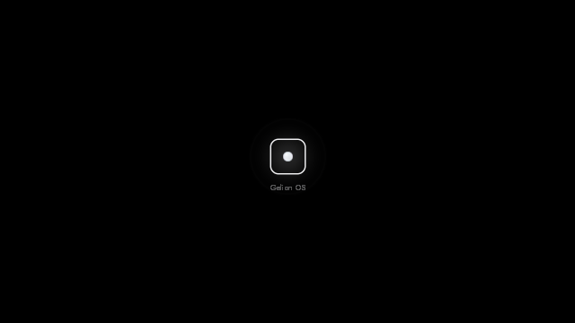 |
| [cin-060.png](galion-operating-system/desktop/boot/plymouth/images/cin-060.png) | splash | `desktop/boot/plymouth/images/cin-060.png` [`73b62b1b18`](https://github.com/galion-studio/galion-operating-system/commit/73b62b1b183dc61de40d15b6f95ce0303836139a) | 2026-11-21 | Perpetual Open MIT · Copyright (c) 2026 Galion Labs |  |
| [cin-061.png](galion-operating-system/desktop/boot/plymouth/images/cin-061.png) | splash | `desktop/boot/plymouth/images/cin-061.png` [`73b62b1b18`](https://github.com/galion-studio/galion-operating-system/commit/73b62b1b183dc61de40d15b6f95ce0303836139a) | 2026-11-21 | Perpetual Open MIT · Copyright (c) 2026 Galion Labs |  |
| [cin-062.png](galion-operating-system/desktop/boot/plymouth/images/cin-062.png) | splash | `desktop/boot/plymouth/images/cin-062.png` [`73b62b1b18`](https://github.com/galion-studio/galion-operating-system/commit/73b62b1b183dc61de40d15b6f95ce0303836139a) | 2026-11-21 | Perpetual Open MIT · Copyright (c) 2026 Galion Labs |  |
| [cin-063.png](galion-operating-system/desktop/boot/plymouth/images/cin-063.png) | splash | `desktop/boot/plymouth/images/cin-063.png` [`73b62b1b18`](https://github.com/galion-studio/galion-operating-system/commit/73b62b1b183dc61de40d15b6f95ce0303836139a) | 2026-11-21 | Perpetual Open MIT · Copyright (c) 2026 Galion Labs |  |
| [cin-064.png](galion-operating-system/desktop/boot/plymouth/images/cin-064.png) | splash | `desktop/boot/plymouth/images/cin-064.png` [`73b62b1b18`](https://github.com/galion-studio/galion-operating-system/commit/73b62b1b183dc61de40d15b6f95ce0303836139a) | 2026-11-21 | Perpetual Open MIT · Copyright (c) 2026 Galion Labs |  |
| [cin-065.png](galion-operating-system/desktop/boot/plymouth/images/cin-065.png) | splash | `desktop/boot/plymouth/images/cin-065.png` [`73b62b1b18`](https://github.com/galion-studio/galion-operating-system/commit/73b62b1b183dc61de40d15b6f95ce0303836139a) | 2026-11-21 | Perpetual Open MIT · Copyright (c) 2026 Galion Labs |  |
| [cin-066.png](galion-operating-system/desktop/boot/plymouth/images/cin-066.png) | splash | `desktop/boot/plymouth/images/cin-066.png` [`73b62b1b18`](https://github.com/galion-studio/galion-operating-system/commit/73b62b1b183dc61de40d15b6f95ce0303836139a) | 2026-11-21 | Perpetual Open MIT · Copyright (c) 2026 Galion Labs |  |
| [cin-067.png](galion-operating-system/desktop/boot/plymouth/images/cin-067.png) | splash | `desktop/boot/plymouth/images/cin-067.png` [`73b62b1b18`](https://github.com/galion-studio/galion-operating-system/commit/73b62b1b183dc61de40d15b6f95ce0303836139a) | 2026-11-21 | Perpetual Open MIT · Copyright (c) 2026 Galion Labs |  |
| [cin-068.png](galion-operating-system/desktop/boot/plymouth/images/cin-068.png) | splash | `desktop/boot/plymouth/images/cin-068.png` [`73b62b1b18`](https://github.com/galion-studio/galion-operating-system/commit/73b62b1b183dc61de40d15b6f95ce0303836139a) | 2026-11-21 | Perpetual Open MIT · Copyright (c) 2026 Galion Labs |  |
| [cin-069.png](galion-operating-system/desktop/boot/plymouth/images/cin-069.png) | splash | `desktop/boot/plymouth/images/cin-069.png` [`73b62b1b18`](https://github.com/galion-studio/galion-operating-system/commit/73b62b1b183dc61de40d15b6f95ce0303836139a) | 2026-11-21 | Perpetual Open MIT · Copyright (c) 2026 Galion Labs |  |
| [cin-070.png](galion-operating-system/desktop/boot/plymouth/images/cin-070.png) | splash | `desktop/boot/plymouth/images/cin-070.png` [`73b62b1b18`](https://github.com/galion-studio/galion-operating-system/commit/73b62b1b183dc61de40d15b6f95ce0303836139a) | 2026-11-21 | Perpetual Open MIT · Copyright (c) 2026 Galion Labs |  |
| [cin-071.png](galion-operating-system/desktop/boot/plymouth/images/cin-071.png) | splash | `desktop/boot/plymouth/images/cin-071.png` [`73b62b1b18`](https://github.com/galion-studio/galion-operating-system/commit/73b62b1b183dc61de40d15b6f95ce0303836139a) | 2026-11-21 | Perpetual Open MIT · Copyright (c) 2026 Galion Labs |  |
| [cin-072.png](galion-operating-system/desktop/boot/plymouth/images/cin-072.png) | splash | `desktop/boot/plymouth/images/cin-072.png` [`73b62b1b18`](https://github.com/galion-studio/galion-operating-system/commit/73b62b1b183dc61de40d15b6f95ce0303836139a) | 2026-11-21 | Perpetual Open MIT · Copyright (c) 2026 Galion Labs |  |
| [cin-073.png](galion-operating-system/desktop/boot/plymouth/images/cin-073.png) | splash | `desktop/boot/plymouth/images/cin-073.png` [`73b62b1b18`](https://github.com/galion-studio/galion-operating-system/commit/73b62b1b183dc61de40d15b6f95ce0303836139a) | 2026-11-21 | Perpetual Open MIT · Copyright (c) 2026 Galion Labs |  |
| [cin-074.png](galion-operating-system/desktop/boot/plymouth/images/cin-074.png) | splash | `desktop/boot/plymouth/images/cin-074.png` [`73b62b1b18`](https://github.com/galion-studio/galion-operating-system/commit/73b62b1b183dc61de40d15b6f95ce0303836139a) | 2026-11-21 | Perpetual Open MIT · Copyright (c) 2026 Galion Labs |  |
| [cin-075.png](galion-operating-system/desktop/boot/plymouth/images/cin-075.png) | splash | `desktop/boot/plymouth/images/cin-075.png` [`73b62b1b18`](https://github.com/galion-studio/galion-operating-system/commit/73b62b1b183dc61de40d15b6f95ce0303836139a) | 2026-11-21 | Perpetual Open MIT · Copyright (c) 2026 Galion Labs |  |
| [cin-076.png](galion-operating-system/desktop/boot/plymouth/images/cin-076.png) | splash | `desktop/boot/plymouth/images/cin-076.png` [`73b62b1b18`](https://github.com/galion-studio/galion-operating-system/commit/73b62b1b183dc61de40d15b6f95ce0303836139a) | 2026-11-21 | Perpetual Open MIT · Copyright (c) 2026 Galion Labs |  |
| [cin-077.png](galion-operating-system/desktop/boot/plymouth/images/cin-077.png) | splash | `desktop/boot/plymouth/images/cin-077.png` [`73b62b1b18`](https://github.com/galion-studio/galion-operating-system/commit/73b62b1b183dc61de40d15b6f95ce0303836139a) | 2026-11-21 | Perpetual Open MIT · Copyright (c) 2026 Galion Labs |  |
| [cin-078.png](galion-operating-system/desktop/boot/plymouth/images/cin-078.png) | splash | `desktop/boot/plymouth/images/cin-078.png` [`73b62b1b18`](https://github.com/galion-studio/galion-operating-system/commit/73b62b1b183dc61de40d15b6f95ce0303836139a) | 2026-11-21 | Perpetual Open MIT · Copyright (c) 2026 Galion Labs |  |
| [cin-079.png](galion-operating-system/desktop/boot/plymouth/images/cin-079.png) | splash | `desktop/boot/plymouth/images/cin-079.png` [`73b62b1b18`](https://github.com/galion-studio/galion-operating-system/commit/73b62b1b183dc61de40d15b6f95ce0303836139a) | 2026-11-21 | Perpetual Open MIT · Copyright (c) 2026 Galion Labs |  |
| [cin-080.png](galion-operating-system/desktop/boot/plymouth/images/cin-080.png) | splash | `desktop/boot/plymouth/images/cin-080.png` [`73b62b1b18`](https://github.com/galion-studio/galion-operating-system/commit/73b62b1b183dc61de40d15b6f95ce0303836139a) | 2026-11-21 | Perpetual Open MIT · Copyright (c) 2026 Galion Labs |  |
| [cin-081.png](galion-operating-system/desktop/boot/plymouth/images/cin-081.png) | splash | `desktop/boot/plymouth/images/cin-081.png` [`73b62b1b18`](https://github.com/galion-studio/galion-operating-system/commit/73b62b1b183dc61de40d15b6f95ce0303836139a) | 2026-11-21 | Perpetual Open MIT · Copyright (c) 2026 Galion Labs |  |
| [cin-082.png](galion-operating-system/desktop/boot/plymouth/images/cin-082.png) | splash | `desktop/boot/plymouth/images/cin-082.png` [`73b62b1b18`](https://github.com/galion-studio/galion-operating-system/commit/73b62b1b183dc61de40d15b6f95ce0303836139a) | 2026-11-21 | Perpetual Open MIT · Copyright (c) 2026 Galion Labs |  |
| [cin-083.png](galion-operating-system/desktop/boot/plymouth/images/cin-083.png) | splash | `desktop/boot/plymouth/images/cin-083.png` [`73b62b1b18`](https://github.com/galion-studio/galion-operating-system/commit/73b62b1b183dc61de40d15b6f95ce0303836139a) | 2026-11-21 | Perpetual Open MIT · Copyright (c) 2026 Galion Labs |  |
| [cin-084.png](galion-operating-system/desktop/boot/plymouth/images/cin-084.png) | splash | `desktop/boot/plymouth/images/cin-084.png` [`73b62b1b18`](https://github.com/galion-studio/galion-operating-system/commit/73b62b1b183dc61de40d15b6f95ce0303836139a) | 2026-11-21 | Perpetual Open MIT · Copyright (c) 2026 Galion Labs |  |
| [cin-085.png](galion-operating-system/desktop/boot/plymouth/images/cin-085.png) | splash | `desktop/boot/plymouth/images/cin-085.png` [`73b62b1b18`](https://github.com/galion-studio/galion-operating-system/commit/73b62b1b183dc61de40d15b6f95ce0303836139a) | 2026-11-21 | Perpetual Open MIT · Copyright (c) 2026 Galion Labs |  |
| [cin-086.png](galion-operating-system/desktop/boot/plymouth/images/cin-086.png) | splash | `desktop/boot/plymouth/images/cin-086.png` [`73b62b1b18`](https://github.com/galion-studio/galion-operating-system/commit/73b62b1b183dc61de40d15b6f95ce0303836139a) | 2026-11-21 | Perpetual Open MIT · Copyright (c) 2026 Galion Labs |  |
| [cin-087.png](galion-operating-system/desktop/boot/plymouth/images/cin-087.png) | splash | `desktop/boot/plymouth/images/cin-087.png` [`73b62b1b18`](https://github.com/galion-studio/galion-operating-system/commit/73b62b1b183dc61de40d15b6f95ce0303836139a) | 2026-11-21 | Perpetual Open MIT · Copyright (c) 2026 Galion Labs |  |
| [cin-088.png](galion-operating-system/desktop/boot/plymouth/images/cin-088.png) | splash | `desktop/boot/plymouth/images/cin-088.png` [`73b62b1b18`](https://github.com/galion-studio/galion-operating-system/commit/73b62b1b183dc61de40d15b6f95ce0303836139a) | 2026-11-21 | Perpetual Open MIT · Copyright (c) 2026 Galion Labs |  |
| [cin-089.png](galion-operating-system/desktop/boot/plymouth/images/cin-089.png) | splash | `desktop/boot/plymouth/images/cin-089.png` [`73b62b1b18`](https://github.com/galion-studio/galion-operating-system/commit/73b62b1b183dc61de40d15b6f95ce0303836139a) | 2026-11-21 | Perpetual Open MIT · Copyright (c) 2026 Galion Labs |  |
| [cin-090.png](galion-operating-system/desktop/boot/plymouth/images/cin-090.png) | splash | `desktop/boot/plymouth/images/cin-090.png` [`73b62b1b18`](https://github.com/galion-studio/galion-operating-system/commit/73b62b1b183dc61de40d15b6f95ce0303836139a) | 2026-11-21 | Perpetual Open MIT · Copyright (c) 2026 Galion Labs |  |
| [cin-091.png](galion-operating-system/desktop/boot/plymouth/images/cin-091.png) | splash | `desktop/boot/plymouth/images/cin-091.png` [`73b62b1b18`](https://github.com/galion-studio/galion-operating-system/commit/73b62b1b183dc61de40d15b6f95ce0303836139a) | 2026-11-21 | Perpetual Open MIT · Copyright (c) 2026 Galion Labs |  |
| [cin-092.png](galion-operating-system/desktop/boot/plymouth/images/cin-092.png) | splash | `desktop/boot/plymouth/images/cin-092.png` [`73b62b1b18`](https://github.com/galion-studio/galion-operating-system/commit/73b62b1b183dc61de40d15b6f95ce0303836139a) | 2026-11-21 | Perpetual Open MIT · Copyright (c) 2026 Galion Labs | 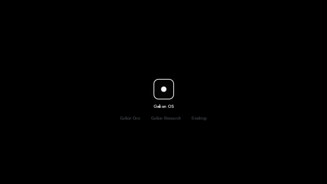 |
| [cin-093.png](galion-operating-system/desktop/boot/plymouth/images/cin-093.png) | splash | `desktop/boot/plymouth/images/cin-093.png` [`73b62b1b18`](https://github.com/galion-studio/galion-operating-system/commit/73b62b1b183dc61de40d15b6f95ce0303836139a) | 2026-11-21 | Perpetual Open MIT · Copyright (c) 2026 Galion Labs | 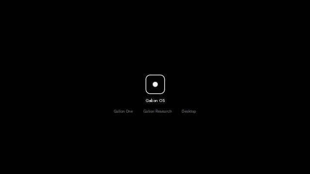 |
| [cin-094.png](galion-operating-system/desktop/boot/plymouth/images/cin-094.png) | splash | `desktop/boot/plymouth/images/cin-094.png` [`73b62b1b18`](https://github.com/galion-studio/galion-operating-system/commit/73b62b1b183dc61de40d15b6f95ce0303836139a) | 2026-11-21 | Perpetual Open MIT · Copyright (c) 2026 Galion Labs | 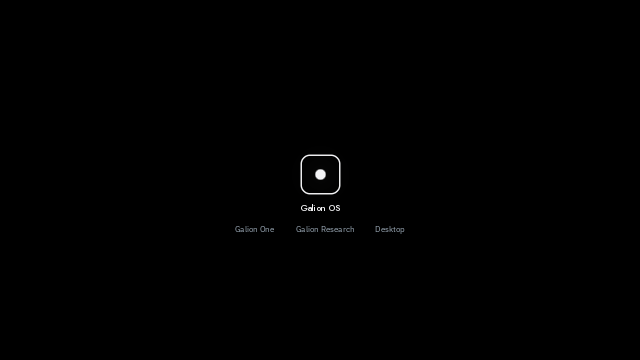 |
| [cin-095.png](galion-operating-system/desktop/boot/plymouth/images/cin-095.png) | splash | `desktop/boot/plymouth/images/cin-095.png` [`73b62b1b18`](https://github.com/galion-studio/galion-operating-system/commit/73b62b1b183dc61de40d15b6f95ce0303836139a) | 2026-11-21 | Perpetual Open MIT · Copyright (c) 2026 Galion Labs | 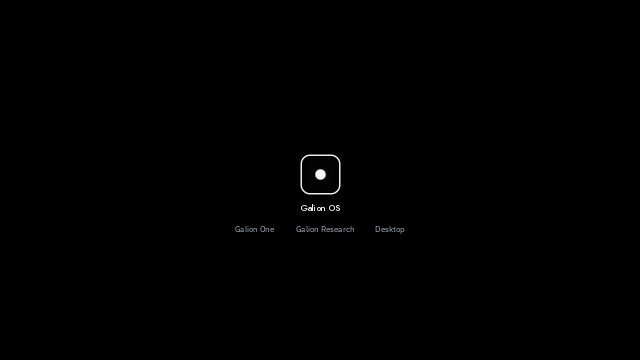 |
| [cin-096.png](galion-operating-system/desktop/boot/plymouth/images/cin-096.png) | splash | `desktop/boot/plymouth/images/cin-096.png` [`73b62b1b18`](https://github.com/galion-studio/galion-operating-system/commit/73b62b1b183dc61de40d15b6f95ce0303836139a) | 2026-11-21 | Perpetual Open MIT · Copyright (c) 2026 Galion Labs | 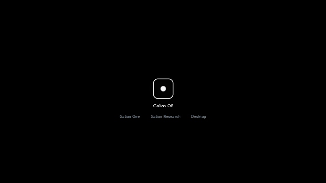 |
| [cin-097.png](galion-operating-system/desktop/boot/plymouth/images/cin-097.png) | splash | `desktop/boot/plymouth/images/cin-097.png` [`73b62b1b18`](https://github.com/galion-studio/galion-operating-system/commit/73b62b1b183dc61de40d15b6f95ce0303836139a) | 2026-11-21 | Perpetual Open MIT · Copyright (c) 2026 Galion Labs |  |
| [cin-098.png](galion-operating-system/desktop/boot/plymouth/images/cin-098.png) | splash | `desktop/boot/plymouth/images/cin-098.png` [`73b62b1b18`](https://github.com/galion-studio/galion-operating-system/commit/73b62b1b183dc61de40d15b6f95ce0303836139a) | 2026-11-21 | Perpetual Open MIT · Copyright (c) 2026 Galion Labs |  |
| [cin-099.png](galion-operating-system/desktop/boot/plymouth/images/cin-099.png) | splash | `desktop/boot/plymouth/images/cin-099.png` [`73b62b1b18`](https://github.com/galion-studio/galion-operating-system/commit/73b62b1b183dc61de40d15b6f95ce0303836139a) | 2026-11-21 | Perpetual Open MIT · Copyright (c) 2026 Galion Labs | 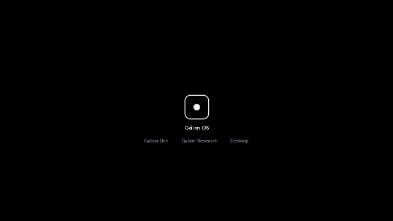 |
| [dot-00.png](galion-operating-system/desktop/boot/plymouth/images/dot-00.png) | splash | `desktop/boot/plymouth/images/dot-00.png` [`2d286652b8`](https://github.com/galion-studio/galion-operating-system/commit/2d286652b8716f36f0c5db6a46145fcb5b346657) | 2026-11-21 | Perpetual Open MIT · Copyright (c) 2026 Galion Labs |  |
| [dot-01.png](galion-operating-system/desktop/boot/plymouth/images/dot-01.png) | splash | `desktop/boot/plymouth/images/dot-01.png` [`2d286652b8`](https://github.com/galion-studio/galion-operating-system/commit/2d286652b8716f36f0c5db6a46145fcb5b346657) | 2026-11-21 | Perpetual Open MIT · Copyright (c) 2026 Galion Labs |  |
| [dot-02.png](galion-operating-system/desktop/boot/plymouth/images/dot-02.png) | splash | `desktop/boot/plymouth/images/dot-02.png` [`2d286652b8`](https://github.com/galion-studio/galion-operating-system/commit/2d286652b8716f36f0c5db6a46145fcb5b346657) | 2026-11-21 | Perpetual Open MIT · Copyright (c) 2026 Galion Labs |  |
| [dot-03.png](galion-operating-system/desktop/boot/plymouth/images/dot-03.png) | splash | `desktop/boot/plymouth/images/dot-03.png` [`2d286652b8`](https://github.com/galion-studio/galion-operating-system/commit/2d286652b8716f36f0c5db6a46145fcb5b346657) | 2026-11-21 | Perpetual Open MIT · Copyright (c) 2026 Galion Labs |  |
| [dot-04.png](galion-operating-system/desktop/boot/plymouth/images/dot-04.png) | splash | `desktop/boot/plymouth/images/dot-04.png` [`2d286652b8`](https://github.com/galion-studio/galion-operating-system/commit/2d286652b8716f36f0c5db6a46145fcb5b346657) | 2026-11-21 | Perpetual Open MIT · Copyright (c) 2026 Galion Labs |  |
| [dot-05.png](galion-operating-system/desktop/boot/plymouth/images/dot-05.png) | splash | `desktop/boot/plymouth/images/dot-05.png` [`2d286652b8`](https://github.com/galion-studio/galion-operating-system/commit/2d286652b8716f36f0c5db6a46145fcb5b346657) | 2026-11-21 | Perpetual Open MIT · Copyright (c) 2026 Galion Labs |  |
| [dot-06.png](galion-operating-system/desktop/boot/plymouth/images/dot-06.png) | splash | `desktop/boot/plymouth/images/dot-06.png` [`2d286652b8`](https://github.com/galion-studio/galion-operating-system/commit/2d286652b8716f36f0c5db6a46145fcb5b346657) | 2026-11-21 | Perpetual Open MIT · Copyright (c) 2026 Galion Labs |  |
| [dot-07.png](galion-operating-system/desktop/boot/plymouth/images/dot-07.png) | splash | `desktop/boot/plymouth/images/dot-07.png` [`2d286652b8`](https://github.com/galion-studio/galion-operating-system/commit/2d286652b8716f36f0c5db6a46145fcb5b346657) | 2026-11-21 | Perpetual Open MIT · Copyright (c) 2026 Galion Labs |  |
| [dot-08.png](galion-operating-system/desktop/boot/plymouth/images/dot-08.png) | splash | `desktop/boot/plymouth/images/dot-08.png` [`2d286652b8`](https://github.com/galion-studio/galion-operating-system/commit/2d286652b8716f36f0c5db6a46145fcb5b346657) | 2026-11-21 | Perpetual Open MIT · Copyright (c) 2026 Galion Labs |  |
| [dot-09.png](galion-operating-system/desktop/boot/plymouth/images/dot-09.png) | splash | `desktop/boot/plymouth/images/dot-09.png` [`2d286652b8`](https://github.com/galion-studio/galion-operating-system/commit/2d286652b8716f36f0c5db6a46145fcb5b346657) | 2026-11-21 | Perpetual Open MIT · Copyright (c) 2026 Galion Labs |  |
| [dot-10.png](galion-operating-system/desktop/boot/plymouth/images/dot-10.png) | splash | `desktop/boot/plymouth/images/dot-10.png` [`2d286652b8`](https://github.com/galion-studio/galion-operating-system/commit/2d286652b8716f36f0c5db6a46145fcb5b346657) | 2026-11-21 | Perpetual Open MIT · Copyright (c) 2026 Galion Labs |  |
| [dot-11.png](galion-operating-system/desktop/boot/plymouth/images/dot-11.png) | splash | `desktop/boot/plymouth/images/dot-11.png` [`2d286652b8`](https://github.com/galion-studio/galion-operating-system/commit/2d286652b8716f36f0c5db6a46145fcb5b346657) | 2026-11-21 | Perpetual Open MIT · Copyright (c) 2026 Galion Labs |  |
| [dot-12.png](galion-operating-system/desktop/boot/plymouth/images/dot-12.png) | splash | `desktop/boot/plymouth/images/dot-12.png` [`2d286652b8`](https://github.com/galion-studio/galion-operating-system/commit/2d286652b8716f36f0c5db6a46145fcb5b346657) | 2026-11-21 | Perpetual Open MIT · Copyright (c) 2026 Galion Labs |  |
| [dot-13.png](galion-operating-system/desktop/boot/plymouth/images/dot-13.png) | splash | `desktop/boot/plymouth/images/dot-13.png` [`2d286652b8`](https://github.com/galion-studio/galion-operating-system/commit/2d286652b8716f36f0c5db6a46145fcb5b346657) | 2026-11-21 | Perpetual Open MIT · Copyright (c) 2026 Galion Labs |  |
| [dot-14.png](galion-operating-system/desktop/boot/plymouth/images/dot-14.png) | splash | `desktop/boot/plymouth/images/dot-14.png` [`2d286652b8`](https://github.com/galion-studio/galion-operating-system/commit/2d286652b8716f36f0c5db6a46145fcb5b346657) | 2026-11-21 | Perpetual Open MIT · Copyright (c) 2026 Galion Labs |  |
| [dot-15.png](galion-operating-system/desktop/boot/plymouth/images/dot-15.png) | splash | `desktop/boot/plymouth/images/dot-15.png` [`2d286652b8`](https://github.com/galion-studio/galion-operating-system/commit/2d286652b8716f36f0c5db6a46145fcb5b346657) | 2026-11-21 | Perpetual Open MIT · Copyright (c) 2026 Galion Labs |  |
| [dot-16.png](galion-operating-system/desktop/boot/plymouth/images/dot-16.png) | splash | `desktop/boot/plymouth/images/dot-16.png` [`2d286652b8`](https://github.com/galion-studio/galion-operating-system/commit/2d286652b8716f36f0c5db6a46145fcb5b346657) | 2026-11-21 | Perpetual Open MIT · Copyright (c) 2026 Galion Labs |  |
| [dot-17.png](galion-operating-system/desktop/boot/plymouth/images/dot-17.png) | splash | `desktop/boot/plymouth/images/dot-17.png` [`2d286652b8`](https://github.com/galion-studio/galion-operating-system/commit/2d286652b8716f36f0c5db6a46145fcb5b346657) | 2026-11-21 | Perpetual Open MIT · Copyright (c) 2026 Galion Labs |  |
| [dot-18.png](galion-operating-system/desktop/boot/plymouth/images/dot-18.png) | splash | `desktop/boot/plymouth/images/dot-18.png` [`2d286652b8`](https://github.com/galion-studio/galion-operating-system/commit/2d286652b8716f36f0c5db6a46145fcb5b346657) | 2026-11-21 | Perpetual Open MIT · Copyright (c) 2026 Galion Labs |  |
| [dot-19.png](galion-operating-system/desktop/boot/plymouth/images/dot-19.png) | splash | `desktop/boot/plymouth/images/dot-19.png` [`2d286652b8`](https://github.com/galion-studio/galion-operating-system/commit/2d286652b8716f36f0c5db6a46145fcb5b346657) | 2026-11-21 | Perpetual Open MIT · Copyright (c) 2026 Galion Labs |  |
| [dot-20.png](galion-operating-system/desktop/boot/plymouth/images/dot-20.png) | splash | `desktop/boot/plymouth/images/dot-20.png` [`2d286652b8`](https://github.com/galion-studio/galion-operating-system/commit/2d286652b8716f36f0c5db6a46145fcb5b346657) | 2026-11-21 | Perpetual Open MIT · Copyright (c) 2026 Galion Labs |  |
| [dot-21.png](galion-operating-system/desktop/boot/plymouth/images/dot-21.png) | splash | `desktop/boot/plymouth/images/dot-21.png` [`2d286652b8`](https://github.com/galion-studio/galion-operating-system/commit/2d286652b8716f36f0c5db6a46145fcb5b346657) | 2026-11-21 | Perpetual Open MIT · Copyright (c) 2026 Galion Labs |  |
| [dot-22.png](galion-operating-system/desktop/boot/plymouth/images/dot-22.png) | splash | `desktop/boot/plymouth/images/dot-22.png` [`2d286652b8`](https://github.com/galion-studio/galion-operating-system/commit/2d286652b8716f36f0c5db6a46145fcb5b346657) | 2026-11-21 | Perpetual Open MIT · Copyright (c) 2026 Galion Labs |  |
| [dot-23.png](galion-operating-system/desktop/boot/plymouth/images/dot-23.png) | splash | `desktop/boot/plymouth/images/dot-23.png` [`2d286652b8`](https://github.com/galion-studio/galion-operating-system/commit/2d286652b8716f36f0c5db6a46145fcb5b346657) | 2026-11-21 | Perpetual Open MIT · Copyright (c) 2026 Galion Labs |  |
| [entry.png](galion-operating-system/desktop/boot/plymouth/images/entry.png) | splash | `desktop/boot/plymouth/images/entry.png` [`2d286652b8`](https://github.com/galion-studio/galion-operating-system/commit/2d286652b8716f36f0c5db6a46145fcb5b346657) | 2026-11-21 | Perpetual Open MIT · Copyright (c) 2026 Galion Labs |  |
| [mark-ring.png](galion-operating-system/desktop/boot/plymouth/images/mark-ring.png) | splash | `desktop/boot/plymouth/images/mark-ring.png` [`2d286652b8`](https://github.com/galion-studio/galion-operating-system/commit/2d286652b8716f36f0c5db6a46145fcb5b346657) | 2026-11-21 | Perpetual Open MIT · Copyright (c) 2026 Galion Labs |  |
| [install.sh](galion-operating-system/desktop/boot/plymouth/install.sh) | animation | `desktop/boot/plymouth/install.sh` [`2d286652b8`](https://github.com/galion-studio/galion-operating-system/commit/2d286652b8716f36f0c5db6a46145fcb5b346657) | 2026-11-21 | Perpetual Open MIT · Copyright (c) 2026 Galion Labs |  |
| [preview.py](galion-operating-system/desktop/boot/plymouth/preview.py) | animation | `desktop/boot/plymouth/preview.py` [`2d286652b8`](https://github.com/galion-studio/galion-operating-system/commit/2d286652b8716f36f0c5db6a46145fcb5b346657) | 2026-11-21 | Perpetual Open MIT · Copyright (c) 2026 Galion Labs |  |
| [render_mark.py](galion-operating-system/desktop/boot/plymouth/render_mark.py) | animation | `desktop/boot/plymouth/render_mark.py` [`2d286652b8`](https://github.com/galion-studio/galion-operating-system/commit/2d286652b8716f36f0c5db6a46145fcb5b346657) | 2026-11-21 | Perpetual Open MIT · Copyright (c) 2026 Galion Labs |  |
| [uninstall.sh](galion-operating-system/desktop/boot/plymouth/uninstall.sh) | animation | `desktop/boot/plymouth/uninstall.sh` [`2d286652b8`](https://github.com/galion-studio/galion-operating-system/commit/2d286652b8716f36f0c5db6a46145fcb5b346657) | 2026-11-21 | Perpetual Open MIT · Copyright (c) 2026 Galion Labs |  |
| [PROVENANCE.txt](galion-operating-system/desktop/boot/sounds/PROVENANCE.txt) | ui-sound | `desktop/boot/sounds/PROVENANCE.txt` [`73b62b1b18`](https://github.com/galion-studio/galion-operating-system/commit/73b62b1b183dc61de40d15b6f95ce0303836139a) | 2026-11-21 | Perpetual Open MIT · Copyright (c) 2026 Galion Labs |  |
| [boot.ogg](galion-operating-system/desktop/boot/sounds/boot.ogg) | ui-sound | `desktop/boot/sounds/boot.ogg` [`2d286652b8`](https://github.com/galion-studio/galion-operating-system/commit/2d286652b8716f36f0c5db6a46145fcb5b346657) | 2026-11-21 | Perpetual Open MIT · Copyright (c) 2026 Galion Labs |  |
| [boot.wav](galion-operating-system/desktop/boot/sounds/boot.wav) | ui-sound | `desktop/boot/sounds/boot.wav` [`2d286652b8`](https://github.com/galion-studio/galion-operating-system/commit/2d286652b8716f36f0c5db6a46145fcb5b346657) | 2026-11-21 | Perpetual Open MIT · Copyright (c) 2026 Galion Labs |  |
| [console-ui-sound.rs](galion-operating-system/desktop/boot/sounds/console-ui-sound.rs) | ui-sound | `desktop/boot/sounds/console-ui-sound.rs` [`b5937b3411`](https://github.com/galion-studio/galion-operating-system/commit/b5937b341129a2513d8dfb0a3dd81a062b9b77c9) | 2026-11-21 | Perpetual Open MIT · Copyright (c) 2026 Galion Labs |  |
| [galion-boot-sound](galion-operating-system/desktop/boot/sounds/galion-boot-sound) | ui-sound | `desktop/boot/sounds/galion-boot-sound` [`73b62b1b18`](https://github.com/galion-studio/galion-operating-system/commit/73b62b1b183dc61de40d15b6f95ce0303836139a) | 2026-11-21 | Perpetual Open MIT · Copyright (c) 2026 Galion Labs |  |
| [galion-os-startup.mp3](galion-operating-system/desktop/boot/sounds/galion-os-startup.mp3) | ui-sound | `desktop/boot/sounds/galion-os-startup.mp3` [`73b62b1b18`](https://github.com/galion-studio/galion-operating-system/commit/73b62b1b183dc61de40d15b6f95ce0303836139a) | 2026-11-21 | Perpetual Open MIT · Copyright (c) 2026 Galion Labs |  |
| [galion-os-startup.ogg](galion-operating-system/desktop/boot/sounds/galion-os-startup.ogg) | ui-sound | `desktop/boot/sounds/galion-os-startup.ogg` [`73b62b1b18`](https://github.com/galion-studio/galion-operating-system/commit/73b62b1b183dc61de40d15b6f95ce0303836139a) | 2026-11-21 | Perpetual Open MIT · Copyright (c) 2026 Galion Labs |  |
| [galion-sound.ts](galion-operating-system/desktop/boot/sounds/galion-sound.ts) | ui-sound | `desktop/boot/sounds/galion-sound.ts` [`b5937b3411`](https://github.com/galion-studio/galion-operating-system/commit/b5937b341129a2513d8dfb0a3dd81a062b9b77c9) | 2026-11-21 | Perpetual Open MIT · Copyright (c) 2026 Galion Labs |  |
| [generate_tones.py](galion-operating-system/desktop/boot/sounds/generate_tones.py) | ui-sound | `desktop/boot/sounds/generate_tones.py` [`73b62b1b18`](https://github.com/galion-studio/galion-operating-system/commit/73b62b1b183dc61de40d15b6f95ce0303836139a) | 2026-11-21 | Perpetual Open MIT · Copyright (c) 2026 Galion Labs |  |
| [openmind-desktop-sound.rs](galion-operating-system/desktop/boot/sounds/openmind-desktop-sound.rs) | ui-sound | `desktop/boot/sounds/openmind-desktop-sound.rs` [`b5937b3411`](https://github.com/galion-studio/galion-operating-system/commit/b5937b341129a2513d8dfb0a3dd81a062b9b77c9) | 2026-11-21 | Perpetual Open MIT · Copyright (c) 2026 Galion Labs |  |
| [os-tones.js](galion-operating-system/desktop/boot/sounds/os-tones.js) | ui-sound | `desktop/boot/sounds/os-tones.js` [`b5937b3411`](https://github.com/galion-studio/galion-operating-system/commit/b5937b341129a2513d8dfb0a3dd81a062b9b77c9) | 2026-11-21 | Perpetual Open MIT · Copyright (c) 2026 Galion Labs |  |
| [shutdown.ogg](galion-operating-system/desktop/boot/sounds/shutdown.ogg) | ui-sound | `desktop/boot/sounds/shutdown.ogg` [`2d286652b8`](https://github.com/galion-studio/galion-operating-system/commit/2d286652b8716f36f0c5db6a46145fcb5b346657) | 2026-11-21 | Perpetual Open MIT · Copyright (c) 2026 Galion Labs |  |
| [shutdown.wav](galion-operating-system/desktop/boot/sounds/shutdown.wav) | ui-sound | `desktop/boot/sounds/shutdown.wav` [`2d286652b8`](https://github.com/galion-studio/galion-operating-system/commit/2d286652b8716f36f0c5db6a46145fcb5b346657) | 2026-11-21 | Perpetual Open MIT · Copyright (c) 2026 Galion Labs |  |
| [wake.ogg](galion-operating-system/desktop/boot/sounds/wake.ogg) | ui-sound | `desktop/boot/sounds/wake.ogg` [`2d286652b8`](https://github.com/galion-studio/galion-operating-system/commit/2d286652b8716f36f0c5db6a46145fcb5b346657) | 2026-11-21 | Perpetual Open MIT · Copyright (c) 2026 Galion Labs |  |
| [wake.wav](galion-operating-system/desktop/boot/sounds/wake.wav) | ui-sound | `desktop/boot/sounds/wake.wav` [`2d286652b8`](https://github.com/galion-studio/galion-operating-system/commit/2d286652b8716f36f0c5db6a46145fcb5b346657) | 2026-11-21 | Perpetual Open MIT · Copyright (c) 2026 Galion Labs |  |
| [galion-os.svg](galion-operating-system/desktop/icons/hicolor/scalable/apps/galion-os.svg) | icon | `desktop/icons/hicolor/scalable/apps/galion-os.svg` [`5db66828e8`](https://github.com/galion-studio/galion-operating-system/commit/5db66828e824935328b7c3d443777f125d8997d0) git symlink to `docs/brand/marks/icon-os.svg`; the copy is that file's bytes | 2026-11-19 | Perpetual Open MIT · Copyright (c) 2026 Galion Labs |  |
| [galion-research.svg](galion-operating-system/desktop/icons/hicolor/scalable/apps/galion-research.svg) | icon | `desktop/icons/hicolor/scalable/apps/galion-research.svg` [`5db66828e8`](https://github.com/galion-studio/galion-operating-system/commit/5db66828e824935328b7c3d443777f125d8997d0) git symlink to `docs/brand/marks/icon-research.svg`; the copy is that file's bytes | 2026-11-19 | Perpetual Open MIT · Copyright (c) 2026 Galion Labs |  |
| [galion-voice.svg](galion-operating-system/desktop/icons/hicolor/scalable/apps/galion-voice.svg) | icon | `desktop/icons/hicolor/scalable/apps/galion-voice.svg` [`5db66828e8`](https://github.com/galion-studio/galion-operating-system/commit/5db66828e824935328b7c3d443777f125d8997d0) git symlink to `docs/brand/marks/icon-voice.svg`; the copy is that file's bytes | 2026-11-19 | Perpetual Open MIT · Copyright (c) 2026 Galion Labs |  |
| [galion-os-icon-1024.png](galion-operating-system/docs/brand/icons/galion-os-icon-1024.png) | icon | `docs/brand/icons/galion-os-icon-1024.png` [`437579cb0c`](https://github.com/galion-studio/galion-operating-system/commit/437579cb0cf33a7fa436afe240524c5a43f4b3c9) | 2026-11-21 | Perpetual Open MIT · Copyright (c) 2026 Galion Labs |  |
| [galion-os.ico](galion-operating-system/docs/brand/icons/galion-os.ico) | favicon | `docs/brand/icons/galion-os.ico` [`437579cb0c`](https://github.com/galion-studio/galion-operating-system/commit/437579cb0cf33a7fa436afe240524c5a43f4b3c9) | 2026-11-21 | Perpetual Open MIT · Copyright (c) 2026 Galion Labs |  |
| [icon-os.svg](galion-operating-system/docs/brand/icons/icon-os.svg) | icon | `docs/brand/icons/icon-os.svg` [`437579cb0c`](https://github.com/galion-studio/galion-operating-system/commit/437579cb0cf33a7fa436afe240524c5a43f4b3c9) | 2026-11-21 | Perpetual Open MIT · Copyright (c) 2026 Galion Labs |  |
| [make-galion-os-icon.py](galion-operating-system/docs/brand/icons/make-galion-os-icon.py) | icon | `docs/brand/icons/make-galion-os-icon.py` [`437579cb0c`](https://github.com/galion-studio/galion-operating-system/commit/437579cb0cf33a7fa436afe240524c5a43f4b3c9) | 2026-11-21 | Perpetual Open MIT · Copyright (c) 2026 Galion Labs |  |
| [favicon.svg](galion-operating-system/docs/brand/marks/favicon.svg) | favicon | `docs/brand/marks/favicon.svg` [`5e1efd7903`](https://github.com/galion-studio/galion-operating-system/commit/5e1efd7903fc4b088c87c208fbfd1fccab9eff7e) | 2026-11-09 | Perpetual Open MIT · Copyright (c) 2026 Galion Labs |  |
| [icon-labs.svg](galion-operating-system/docs/brand/marks/icon-labs.svg) | icon | `docs/brand/marks/icon-labs.svg` [`5e1efd7903`](https://github.com/galion-studio/galion-operating-system/commit/5e1efd7903fc4b088c87c208fbfd1fccab9eff7e) | 2026-11-09 | Perpetual Open MIT · Copyright (c) 2026 Galion Labs |  |
| [icon-one.svg](galion-operating-system/docs/brand/marks/icon-one.svg) | icon | `docs/brand/marks/icon-one.svg` [`5e1efd7903`](https://github.com/galion-studio/galion-operating-system/commit/5e1efd7903fc4b088c87c208fbfd1fccab9eff7e) | 2026-11-09 | Perpetual Open MIT · Copyright (c) 2026 Galion Labs |  |
| [icon-os.svg](galion-operating-system/docs/brand/marks/icon-os.svg) | icon | `docs/brand/marks/icon-os.svg` [`5e1efd7903`](https://github.com/galion-studio/galion-operating-system/commit/5e1efd7903fc4b088c87c208fbfd1fccab9eff7e) | 2026-11-09 | Perpetual Open MIT · Copyright (c) 2026 Galion Labs |  |
| [icon-research.svg](galion-operating-system/docs/brand/marks/icon-research.svg) | icon | `docs/brand/marks/icon-research.svg` [`5e1efd7903`](https://github.com/galion-studio/galion-operating-system/commit/5e1efd7903fc4b088c87c208fbfd1fccab9eff7e) | 2026-11-09 | Perpetual Open MIT · Copyright (c) 2026 Galion Labs |  |
| [icon-voice.svg](galion-operating-system/docs/brand/marks/icon-voice.svg) | icon | `docs/brand/marks/icon-voice.svg` [`5e1efd7903`](https://github.com/galion-studio/galion-operating-system/commit/5e1efd7903fc4b088c87c208fbfd1fccab9eff7e) | 2026-11-09 | Perpetual Open MIT · Copyright (c) 2026 Galion Labs |  |
| [lockup-on-dark.svg](galion-operating-system/docs/brand/marks/lockup-on-dark.svg) | lockup | `docs/brand/marks/lockup-on-dark.svg` [`9511aadee2`](https://github.com/galion-studio/galion-operating-system/commit/9511aadee24970a6594251e1498bcf8bc372dec3) | 2026-11-19 | Perpetual Open MIT · Copyright (c) 2026 Galion Labs |  |
| [lockup-tile.svg](galion-operating-system/docs/brand/marks/lockup-tile.svg) | lockup | `docs/brand/marks/lockup-tile.svg` [`9511aadee2`](https://github.com/galion-studio/galion-operating-system/commit/9511aadee24970a6594251e1498bcf8bc372dec3) | 2026-11-19 | Perpetual Open MIT · Copyright (c) 2026 Galion Labs |  |
| [mark-dot-tile.svg](galion-operating-system/docs/brand/marks/mark-dot-tile.svg) | logo | `docs/brand/marks/mark-dot-tile.svg` [`5e1efd7903`](https://github.com/galion-studio/galion-operating-system/commit/5e1efd7903fc4b088c87c208fbfd1fccab9eff7e) | 2026-11-09 | Perpetual Open MIT · Copyright (c) 2026 Galion Labs |  |
| [mark-dot.svg](galion-operating-system/docs/brand/marks/mark-dot.svg) | logo | `docs/brand/marks/mark-dot.svg` [`5e1efd7903`](https://github.com/galion-studio/galion-operating-system/commit/5e1efd7903fc4b088c87c208fbfd1fccab9eff7e) | 2026-11-09 | Perpetual Open MIT · Copyright (c) 2026 Galion Labs |  |
| [mark-maze-tile.svg](galion-operating-system/docs/brand/marks/mark-maze-tile.svg) | logo | `docs/brand/marks/mark-maze-tile.svg` [`5e1efd7903`](https://github.com/galion-studio/galion-operating-system/commit/5e1efd7903fc4b088c87c208fbfd1fccab9eff7e) | 2026-11-09 | Perpetual Open MIT · Copyright (c) 2026 Galion Labs |  |
| [mark-maze.svg](galion-operating-system/docs/brand/marks/mark-maze.svg) | logo | `docs/brand/marks/mark-maze.svg` [`5e1efd7903`](https://github.com/galion-studio/galion-operating-system/commit/5e1efd7903fc4b088c87c208fbfd1fccab9eff7e) | 2026-11-09 | Perpetual Open MIT · Copyright (c) 2026 Galion Labs |  |
| [wordmark-on-dark.svg](galion-operating-system/docs/brand/marks/wordmark-on-dark.svg) | wordmark | `docs/brand/marks/wordmark-on-dark.svg` [`9511aadee2`](https://github.com/galion-studio/galion-operating-system/commit/9511aadee24970a6594251e1498bcf8bc372dec3) | 2026-11-19 | Perpetual Open MIT · Copyright (c) 2026 Galion Labs |  |
| [wordmark-on-light.svg](galion-operating-system/docs/brand/marks/wordmark-on-light.svg) | wordmark | `docs/brand/marks/wordmark-on-light.svg` [`9511aadee2`](https://github.com/galion-studio/galion-operating-system/commit/9511aadee24970a6594251e1498bcf8bc372dec3) | 2026-11-19 | Perpetual Open MIT · Copyright (c) 2026 Galion Labs |  |
| [favicon.svg](galion-operating-system/site/favicon.svg) | favicon | `site/favicon.svg` [`5e1efd7903`](https://github.com/galion-studio/galion-operating-system/commit/5e1efd7903fc4b088c87c208fbfd1fccab9eff7e) | 2026-11-09 | Perpetual Open MIT · Copyright (c) 2026 Galion Labs |  |
| [_history/2026-11-21-b5937b3411/desktop/boot/index.html](galion-operating-system/_history/2026-11-21-b5937b3411/desktop/boot/index.html) | splash | `desktop/boot/index.html` [`b5937b3411`](https://github.com/galion-studio/galion-operating-system/commit/b5937b341129a2513d8dfb0a3dd81a062b9b77c9) | 2026-11-21 | Perpetual Open MIT · Copyright (c) 2026 Galion Labs |  |
| [_history/2026-11-21-2d286652b8/desktop/boot/index.html](galion-operating-system/_history/2026-11-21-2d286652b8/desktop/boot/index.html) | splash | `desktop/boot/index.html` [`2d286652b8`](https://github.com/galion-studio/galion-operating-system/commit/2d286652b8716f36f0c5db6a46145fcb5b346657) | 2026-11-21 | Perpetual Open MIT · Copyright (c) 2026 Galion Labs |  |
| [_history/2026-11-21-2d286652b8/desktop/boot/plymouth/galion.script](galion-operating-system/_history/2026-11-21-2d286652b8/desktop/boot/plymouth/galion.script) | animation | `desktop/boot/plymouth/galion.script` [`2d286652b8`](https://github.com/galion-studio/galion-operating-system/commit/2d286652b8716f36f0c5db6a46145fcb5b346657) | 2026-11-21 | Perpetual Open MIT · Copyright (c) 2026 Galion Labs |  |
| [_history/2026-11-21-2d286652b8/desktop/boot/sounds/PROVENANCE.txt](galion-operating-system/_history/2026-11-21-2d286652b8/desktop/boot/sounds/PROVENANCE.txt) | ui-sound | `desktop/boot/sounds/PROVENANCE.txt` [`2d286652b8`](https://github.com/galion-studio/galion-operating-system/commit/2d286652b8716f36f0c5db6a46145fcb5b346657) | 2026-11-21 | Perpetual Open MIT · Copyright (c) 2026 Galion Labs |  |
| [_history/2026-11-21-2d286652b8/desktop/boot/sounds/galion-boot-sound](galion-operating-system/_history/2026-11-21-2d286652b8/desktop/boot/sounds/galion-boot-sound) | ui-sound | `desktop/boot/sounds/galion-boot-sound` [`2d286652b8`](https://github.com/galion-studio/galion-operating-system/commit/2d286652b8716f36f0c5db6a46145fcb5b346657) | 2026-11-21 | Perpetual Open MIT · Copyright (c) 2026 Galion Labs |  |
| [_history/2026-11-21-2d286652b8/desktop/boot/sounds/generate_tones.py](galion-operating-system/_history/2026-11-21-2d286652b8/desktop/boot/sounds/generate_tones.py) | ui-sound | `desktop/boot/sounds/generate_tones.py` [`2d286652b8`](https://github.com/galion-studio/galion-operating-system/commit/2d286652b8716f36f0c5db6a46145fcb5b346657) | 2026-11-21 | Perpetual Open MIT · Copyright (c) 2026 Galion Labs |  |
| [_history/2026-11-09-5e1efd7903/docs/brand/marks/lockup-on-dark.svg](galion-operating-system/_history/2026-11-09-5e1efd7903/docs/brand/marks/lockup-on-dark.svg) | lockup | `docs/brand/marks/lockup-on-dark.svg` [`5e1efd7903`](https://github.com/galion-studio/galion-operating-system/commit/5e1efd7903fc4b088c87c208fbfd1fccab9eff7e) | 2026-11-09 | Perpetual Open MIT · Copyright (c) 2026 Galion Labs |  |
| [_history/2026-11-09-5e1efd7903/docs/brand/marks/lockup-tile.svg](galion-operating-system/_history/2026-11-09-5e1efd7903/docs/brand/marks/lockup-tile.svg) | lockup | `docs/brand/marks/lockup-tile.svg` [`5e1efd7903`](https://github.com/galion-studio/galion-operating-system/commit/5e1efd7903fc4b088c87c208fbfd1fccab9eff7e) | 2026-11-09 | Perpetual Open MIT · Copyright (c) 2026 Galion Labs |  |
| [_history/2026-11-09-5e1efd7903/docs/brand/marks/wordmark-on-dark.svg](galion-operating-system/_history/2026-11-09-5e1efd7903/docs/brand/marks/wordmark-on-dark.svg) | wordmark | `docs/brand/marks/wordmark-on-dark.svg` [`5e1efd7903`](https://github.com/galion-studio/galion-operating-system/commit/5e1efd7903fc4b088c87c208fbfd1fccab9eff7e) | 2026-11-09 | Perpetual Open MIT · Copyright (c) 2026 Galion Labs |  |
| [_history/2026-11-09-5e1efd7903/docs/brand/marks/wordmark-on-light.svg](galion-operating-system/_history/2026-11-09-5e1efd7903/docs/brand/marks/wordmark-on-light.svg) | wordmark | `docs/brand/marks/wordmark-on-light.svg` [`5e1efd7903`](https://github.com/galion-studio/galion-operating-system/commit/5e1efd7903fc4b088c87c208fbfd1fccab9eff7e) | 2026-11-09 | Perpetual Open MIT · Copyright (c) 2026 Galion Labs |  |

### obsidian-open-mind

Licence: MIT · Copyright (c) 3000 Galion / galion-studio

Copyright notice kept on these files: Copyright (c) 3000 Galion / galion-studio.

| File | Type | Source | Date | Licence | Thumbnail |
|---|---|---|---|---|---|
| [icon.svg](obsidian-open-mind/apps/phone-voice/icon.svg) | icon | `apps/phone-voice/icon.svg` [`79925286c0`](https://github.com/galion-studio/obsidian-open-mind/commit/79925286c035951f87142c53ae0d548fca0d77e2) | 2026-10-18 | MIT · Copyright (c) 3000 Galion / galion-studio |  |
| [banner.png](obsidian-open-mind/brand/banner.png) | banner | `brand/banner.png` [`6f3c9ba000`](https://github.com/galion-studio/obsidian-open-mind/commit/6f3c9ba00015ffb939521f0be6ec735e15d1f108) | 2026-10-18 | MIT · Copyright (c) 3000 Galion / galion-studio |  |
| [banner.svg](obsidian-open-mind/brand/banner.svg) | banner | `brand/banner.svg` [`6f3c9ba000`](https://github.com/galion-studio/obsidian-open-mind/commit/6f3c9ba00015ffb939521f0be6ec735e15d1f108) | 2026-10-18 | MIT · Copyright (c) 3000 Galion / galion-studio |  |
| [banner-1280x640.png](obsidian-open-mind/brand/banner/banner-1280x640.png) | banner | `brand/banner/banner-1280x640.png` [`6f3c9ba000`](https://github.com/galion-studio/obsidian-open-mind/commit/6f3c9ba00015ffb939521f0be6ec735e15d1f108) | 2026-10-18 | MIT · Copyright (c) 3000 Galion / galion-studio |  |
| [banner-src.svg](obsidian-open-mind/brand/banner/banner-src.svg) | banner | `brand/banner/banner-src.svg` [`6f3c9ba000`](https://github.com/galion-studio/obsidian-open-mind/commit/6f3c9ba00015ffb939521f0be6ec735e15d1f108) | 2026-10-18 | MIT · Copyright (c) 3000 Galion / galion-studio |  |
| [banner.svg](obsidian-open-mind/brand/banner/banner.svg) | banner | `brand/banner/banner.svg` [`6f3c9ba000`](https://github.com/galion-studio/obsidian-open-mind/commit/6f3c9ba00015ffb939521f0be6ec735e15d1f108) | 2026-10-18 | MIT · Copyright (c) 3000 Galion / galion-studio |  |
| [config.svg](obsidian-open-mind/brand/icons/config.svg) | icon | `brand/icons/config.svg` [`6f3c9ba000`](https://github.com/galion-studio/obsidian-open-mind/commit/6f3c9ba00015ffb939521f0be6ec735e15d1f108) | 2026-10-18 | MIT · Copyright (c) 3000 Galion / galion-studio |  |
| [cpu.svg](obsidian-open-mind/brand/icons/cpu.svg) | icon | `brand/icons/cpu.svg` [`6f3c9ba000`](https://github.com/galion-studio/obsidian-open-mind/commit/6f3c9ba00015ffb939521f0be6ec735e15d1f108) | 2026-10-18 | MIT · Copyright (c) 3000 Galion / galion-studio | 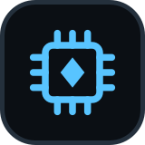 |
| [favicon-16.png](obsidian-open-mind/brand/icons/favicon-16.png) | favicon | `brand/icons/favicon-16.png` [`6f3c9ba000`](https://github.com/galion-studio/obsidian-open-mind/commit/6f3c9ba00015ffb939521f0be6ec735e15d1f108) | 2026-10-18 | MIT · Copyright (c) 3000 Galion / galion-studio |  |
| [favicon-180.png](obsidian-open-mind/brand/icons/favicon-180.png) | favicon | `brand/icons/favicon-180.png` [`6f3c9ba000`](https://github.com/galion-studio/obsidian-open-mind/commit/6f3c9ba00015ffb939521f0be6ec735e15d1f108) | 2026-10-18 | MIT · Copyright (c) 3000 Galion / galion-studio |  |
| [favicon-32.png](obsidian-open-mind/brand/icons/favicon-32.png) | favicon | `brand/icons/favicon-32.png` [`6f3c9ba000`](https://github.com/galion-studio/obsidian-open-mind/commit/6f3c9ba00015ffb939521f0be6ec735e15d1f108) | 2026-10-18 | MIT · Copyright (c) 3000 Galion / galion-studio |  |
| [favicon-512.png](obsidian-open-mind/brand/icons/favicon-512.png) | favicon | `brand/icons/favicon-512.png` [`6f3c9ba000`](https://github.com/galion-studio/obsidian-open-mind/commit/6f3c9ba00015ffb939521f0be6ec735e15d1f108) | 2026-10-18 | MIT · Copyright (c) 3000 Galion / galion-studio | 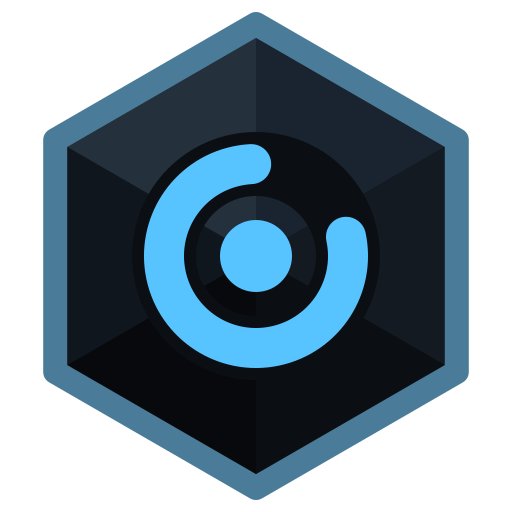 |
| [favicon.svg](obsidian-open-mind/brand/icons/favicon.svg) | favicon | `brand/icons/favicon.svg` [`6f3c9ba000`](https://github.com/galion-studio/obsidian-open-mind/commit/6f3c9ba00015ffb939521f0be6ec735e15d1f108) | 2026-10-18 | MIT · Copyright (c) 3000 Galion / galion-studio |  |
| [galion-one.svg](obsidian-open-mind/brand/icons/galion-one.svg) | icon | `brand/icons/galion-one.svg` [`6f3c9ba000`](https://github.com/galion-studio/obsidian-open-mind/commit/6f3c9ba00015ffb939521f0be6ec735e15d1f108) | 2026-10-18 | MIT · Copyright (c) 3000 Galion / galion-studio |  |
| [guardian.svg](obsidian-open-mind/brand/icons/guardian.svg) | icon | `brand/icons/guardian.svg` [`6f3c9ba000`](https://github.com/galion-studio/obsidian-open-mind/commit/6f3c9ba00015ffb939521f0be6ec735e15d1f108) | 2026-10-18 | MIT · Copyright (c) 3000 Galion / galion-studio |  |
| [hermes.svg](obsidian-open-mind/brand/icons/hermes.svg) | icon | `brand/icons/hermes.svg` [`6f3c9ba000`](https://github.com/galion-studio/obsidian-open-mind/commit/6f3c9ba00015ffb939521f0be6ec735e15d1f108) | 2026-10-18 | MIT · Copyright (c) 3000 Galion / galion-studio |  |
| [omnode.svg](obsidian-open-mind/brand/icons/omnode.svg) | icon | `brand/icons/omnode.svg` [`6f3c9ba000`](https://github.com/galion-studio/obsidian-open-mind/commit/6f3c9ba00015ffb939521f0be6ec735e15d1f108) | 2026-10-18 | MIT · Copyright (c) 3000 Galion / galion-studio |  |
| [sandbox.svg](obsidian-open-mind/brand/icons/sandbox.svg) | icon | `brand/icons/sandbox.svg` [`6f3c9ba000`](https://github.com/galion-studio/obsidian-open-mind/commit/6f3c9ba00015ffb939521f0be6ec735e15d1f108) | 2026-10-18 | MIT · Copyright (c) 3000 Galion / galion-studio |  |
| [security.svg](obsidian-open-mind/brand/icons/security.svg) | icon | `brand/icons/security.svg` [`6f3c9ba000`](https://github.com/galion-studio/obsidian-open-mind/commit/6f3c9ba00015ffb939521f0be6ec735e15d1f108) | 2026-10-18 | MIT · Copyright (c) 3000 Galion / galion-studio |  |
| [voice.svg](obsidian-open-mind/brand/icons/voice.svg) | icon | `brand/icons/voice.svg` [`6f3c9ba000`](https://github.com/galion-studio/obsidian-open-mind/commit/6f3c9ba00015ffb939521f0be6ec735e15d1f108) | 2026-10-18 | MIT · Copyright (c) 3000 Galion / galion-studio |  |
| [logo-full-dark.png](obsidian-open-mind/brand/logo-full-dark.png) | logo | `brand/logo-full-dark.png` [`6f3c9ba000`](https://github.com/galion-studio/obsidian-open-mind/commit/6f3c9ba00015ffb939521f0be6ec735e15d1f108) | 2026-10-18 | MIT · Copyright (c) 3000 Galion / galion-studio |  |
| [logo-full-dark.svg](obsidian-open-mind/brand/logo-full-dark.svg) | logo | `brand/logo-full-dark.svg` [`6f3c9ba000`](https://github.com/galion-studio/obsidian-open-mind/commit/6f3c9ba00015ffb939521f0be6ec735e15d1f108) | 2026-10-18 | MIT · Copyright (c) 3000 Galion / galion-studio |  |
| [logo-full-light.png](obsidian-open-mind/brand/logo-full-light.png) | logo | `brand/logo-full-light.png` [`6f3c9ba000`](https://github.com/galion-studio/obsidian-open-mind/commit/6f3c9ba00015ffb939521f0be6ec735e15d1f108) | 2026-10-18 | MIT · Copyright (c) 3000 Galion / galion-studio |  |
| [logo-full-light.svg](obsidian-open-mind/brand/logo-full-light.svg) | logo | `brand/logo-full-light.svg` [`6f3c9ba000`](https://github.com/galion-studio/obsidian-open-mind/commit/6f3c9ba00015ffb939521f0be6ec735e15d1f108) | 2026-10-18 | MIT · Copyright (c) 3000 Galion / galion-studio |  |
| [logo-mark-512.png](obsidian-open-mind/brand/logo-mark-512.png) | logo | `brand/logo-mark-512.png` [`6f3c9ba000`](https://github.com/galion-studio/obsidian-open-mind/commit/6f3c9ba00015ffb939521f0be6ec735e15d1f108) | 2026-10-18 | MIT · Copyright (c) 3000 Galion / galion-studio | 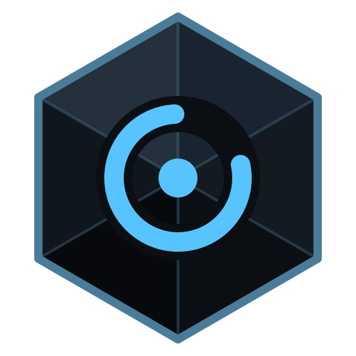 |
| [logo-mark.svg](obsidian-open-mind/brand/logo-mark.svg) | logo | `brand/logo-mark.svg` [`6f3c9ba000`](https://github.com/galion-studio/obsidian-open-mind/commit/6f3c9ba00015ffb939521f0be6ec735e15d1f108) | 2026-10-18 | MIT · Copyright (c) 3000 Galion / galion-studio |  |
| [logo-mono-512.png](obsidian-open-mind/brand/logo-mono-512.png) | logo | `brand/logo-mono-512.png` [`6f3c9ba000`](https://github.com/galion-studio/obsidian-open-mind/commit/6f3c9ba00015ffb939521f0be6ec735e15d1f108) | 2026-10-18 | MIT · Copyright (c) 3000 Galion / galion-studio | 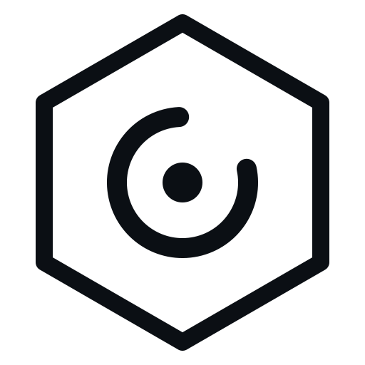 |
| [logo-mono.svg](obsidian-open-mind/brand/logo-mono.svg) | logo | `brand/logo-mono.svg` [`6f3c9ba000`](https://github.com/galion-studio/obsidian-open-mind/commit/6f3c9ba00015ffb939521f0be6ec735e15d1f108) | 2026-10-18 | MIT · Copyright (c) 3000 Galion / galion-studio |  |
| [favicon.svg](obsidian-open-mind/brand/logo/favicon.svg) | favicon | `brand/logo/favicon.svg` [`6f3c9ba000`](https://github.com/galion-studio/obsidian-open-mind/commit/6f3c9ba00015ffb939521f0be6ec735e15d1f108) | 2026-10-18 | MIT · Copyright (c) 3000 Galion / galion-studio |  |
| [mark-dark.svg](obsidian-open-mind/brand/logo/mark-dark.svg) | logo | `brand/logo/mark-dark.svg` [`6f3c9ba000`](https://github.com/galion-studio/obsidian-open-mind/commit/6f3c9ba00015ffb939521f0be6ec735e15d1f108) | 2026-10-18 | MIT · Copyright (c) 3000 Galion / galion-studio |  |
| [mark-light.svg](obsidian-open-mind/brand/logo/mark-light.svg) | logo | `brand/logo/mark-light.svg` [`6f3c9ba000`](https://github.com/galion-studio/obsidian-open-mind/commit/6f3c9ba00015ffb939521f0be6ec735e15d1f108) | 2026-10-18 | MIT · Copyright (c) 3000 Galion / galion-studio |  |
| [palette.json](obsidian-open-mind/brand/palette.json) | palette | `brand/palette.json` [`6f3c9ba000`](https://github.com/galion-studio/obsidian-open-mind/commit/6f3c9ba00015ffb939521f0be6ec735e15d1f108) | 2026-10-18 | MIT · Copyright (c) 3000 Galion / galion-studio |  |
| [favicon-32.png](obsidian-open-mind/brand/png/favicon-32.png) | favicon | `brand/png/favicon-32.png` [`6f3c9ba000`](https://github.com/galion-studio/obsidian-open-mind/commit/6f3c9ba00015ffb939521f0be6ec735e15d1f108) | 2026-10-18 | MIT · Copyright (c) 3000 Galion / galion-studio |  |
| [favicon.ico](obsidian-open-mind/brand/png/favicon.ico) | favicon | `brand/png/favicon.ico` [`6f3c9ba000`](https://github.com/galion-studio/obsidian-open-mind/commit/6f3c9ba00015ffb939521f0be6ec735e15d1f108) | 2026-10-18 | MIT · Copyright (c) 3000 Galion / galion-studio |  |
| [lockup-dark-1200.png](obsidian-open-mind/brand/png/lockup-dark-1200.png) | lockup | `brand/png/lockup-dark-1200.png` [`6f3c9ba000`](https://github.com/galion-studio/obsidian-open-mind/commit/6f3c9ba00015ffb939521f0be6ec735e15d1f108) | 2026-10-18 | MIT · Copyright (c) 3000 Galion / galion-studio |  |
| [lockup-light-1200.png](obsidian-open-mind/brand/png/lockup-light-1200.png) | lockup | `brand/png/lockup-light-1200.png` [`6f3c9ba000`](https://github.com/galion-studio/obsidian-open-mind/commit/6f3c9ba00015ffb939521f0be6ec735e15d1f108) | 2026-10-18 | MIT · Copyright (c) 3000 Galion / galion-studio |  |
| [mark-dark-256.png](obsidian-open-mind/brand/png/mark-dark-256.png) | logo | `brand/png/mark-dark-256.png` [`6f3c9ba000`](https://github.com/galion-studio/obsidian-open-mind/commit/6f3c9ba00015ffb939521f0be6ec735e15d1f108) | 2026-10-18 | MIT · Copyright (c) 3000 Galion / galion-studio | 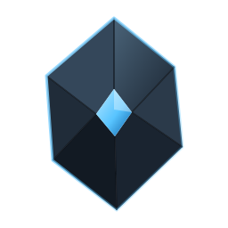 |
| [mark-dark-512.png](obsidian-open-mind/brand/png/mark-dark-512.png) | logo | `brand/png/mark-dark-512.png` [`6f3c9ba000`](https://github.com/galion-studio/obsidian-open-mind/commit/6f3c9ba00015ffb939521f0be6ec735e15d1f108) | 2026-10-18 | MIT · Copyright (c) 3000 Galion / galion-studio |  |
| [mark-dark-64.png](obsidian-open-mind/brand/png/mark-dark-64.png) | logo | `brand/png/mark-dark-64.png` [`6f3c9ba000`](https://github.com/galion-studio/obsidian-open-mind/commit/6f3c9ba00015ffb939521f0be6ec735e15d1f108) | 2026-10-18 | MIT · Copyright (c) 3000 Galion / galion-studio |  |
| [mark-light-256.png](obsidian-open-mind/brand/png/mark-light-256.png) | logo | `brand/png/mark-light-256.png` [`6f3c9ba000`](https://github.com/galion-studio/obsidian-open-mind/commit/6f3c9ba00015ffb939521f0be6ec735e15d1f108) | 2026-10-18 | MIT · Copyright (c) 3000 Galion / galion-studio | 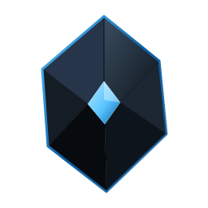 |
| [mark-light-512.png](obsidian-open-mind/brand/png/mark-light-512.png) | logo | `brand/png/mark-light-512.png` [`6f3c9ba000`](https://github.com/galion-studio/obsidian-open-mind/commit/6f3c9ba00015ffb939521f0be6ec735e15d1f108) | 2026-10-18 | MIT · Copyright (c) 3000 Galion / galion-studio |  |
| [mark-light-64.png](obsidian-open-mind/brand/png/mark-light-64.png) | logo | `brand/png/mark-light-64.png` [`6f3c9ba000`](https://github.com/galion-studio/obsidian-open-mind/commit/6f3c9ba00015ffb939521f0be6ec735e15d1f108) | 2026-10-18 | MIT · Copyright (c) 3000 Galion / galion-studio |  |
| [omnode-help.png](obsidian-open-mind/brand/screens/omnode-help.png) | image | `brand/screens/omnode-help.png` [`6f3c9ba000`](https://github.com/galion-studio/obsidian-open-mind/commit/6f3c9ba00015ffb939521f0be6ec735e15d1f108) | 2026-10-18 | MIT · Copyright (c) 3000 Galion / galion-studio | 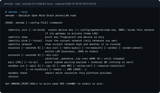 |
| [omnode-help.svg](obsidian-open-mind/brand/screens/omnode-help.svg) | image | `brand/screens/omnode-help.svg` [`6f3c9ba000`](https://github.com/galion-studio/obsidian-open-mind/commit/6f3c9ba00015ffb939521f0be6ec735e15d1f108) | 2026-10-18 | MIT · Copyright (c) 3000 Galion / galion-studio | 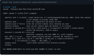 |
| [tokens.css](obsidian-open-mind/brand/tokens.css) | animation | `brand/tokens.css` [`6f3c9ba000`](https://github.com/galion-studio/obsidian-open-mind/commit/6f3c9ba00015ffb939521f0be6ec735e15d1f108) | 2026-10-18 | MIT · Copyright (c) 3000 Galion / galion-studio |  |
| [lockup-dark.svg](obsidian-open-mind/brand/wordmark/lockup-dark.svg) | wordmark | `brand/wordmark/lockup-dark.svg` [`6f3c9ba000`](https://github.com/galion-studio/obsidian-open-mind/commit/6f3c9ba00015ffb939521f0be6ec735e15d1f108) | 2026-10-18 | MIT · Copyright (c) 3000 Galion / galion-studio |  |
| [lockup-light.svg](obsidian-open-mind/brand/wordmark/lockup-light.svg) | wordmark | `brand/wordmark/lockup-light.svg` [`6f3c9ba000`](https://github.com/galion-studio/obsidian-open-mind/commit/6f3c9ba00015ffb939521f0be6ec735e15d1f108) | 2026-10-18 | MIT · Copyright (c) 3000 Galion / galion-studio |  |
| [lockup-dark.svg](obsidian-open-mind/brand/wordmark/src/lockup-dark.svg) | wordmark | `brand/wordmark/src/lockup-dark.svg` [`6f3c9ba000`](https://github.com/galion-studio/obsidian-open-mind/commit/6f3c9ba00015ffb939521f0be6ec735e15d1f108) | 2026-10-18 | MIT · Copyright (c) 3000 Galion / galion-studio |  |
| [lockup-light.svg](obsidian-open-mind/brand/wordmark/src/lockup-light.svg) | wordmark | `brand/wordmark/src/lockup-light.svg` [`6f3c9ba000`](https://github.com/galion-studio/obsidian-open-mind/commit/6f3c9ba00015ffb939521f0be6ec735e15d1f108) | 2026-10-18 | MIT · Copyright (c) 3000 Galion / galion-studio |  |
| [wordmark-dark.svg](obsidian-open-mind/brand/wordmark/src/wordmark-dark.svg) | wordmark | `brand/wordmark/src/wordmark-dark.svg` [`6f3c9ba000`](https://github.com/galion-studio/obsidian-open-mind/commit/6f3c9ba00015ffb939521f0be6ec735e15d1f108) | 2026-10-18 | MIT · Copyright (c) 3000 Galion / galion-studio |  |
| [wordmark-light.svg](obsidian-open-mind/brand/wordmark/src/wordmark-light.svg) | wordmark | `brand/wordmark/src/wordmark-light.svg` [`6f3c9ba000`](https://github.com/galion-studio/obsidian-open-mind/commit/6f3c9ba00015ffb939521f0be6ec735e15d1f108) | 2026-10-18 | MIT · Copyright (c) 3000 Galion / galion-studio |  |
| [wordmark-dark.svg](obsidian-open-mind/brand/wordmark/wordmark-dark.svg) | wordmark | `brand/wordmark/wordmark-dark.svg` [`6f3c9ba000`](https://github.com/galion-studio/obsidian-open-mind/commit/6f3c9ba00015ffb939521f0be6ec735e15d1f108) | 2026-10-18 | MIT · Copyright (c) 3000 Galion / galion-studio |  |
| [wordmark-light.svg](obsidian-open-mind/brand/wordmark/wordmark-light.svg) | wordmark | `brand/wordmark/wordmark-light.svg` [`6f3c9ba000`](https://github.com/galion-studio/obsidian-open-mind/commit/6f3c9ba00015ffb939521f0be6ec735e15d1f108) | 2026-10-18 | MIT · Copyright (c) 3000 Galion / galion-studio |  |
| [sound.rs](obsidian-open-mind/crates/console-ui/src/sound.rs) | ui-sound | `crates/console-ui/src/sound.rs` [`9c33a87748`](https://github.com/galion-studio/obsidian-open-mind/commit/9c33a87748f216995c638a853f93ec708f1f5c70) | 2026-11-14 | MIT · Copyright (c) 3000 Galion / galion-studio |  |
| [motion.rs](obsidian-open-mind/crates/openmind-desktop/src/motion.rs) | animation | `crates/openmind-desktop/src/motion.rs` [`b1e38f7bb1`](https://github.com/galion-studio/obsidian-open-mind/commit/b1e38f7bb13eb81666b729e8587f9c5ef44e14fd) | 2026-11-21 | MIT · Copyright (c) 3000 Galion / galion-studio |  |
| [sound.rs](obsidian-open-mind/crates/openmind-desktop/src/sound.rs) | ui-sound | `crates/openmind-desktop/src/sound.rs` [`bad4b695e7`](https://github.com/galion-studio/obsidian-open-mind/commit/bad4b695e77abb1acde822beafa97628a1cd4405) | 2026-11-14 | MIT · Copyright (c) 3000 Galion / galion-studio |  |
| [logo.svg](obsidian-open-mind/release/brand/logo.svg) | logo | `release/brand/logo.svg` [`f0c69e7cbf`](https://github.com/galion-studio/obsidian-open-mind/commit/f0c69e7cbfeec3c0fd2cabde36358e47de20bd7a) | 2026-10-19 | MIT · Copyright (c) 3000 Galion / galion-studio |  |
| [logo.svg](obsidian-open-mind/release/site/logo.svg) | logo | `release/site/logo.svg` [`f0c69e7cbf`](https://github.com/galion-studio/obsidian-open-mind/commit/f0c69e7cbfeec3c0fd2cabde36358e47de20bd7a) | 2026-10-19 | MIT · Copyright (c) 3000 Galion / galion-studio |  |
| [openmind-desktop.png](obsidian-open-mind/scripts/desktop/openmind-desktop.png) | image | `scripts/desktop/openmind-desktop.png` [`2b9c45fbde`](https://github.com/galion-studio/obsidian-open-mind/commit/2b9c45fbdef87fe4fd944a0faa4642ce4eb36705) | 2026-11-21 | MIT · Copyright (c) 3000 Galion / galion-studio |  |
| [galion-console.css](obsidian-open-mind/stack/research-agent/console-ide/src/components/galion-console.css) | animation | `stack/research-agent/console-ide/src/components/galion-console.css` [`b2a13ac31d`](https://github.com/galion-studio/obsidian-open-mind/commit/b2a13ac31d0abe8c4fb2a30114d55592a79fbbb8) | 2026-11-14 | MIT · Copyright (c) 3000 Galion / galion-studio |  |
| [galion-sound.ts](obsidian-open-mind/stack/research-agent/console-ide/src/lib/galion-sound.ts) | ui-sound | `stack/research-agent/console-ide/src/lib/galion-sound.ts` [`b2a13ac31d`](https://github.com/galion-studio/obsidian-open-mind/commit/b2a13ac31d0abe8c4fb2a30114d55592a79fbbb8) | 2026-11-14 | MIT · Copyright (c) 3000 Galion / galion-studio |  |
| [_history/2026-11-01-ce580ef8b1/brand/galion/galion-logo.svg](obsidian-open-mind/_history/2026-11-01-ce580ef8b1/brand/galion/galion-logo.svg) | logo | `brand/galion/galion-logo.svg` [`ce580ef8b1`](https://github.com/galion-studio/obsidian-open-mind/commit/ce580ef8b1cb7de1d8d36c0c7c6c6c06c2ba513c) | 2026-11-01 | MIT · Copyright (c) 3000 Galion / galion-studio |  |
| [_history/2026-11-01-ce580ef8b1/brand/galion/galion-mark.svg](obsidian-open-mind/_history/2026-11-01-ce580ef8b1/brand/galion/galion-mark.svg) | logo | `brand/galion/galion-mark.svg` [`ce580ef8b1`](https://github.com/galion-studio/obsidian-open-mind/commit/ce580ef8b1cb7de1d8d36c0c7c6c6c06c2ba513c) | 2026-11-01 | MIT · Copyright (c) 3000 Galion / galion-studio |  |
| [_history/2026-11-01-ce580ef8b1/crates/galion-one/home/galion-mark.svg](obsidian-open-mind/_history/2026-11-01-ce580ef8b1/crates/galion-one/home/galion-mark.svg) | logo | `crates/galion-one/home/galion-mark.svg` [`ce580ef8b1`](https://github.com/galion-studio/obsidian-open-mind/commit/ce580ef8b1cb7de1d8d36c0c7c6c6c06c2ba513c) | 2026-11-01 | MIT · Copyright (c) 3000 Galion / galion-studio |  |
| [_history/2026-11-01-cedc8dc2f2/crates/galion-one/pwa/apple-touch-icon.png](obsidian-open-mind/_history/2026-11-01-cedc8dc2f2/crates/galion-one/pwa/apple-touch-icon.png) | icon | `crates/galion-one/pwa/apple-touch-icon.png` [`cedc8dc2f2`](https://github.com/galion-studio/obsidian-open-mind/commit/cedc8dc2f2cbe55ad69033308ec9bb8db4b88299) | 2026-11-01 | MIT · Copyright (c) 3000 Galion / galion-studio |  |
| [_history/2026-11-01-cedc8dc2f2/crates/galion-one/pwa/icon-192.png](obsidian-open-mind/_history/2026-11-01-cedc8dc2f2/crates/galion-one/pwa/icon-192.png) | icon | `crates/galion-one/pwa/icon-192.png` [`cedc8dc2f2`](https://github.com/galion-studio/obsidian-open-mind/commit/cedc8dc2f2cbe55ad69033308ec9bb8db4b88299) | 2026-11-01 | MIT · Copyright (c) 3000 Galion / galion-studio |  |
| [_history/2026-11-01-cedc8dc2f2/crates/galion-one/pwa/icon-512.png](obsidian-open-mind/_history/2026-11-01-cedc8dc2f2/crates/galion-one/pwa/icon-512.png) | icon | `crates/galion-one/pwa/icon-512.png` [`cedc8dc2f2`](https://github.com/galion-studio/obsidian-open-mind/commit/cedc8dc2f2cbe55ad69033308ec9bb8db4b88299) | 2026-11-01 | MIT · Copyright (c) 3000 Galion / galion-studio |  |
| [_history/2026-11-01-cedc8dc2f2/crates/galion-one/pwa/icon.svg](obsidian-open-mind/_history/2026-11-01-cedc8dc2f2/crates/galion-one/pwa/icon.svg) | icon | `crates/galion-one/pwa/icon.svg` [`cedc8dc2f2`](https://github.com/galion-studio/obsidian-open-mind/commit/cedc8dc2f2cbe55ad69033308ec9bb8db4b88299) | 2026-11-01 | MIT · Copyright (c) 3000 Galion / galion-studio |  |
| [_history/2026-11-01-cedc8dc2f2/crates/galion-one/pwa/maskable-192.png](obsidian-open-mind/_history/2026-11-01-cedc8dc2f2/crates/galion-one/pwa/maskable-192.png) | image | `crates/galion-one/pwa/maskable-192.png` [`cedc8dc2f2`](https://github.com/galion-studio/obsidian-open-mind/commit/cedc8dc2f2cbe55ad69033308ec9bb8db4b88299) | 2026-11-01 | MIT · Copyright (c) 3000 Galion / galion-studio |  |
| [_history/2026-11-01-cedc8dc2f2/crates/galion-one/pwa/maskable-512.png](obsidian-open-mind/_history/2026-11-01-cedc8dc2f2/crates/galion-one/pwa/maskable-512.png) | image | `crates/galion-one/pwa/maskable-512.png` [`cedc8dc2f2`](https://github.com/galion-studio/obsidian-open-mind/commit/cedc8dc2f2cbe55ad69033308ec9bb8db4b88299) | 2026-11-01 | MIT · Copyright (c) 3000 Galion / galion-studio |  |
| [_history/2026-11-01-cedc8dc2f2/crates/galion-one/pwa/maskable.svg](obsidian-open-mind/_history/2026-11-01-cedc8dc2f2/crates/galion-one/pwa/maskable.svg) | image | `crates/galion-one/pwa/maskable.svg` [`cedc8dc2f2`](https://github.com/galion-studio/obsidian-open-mind/commit/cedc8dc2f2cbe55ad69033308ec9bb8db4b88299) | 2026-11-01 | MIT · Copyright (c) 3000 Galion / galion-studio |  |
| [_history/2026-11-14-6b8444b346/crates/openmind-desktop/src/sound.rs](obsidian-open-mind/_history/2026-11-14-6b8444b346/crates/openmind-desktop/src/sound.rs) | ui-sound | `crates/openmind-desktop/src/sound.rs` [`6b8444b346`](https://github.com/galion-studio/obsidian-open-mind/commit/6b8444b34636284ad9c907df6ccbf8b675bf5797) | 2026-11-14 | MIT · Copyright (c) 3000 Galion / galion-studio |  |
| [_history/2026-11-14-fec434ba87/stack/research-agent/console-ide/src/components/galion-console.css](obsidian-open-mind/_history/2026-11-14-fec434ba87/stack/research-agent/console-ide/src/components/galion-console.css) | animation | `stack/research-agent/console-ide/src/components/galion-console.css` [`fec434ba87`](https://github.com/galion-studio/obsidian-open-mind/commit/fec434ba879acf2ef91231de2eedcdd6dd284255) | 2026-11-14 | MIT · Copyright (c) 3000 Galion / galion-studio |  |
| [_history/2026-11-14-b40a5e81c6/stack/research-agent/console-ide/src/components/galion-console.css](obsidian-open-mind/_history/2026-11-14-b40a5e81c6/stack/research-agent/console-ide/src/components/galion-console.css) | animation | `stack/research-agent/console-ide/src/components/galion-console.css` [`b40a5e81c6`](https://github.com/galion-studio/obsidian-open-mind/commit/b40a5e81c6110fb73a51d2691f23cd11d8e0e8b5) | 2026-11-14 | MIT · Copyright (c) 3000 Galion / galion-studio |  |
| [_history/2026-11-14-137149c359/stack/research-agent/console-ide/src/components/galion-console.css](obsidian-open-mind/_history/2026-11-14-137149c359/stack/research-agent/console-ide/src/components/galion-console.css) | animation | `stack/research-agent/console-ide/src/components/galion-console.css` [`137149c359`](https://github.com/galion-studio/obsidian-open-mind/commit/137149c35969150236aef02a6e0dbbb3fa318051) | 2026-11-14 | MIT · Copyright (c) 3000 Galion / galion-studio |  |

### galion-one-voice

Licence: Perpetual Open MIT · Copyright (c) 2026 Galion Labs

| File | Type | Source | Date | Licence | Thumbnail |
|---|---|---|---|---|---|
| [orb_spring.rs](galion-one-voice/galion-render/examples/orb_spring.rs) | animation | `galion-render/examples/orb_spring.rs` [`b584a56db6`](https://github.com/galion-studio/galion-one-voice/commit/b584a56db60b0e77ef185b6b8b1bd6123fed6689) | 2026-11-03 | Perpetual Open MIT · Copyright (c) 2026 Galion Labs |  |
| [dot.rs](galion-one-voice/galion-render/src/dot.rs) | animation | `galion-render/src/dot.rs` [`b584a56db6`](https://github.com/galion-studio/galion-one-voice/commit/b584a56db60b0e77ef185b6b8b1bd6123fed6689) | 2026-11-03 | Perpetual Open MIT · Copyright (c) 2026 Galion Labs |  |
| [frame.rs](galion-one-voice/galion-render/src/frame.rs) | image | `galion-render/src/frame.rs` [`e362050f45`](https://github.com/galion-studio/galion-one-voice/commit/e362050f45abefa490d2ea4d623bf817dc5d1353) | 2026-11-03 | Perpetual Open MIT · Copyright (c) 2026 Galion Labs |  |
| [nebula_halo.rs](galion-one-voice/galion-render/src/nebula_halo.rs) | animation | `galion-render/src/nebula_halo.rs` [`32bfd16f94`](https://github.com/galion-studio/galion-one-voice/commit/32bfd16f94116bce0a46ec8f2c4822fbb530a396) | 2026-11-17 | Perpetual Open MIT · Copyright (c) 2026 Galion Labs |  |
| [orb_engine.rs](galion-one-voice/galion-render/src/orb_engine.rs) | animation | `galion-render/src/orb_engine.rs` [`4f537b48a7`](https://github.com/galion-studio/galion-one-voice/commit/4f537b48a785d61578519719f62646d2b263ad69) | 2026-11-03 | Perpetual Open MIT · Copyright (c) 2026 Galion Labs |  |
| [palette.rs](galion-one-voice/galion-render/src/palette.rs) | palette | `galion-render/src/palette.rs` [`2dd65e06d8`](https://github.com/galion-studio/galion-one-voice/commit/2dd65e06d863cdd9abc2586f3b3062a3bccb9e80) | 2026-11-02 | Perpetual Open MIT · Copyright (c) 2026 Galion Labs |  |
| [spring.rs](galion-one-voice/galion-render/src/spring.rs) | animation | `galion-render/src/spring.rs` [`4f537b48a7`](https://github.com/galion-studio/galion-one-voice/commit/4f537b48a785d61578519719f62646d2b263ad69) | 2026-11-03 | Perpetual Open MIT · Copyright (c) 2026 Galion Labs |  |
| [galion-samantha.svg](galion-one-voice/voice-stack/linux-package/share/icons/hicolor/scalable/apps/galion-samantha.svg) | icon | `voice-stack/linux-package/share/icons/hicolor/scalable/apps/galion-samantha.svg` [`932069ae6e`](https://github.com/galion-studio/galion-one-voice/commit/932069ae6eb8d94c939b890042f779baae793f47) | 2026-11-21 | Perpetual Open MIT · Copyright (c) 2026 Galion Labs |  |
| [app.js](galion-one-voice/voice-stack/local-server/ui/dot/app.js) | image | `voice-stack/local-server/ui/dot/app.js` [`62bda45de9`](https://github.com/galion-studio/galion-one-voice/commit/62bda45de92bffa2d86caa1e30e73e4989229b7f) | 2026-11-21 | Perpetual Open MIT · Copyright (c) 2026 Galion Labs |  |
| [dot.css](galion-one-voice/voice-stack/local-server/ui/dot/dot.css) | animation | `voice-stack/local-server/ui/dot/dot.css` [`62bda45de9`](https://github.com/galion-studio/galion-one-voice/commit/62bda45de92bffa2d86caa1e30e73e4989229b7f) | 2026-11-21 | Perpetual Open MIT · Copyright (c) 2026 Galion Labs |  |
| [index.html](galion-one-voice/voice-stack/local-server/ui/dot/index.html) | splash | `voice-stack/local-server/ui/dot/index.html` [`62bda45de9`](https://github.com/galion-studio/galion-one-voice/commit/62bda45de92bffa2d86caa1e30e73e4989229b7f) | 2026-11-21 | Perpetual Open MIT · Copyright (c) 2026 Galion Labs |  |
| [favicon.ico](galion-one-voice/voice-stack/local-server/ui/favicon.ico) | favicon | `voice-stack/local-server/ui/favicon.ico` [`62bda45de9`](https://github.com/galion-studio/galion-one-voice/commit/62bda45de92bffa2d86caa1e30e73e4989229b7f) | 2026-11-21 | Perpetual Open MIT · Copyright (c) 2026 Galion Labs |  |
| [dot-logic.js](galion-one-voice/voice-stack/one-dot-ui/assets/dot-logic.js) | animation | `voice-stack/one-dot-ui/assets/dot-logic.js` [`32a3932817`](https://github.com/galion-studio/galion-one-voice/commit/32a3932817dd5ac2b03a8ee09cc75f2900cc3482) | 2026-11-21 | Perpetual Open MIT · Copyright (c) 2026 Galion Labs |  |
| [index.html](galion-one-voice/voice-stack/one-dot-ui/assets/index.html) | animation | `voice-stack/one-dot-ui/assets/index.html` [`32a3932817`](https://github.com/galion-studio/galion-one-voice/commit/32a3932817dd5ac2b03a8ee09cc75f2900cc3482) | 2026-11-21 | Perpetual Open MIT · Copyright (c) 2026 Galion Labs |  |
| [samantha.css](galion-one-voice/voice-stack/one-dot-ui/assets/samantha.css) | animation | `voice-stack/one-dot-ui/assets/samantha.css` [`32a3932817`](https://github.com/galion-studio/galion-one-voice/commit/32a3932817dd5ac2b03a8ee09cc75f2900cc3482) | 2026-11-21 | Perpetual Open MIT · Copyright (c) 2026 Galion Labs |  |
| [samantha.js](galion-one-voice/voice-stack/one-dot-ui/assets/samantha.js) | animation | `voice-stack/one-dot-ui/assets/samantha.js` [`32a3932817`](https://github.com/galion-studio/galion-one-voice/commit/32a3932817dd5ac2b03a8ee09cc75f2900cc3482) | 2026-11-21 | Perpetual Open MIT · Copyright (c) 2026 Galion Labs |  |
| [selfcheck.js](galion-one-voice/voice-stack/one-dot-ui/assets/selfcheck.js) | animation | `voice-stack/one-dot-ui/assets/selfcheck.js` [`32a3932817`](https://github.com/galion-studio/galion-one-voice/commit/32a3932817dd5ac2b03a8ee09cc75f2900cc3482) | 2026-11-21 | Perpetual Open MIT · Copyright (c) 2026 Galion Labs |  |
| [engine.rs](galion-one-voice/voice-stack/one-dot-ui/src/engine.rs) | animation | `voice-stack/one-dot-ui/src/engine.rs` [`32a3932817`](https://github.com/galion-studio/galion-one-voice/commit/32a3932817dd5ac2b03a8ee09cc75f2900cc3482) | 2026-11-21 | Perpetual Open MIT · Copyright (c) 2026 Galion Labs |  |
| [look.rs](galion-one-voice/voice-stack/one-dot-ui/src/look.rs) | animation | `voice-stack/one-dot-ui/src/look.rs` [`32a3932817`](https://github.com/galion-studio/galion-one-voice/commit/32a3932817dd5ac2b03a8ee09cc75f2900cc3482) | 2026-11-21 | Perpetual Open MIT · Copyright (c) 2026 Galion Labs |  |
| [_history/2026-11-03-8973e6fb86/galion-render/examples/orb_spring.rs](galion-one-voice/_history/2026-11-03-8973e6fb86/galion-render/examples/orb_spring.rs) | animation | `galion-render/examples/orb_spring.rs` [`8973e6fb86`](https://github.com/galion-studio/galion-one-voice/commit/8973e6fb8620685a8b5f3794c9e58f630f61f2a1) | 2026-11-03 | Perpetual Open MIT · Copyright (c) 2026 Galion Labs |  |
| [_history/2026-11-02-2dd65e06d8/galion-render/src/dot.rs](galion-one-voice/_history/2026-11-02-2dd65e06d8/galion-render/src/dot.rs) | animation | `galion-render/src/dot.rs` [`2dd65e06d8`](https://github.com/galion-studio/galion-one-voice/commit/2dd65e06d863cdd9abc2586f3b3062a3bccb9e80) | 2026-11-02 | Perpetual Open MIT · Copyright (c) 2026 Galion Labs |  |
| [_history/2026-11-03-8973e6fb86/galion-render/src/dot.rs](galion-one-voice/_history/2026-11-03-8973e6fb86/galion-render/src/dot.rs) | animation | `galion-render/src/dot.rs` [`8973e6fb86`](https://github.com/galion-studio/galion-one-voice/commit/8973e6fb8620685a8b5f3794c9e58f630f61f2a1) | 2026-11-03 | Perpetual Open MIT · Copyright (c) 2026 Galion Labs |  |
| [_history/2026-11-03-e362050f45/galion-render/src/dot.rs](galion-one-voice/_history/2026-11-03-e362050f45/galion-render/src/dot.rs) | animation | `galion-render/src/dot.rs` [`e362050f45`](https://github.com/galion-studio/galion-one-voice/commit/e362050f45abefa490d2ea4d623bf817dc5d1353) | 2026-11-03 | Perpetual Open MIT · Copyright (c) 2026 Galion Labs |  |
| [_history/2026-11-02-2dd65e06d8/galion-render/src/frame.rs](galion-one-voice/_history/2026-11-02-2dd65e06d8/galion-render/src/frame.rs) | image | `galion-render/src/frame.rs` [`2dd65e06d8`](https://github.com/galion-studio/galion-one-voice/commit/2dd65e06d863cdd9abc2586f3b3062a3bccb9e80) | 2026-11-02 | Perpetual Open MIT · Copyright (c) 2026 Galion Labs |  |
| [_history/2026-11-14-4823b285f5/galion-render/src/nebula_halo.rs](galion-one-voice/_history/2026-11-14-4823b285f5/galion-render/src/nebula_halo.rs) | animation | `galion-render/src/nebula_halo.rs` [`4823b285f5`](https://github.com/galion-studio/galion-one-voice/commit/4823b285f53af797290ddaebebc50c5037b1de85) | 2026-11-14 | Perpetual Open MIT · Copyright (c) 2026 Galion Labs |  |
| [_history/2026-11-14-49df4fd164/galion-render/src/nebula_halo.rs](galion-one-voice/_history/2026-11-14-49df4fd164/galion-render/src/nebula_halo.rs) | animation | `galion-render/src/nebula_halo.rs` [`49df4fd164`](https://github.com/galion-studio/galion-one-voice/commit/49df4fd1647cc43c561fb89b1755aff5b814cdc8) | 2026-11-14 | Perpetual Open MIT · Copyright (c) 2026 Galion Labs |  |
| [_history/2026-11-14-8cc66e3f16/galion-render/src/nebula_halo.rs](galion-one-voice/_history/2026-11-14-8cc66e3f16/galion-render/src/nebula_halo.rs) | animation | `galion-render/src/nebula_halo.rs` [`8cc66e3f16`](https://github.com/galion-studio/galion-one-voice/commit/8cc66e3f16318a675fb92774d6c5badad7f36571) | 2026-11-14 | Perpetual Open MIT · Copyright (c) 2026 Galion Labs |  |
| [_history/2026-11-14-370af4f1e7/galion-render/src/nebula_halo.rs](galion-one-voice/_history/2026-11-14-370af4f1e7/galion-render/src/nebula_halo.rs) | animation | `galion-render/src/nebula_halo.rs` [`370af4f1e7`](https://github.com/galion-studio/galion-one-voice/commit/370af4f1e799f65fe94047375c496ee41b2380fc) | 2026-11-14 | Perpetual Open MIT · Copyright (c) 2026 Galion Labs |  |
| [_history/2026-11-14-5cc001d6e9/galion-render/src/nebula_halo.rs](galion-one-voice/_history/2026-11-14-5cc001d6e9/galion-render/src/nebula_halo.rs) | animation | `galion-render/src/nebula_halo.rs` [`5cc001d6e9`](https://github.com/galion-studio/galion-one-voice/commit/5cc001d6e9a7d1fb6cc32cacc31ffbe691a7e199) | 2026-11-14 | Perpetual Open MIT · Copyright (c) 2026 Galion Labs |  |
| [_history/2026-11-14-ea4f393443/galion-render/src/nebula_halo.rs](galion-one-voice/_history/2026-11-14-ea4f393443/galion-render/src/nebula_halo.rs) | animation | `galion-render/src/nebula_halo.rs` [`ea4f393443`](https://github.com/galion-studio/galion-one-voice/commit/ea4f3934438c0203af2b6c66be367044404913b2) | 2026-11-14 | Perpetual Open MIT · Copyright (c) 2026 Galion Labs |  |
| [_history/2026-11-03-8973e6fb86/galion-render/src/orb_engine.rs](galion-one-voice/_history/2026-11-03-8973e6fb86/galion-render/src/orb_engine.rs) | animation | `galion-render/src/orb_engine.rs` [`8973e6fb86`](https://github.com/galion-studio/galion-one-voice/commit/8973e6fb8620685a8b5f3794c9e58f630f61f2a1) | 2026-11-03 | Perpetual Open MIT · Copyright (c) 2026 Galion Labs |  |
| [_history/2026-11-03-b584a56db6/galion-render/src/orb_engine.rs](galion-one-voice/_history/2026-11-03-b584a56db6/galion-render/src/orb_engine.rs) | animation | `galion-render/src/orb_engine.rs` [`b584a56db6`](https://github.com/galion-studio/galion-one-voice/commit/b584a56db60b0e77ef185b6b8b1bd6123fed6689) | 2026-11-03 | Perpetual Open MIT · Copyright (c) 2026 Galion Labs |  |
| [_history/2026-11-03-6dbf97f00a/galion-render/src/orb_engine.rs](galion-one-voice/_history/2026-11-03-6dbf97f00a/galion-render/src/orb_engine.rs) | animation | `galion-render/src/orb_engine.rs` [`6dbf97f00a`](https://github.com/galion-studio/galion-one-voice/commit/6dbf97f00a4b8a8c1a7a45101aba8167130bdd54) | 2026-11-03 | Perpetual Open MIT · Copyright (c) 2026 Galion Labs |  |
| [_history/2026-11-03-8973e6fb86/galion-render/src/spring.rs](galion-one-voice/_history/2026-11-03-8973e6fb86/galion-render/src/spring.rs) | animation | `galion-render/src/spring.rs` [`8973e6fb86`](https://github.com/galion-studio/galion-one-voice/commit/8973e6fb8620685a8b5f3794c9e58f630f61f2a1) | 2026-11-03 | Perpetual Open MIT · Copyright (c) 2026 Galion Labs |  |
| [_history/2026-11-03-b584a56db6/galion-render/src/spring.rs](galion-one-voice/_history/2026-11-03-b584a56db6/galion-render/src/spring.rs) | animation | `galion-render/src/spring.rs` [`b584a56db6`](https://github.com/galion-studio/galion-one-voice/commit/b584a56db60b0e77ef185b6b8b1bd6123fed6689) | 2026-11-03 | Perpetual Open MIT · Copyright (c) 2026 Galion Labs |  |
| [_history/2026-11-03-6dbf97f00a/galion-render/src/spring.rs](galion-one-voice/_history/2026-11-03-6dbf97f00a/galion-render/src/spring.rs) | animation | `galion-render/src/spring.rs` [`6dbf97f00a`](https://github.com/galion-studio/galion-one-voice/commit/6dbf97f00a4b8a8c1a7a45101aba8167130bdd54) | 2026-11-03 | Perpetual Open MIT · Copyright (c) 2026 Galion Labs |  |

### galion-universal-downloader

Licence: MIT · Copyright (c) 2024 Galion

| File | Type | Source | Date | Licence | Thumbnail |
|---|---|---|---|---|---|
| [galion-logo.png](galion-universal-downloader/docs-site/static/galion-logo.png) | logo | `docs-site/static/galion-logo.png` [`641fcbcc10`](https://github.com/galion-studio/galion-universal-downloader/commit/641fcbcc10713d1fcda7df8d6f54a79e2cec8409) | 2025-12-09 | MIT · Copyright (c) 2024 Galion |  |
| [content.css](galion-universal-downloader/extension/content.css) | animation | `extension/content.css` [`b0ef2adb92`](https://github.com/galion-studio/galion-universal-downloader/commit/b0ef2adb920ba7e319e82e9dd4938736554ad484) | 2025-12-09 | MIT · Copyright (c) 2024 Galion |  |
| [apple-touch-icon.png](galion-universal-downloader/galion-v2/public/apple-touch-icon.png) | icon | `galion-v2/public/apple-touch-icon.png` [`7f2e4afe0a`](https://github.com/galion-studio/galion-universal-downloader/commit/7f2e4afe0a5f04f2720d3252d5dd809b49c52dc4) | 2025-12-08 | MIT · Copyright (c) 2024 Galion |  |
| [favicon-96x96.png](galion-universal-downloader/galion-v2/public/favicon-96x96.png) | favicon | `galion-v2/public/favicon-96x96.png` [`7f2e4afe0a`](https://github.com/galion-studio/galion-universal-downloader/commit/7f2e4afe0a5f04f2720d3252d5dd809b49c52dc4) | 2025-12-08 | MIT · Copyright (c) 2024 Galion |  |
| [favicon.ico](galion-universal-downloader/galion-v2/public/favicon.ico) | favicon | `galion-v2/public/favicon.ico` [`7f2e4afe0a`](https://github.com/galion-studio/galion-universal-downloader/commit/7f2e4afe0a5f04f2720d3252d5dd809b49c52dc4) | 2025-12-08 | MIT · Copyright (c) 2024 Galion |  |
| [favicon.svg](galion-universal-downloader/galion-v2/public/favicon.svg) | favicon | `galion-v2/public/favicon.svg` [`7f2e4afe0a`](https://github.com/galion-studio/galion-universal-downloader/commit/7f2e4afe0a5f04f2720d3252d5dd809b49c52dc4) | 2025-12-08 | MIT · Copyright (c) 2024 Galion |  |
| [galion-logo.png](galion-universal-downloader/galion-v2/public/galion-logo.png) | logo | `galion-v2/public/galion-logo.png` [`8f9449c065`](https://github.com/galion-studio/galion-universal-downloader/commit/8f9449c06559d9a7f87e7d9050ee5b4150f088d5) | 2025-12-09 | MIT · Copyright (c) 2024 Galion |  |
| [web-app-manifest-192x192.png](galion-universal-downloader/galion-v2/public/web-app-manifest-192x192.png) | image | `galion-v2/public/web-app-manifest-192x192.png` [`7f2e4afe0a`](https://github.com/galion-studio/galion-universal-downloader/commit/7f2e4afe0a5f04f2720d3252d5dd809b49c52dc4) | 2025-12-08 | MIT · Copyright (c) 2024 Galion |  |
| [web-app-manifest-512x512.png](galion-universal-downloader/galion-v2/public/web-app-manifest-512x512.png) | image | `galion-v2/public/web-app-manifest-512x512.png` [`7f2e4afe0a`](https://github.com/galion-studio/galion-universal-downloader/commit/7f2e4afe0a5f04f2720d3252d5dd809b49c52dc4) | 2025-12-08 | MIT · Copyright (c) 2024 Galion |  |
| [index.css](galion-universal-downloader/galion-v2/src/index.css) | animation | `galion-v2/src/index.css` [`7f2e4afe0a`](https://github.com/galion-studio/galion-universal-downloader/commit/7f2e4afe0a5f04f2720d3252d5dd809b49c52dc4) | 2025-12-08 | MIT · Copyright (c) 2024 Galion |  |
| [_history/2025-12-09-466f750108/galion-v2/public/galion-logo.png](galion-universal-downloader/_history/2025-12-09-466f750108/galion-v2/public/galion-logo.png) | logo | `galion-v2/public/galion-logo.png` [`466f750108`](https://github.com/galion-studio/galion-universal-downloader/commit/466f7501088f8657b4f6e8fb50ebc09bc0c3c380) | 2025-12-09 | MIT · Copyright (c) 2024 Galion |  |
| [_history/2025-12-08-0afb30f389/galion-v2/public/galion-logo.svg](galion-universal-downloader/_history/2025-12-08-0afb30f389/galion-v2/public/galion-logo.svg) | logo | `galion-v2/public/galion-logo.svg` [`0afb30f389`](https://github.com/galion-studio/galion-universal-downloader/commit/0afb30f38925bf5b77051ac311076c1638cc58fe) | 2025-12-08 | MIT · Copyright (c) 2024 Galion |  |
| [_history/2025-12-08-7f2e4afe0a/galion-v2/public/galion-logo.svg](galion-universal-downloader/_history/2025-12-08-7f2e4afe0a/galion-v2/public/galion-logo.svg) | logo | `galion-v2/public/galion-logo.svg` [`7f2e4afe0a`](https://github.com/galion-studio/galion-universal-downloader/commit/7f2e4afe0a5f04f2720d3252d5dd809b49c52dc4) | 2025-12-08 | MIT · Copyright (c) 2024 Galion |  |
| [_history/2025-12-08-0afb30f389/galion-v2/src/index.css](galion-universal-downloader/_history/2025-12-08-0afb30f389/galion-v2/src/index.css) | animation | `galion-v2/src/index.css` [`0afb30f389`](https://github.com/galion-studio/galion-universal-downloader/commit/0afb30f38925bf5b77051ac311076c1638cc58fe) | 2025-12-08 | MIT · Copyright (c) 2024 Galion |  |

### galion-initiative-web

Licence: No LICENSE file. README says MIT; no copyright line in the repo

| File | Type | Source | Date | Licence | Thumbnail |
|---|---|---|---|---|---|
| [globals.css](galion-initiative-web/apps/torchbearer/src/app/globals.css) | animation | `apps/torchbearer/src/app/globals.css` [`9aa03724ac`](https://github.com/galion-studio/galion-initiative-web/commit/9aa03724acc488bf8c395576796d6dcd4c491d55) | 2025-12-29 | No LICENSE file. README says MIT; no copyright line in the repo |  |
| [apple-touch-icon.png](galion-initiative-web/public/apple-touch-icon.png) | icon | `public/apple-touch-icon.png` [`15c78042cd`](https://github.com/galion-studio/galion-initiative-web/commit/15c78042cd767f91ef3fc60e4d8b9af49f02d487) | 2025-12-02 | No LICENSE file. README says MIT; no copyright line in the repo |  |
| [favicon-16x16.png](galion-initiative-web/public/favicon-16x16.png) | favicon | `public/favicon-16x16.png` [`afc8ae1781`](https://github.com/galion-studio/galion-initiative-web/commit/afc8ae17819ef2a21cbd0966f4be9e099b2a5426) | 2025-12-02 | No LICENSE file. README says MIT; no copyright line in the repo |  |
| [favicon-32x32.png](galion-initiative-web/public/favicon-32x32.png) | favicon | `public/favicon-32x32.png` [`afc8ae1781`](https://github.com/galion-studio/galion-initiative-web/commit/afc8ae17819ef2a21cbd0966f4be9e099b2a5426) | 2025-12-02 | No LICENSE file. README says MIT; no copyright line in the repo |  |
| [favicon-96x96.png](galion-initiative-web/public/favicon-96x96.png) | favicon | `public/favicon-96x96.png` [`15c78042cd`](https://github.com/galion-studio/galion-initiative-web/commit/15c78042cd767f91ef3fc60e4d8b9af49f02d487) | 2025-12-02 | No LICENSE file. README says MIT; no copyright line in the repo |  |
| [favicon.ico](galion-initiative-web/public/favicon.ico) | favicon | `public/favicon.ico` [`15c78042cd`](https://github.com/galion-studio/galion-initiative-web/commit/15c78042cd767f91ef3fc60e4d8b9af49f02d487) | 2025-12-02 | No LICENSE file. README says MIT; no copyright line in the repo |  |
| [favicon.svg](galion-initiative-web/public/favicon.svg) | favicon | `public/favicon.svg` [`15c78042cd`](https://github.com/galion-studio/galion-initiative-web/commit/15c78042cd767f91ef3fc60e4d8b9af49f02d487) | 2025-12-02 | No LICENSE file. README says MIT; no copyright line in the repo |  |
| [logo.webp](galion-initiative-web/public/logo.webp) | logo | `public/logo.webp` [`afc8ae1781`](https://github.com/galion-studio/galion-initiative-web/commit/afc8ae17819ef2a21cbd0966f4be9e099b2a5426) | 2025-12-02 | No LICENSE file. README says MIT; no copyright line in the repo |  |
| [web-app-manifest-192x192.png](galion-initiative-web/public/web-app-manifest-192x192.png) | image | `public/web-app-manifest-192x192.png` [`15c78042cd`](https://github.com/galion-studio/galion-initiative-web/commit/15c78042cd767f91ef3fc60e4d8b9af49f02d487) | 2025-12-02 | No LICENSE file. README says MIT; no copyright line in the repo |  |
| [web-app-manifest-512x512.png](galion-initiative-web/public/web-app-manifest-512x512.png) | image | `public/web-app-manifest-512x512.png` [`15c78042cd`](https://github.com/galion-studio/galion-initiative-web/commit/15c78042cd767f91ef3fc60e4d8b9af49f02d487) | 2025-12-02 | No LICENSE file. README says MIT; no copyright line in the repo |  |
| [favicon.ico](galion-initiative-web/src/app/favicon.ico) | favicon | `src/app/favicon.ico` [`af59b5eaf1`](https://github.com/galion-studio/galion-initiative-web/commit/af59b5eaf10f7fd3f701a86ea4877f25eea45ec6) | 2025-12-03 | No LICENSE file. README says MIT; no copyright line in the repo |  |
| [globals.css](galion-initiative-web/src/app/globals.css) | animation | `src/app/globals.css` [`c97aed9b12`](https://github.com/galion-studio/galion-initiative-web/commit/c97aed9b121a0b9074beab8435a30a5d47270068) | 2025-12-29 | No LICENSE file. README says MIT; no copyright line in the repo |  |
| [_history/2025-12-02-afc8ae1781/public/apple-touch-icon.png](galion-initiative-web/_history/2025-12-02-afc8ae1781/public/apple-touch-icon.png) | icon | `public/apple-touch-icon.png` [`afc8ae1781`](https://github.com/galion-studio/galion-initiative-web/commit/afc8ae17819ef2a21cbd0966f4be9e099b2a5426) | 2025-12-02 | No LICENSE file. README says MIT; no copyright line in the repo |  |
| [_history/2025-12-02-afc8ae1781/src/app/favicon.ico](galion-initiative-web/_history/2025-12-02-afc8ae1781/src/app/favicon.ico) | favicon | `src/app/favicon.ico` [`afc8ae1781`](https://github.com/galion-studio/galion-initiative-web/commit/afc8ae17819ef2a21cbd0966f4be9e099b2a5426) | 2025-12-02 | No LICENSE file. README says MIT; no copyright line in the repo |  |
| [_history/2025-12-02-afc8ae1781/src/app/globals.css](galion-initiative-web/_history/2025-12-02-afc8ae1781/src/app/globals.css) | animation | `src/app/globals.css` [`afc8ae1781`](https://github.com/galion-studio/galion-initiative-web/commit/afc8ae17819ef2a21cbd0966f4be9e099b2a5426) | 2025-12-02 | No LICENSE file. README says MIT; no copyright line in the repo |  |
| [_history/2025-12-03-7b854f092e/src/app/globals.css](galion-initiative-web/_history/2025-12-03-7b854f092e/src/app/globals.css) | animation | `src/app/globals.css` [`7b854f092e`](https://github.com/galion-studio/galion-initiative-web/commit/7b854f092e6d960cff692255facc2cb5a2d06fc6) | 2025-12-03 | No LICENSE file. README says MIT; no copyright line in the repo |  |

### galion-knowledge

Licence: MIT · Copyright (c) 2024-2026 Galion Labs

| File | Type | Source | Date | Licence | Thumbnail |
|---|---|---|---|---|---|
| [favicon.svg](galion-knowledge/v2/src/assets/favicon.svg) | favicon | `v2/src/assets/favicon.svg` [`9c3ac46b9c`](https://github.com/galion-studio/galion-knowledge/commit/9c3ac46b9cc74175d99a31915463aad300156a13) | 2026-11-18 | MIT · Copyright (c) 2024-2026 Galion Labs | 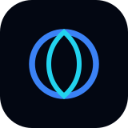 |

### mmee

Licence: No LICENSE file in the repository

| File | Type | Source | Date | Licence | Thumbnail |
|---|---|---|---|---|---|
| [bg.mp4](mmee/public/bg.mp4) | animation | `public/bg.mp4` [`a96effcb4f`](https://github.com/galion-studio/mmee/commit/a96effcb4f1366bbd3e32ddb9a1df1acfd23b2a3) | 2024-10-21 | No LICENSE file in the repository |  |
| [favicon.ico](mmee/public/favicon.ico) | favicon | `public/favicon.ico` [`a96effcb4f`](https://github.com/galion-studio/mmee/commit/a96effcb4f1366bbd3e32ddb9a1df1acfd23b2a3) | 2024-10-21 | No LICENSE file in the repository |  |
| [logo.png](mmee/public/logo.png) | logo | `public/logo.png` [`a96effcb4f`](https://github.com/galion-studio/mmee/commit/a96effcb4f1366bbd3e32ddb9a1df1acfd23b2a3) | 2024-10-21 | No LICENSE file in the repository |  |
| [poster.jpg](mmee/public/poster.jpg) | image | `public/poster.jpg` [`a96effcb4f`](https://github.com/galion-studio/mmee/commit/a96effcb4f1366bbd3e32ddb9a1df1acfd23b2a3) | 2024-10-21 | No LICENSE file in the repository |  |
| [bg.mp4](mmee/static/bg.mp4) | animation | `static/bg.mp4` [`a572dd782f`](https://github.com/galion-studio/mmee/commit/a572dd782fbc525df295a4aa0f70f5549e8ab907) | 2024-10-21 | No LICENSE file in the repository |  |
| [favicon.ico](mmee/static/favicon.ico) | favicon | `static/favicon.ico` [`a572dd782f`](https://github.com/galion-studio/mmee/commit/a572dd782fbc525df295a4aa0f70f5549e8ab907) | 2024-10-21 | No LICENSE file in the repository |  |
| [logo.png](mmee/static/logo.png) | logo | `static/logo.png` [`a572dd782f`](https://github.com/galion-studio/mmee/commit/a572dd782fbc525df295a4aa0f70f5549e8ab907) | 2024-10-21 | No LICENSE file in the repository | 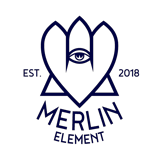 |
| [_history/2024-10-21-89928adbce/bg.mp4](mmee/_history/2024-10-21-89928adbce/bg.mp4) | animation | `bg.mp4` [`89928adbce`](https://github.com/galion-studio/mmee/commit/89928adbcebea64237bb0413d15f9a4fa7113bdc) | 2024-10-21 | No LICENSE file in the repository |  |
| [_history/2024-10-21-89928adbce/favicon.ico](mmee/_history/2024-10-21-89928adbce/favicon.ico) | favicon | `favicon.ico` [`89928adbce`](https://github.com/galion-studio/mmee/commit/89928adbcebea64237bb0413d15f9a4fa7113bdc) | 2024-10-21 | No LICENSE file in the repository |  |
| [_history/2024-10-21-89928adbce/logo.png](mmee/_history/2024-10-21-89928adbce/logo.png) | logo | `logo.png` [`89928adbce`](https://github.com/galion-studio/mmee/commit/89928adbcebea64237bb0413d15f9a4fa7113bdc) | 2024-10-21 | No LICENSE file in the repository |  |
| [_history/2024-10-21-89928adbce/poster.jpg](mmee/_history/2024-10-21-89928adbce/poster.jpg) | image | `poster.jpg` [`89928adbce`](https://github.com/galion-studio/mmee/commit/89928adbcebea64237bb0413d15f9a4fa7113bdc) | 2024-10-21 | No LICENSE file in the repository |  |

### cargen

Licence: MIT · Copyright (c) 2026 galion-studio

| File | Type | Source | Date | Licence | Thumbnail |
|---|---|---|---|---|---|
| [cargen-banner-dark-1280x320.png](cargen/assets/logo/cargen-banner-dark-1280x320.png) | banner | `assets/logo/cargen-banner-dark-1280x320.png` [`bf4395dffd`](https://github.com/galion-studio/cargen/commit/bf4395dffdf78f9c955858409d901c8da8320d5b) | 2026-10-21 | MIT · Copyright (c) 2026 galion-studio |  |
| [cargen-banner-dark.svg](cargen/assets/logo/cargen-banner-dark.svg) | banner | `assets/logo/cargen-banner-dark.svg` [`bf4395dffd`](https://github.com/galion-studio/cargen/commit/bf4395dffdf78f9c955858409d901c8da8320d5b) | 2026-10-21 | MIT · Copyright (c) 2026 galion-studio |  |
| [cargen-banner-light-1280x320.png](cargen/assets/logo/cargen-banner-light-1280x320.png) | banner | `assets/logo/cargen-banner-light-1280x320.png` [`bf4395dffd`](https://github.com/galion-studio/cargen/commit/bf4395dffdf78f9c955858409d901c8da8320d5b) | 2026-10-21 | MIT · Copyright (c) 2026 galion-studio |  |
| [cargen-banner-light.svg](cargen/assets/logo/cargen-banner-light.svg) | banner | `assets/logo/cargen-banner-light.svg` [`bf4395dffd`](https://github.com/galion-studio/cargen/commit/bf4395dffdf78f9c955858409d901c8da8320d5b) | 2026-10-21 | MIT · Copyright (c) 2026 galion-studio |  |
| [cargen-mark-512.png](cargen/assets/logo/cargen-mark-512.png) | logo | `assets/logo/cargen-mark-512.png` [`bf4395dffd`](https://github.com/galion-studio/cargen/commit/bf4395dffdf78f9c955858409d901c8da8320d5b) | 2026-10-21 | MIT · Copyright (c) 2026 galion-studio |  |
| [cargen-mark.svg](cargen/assets/logo/cargen-mark.svg) | logo | `assets/logo/cargen-mark.svg` [`bf4395dffd`](https://github.com/galion-studio/cargen/commit/bf4395dffdf78f9c955858409d901c8da8320d5b) | 2026-10-21 | MIT · Copyright (c) 2026 galion-studio |  |
| [forge-banner-dark-1280x320.png](cargen/assets/logo/forge-banner-dark-1280x320.png) | banner | `assets/logo/forge-banner-dark-1280x320.png` [`bf4395dffd`](https://github.com/galion-studio/cargen/commit/bf4395dffdf78f9c955858409d901c8da8320d5b) | 2026-10-21 | MIT · Copyright (c) 2026 galion-studio |  |
| [forge-banner-dark.svg](cargen/assets/logo/forge-banner-dark.svg) | banner | `assets/logo/forge-banner-dark.svg` [`bf4395dffd`](https://github.com/galion-studio/cargen/commit/bf4395dffdf78f9c955858409d901c8da8320d5b) | 2026-10-21 | MIT · Copyright (c) 2026 galion-studio |  |
| [forge-banner-light-1280x320.png](cargen/assets/logo/forge-banner-light-1280x320.png) | banner | `assets/logo/forge-banner-light-1280x320.png` [`bf4395dffd`](https://github.com/galion-studio/cargen/commit/bf4395dffdf78f9c955858409d901c8da8320d5b) | 2026-10-21 | MIT · Copyright (c) 2026 galion-studio |  |
| [forge-banner-light.svg](cargen/assets/logo/forge-banner-light.svg) | banner | `assets/logo/forge-banner-light.svg` [`bf4395dffd`](https://github.com/galion-studio/cargen/commit/bf4395dffdf78f9c955858409d901c8da8320d5b) | 2026-10-21 | MIT · Copyright (c) 2026 galion-studio |  |
| [forge-mark-512.png](cargen/assets/logo/forge-mark-512.png) | logo | `assets/logo/forge-mark-512.png` [`bf4395dffd`](https://github.com/galion-studio/cargen/commit/bf4395dffdf78f9c955858409d901c8da8320d5b) | 2026-10-21 | MIT · Copyright (c) 2026 galion-studio |  |
| [forge-mark.svg](cargen/assets/logo/forge-mark.svg) | logo | `assets/logo/forge-mark.svg` [`bf4395dffd`](https://github.com/galion-studio/cargen/commit/bf4395dffdf78f9c955858409d901c8da8320d5b) | 2026-10-21 | MIT · Copyright (c) 2026 galion-studio |  |
| [cargen-banner-dark-1280x320.png](cargen/branding/earthrise/banner/cargen-banner-dark-1280x320.png) | banner | `branding/earthrise/banner/cargen-banner-dark-1280x320.png` [`239871ed5c`](https://github.com/galion-studio/cargen/commit/239871ed5c5e0df170acc676d1a148f6906f429e) | 2026-10-21 | MIT · Copyright (c) 2026 galion-studio |  |
| [cargen-banner-dark-1280x320.svg](cargen/branding/earthrise/banner/cargen-banner-dark-1280x320.svg) | banner | `branding/earthrise/banner/cargen-banner-dark-1280x320.svg` [`239871ed5c`](https://github.com/galion-studio/cargen/commit/239871ed5c5e0df170acc676d1a148f6906f429e) | 2026-10-21 | MIT · Copyright (c) 2026 galion-studio |  |
| [cargen-banner-light-1280x320.png](cargen/branding/earthrise/banner/cargen-banner-light-1280x320.png) | banner | `branding/earthrise/banner/cargen-banner-light-1280x320.png` [`239871ed5c`](https://github.com/galion-studio/cargen/commit/239871ed5c5e0df170acc676d1a148f6906f429e) | 2026-10-21 | MIT · Copyright (c) 2026 galion-studio |  |
| [cargen-banner-light-1280x320.svg](cargen/branding/earthrise/banner/cargen-banner-light-1280x320.svg) | banner | `branding/earthrise/banner/cargen-banner-light-1280x320.svg` [`239871ed5c`](https://github.com/galion-studio/cargen/commit/239871ed5c5e0df170acc676d1a148f6906f429e) | 2026-10-21 | MIT · Copyright (c) 2026 galion-studio |  |
| [cargen-banner-dark-tagline-slot.png](cargen/branding/earthrise/banner/templates/cargen-banner-dark-tagline-slot.png) | banner | `branding/earthrise/banner/templates/cargen-banner-dark-tagline-slot.png` [`239871ed5c`](https://github.com/galion-studio/cargen/commit/239871ed5c5e0df170acc676d1a148f6906f429e) | 2026-10-21 | MIT · Copyright (c) 2026 galion-studio |  |
| [cargen-banner-dark-tagline-slot.svg](cargen/branding/earthrise/banner/templates/cargen-banner-dark-tagline-slot.svg) | banner | `branding/earthrise/banner/templates/cargen-banner-dark-tagline-slot.svg` [`239871ed5c`](https://github.com/galion-studio/cargen/commit/239871ed5c5e0df170acc676d1a148f6906f429e) | 2026-10-21 | MIT · Copyright (c) 2026 galion-studio |  |
| [cargen-banner-light-tagline-slot.png](cargen/branding/earthrise/banner/templates/cargen-banner-light-tagline-slot.png) | banner | `branding/earthrise/banner/templates/cargen-banner-light-tagline-slot.png` [`239871ed5c`](https://github.com/galion-studio/cargen/commit/239871ed5c5e0df170acc676d1a148f6906f429e) | 2026-10-21 | MIT · Copyright (c) 2026 galion-studio |  |
| [cargen-banner-light-tagline-slot.svg](cargen/branding/earthrise/banner/templates/cargen-banner-light-tagline-slot.svg) | banner | `branding/earthrise/banner/templates/cargen-banner-light-tagline-slot.svg` [`239871ed5c`](https://github.com/galion-studio/cargen/commit/239871ed5c5e0df170acc676d1a148f6906f429e) | 2026-10-21 | MIT · Copyright (c) 2026 galion-studio |  |
| [cargen-lockup-dark.svg](cargen/branding/earthrise/lockup/cargen-lockup-dark.svg) | lockup | `branding/earthrise/lockup/cargen-lockup-dark.svg` [`239871ed5c`](https://github.com/galion-studio/cargen/commit/239871ed5c5e0df170acc676d1a148f6906f429e) | 2026-10-21 | MIT · Copyright (c) 2026 galion-studio |  |
| [cargen-lockup-dark@2x.png](cargen/branding/earthrise/lockup/cargen-lockup-dark@2x.png) | lockup | `branding/earthrise/lockup/cargen-lockup-dark@2x.png` [`239871ed5c`](https://github.com/galion-studio/cargen/commit/239871ed5c5e0df170acc676d1a148f6906f429e) | 2026-10-21 | MIT · Copyright (c) 2026 galion-studio |  |
| [cargen-lockup-light.svg](cargen/branding/earthrise/lockup/cargen-lockup-light.svg) | lockup | `branding/earthrise/lockup/cargen-lockup-light.svg` [`239871ed5c`](https://github.com/galion-studio/cargen/commit/239871ed5c5e0df170acc676d1a148f6906f429e) | 2026-10-21 | MIT · Copyright (c) 2026 galion-studio |  |
| [cargen-lockup-light@2x.png](cargen/branding/earthrise/lockup/cargen-lockup-light@2x.png) | lockup | `branding/earthrise/lockup/cargen-lockup-light@2x.png` [`239871ed5c`](https://github.com/galion-studio/cargen/commit/239871ed5c5e0df170acc676d1a148f6906f429e) | 2026-10-21 | MIT · Copyright (c) 2026 galion-studio |  |
| [cargen-lockup-stacked-dark.svg](cargen/branding/earthrise/lockup/cargen-lockup-stacked-dark.svg) | lockup | `branding/earthrise/lockup/cargen-lockup-stacked-dark.svg` [`239871ed5c`](https://github.com/galion-studio/cargen/commit/239871ed5c5e0df170acc676d1a148f6906f429e) | 2026-10-21 | MIT · Copyright (c) 2026 galion-studio |  |
| [cargen-lockup-stacked-dark@2x.png](cargen/branding/earthrise/lockup/cargen-lockup-stacked-dark@2x.png) | lockup | `branding/earthrise/lockup/cargen-lockup-stacked-dark@2x.png` [`239871ed5c`](https://github.com/galion-studio/cargen/commit/239871ed5c5e0df170acc676d1a148f6906f429e) | 2026-10-21 | MIT · Copyright (c) 2026 galion-studio |  |
| [cargen-lockup-stacked-light.svg](cargen/branding/earthrise/lockup/cargen-lockup-stacked-light.svg) | lockup | `branding/earthrise/lockup/cargen-lockup-stacked-light.svg` [`239871ed5c`](https://github.com/galion-studio/cargen/commit/239871ed5c5e0df170acc676d1a148f6906f429e) | 2026-10-21 | MIT · Copyright (c) 2026 galion-studio |  |
| [cargen-lockup-stacked-light@2x.png](cargen/branding/earthrise/lockup/cargen-lockup-stacked-light@2x.png) | lockup | `branding/earthrise/lockup/cargen-lockup-stacked-light@2x.png` [`239871ed5c`](https://github.com/galion-studio/cargen/commit/239871ed5c5e0df170acc676d1a148f6906f429e) | 2026-10-21 | MIT · Copyright (c) 2026 galion-studio |  |
| [cargen-earthrise-glyph-512.png](cargen/branding/earthrise/mark/cargen-earthrise-glyph-512.png) | logo | `branding/earthrise/mark/cargen-earthrise-glyph-512.png` [`239871ed5c`](https://github.com/galion-studio/cargen/commit/239871ed5c5e0df170acc676d1a148f6906f429e) | 2026-10-21 | MIT · Copyright (c) 2026 galion-studio |  |
| [cargen-earthrise-glyph-light-512.png](cargen/branding/earthrise/mark/cargen-earthrise-glyph-light-512.png) | logo | `branding/earthrise/mark/cargen-earthrise-glyph-light-512.png` [`239871ed5c`](https://github.com/galion-studio/cargen/commit/239871ed5c5e0df170acc676d1a148f6906f429e) | 2026-10-21 | MIT · Copyright (c) 2026 galion-studio |  |
| [cargen-earthrise-glyph-light.svg](cargen/branding/earthrise/mark/cargen-earthrise-glyph-light.svg) | logo | `branding/earthrise/mark/cargen-earthrise-glyph-light.svg` [`239871ed5c`](https://github.com/galion-studio/cargen/commit/239871ed5c5e0df170acc676d1a148f6906f429e) | 2026-10-21 | MIT · Copyright (c) 2026 galion-studio |  |
| [cargen-earthrise-glyph-mono-dark-512.png](cargen/branding/earthrise/mark/cargen-earthrise-glyph-mono-dark-512.png) | logo | `branding/earthrise/mark/cargen-earthrise-glyph-mono-dark-512.png` [`239871ed5c`](https://github.com/galion-studio/cargen/commit/239871ed5c5e0df170acc676d1a148f6906f429e) | 2026-10-21 | MIT · Copyright (c) 2026 galion-studio |  |
| [cargen-earthrise-glyph-mono-dark.svg](cargen/branding/earthrise/mark/cargen-earthrise-glyph-mono-dark.svg) | logo | `branding/earthrise/mark/cargen-earthrise-glyph-mono-dark.svg` [`239871ed5c`](https://github.com/galion-studio/cargen/commit/239871ed5c5e0df170acc676d1a148f6906f429e) | 2026-10-21 | MIT · Copyright (c) 2026 galion-studio |  |
| [cargen-earthrise-glyph-mono-light-512.png](cargen/branding/earthrise/mark/cargen-earthrise-glyph-mono-light-512.png) | logo | `branding/earthrise/mark/cargen-earthrise-glyph-mono-light-512.png` [`239871ed5c`](https://github.com/galion-studio/cargen/commit/239871ed5c5e0df170acc676d1a148f6906f429e) | 2026-10-21 | MIT · Copyright (c) 2026 galion-studio |  |
| [cargen-earthrise-glyph-mono-light.svg](cargen/branding/earthrise/mark/cargen-earthrise-glyph-mono-light.svg) | logo | `branding/earthrise/mark/cargen-earthrise-glyph-mono-light.svg` [`239871ed5c`](https://github.com/galion-studio/cargen/commit/239871ed5c5e0df170acc676d1a148f6906f429e) | 2026-10-21 | MIT · Copyright (c) 2026 galion-studio |  |
| [cargen-earthrise-glyph.svg](cargen/branding/earthrise/mark/cargen-earthrise-glyph.svg) | logo | `branding/earthrise/mark/cargen-earthrise-glyph.svg` [`239871ed5c`](https://github.com/galion-studio/cargen/commit/239871ed5c5e0df170acc676d1a148f6906f429e) | 2026-10-21 | MIT · Copyright (c) 2026 galion-studio |  |
| [cargen-earthrise-mark-256.png](cargen/branding/earthrise/mark/cargen-earthrise-mark-256.png) | logo | `branding/earthrise/mark/cargen-earthrise-mark-256.png` [`239871ed5c`](https://github.com/galion-studio/cargen/commit/239871ed5c5e0df170acc676d1a148f6906f429e) | 2026-10-21 | MIT · Copyright (c) 2026 galion-studio |  |
| [cargen-earthrise-mark-32.png](cargen/branding/earthrise/mark/cargen-earthrise-mark-32.png) | logo | `branding/earthrise/mark/cargen-earthrise-mark-32.png` [`239871ed5c`](https://github.com/galion-studio/cargen/commit/239871ed5c5e0df170acc676d1a148f6906f429e) | 2026-10-21 | MIT · Copyright (c) 2026 galion-studio |  |
| [cargen-earthrise-mark-512.png](cargen/branding/earthrise/mark/cargen-earthrise-mark-512.png) | logo | `branding/earthrise/mark/cargen-earthrise-mark-512.png` [`239871ed5c`](https://github.com/galion-studio/cargen/commit/239871ed5c5e0df170acc676d1a148f6906f429e) | 2026-10-21 | MIT · Copyright (c) 2026 galion-studio |  |
| [cargen-earthrise-mark-64.png](cargen/branding/earthrise/mark/cargen-earthrise-mark-64.png) | logo | `branding/earthrise/mark/cargen-earthrise-mark-64.png` [`239871ed5c`](https://github.com/galion-studio/cargen/commit/239871ed5c5e0df170acc676d1a148f6906f429e) | 2026-10-21 | MIT · Copyright (c) 2026 galion-studio |  |
| [cargen-earthrise-mark-small-16.png](cargen/branding/earthrise/mark/cargen-earthrise-mark-small-16.png) | logo | `branding/earthrise/mark/cargen-earthrise-mark-small-16.png` [`239871ed5c`](https://github.com/galion-studio/cargen/commit/239871ed5c5e0df170acc676d1a148f6906f429e) | 2026-10-21 | MIT · Copyright (c) 2026 galion-studio |  |
| [cargen-earthrise-mark-small-32.png](cargen/branding/earthrise/mark/cargen-earthrise-mark-small-32.png) | logo | `branding/earthrise/mark/cargen-earthrise-mark-small-32.png` [`239871ed5c`](https://github.com/galion-studio/cargen/commit/239871ed5c5e0df170acc676d1a148f6906f429e) | 2026-10-21 | MIT · Copyright (c) 2026 galion-studio |  |
| [cargen-earthrise-mark-small-48.png](cargen/branding/earthrise/mark/cargen-earthrise-mark-small-48.png) | logo | `branding/earthrise/mark/cargen-earthrise-mark-small-48.png` [`239871ed5c`](https://github.com/galion-studio/cargen/commit/239871ed5c5e0df170acc676d1a148f6906f429e) | 2026-10-21 | MIT · Copyright (c) 2026 galion-studio |  |
| [cargen-earthrise-mark-small.svg](cargen/branding/earthrise/mark/cargen-earthrise-mark-small.svg) | logo | `branding/earthrise/mark/cargen-earthrise-mark-small.svg` [`239871ed5c`](https://github.com/galion-studio/cargen/commit/239871ed5c5e0df170acc676d1a148f6906f429e) | 2026-10-21 | MIT · Copyright (c) 2026 galion-studio |  |
| [cargen-earthrise-mark.svg](cargen/branding/earthrise/mark/cargen-earthrise-mark.svg) | logo | `branding/earthrise/mark/cargen-earthrise-mark.svg` [`239871ed5c`](https://github.com/galion-studio/cargen/commit/239871ed5c5e0df170acc676d1a148f6906f429e) | 2026-10-21 | MIT · Copyright (c) 2026 galion-studio |  |
| [palette.png](cargen/branding/earthrise/palette/palette.png) | palette | `branding/earthrise/palette/palette.png` [`239871ed5c`](https://github.com/galion-studio/cargen/commit/239871ed5c5e0df170acc676d1a148f6906f429e) | 2026-10-21 | MIT · Copyright (c) 2026 galion-studio | 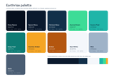 |
| [palette.svg](cargen/branding/earthrise/palette/palette.svg) | palette | `branding/earthrise/palette/palette.svg` [`239871ed5c`](https://github.com/galion-studio/cargen/commit/239871ed5c5e0df170acc676d1a148f6906f429e) | 2026-10-21 | MIT · Copyright (c) 2026 galion-studio | 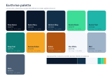 |
| [cargen-social-preview-1280x640.png](cargen/branding/earthrise/social/cargen-social-preview-1280x640.png) | image | `branding/earthrise/social/cargen-social-preview-1280x640.png` [`239871ed5c`](https://github.com/galion-studio/cargen/commit/239871ed5c5e0df170acc676d1a148f6906f429e) | 2026-10-21 | MIT · Copyright (c) 2026 galion-studio |  |
| [cargen-social-preview-1280x640.svg](cargen/branding/earthrise/social/cargen-social-preview-1280x640.svg) | image | `branding/earthrise/social/cargen-social-preview-1280x640.svg` [`239871ed5c`](https://github.com/galion-studio/cargen/commit/239871ed5c5e0df170acc676d1a148f6906f429e) | 2026-10-21 | MIT · Copyright (c) 2026 galion-studio |  |
| [typography.png](cargen/branding/earthrise/typography/typography.png) | image | `branding/earthrise/typography/typography.png` [`239871ed5c`](https://github.com/galion-studio/cargen/commit/239871ed5c5e0df170acc676d1a148f6906f429e) | 2026-10-21 | MIT · Copyright (c) 2026 galion-studio | 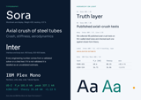 |
| [typography.svg](cargen/branding/earthrise/typography/typography.svg) | image | `branding/earthrise/typography/typography.svg` [`239871ed5c`](https://github.com/galion-studio/cargen/commit/239871ed5c5e0df170acc676d1a148f6906f429e) | 2026-10-21 | MIT · Copyright (c) 2026 galion-studio | 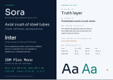 |
| [cargen-wordmark-dark.svg](cargen/branding/earthrise/wordmark/cargen-wordmark-dark.svg) | wordmark | `branding/earthrise/wordmark/cargen-wordmark-dark.svg` [`239871ed5c`](https://github.com/galion-studio/cargen/commit/239871ed5c5e0df170acc676d1a148f6906f429e) | 2026-10-21 | MIT · Copyright (c) 2026 galion-studio |  |
| [cargen-wordmark-dark@2x.png](cargen/branding/earthrise/wordmark/cargen-wordmark-dark@2x.png) | wordmark | `branding/earthrise/wordmark/cargen-wordmark-dark@2x.png` [`239871ed5c`](https://github.com/galion-studio/cargen/commit/239871ed5c5e0df170acc676d1a148f6906f429e) | 2026-10-21 | MIT · Copyright (c) 2026 galion-studio |  |
| [cargen-wordmark-light.svg](cargen/branding/earthrise/wordmark/cargen-wordmark-light.svg) | wordmark | `branding/earthrise/wordmark/cargen-wordmark-light.svg` [`239871ed5c`](https://github.com/galion-studio/cargen/commit/239871ed5c5e0df170acc676d1a148f6906f429e) | 2026-10-21 | MIT · Copyright (c) 2026 galion-studio |  |
| [cargen-wordmark-light@2x.png](cargen/branding/earthrise/wordmark/cargen-wordmark-light@2x.png) | wordmark | `branding/earthrise/wordmark/cargen-wordmark-light@2x.png` [`239871ed5c`](https://github.com/galion-studio/cargen/commit/239871ed5c5e0df170acc676d1a148f6906f429e) | 2026-10-21 | MIT · Copyright (c) 2026 galion-studio |  |
| [cargen-banner-dark-1280x320.png](cargen/branding/fieldnotes/banner/cargen-banner-dark-1280x320.png) | banner | `branding/fieldnotes/banner/cargen-banner-dark-1280x320.png` [`f422383368`](https://github.com/galion-studio/cargen/commit/f422383368779ce7376027b1fe2cb37bb7d60b13) | 2026-10-21 | MIT · Copyright (c) 2026 galion-studio |  |
| [cargen-banner-dark-1280x320.svg](cargen/branding/fieldnotes/banner/cargen-banner-dark-1280x320.svg) | banner | `branding/fieldnotes/banner/cargen-banner-dark-1280x320.svg` [`f422383368`](https://github.com/galion-studio/cargen/commit/f422383368779ce7376027b1fe2cb37bb7d60b13) | 2026-10-21 | MIT · Copyright (c) 2026 galion-studio |  |
| [cargen-banner-light-1280x320.png](cargen/branding/fieldnotes/banner/cargen-banner-light-1280x320.png) | banner | `branding/fieldnotes/banner/cargen-banner-light-1280x320.png` [`f422383368`](https://github.com/galion-studio/cargen/commit/f422383368779ce7376027b1fe2cb37bb7d60b13) | 2026-10-21 | MIT · Copyright (c) 2026 galion-studio |  |
| [cargen-banner-light-1280x320.svg](cargen/branding/fieldnotes/banner/cargen-banner-light-1280x320.svg) | banner | `branding/fieldnotes/banner/cargen-banner-light-1280x320.svg` [`f422383368`](https://github.com/galion-studio/cargen/commit/f422383368779ce7376027b1fe2cb37bb7d60b13) | 2026-10-21 | MIT · Copyright (c) 2026 galion-studio |  |
| [cargen-banner-dark-tagline-slot.png](cargen/branding/fieldnotes/banner/templates/cargen-banner-dark-tagline-slot.png) | banner | `branding/fieldnotes/banner/templates/cargen-banner-dark-tagline-slot.png` [`f422383368`](https://github.com/galion-studio/cargen/commit/f422383368779ce7376027b1fe2cb37bb7d60b13) | 2026-10-21 | MIT · Copyright (c) 2026 galion-studio |  |
| [cargen-banner-dark-tagline-slot.svg](cargen/branding/fieldnotes/banner/templates/cargen-banner-dark-tagline-slot.svg) | banner | `branding/fieldnotes/banner/templates/cargen-banner-dark-tagline-slot.svg` [`f422383368`](https://github.com/galion-studio/cargen/commit/f422383368779ce7376027b1fe2cb37bb7d60b13) | 2026-10-21 | MIT · Copyright (c) 2026 galion-studio |  |
| [cargen-banner-light-tagline-slot.png](cargen/branding/fieldnotes/banner/templates/cargen-banner-light-tagline-slot.png) | banner | `branding/fieldnotes/banner/templates/cargen-banner-light-tagline-slot.png` [`f422383368`](https://github.com/galion-studio/cargen/commit/f422383368779ce7376027b1fe2cb37bb7d60b13) | 2026-10-21 | MIT · Copyright (c) 2026 galion-studio |  |
| [cargen-banner-light-tagline-slot.svg](cargen/branding/fieldnotes/banner/templates/cargen-banner-light-tagline-slot.svg) | banner | `branding/fieldnotes/banner/templates/cargen-banner-light-tagline-slot.svg` [`f422383368`](https://github.com/galion-studio/cargen/commit/f422383368779ce7376027b1fe2cb37bb7d60b13) | 2026-10-21 | MIT · Copyright (c) 2026 galion-studio |  |
| [cargen-lockup-dark.svg](cargen/branding/fieldnotes/lockup/cargen-lockup-dark.svg) | lockup | `branding/fieldnotes/lockup/cargen-lockup-dark.svg` [`f422383368`](https://github.com/galion-studio/cargen/commit/f422383368779ce7376027b1fe2cb37bb7d60b13) | 2026-10-21 | MIT · Copyright (c) 2026 galion-studio |  |
| [cargen-lockup-dark@2x.png](cargen/branding/fieldnotes/lockup/cargen-lockup-dark@2x.png) | lockup | `branding/fieldnotes/lockup/cargen-lockup-dark@2x.png` [`f422383368`](https://github.com/galion-studio/cargen/commit/f422383368779ce7376027b1fe2cb37bb7d60b13) | 2026-10-21 | MIT · Copyright (c) 2026 galion-studio |  |
| [cargen-lockup-light.svg](cargen/branding/fieldnotes/lockup/cargen-lockup-light.svg) | lockup | `branding/fieldnotes/lockup/cargen-lockup-light.svg` [`f422383368`](https://github.com/galion-studio/cargen/commit/f422383368779ce7376027b1fe2cb37bb7d60b13) | 2026-10-21 | MIT · Copyright (c) 2026 galion-studio |  |
| [cargen-lockup-light@2x.png](cargen/branding/fieldnotes/lockup/cargen-lockup-light@2x.png) | lockup | `branding/fieldnotes/lockup/cargen-lockup-light@2x.png` [`f422383368`](https://github.com/galion-studio/cargen/commit/f422383368779ce7376027b1fe2cb37bb7d60b13) | 2026-10-21 | MIT · Copyright (c) 2026 galion-studio |  |
| [cargen-lockup-stacked-dark.svg](cargen/branding/fieldnotes/lockup/cargen-lockup-stacked-dark.svg) | lockup | `branding/fieldnotes/lockup/cargen-lockup-stacked-dark.svg` [`f422383368`](https://github.com/galion-studio/cargen/commit/f422383368779ce7376027b1fe2cb37bb7d60b13) | 2026-10-21 | MIT · Copyright (c) 2026 galion-studio |  |
| [cargen-lockup-stacked-dark@2x.png](cargen/branding/fieldnotes/lockup/cargen-lockup-stacked-dark@2x.png) | lockup | `branding/fieldnotes/lockup/cargen-lockup-stacked-dark@2x.png` [`f422383368`](https://github.com/galion-studio/cargen/commit/f422383368779ce7376027b1fe2cb37bb7d60b13) | 2026-10-21 | MIT · Copyright (c) 2026 galion-studio |  |
| [cargen-lockup-stacked-light.svg](cargen/branding/fieldnotes/lockup/cargen-lockup-stacked-light.svg) | lockup | `branding/fieldnotes/lockup/cargen-lockup-stacked-light.svg` [`f422383368`](https://github.com/galion-studio/cargen/commit/f422383368779ce7376027b1fe2cb37bb7d60b13) | 2026-10-21 | MIT · Copyright (c) 2026 galion-studio |  |
| [cargen-lockup-stacked-light@2x.png](cargen/branding/fieldnotes/lockup/cargen-lockup-stacked-light@2x.png) | lockup | `branding/fieldnotes/lockup/cargen-lockup-stacked-light@2x.png` [`f422383368`](https://github.com/galion-studio/cargen/commit/f422383368779ce7376027b1fe2cb37bb7d60b13) | 2026-10-21 | MIT · Copyright (c) 2026 galion-studio |  |
| [cargen-fieldnotes-glyph-mono-chalk.svg](cargen/branding/fieldnotes/mark/cargen-fieldnotes-glyph-mono-chalk.svg) | logo | `branding/fieldnotes/mark/cargen-fieldnotes-glyph-mono-chalk.svg` [`f422383368`](https://github.com/galion-studio/cargen/commit/f422383368779ce7376027b1fe2cb37bb7d60b13) | 2026-10-21 | MIT · Copyright (c) 2026 galion-studio |  |
| [cargen-fieldnotes-glyph-mono-chalk@2x.png](cargen/branding/fieldnotes/mark/cargen-fieldnotes-glyph-mono-chalk@2x.png) | logo | `branding/fieldnotes/mark/cargen-fieldnotes-glyph-mono-chalk@2x.png` [`f422383368`](https://github.com/galion-studio/cargen/commit/f422383368779ce7376027b1fe2cb37bb7d60b13) | 2026-10-21 | MIT · Copyright (c) 2026 galion-studio |  |
| [cargen-fieldnotes-glyph-mono.svg](cargen/branding/fieldnotes/mark/cargen-fieldnotes-glyph-mono.svg) | logo | `branding/fieldnotes/mark/cargen-fieldnotes-glyph-mono.svg` [`f422383368`](https://github.com/galion-studio/cargen/commit/f422383368779ce7376027b1fe2cb37bb7d60b13) | 2026-10-21 | MIT · Copyright (c) 2026 galion-studio |  |
| [cargen-fieldnotes-glyph-mono@2x.png](cargen/branding/fieldnotes/mark/cargen-fieldnotes-glyph-mono@2x.png) | logo | `branding/fieldnotes/mark/cargen-fieldnotes-glyph-mono@2x.png` [`f422383368`](https://github.com/galion-studio/cargen/commit/f422383368779ce7376027b1fe2cb37bb7d60b13) | 2026-10-21 | MIT · Copyright (c) 2026 galion-studio |  |
| [cargen-fieldnotes-glyph-paper.svg](cargen/branding/fieldnotes/mark/cargen-fieldnotes-glyph-paper.svg) | logo | `branding/fieldnotes/mark/cargen-fieldnotes-glyph-paper.svg` [`f422383368`](https://github.com/galion-studio/cargen/commit/f422383368779ce7376027b1fe2cb37bb7d60b13) | 2026-10-21 | MIT · Copyright (c) 2026 galion-studio |  |
| [cargen-fieldnotes-glyph-paper@2x.png](cargen/branding/fieldnotes/mark/cargen-fieldnotes-glyph-paper@2x.png) | logo | `branding/fieldnotes/mark/cargen-fieldnotes-glyph-paper@2x.png` [`f422383368`](https://github.com/galion-studio/cargen/commit/f422383368779ce7376027b1fe2cb37bb7d60b13) | 2026-10-21 | MIT · Copyright (c) 2026 galion-studio |  |
| [cargen-fieldnotes-glyph.svg](cargen/branding/fieldnotes/mark/cargen-fieldnotes-glyph.svg) | logo | `branding/fieldnotes/mark/cargen-fieldnotes-glyph.svg` [`f422383368`](https://github.com/galion-studio/cargen/commit/f422383368779ce7376027b1fe2cb37bb7d60b13) | 2026-10-21 | MIT · Copyright (c) 2026 galion-studio |  |
| [cargen-fieldnotes-glyph@2x.png](cargen/branding/fieldnotes/mark/cargen-fieldnotes-glyph@2x.png) | logo | `branding/fieldnotes/mark/cargen-fieldnotes-glyph@2x.png` [`f422383368`](https://github.com/galion-studio/cargen/commit/f422383368779ce7376027b1fe2cb37bb7d60b13) | 2026-10-21 | MIT · Copyright (c) 2026 galion-studio |  |
| [cargen-fieldnotes-mark-128.png](cargen/branding/fieldnotes/mark/cargen-fieldnotes-mark-128.png) | logo | `branding/fieldnotes/mark/cargen-fieldnotes-mark-128.png` [`f422383368`](https://github.com/galion-studio/cargen/commit/f422383368779ce7376027b1fe2cb37bb7d60b13) | 2026-10-21 | MIT · Copyright (c) 2026 galion-studio |  |
| [cargen-fieldnotes-mark-16-paper.png](cargen/branding/fieldnotes/mark/cargen-fieldnotes-mark-16-paper.png) | logo | `branding/fieldnotes/mark/cargen-fieldnotes-mark-16-paper.png` [`f422383368`](https://github.com/galion-studio/cargen/commit/f422383368779ce7376027b1fe2cb37bb7d60b13) | 2026-10-21 | MIT · Copyright (c) 2026 galion-studio |  |
| [cargen-fieldnotes-mark-16-paper.svg](cargen/branding/fieldnotes/mark/cargen-fieldnotes-mark-16-paper.svg) | logo | `branding/fieldnotes/mark/cargen-fieldnotes-mark-16-paper.svg` [`f422383368`](https://github.com/galion-studio/cargen/commit/f422383368779ce7376027b1fe2cb37bb7d60b13) | 2026-10-21 | MIT · Copyright (c) 2026 galion-studio |  |
| [cargen-fieldnotes-mark-16.png](cargen/branding/fieldnotes/mark/cargen-fieldnotes-mark-16.png) | logo | `branding/fieldnotes/mark/cargen-fieldnotes-mark-16.png` [`f422383368`](https://github.com/galion-studio/cargen/commit/f422383368779ce7376027b1fe2cb37bb7d60b13) | 2026-10-21 | MIT · Copyright (c) 2026 galion-studio |  |
| [cargen-fieldnotes-mark-16.svg](cargen/branding/fieldnotes/mark/cargen-fieldnotes-mark-16.svg) | logo | `branding/fieldnotes/mark/cargen-fieldnotes-mark-16.svg` [`f422383368`](https://github.com/galion-studio/cargen/commit/f422383368779ce7376027b1fe2cb37bb7d60b13) | 2026-10-21 | MIT · Copyright (c) 2026 galion-studio |  |
| [cargen-fieldnotes-mark-256.png](cargen/branding/fieldnotes/mark/cargen-fieldnotes-mark-256.png) | logo | `branding/fieldnotes/mark/cargen-fieldnotes-mark-256.png` [`f422383368`](https://github.com/galion-studio/cargen/commit/f422383368779ce7376027b1fe2cb37bb7d60b13) | 2026-10-21 | MIT · Copyright (c) 2026 galion-studio | 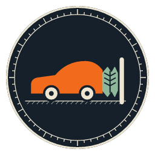 |
| [cargen-fieldnotes-mark-48.png](cargen/branding/fieldnotes/mark/cargen-fieldnotes-mark-48.png) | logo | `branding/fieldnotes/mark/cargen-fieldnotes-mark-48.png` [`f422383368`](https://github.com/galion-studio/cargen/commit/f422383368779ce7376027b1fe2cb37bb7d60b13) | 2026-10-21 | MIT · Copyright (c) 2026 galion-studio |  |
| [cargen-fieldnotes-mark-512.png](cargen/branding/fieldnotes/mark/cargen-fieldnotes-mark-512.png) | logo | `branding/fieldnotes/mark/cargen-fieldnotes-mark-512.png` [`f422383368`](https://github.com/galion-studio/cargen/commit/f422383368779ce7376027b1fe2cb37bb7d60b13) | 2026-10-21 | MIT · Copyright (c) 2026 galion-studio | 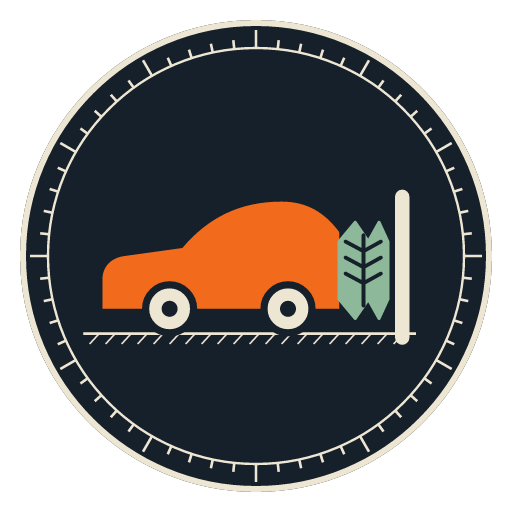 |
| [cargen-fieldnotes-mark-64.png](cargen/branding/fieldnotes/mark/cargen-fieldnotes-mark-64.png) | logo | `branding/fieldnotes/mark/cargen-fieldnotes-mark-64.png` [`f422383368`](https://github.com/galion-studio/cargen/commit/f422383368779ce7376027b1fe2cb37bb7d60b13) | 2026-10-21 | MIT · Copyright (c) 2026 galion-studio |  |
| [cargen-fieldnotes-mark-mono-512.png](cargen/branding/fieldnotes/mark/cargen-fieldnotes-mark-mono-512.png) | logo | `branding/fieldnotes/mark/cargen-fieldnotes-mark-mono-512.png` [`f422383368`](https://github.com/galion-studio/cargen/commit/f422383368779ce7376027b1fe2cb37bb7d60b13) | 2026-10-21 | MIT · Copyright (c) 2026 galion-studio | 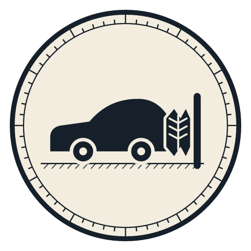 |
| [cargen-fieldnotes-mark-mono-chalk-512.png](cargen/branding/fieldnotes/mark/cargen-fieldnotes-mark-mono-chalk-512.png) | logo | `branding/fieldnotes/mark/cargen-fieldnotes-mark-mono-chalk-512.png` [`f422383368`](https://github.com/galion-studio/cargen/commit/f422383368779ce7376027b1fe2cb37bb7d60b13) | 2026-10-21 | MIT · Copyright (c) 2026 galion-studio |  |
| [cargen-fieldnotes-mark-mono-chalk.svg](cargen/branding/fieldnotes/mark/cargen-fieldnotes-mark-mono-chalk.svg) | logo | `branding/fieldnotes/mark/cargen-fieldnotes-mark-mono-chalk.svg` [`f422383368`](https://github.com/galion-studio/cargen/commit/f422383368779ce7376027b1fe2cb37bb7d60b13) | 2026-10-21 | MIT · Copyright (c) 2026 galion-studio |  |
| [cargen-fieldnotes-mark-mono.svg](cargen/branding/fieldnotes/mark/cargen-fieldnotes-mark-mono.svg) | logo | `branding/fieldnotes/mark/cargen-fieldnotes-mark-mono.svg` [`f422383368`](https://github.com/galion-studio/cargen/commit/f422383368779ce7376027b1fe2cb37bb7d60b13) | 2026-10-21 | MIT · Copyright (c) 2026 galion-studio |  |
| [cargen-fieldnotes-mark-paper-512.png](cargen/branding/fieldnotes/mark/cargen-fieldnotes-mark-paper-512.png) | logo | `branding/fieldnotes/mark/cargen-fieldnotes-mark-paper-512.png` [`f422383368`](https://github.com/galion-studio/cargen/commit/f422383368779ce7376027b1fe2cb37bb7d60b13) | 2026-10-21 | MIT · Copyright (c) 2026 galion-studio |  |
| [cargen-fieldnotes-mark-paper.svg](cargen/branding/fieldnotes/mark/cargen-fieldnotes-mark-paper.svg) | logo | `branding/fieldnotes/mark/cargen-fieldnotes-mark-paper.svg` [`f422383368`](https://github.com/galion-studio/cargen/commit/f422383368779ce7376027b1fe2cb37bb7d60b13) | 2026-10-21 | MIT · Copyright (c) 2026 galion-studio |  |
| [cargen-fieldnotes-mark-small-24.png](cargen/branding/fieldnotes/mark/cargen-fieldnotes-mark-small-24.png) | logo | `branding/fieldnotes/mark/cargen-fieldnotes-mark-small-24.png` [`f422383368`](https://github.com/galion-studio/cargen/commit/f422383368779ce7376027b1fe2cb37bb7d60b13) | 2026-10-21 | MIT · Copyright (c) 2026 galion-studio |  |
| [cargen-fieldnotes-mark-small-32.png](cargen/branding/fieldnotes/mark/cargen-fieldnotes-mark-small-32.png) | logo | `branding/fieldnotes/mark/cargen-fieldnotes-mark-small-32.png` [`f422383368`](https://github.com/galion-studio/cargen/commit/f422383368779ce7376027b1fe2cb37bb7d60b13) | 2026-10-21 | MIT · Copyright (c) 2026 galion-studio |  |
| [cargen-fieldnotes-mark-small-48.png](cargen/branding/fieldnotes/mark/cargen-fieldnotes-mark-small-48.png) | logo | `branding/fieldnotes/mark/cargen-fieldnotes-mark-small-48.png` [`f422383368`](https://github.com/galion-studio/cargen/commit/f422383368779ce7376027b1fe2cb37bb7d60b13) | 2026-10-21 | MIT · Copyright (c) 2026 galion-studio |  |
| [cargen-fieldnotes-mark-small-paper-24.png](cargen/branding/fieldnotes/mark/cargen-fieldnotes-mark-small-paper-24.png) | logo | `branding/fieldnotes/mark/cargen-fieldnotes-mark-small-paper-24.png` [`f422383368`](https://github.com/galion-studio/cargen/commit/f422383368779ce7376027b1fe2cb37bb7d60b13) | 2026-10-21 | MIT · Copyright (c) 2026 galion-studio |  |
| [cargen-fieldnotes-mark-small-paper-32.png](cargen/branding/fieldnotes/mark/cargen-fieldnotes-mark-small-paper-32.png) | logo | `branding/fieldnotes/mark/cargen-fieldnotes-mark-small-paper-32.png` [`f422383368`](https://github.com/galion-studio/cargen/commit/f422383368779ce7376027b1fe2cb37bb7d60b13) | 2026-10-21 | MIT · Copyright (c) 2026 galion-studio |  |
| [cargen-fieldnotes-mark-small-paper-48.png](cargen/branding/fieldnotes/mark/cargen-fieldnotes-mark-small-paper-48.png) | logo | `branding/fieldnotes/mark/cargen-fieldnotes-mark-small-paper-48.png` [`f422383368`](https://github.com/galion-studio/cargen/commit/f422383368779ce7376027b1fe2cb37bb7d60b13) | 2026-10-21 | MIT · Copyright (c) 2026 galion-studio |  |
| [cargen-fieldnotes-mark-small-paper.svg](cargen/branding/fieldnotes/mark/cargen-fieldnotes-mark-small-paper.svg) | logo | `branding/fieldnotes/mark/cargen-fieldnotes-mark-small-paper.svg` [`f422383368`](https://github.com/galion-studio/cargen/commit/f422383368779ce7376027b1fe2cb37bb7d60b13) | 2026-10-21 | MIT · Copyright (c) 2026 galion-studio |  |
| [cargen-fieldnotes-mark-small.svg](cargen/branding/fieldnotes/mark/cargen-fieldnotes-mark-small.svg) | logo | `branding/fieldnotes/mark/cargen-fieldnotes-mark-small.svg` [`f422383368`](https://github.com/galion-studio/cargen/commit/f422383368779ce7376027b1fe2cb37bb7d60b13) | 2026-10-21 | MIT · Copyright (c) 2026 galion-studio |  |
| [cargen-fieldnotes-mark.svg](cargen/branding/fieldnotes/mark/cargen-fieldnotes-mark.svg) | logo | `branding/fieldnotes/mark/cargen-fieldnotes-mark.svg` [`f422383368`](https://github.com/galion-studio/cargen/commit/f422383368779ce7376027b1fe2cb37bb7d60b13) | 2026-10-21 | MIT · Copyright (c) 2026 galion-studio |  |
| [cargen-fieldnotes-touch-icon-180.png](cargen/branding/fieldnotes/mark/cargen-fieldnotes-touch-icon-180.png) | icon | `branding/fieldnotes/mark/cargen-fieldnotes-touch-icon-180.png` [`f422383368`](https://github.com/galion-studio/cargen/commit/f422383368779ce7376027b1fe2cb37bb7d60b13) | 2026-10-21 | MIT · Copyright (c) 2026 galion-studio | 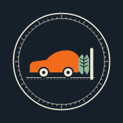 |
| [cargen-fieldnotes-touch-icon.svg](cargen/branding/fieldnotes/mark/cargen-fieldnotes-touch-icon.svg) | icon | `branding/fieldnotes/mark/cargen-fieldnotes-touch-icon.svg` [`f422383368`](https://github.com/galion-studio/cargen/commit/f422383368779ce7376027b1fe2cb37bb7d60b13) | 2026-10-21 | MIT · Copyright (c) 2026 galion-studio | 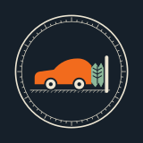 |
| [palette.png](cargen/branding/fieldnotes/palette/palette.png) | palette | `branding/fieldnotes/palette/palette.png` [`f422383368`](https://github.com/galion-studio/cargen/commit/f422383368779ce7376027b1fe2cb37bb7d60b13) | 2026-10-21 | MIT · Copyright (c) 2026 galion-studio |  |
| [palette.svg](cargen/branding/fieldnotes/palette/palette.svg) | palette | `branding/fieldnotes/palette/palette.svg` [`f422383368`](https://github.com/galion-studio/cargen/commit/f422383368779ce7376027b1fe2cb37bb7d60b13) | 2026-10-21 | MIT · Copyright (c) 2026 galion-studio |  |
| [cargen-social-preview-1280x640.png](cargen/branding/fieldnotes/social/cargen-social-preview-1280x640.png) | image | `branding/fieldnotes/social/cargen-social-preview-1280x640.png` [`f422383368`](https://github.com/galion-studio/cargen/commit/f422383368779ce7376027b1fe2cb37bb7d60b13) | 2026-10-21 | MIT · Copyright (c) 2026 galion-studio |  |
| [cargen-social-preview-1280x640.svg](cargen/branding/fieldnotes/social/cargen-social-preview-1280x640.svg) | image | `branding/fieldnotes/social/cargen-social-preview-1280x640.svg` [`f422383368`](https://github.com/galion-studio/cargen/commit/f422383368779ce7376027b1fe2cb37bb7d60b13) | 2026-10-21 | MIT · Copyright (c) 2026 galion-studio |  |
| [cargen-evidence-plate-dark.png](cargen/branding/fieldnotes/templates/cargen-evidence-plate-dark.png) | image | `branding/fieldnotes/templates/cargen-evidence-plate-dark.png` [`f422383368`](https://github.com/galion-studio/cargen/commit/f422383368779ce7376027b1fe2cb37bb7d60b13) | 2026-10-21 | MIT · Copyright (c) 2026 galion-studio | 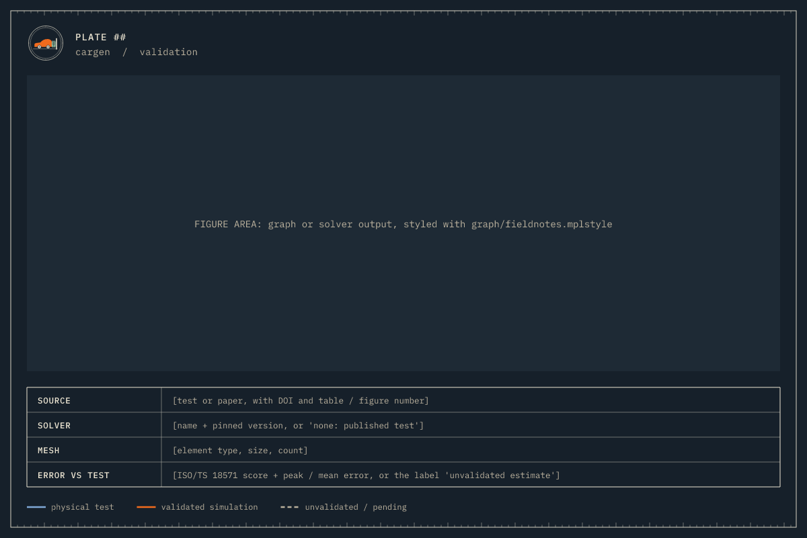 |
| [cargen-evidence-plate-dark.svg](cargen/branding/fieldnotes/templates/cargen-evidence-plate-dark.svg) | image | `branding/fieldnotes/templates/cargen-evidence-plate-dark.svg` [`f422383368`](https://github.com/galion-studio/cargen/commit/f422383368779ce7376027b1fe2cb37bb7d60b13) | 2026-10-21 | MIT · Copyright (c) 2026 galion-studio | 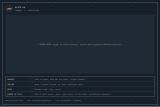 |
| [cargen-evidence-plate-light.png](cargen/branding/fieldnotes/templates/cargen-evidence-plate-light.png) | image | `branding/fieldnotes/templates/cargen-evidence-plate-light.png` [`f422383368`](https://github.com/galion-studio/cargen/commit/f422383368779ce7376027b1fe2cb37bb7d60b13) | 2026-10-21 | MIT · Copyright (c) 2026 galion-studio | 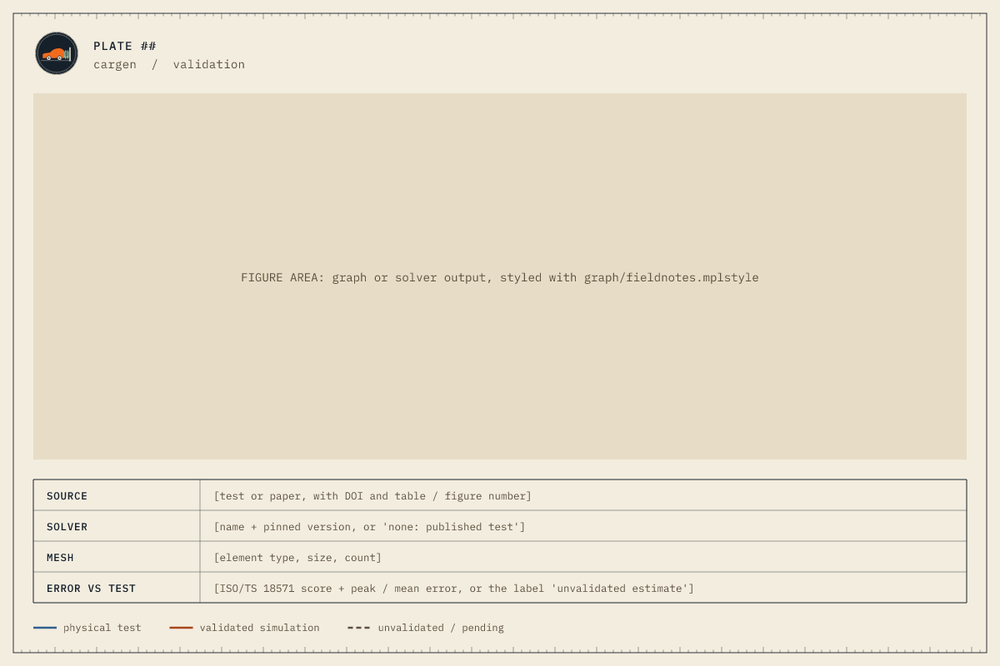 |
| [cargen-evidence-plate-light.svg](cargen/branding/fieldnotes/templates/cargen-evidence-plate-light.svg) | image | `branding/fieldnotes/templates/cargen-evidence-plate-light.svg` [`f422383368`](https://github.com/galion-studio/cargen/commit/f422383368779ce7376027b1fe2cb37bb7d60b13) | 2026-10-21 | MIT · Copyright (c) 2026 galion-studio | 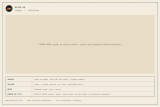 |
| [typography.png](cargen/branding/fieldnotes/typography/typography.png) | image | `branding/fieldnotes/typography/typography.png` [`f422383368`](https://github.com/galion-studio/cargen/commit/f422383368779ce7376027b1fe2cb37bb7d60b13) | 2026-10-21 | MIT · Copyright (c) 2026 galion-studio | 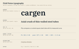 |
| [typography.svg](cargen/branding/fieldnotes/typography/typography.svg) | image | `branding/fieldnotes/typography/typography.svg` [`f422383368`](https://github.com/galion-studio/cargen/commit/f422383368779ce7376027b1fe2cb37bb7d60b13) | 2026-10-21 | MIT · Copyright (c) 2026 galion-studio |  |
| [cargen-wordmark-dark.svg](cargen/branding/fieldnotes/wordmark/cargen-wordmark-dark.svg) | wordmark | `branding/fieldnotes/wordmark/cargen-wordmark-dark.svg` [`f422383368`](https://github.com/galion-studio/cargen/commit/f422383368779ce7376027b1fe2cb37bb7d60b13) | 2026-10-21 | MIT · Copyright (c) 2026 galion-studio |  |
| [cargen-wordmark-dark@2x.png](cargen/branding/fieldnotes/wordmark/cargen-wordmark-dark@2x.png) | wordmark | `branding/fieldnotes/wordmark/cargen-wordmark-dark@2x.png` [`f422383368`](https://github.com/galion-studio/cargen/commit/f422383368779ce7376027b1fe2cb37bb7d60b13) | 2026-10-21 | MIT · Copyright (c) 2026 galion-studio | 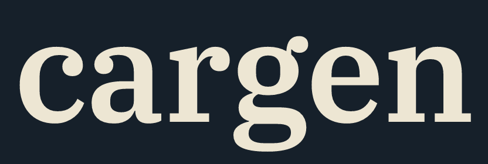 |
| [cargen-wordmark-light.svg](cargen/branding/fieldnotes/wordmark/cargen-wordmark-light.svg) | wordmark | `branding/fieldnotes/wordmark/cargen-wordmark-light.svg` [`f422383368`](https://github.com/galion-studio/cargen/commit/f422383368779ce7376027b1fe2cb37bb7d60b13) | 2026-10-21 | MIT · Copyright (c) 2026 galion-studio |  |
| [cargen-wordmark-light@2x.png](cargen/branding/fieldnotes/wordmark/cargen-wordmark-light@2x.png) | wordmark | `branding/fieldnotes/wordmark/cargen-wordmark-light@2x.png` [`f422383368`](https://github.com/galion-studio/cargen/commit/f422383368779ce7376027b1fe2cb37bb7d60b13) | 2026-10-21 | MIT · Copyright (c) 2026 galion-studio |  |
| [cargen-wordmark-signal.svg](cargen/branding/fieldnotes/wordmark/cargen-wordmark-signal.svg) | wordmark | `branding/fieldnotes/wordmark/cargen-wordmark-signal.svg` [`f422383368`](https://github.com/galion-studio/cargen/commit/f422383368779ce7376027b1fe2cb37bb7d60b13) | 2026-10-21 | MIT · Copyright (c) 2026 galion-studio |  |
| [cargen-wordmark-signal@2x.png](cargen/branding/fieldnotes/wordmark/cargen-wordmark-signal@2x.png) | wordmark | `branding/fieldnotes/wordmark/cargen-wordmark-signal@2x.png` [`f422383368`](https://github.com/galion-studio/cargen/commit/f422383368779ce7376027b1fe2cb37bb7d60b13) | 2026-10-21 | MIT · Copyright (c) 2026 galion-studio |  |
| [cargen-banner-dark-1280x320.png](cargen/branding/grown/banner/cargen-banner-dark-1280x320.png) | banner | `branding/grown/banner/cargen-banner-dark-1280x320.png` [`f422383368`](https://github.com/galion-studio/cargen/commit/f422383368779ce7376027b1fe2cb37bb7d60b13) | 2026-10-21 | MIT · Copyright (c) 2026 galion-studio |  |
| [cargen-banner-dark-1280x320.svg](cargen/branding/grown/banner/cargen-banner-dark-1280x320.svg) | banner | `branding/grown/banner/cargen-banner-dark-1280x320.svg` [`f422383368`](https://github.com/galion-studio/cargen/commit/f422383368779ce7376027b1fe2cb37bb7d60b13) | 2026-10-21 | MIT · Copyright (c) 2026 galion-studio |  |
| [cargen-banner-light-1280x320.png](cargen/branding/grown/banner/cargen-banner-light-1280x320.png) | banner | `branding/grown/banner/cargen-banner-light-1280x320.png` [`f422383368`](https://github.com/galion-studio/cargen/commit/f422383368779ce7376027b1fe2cb37bb7d60b13) | 2026-10-21 | MIT · Copyright (c) 2026 galion-studio |  |
| [cargen-banner-light-1280x320.svg](cargen/branding/grown/banner/cargen-banner-light-1280x320.svg) | banner | `branding/grown/banner/cargen-banner-light-1280x320.svg` [`f422383368`](https://github.com/galion-studio/cargen/commit/f422383368779ce7376027b1fe2cb37bb7d60b13) | 2026-10-21 | MIT · Copyright (c) 2026 galion-studio |  |
| [cargen-banner-dark-tagline-slot.png](cargen/branding/grown/banner/templates/cargen-banner-dark-tagline-slot.png) | banner | `branding/grown/banner/templates/cargen-banner-dark-tagline-slot.png` [`f422383368`](https://github.com/galion-studio/cargen/commit/f422383368779ce7376027b1fe2cb37bb7d60b13) | 2026-10-21 | MIT · Copyright (c) 2026 galion-studio |  |
| [cargen-banner-dark-tagline-slot.svg](cargen/branding/grown/banner/templates/cargen-banner-dark-tagline-slot.svg) | banner | `branding/grown/banner/templates/cargen-banner-dark-tagline-slot.svg` [`f422383368`](https://github.com/galion-studio/cargen/commit/f422383368779ce7376027b1fe2cb37bb7d60b13) | 2026-10-21 | MIT · Copyright (c) 2026 galion-studio |  |
| [cargen-banner-light-tagline-slot.png](cargen/branding/grown/banner/templates/cargen-banner-light-tagline-slot.png) | banner | `branding/grown/banner/templates/cargen-banner-light-tagline-slot.png` [`f422383368`](https://github.com/galion-studio/cargen/commit/f422383368779ce7376027b1fe2cb37bb7d60b13) | 2026-10-21 | MIT · Copyright (c) 2026 galion-studio |  |
| [cargen-banner-light-tagline-slot.svg](cargen/branding/grown/banner/templates/cargen-banner-light-tagline-slot.svg) | banner | `branding/grown/banner/templates/cargen-banner-light-tagline-slot.svg` [`f422383368`](https://github.com/galion-studio/cargen/commit/f422383368779ce7376027b1fe2cb37bb7d60b13) | 2026-10-21 | MIT · Copyright (c) 2026 galion-studio |  |
| [cargen-lockup-dark.svg](cargen/branding/grown/lockup/cargen-lockup-dark.svg) | lockup | `branding/grown/lockup/cargen-lockup-dark.svg` [`239871ed5c`](https://github.com/galion-studio/cargen/commit/239871ed5c5e0df170acc676d1a148f6906f429e) | 2026-10-21 | MIT · Copyright (c) 2026 galion-studio |  |
| [cargen-lockup-dark@2x.png](cargen/branding/grown/lockup/cargen-lockup-dark@2x.png) | lockup | `branding/grown/lockup/cargen-lockup-dark@2x.png` [`239871ed5c`](https://github.com/galion-studio/cargen/commit/239871ed5c5e0df170acc676d1a148f6906f429e) | 2026-10-21 | MIT · Copyright (c) 2026 galion-studio | 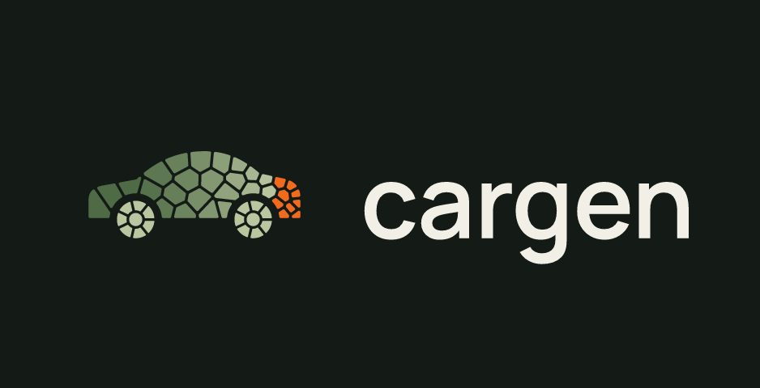 |
| [cargen-lockup-light.svg](cargen/branding/grown/lockup/cargen-lockup-light.svg) | lockup | `branding/grown/lockup/cargen-lockup-light.svg` [`239871ed5c`](https://github.com/galion-studio/cargen/commit/239871ed5c5e0df170acc676d1a148f6906f429e) | 2026-10-21 | MIT · Copyright (c) 2026 galion-studio |  |
| [cargen-lockup-light@2x.png](cargen/branding/grown/lockup/cargen-lockup-light@2x.png) | lockup | `branding/grown/lockup/cargen-lockup-light@2x.png` [`239871ed5c`](https://github.com/galion-studio/cargen/commit/239871ed5c5e0df170acc676d1a148f6906f429e) | 2026-10-21 | MIT · Copyright (c) 2026 galion-studio | 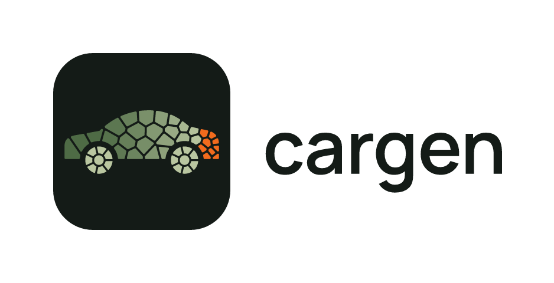 |
| [cargen-lockup-stacked-dark.svg](cargen/branding/grown/lockup/cargen-lockup-stacked-dark.svg) | lockup | `branding/grown/lockup/cargen-lockup-stacked-dark.svg` [`239871ed5c`](https://github.com/galion-studio/cargen/commit/239871ed5c5e0df170acc676d1a148f6906f429e) | 2026-10-21 | MIT · Copyright (c) 2026 galion-studio |  |
| [cargen-lockup-stacked-dark@2x.png](cargen/branding/grown/lockup/cargen-lockup-stacked-dark@2x.png) | lockup | `branding/grown/lockup/cargen-lockup-stacked-dark@2x.png` [`239871ed5c`](https://github.com/galion-studio/cargen/commit/239871ed5c5e0df170acc676d1a148f6906f429e) | 2026-10-21 | MIT · Copyright (c) 2026 galion-studio | 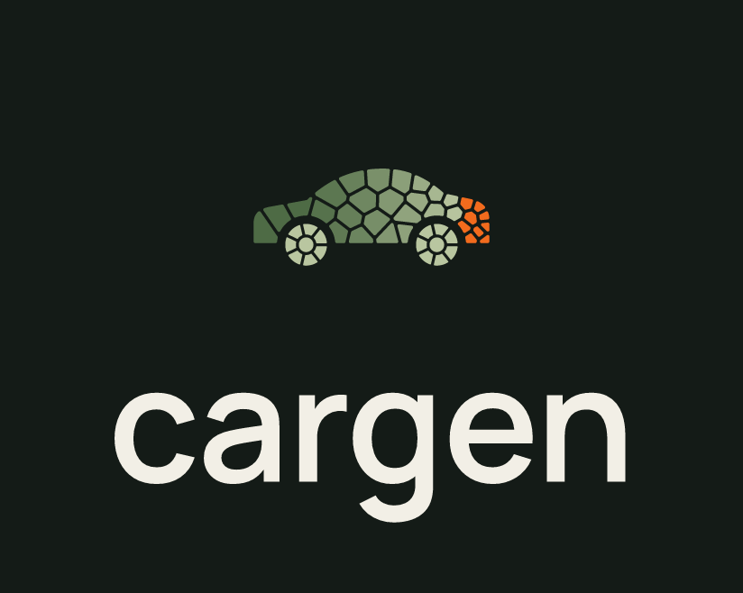 |
| [cargen-lockup-stacked-light.svg](cargen/branding/grown/lockup/cargen-lockup-stacked-light.svg) | lockup | `branding/grown/lockup/cargen-lockup-stacked-light.svg` [`239871ed5c`](https://github.com/galion-studio/cargen/commit/239871ed5c5e0df170acc676d1a148f6906f429e) | 2026-10-21 | MIT · Copyright (c) 2026 galion-studio |  |
| [cargen-lockup-stacked-light@2x.png](cargen/branding/grown/lockup/cargen-lockup-stacked-light@2x.png) | lockup | `branding/grown/lockup/cargen-lockup-stacked-light@2x.png` [`239871ed5c`](https://github.com/galion-studio/cargen/commit/239871ed5c5e0df170acc676d1a148f6906f429e) | 2026-10-21 | MIT · Copyright (c) 2026 galion-studio |  |
| [cargen-grown-glyph-512.png](cargen/branding/grown/mark/cargen-grown-glyph-512.png) | logo | `branding/grown/mark/cargen-grown-glyph-512.png` [`239871ed5c`](https://github.com/galion-studio/cargen/commit/239871ed5c5e0df170acc676d1a148f6906f429e) | 2026-10-21 | MIT · Copyright (c) 2026 galion-studio | 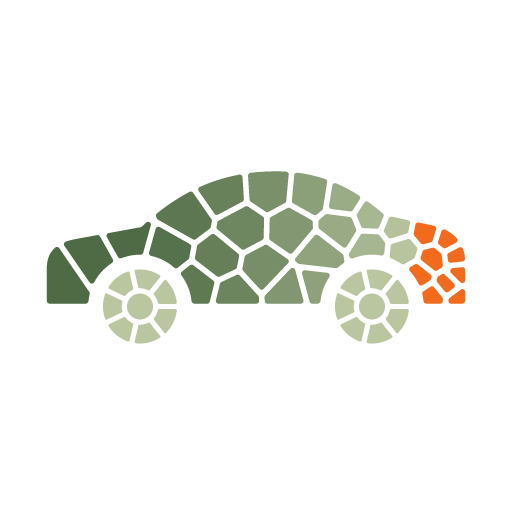 |
| [cargen-grown-glyph-light-512.png](cargen/branding/grown/mark/cargen-grown-glyph-light-512.png) | logo | `branding/grown/mark/cargen-grown-glyph-light-512.png` [`239871ed5c`](https://github.com/galion-studio/cargen/commit/239871ed5c5e0df170acc676d1a148f6906f429e) | 2026-10-21 | MIT · Copyright (c) 2026 galion-studio | 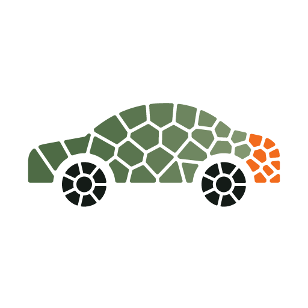 |
| [cargen-grown-glyph-light.svg](cargen/branding/grown/mark/cargen-grown-glyph-light.svg) | logo | `branding/grown/mark/cargen-grown-glyph-light.svg` [`239871ed5c`](https://github.com/galion-studio/cargen/commit/239871ed5c5e0df170acc676d1a148f6906f429e) | 2026-10-21 | MIT · Copyright (c) 2026 galion-studio | 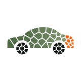 |
| [cargen-grown-glyph-mono-dark-512.png](cargen/branding/grown/mark/cargen-grown-glyph-mono-dark-512.png) | logo | `branding/grown/mark/cargen-grown-glyph-mono-dark-512.png` [`239871ed5c`](https://github.com/galion-studio/cargen/commit/239871ed5c5e0df170acc676d1a148f6906f429e) | 2026-10-21 | MIT · Copyright (c) 2026 galion-studio | 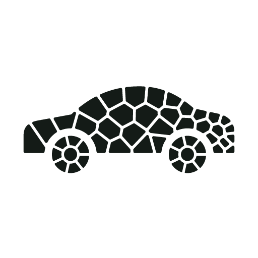 |
| [cargen-grown-glyph-mono-dark.svg](cargen/branding/grown/mark/cargen-grown-glyph-mono-dark.svg) | logo | `branding/grown/mark/cargen-grown-glyph-mono-dark.svg` [`239871ed5c`](https://github.com/galion-studio/cargen/commit/239871ed5c5e0df170acc676d1a148f6906f429e) | 2026-10-21 | MIT · Copyright (c) 2026 galion-studio | 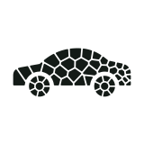 |
| [cargen-grown-glyph-mono-light-512.png](cargen/branding/grown/mark/cargen-grown-glyph-mono-light-512.png) | logo | `branding/grown/mark/cargen-grown-glyph-mono-light-512.png` [`239871ed5c`](https://github.com/galion-studio/cargen/commit/239871ed5c5e0df170acc676d1a148f6906f429e) | 2026-10-21 | MIT · Copyright (c) 2026 galion-studio |  |
| [cargen-grown-glyph-mono-light.svg](cargen/branding/grown/mark/cargen-grown-glyph-mono-light.svg) | logo | `branding/grown/mark/cargen-grown-glyph-mono-light.svg` [`239871ed5c`](https://github.com/galion-studio/cargen/commit/239871ed5c5e0df170acc676d1a148f6906f429e) | 2026-10-21 | MIT · Copyright (c) 2026 galion-studio |  |
| [cargen-grown-glyph.svg](cargen/branding/grown/mark/cargen-grown-glyph.svg) | logo | `branding/grown/mark/cargen-grown-glyph.svg` [`239871ed5c`](https://github.com/galion-studio/cargen/commit/239871ed5c5e0df170acc676d1a148f6906f429e) | 2026-10-21 | MIT · Copyright (c) 2026 galion-studio | 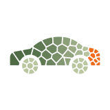 |
| [cargen-grown-mark-128.png](cargen/branding/grown/mark/cargen-grown-mark-128.png) | logo | `branding/grown/mark/cargen-grown-mark-128.png` [`239871ed5c`](https://github.com/galion-studio/cargen/commit/239871ed5c5e0df170acc676d1a148f6906f429e) | 2026-10-21 | MIT · Copyright (c) 2026 galion-studio |  |
| [cargen-grown-mark-256.png](cargen/branding/grown/mark/cargen-grown-mark-256.png) | logo | `branding/grown/mark/cargen-grown-mark-256.png` [`239871ed5c`](https://github.com/galion-studio/cargen/commit/239871ed5c5e0df170acc676d1a148f6906f429e) | 2026-10-21 | MIT · Copyright (c) 2026 galion-studio |  |
| [cargen-grown-mark-512.png](cargen/branding/grown/mark/cargen-grown-mark-512.png) | logo | `branding/grown/mark/cargen-grown-mark-512.png` [`239871ed5c`](https://github.com/galion-studio/cargen/commit/239871ed5c5e0df170acc676d1a148f6906f429e) | 2026-10-21 | MIT · Copyright (c) 2026 galion-studio |  |
| [cargen-grown-mark-64.png](cargen/branding/grown/mark/cargen-grown-mark-64.png) | logo | `branding/grown/mark/cargen-grown-mark-64.png` [`239871ed5c`](https://github.com/galion-studio/cargen/commit/239871ed5c5e0df170acc676d1a148f6906f429e) | 2026-10-21 | MIT · Copyright (c) 2026 galion-studio |  |
| [cargen-grown-mark-small-16.png](cargen/branding/grown/mark/cargen-grown-mark-small-16.png) | logo | `branding/grown/mark/cargen-grown-mark-small-16.png` [`239871ed5c`](https://github.com/galion-studio/cargen/commit/239871ed5c5e0df170acc676d1a148f6906f429e) | 2026-10-21 | MIT · Copyright (c) 2026 galion-studio |  |
| [cargen-grown-mark-small-24.png](cargen/branding/grown/mark/cargen-grown-mark-small-24.png) | logo | `branding/grown/mark/cargen-grown-mark-small-24.png` [`239871ed5c`](https://github.com/galion-studio/cargen/commit/239871ed5c5e0df170acc676d1a148f6906f429e) | 2026-10-21 | MIT · Copyright (c) 2026 galion-studio |  |
| [cargen-grown-mark-small-32.png](cargen/branding/grown/mark/cargen-grown-mark-small-32.png) | logo | `branding/grown/mark/cargen-grown-mark-small-32.png` [`239871ed5c`](https://github.com/galion-studio/cargen/commit/239871ed5c5e0df170acc676d1a148f6906f429e) | 2026-10-21 | MIT · Copyright (c) 2026 galion-studio |  |
| [cargen-grown-mark-small-48.png](cargen/branding/grown/mark/cargen-grown-mark-small-48.png) | logo | `branding/grown/mark/cargen-grown-mark-small-48.png` [`239871ed5c`](https://github.com/galion-studio/cargen/commit/239871ed5c5e0df170acc676d1a148f6906f429e) | 2026-10-21 | MIT · Copyright (c) 2026 galion-studio |  |
| [cargen-grown-mark-small.svg](cargen/branding/grown/mark/cargen-grown-mark-small.svg) | logo | `branding/grown/mark/cargen-grown-mark-small.svg` [`239871ed5c`](https://github.com/galion-studio/cargen/commit/239871ed5c5e0df170acc676d1a148f6906f429e) | 2026-10-21 | MIT · Copyright (c) 2026 galion-studio |  |
| [cargen-grown-mark.svg](cargen/branding/grown/mark/cargen-grown-mark.svg) | logo | `branding/grown/mark/cargen-grown-mark.svg` [`239871ed5c`](https://github.com/galion-studio/cargen/commit/239871ed5c5e0df170acc676d1a148f6906f429e) | 2026-10-21 | MIT · Copyright (c) 2026 galion-studio |  |
| [cargen-social-preview-1280x640.png](cargen/branding/grown/social/cargen-social-preview-1280x640.png) | image | `branding/grown/social/cargen-social-preview-1280x640.png` [`239871ed5c`](https://github.com/galion-studio/cargen/commit/239871ed5c5e0df170acc676d1a148f6906f429e) | 2026-10-21 | MIT · Copyright (c) 2026 galion-studio |  |
| [cargen-social-preview-1280x640.svg](cargen/branding/grown/social/cargen-social-preview-1280x640.svg) | image | `branding/grown/social/cargen-social-preview-1280x640.svg` [`239871ed5c`](https://github.com/galion-studio/cargen/commit/239871ed5c5e0df170acc676d1a148f6906f429e) | 2026-10-21 | MIT · Copyright (c) 2026 galion-studio |  |
| [lockup-reversed.svg](cargen/branding/grown/svg/lockup-reversed.svg) | lockup | `branding/grown/svg/lockup-reversed.svg` [`239871ed5c`](https://github.com/galion-studio/cargen/commit/239871ed5c5e0df170acc676d1a148f6906f429e) | 2026-10-21 | MIT · Copyright (c) 2026 galion-studio |  |
| [lockup.svg](cargen/branding/grown/svg/lockup.svg) | lockup | `branding/grown/svg/lockup.svg` [`239871ed5c`](https://github.com/galion-studio/cargen/commit/239871ed5c5e0df170acc676d1a148f6906f429e) | 2026-10-21 | MIT · Copyright (c) 2026 galion-studio |  |
| [mark-light.svg](cargen/branding/grown/svg/mark-light.svg) | logo | `branding/grown/svg/mark-light.svg` [`239871ed5c`](https://github.com/galion-studio/cargen/commit/239871ed5c5e0df170acc676d1a148f6906f429e) | 2026-10-21 | MIT · Copyright (c) 2026 galion-studio |  |
| [mark-mono-reversed.svg](cargen/branding/grown/svg/mark-mono-reversed.svg) | logo | `branding/grown/svg/mark-mono-reversed.svg` [`239871ed5c`](https://github.com/galion-studio/cargen/commit/239871ed5c5e0df170acc676d1a148f6906f429e) | 2026-10-21 | MIT · Copyright (c) 2026 galion-studio |  |
| [mark-mono.svg](cargen/branding/grown/svg/mark-mono.svg) | logo | `branding/grown/svg/mark-mono.svg` [`239871ed5c`](https://github.com/galion-studio/cargen/commit/239871ed5c5e0df170acc676d1a148f6906f429e) | 2026-10-21 | MIT · Copyright (c) 2026 galion-studio |  |
| [mark-small.svg](cargen/branding/grown/svg/mark-small.svg) | logo | `branding/grown/svg/mark-small.svg` [`239871ed5c`](https://github.com/galion-studio/cargen/commit/239871ed5c5e0df170acc676d1a148f6906f429e) | 2026-10-21 | MIT · Copyright (c) 2026 galion-studio |  |
| [mark.svg](cargen/branding/grown/svg/mark.svg) | logo | `branding/grown/svg/mark.svg` [`239871ed5c`](https://github.com/galion-studio/cargen/commit/239871ed5c5e0df170acc676d1a148f6906f429e) | 2026-10-21 | MIT · Copyright (c) 2026 galion-studio |  |
| [wordmark-reversed.svg](cargen/branding/grown/svg/wordmark-reversed.svg) | wordmark | `branding/grown/svg/wordmark-reversed.svg` [`239871ed5c`](https://github.com/galion-studio/cargen/commit/239871ed5c5e0df170acc676d1a148f6906f429e) | 2026-10-21 | MIT · Copyright (c) 2026 galion-studio |  |
| [wordmark.svg](cargen/branding/grown/svg/wordmark.svg) | wordmark | `branding/grown/svg/wordmark.svg` [`239871ed5c`](https://github.com/galion-studio/cargen/commit/239871ed5c5e0df170acc676d1a148f6906f429e) | 2026-10-21 | MIT · Copyright (c) 2026 galion-studio |  |
| [cargen-wordmark-dark.svg](cargen/branding/grown/wordmark/cargen-wordmark-dark.svg) | wordmark | `branding/grown/wordmark/cargen-wordmark-dark.svg` [`239871ed5c`](https://github.com/galion-studio/cargen/commit/239871ed5c5e0df170acc676d1a148f6906f429e) | 2026-10-21 | MIT · Copyright (c) 2026 galion-studio |  |
| [cargen-wordmark-dark@2x.png](cargen/branding/grown/wordmark/cargen-wordmark-dark@2x.png) | wordmark | `branding/grown/wordmark/cargen-wordmark-dark@2x.png` [`239871ed5c`](https://github.com/galion-studio/cargen/commit/239871ed5c5e0df170acc676d1a148f6906f429e) | 2026-10-21 | MIT · Copyright (c) 2026 galion-studio |  |
| [cargen-wordmark-light.svg](cargen/branding/grown/wordmark/cargen-wordmark-light.svg) | wordmark | `branding/grown/wordmark/cargen-wordmark-light.svg` [`239871ed5c`](https://github.com/galion-studio/cargen/commit/239871ed5c5e0df170acc676d1a148f6906f429e) | 2026-10-21 | MIT · Copyright (c) 2026 galion-studio |  |
| [cargen-wordmark-light@2x.png](cargen/branding/grown/wordmark/cargen-wordmark-light@2x.png) | wordmark | `branding/grown/wordmark/cargen-wordmark-light@2x.png` [`239871ed5c`](https://github.com/galion-studio/cargen/commit/239871ed5c5e0df170acc676d1a148f6906f429e) | 2026-10-21 | MIT · Copyright (c) 2026 galion-studio |  |
| [cargen-banner-dark-1280x320.png](cargen/branding/strata/banner/cargen-banner-dark-1280x320.png) | banner | `branding/strata/banner/cargen-banner-dark-1280x320.png` [`f422383368`](https://github.com/galion-studio/cargen/commit/f422383368779ce7376027b1fe2cb37bb7d60b13) | 2026-10-21 | MIT · Copyright (c) 2026 galion-studio |  |
| [cargen-banner-dark-1280x320.svg](cargen/branding/strata/banner/cargen-banner-dark-1280x320.svg) | banner | `branding/strata/banner/cargen-banner-dark-1280x320.svg` [`f422383368`](https://github.com/galion-studio/cargen/commit/f422383368779ce7376027b1fe2cb37bb7d60b13) | 2026-10-21 | MIT · Copyright (c) 2026 galion-studio |  |
| [cargen-banner-light-1280x320.png](cargen/branding/strata/banner/cargen-banner-light-1280x320.png) | banner | `branding/strata/banner/cargen-banner-light-1280x320.png` [`f422383368`](https://github.com/galion-studio/cargen/commit/f422383368779ce7376027b1fe2cb37bb7d60b13) | 2026-10-21 | MIT · Copyright (c) 2026 galion-studio |  |
| [cargen-banner-light-1280x320.svg](cargen/branding/strata/banner/cargen-banner-light-1280x320.svg) | banner | `branding/strata/banner/cargen-banner-light-1280x320.svg` [`f422383368`](https://github.com/galion-studio/cargen/commit/f422383368779ce7376027b1fe2cb37bb7d60b13) | 2026-10-21 | MIT · Copyright (c) 2026 galion-studio |  |
| [cargen-banner-dark-tagline-slot-1280x320.png](cargen/branding/strata/banner/templates/cargen-banner-dark-tagline-slot-1280x320.png) | banner | `branding/strata/banner/templates/cargen-banner-dark-tagline-slot-1280x320.png` [`f422383368`](https://github.com/galion-studio/cargen/commit/f422383368779ce7376027b1fe2cb37bb7d60b13) | 2026-10-21 | MIT · Copyright (c) 2026 galion-studio |  |
| [cargen-banner-dark-tagline-slot-1280x320.svg](cargen/branding/strata/banner/templates/cargen-banner-dark-tagline-slot-1280x320.svg) | banner | `branding/strata/banner/templates/cargen-banner-dark-tagline-slot-1280x320.svg` [`f422383368`](https://github.com/galion-studio/cargen/commit/f422383368779ce7376027b1fe2cb37bb7d60b13) | 2026-10-21 | MIT · Copyright (c) 2026 galion-studio |  |
| [cargen-banner-light-tagline-slot-1280x320.png](cargen/branding/strata/banner/templates/cargen-banner-light-tagline-slot-1280x320.png) | banner | `branding/strata/banner/templates/cargen-banner-light-tagline-slot-1280x320.png` [`f422383368`](https://github.com/galion-studio/cargen/commit/f422383368779ce7376027b1fe2cb37bb7d60b13) | 2026-10-21 | MIT · Copyright (c) 2026 galion-studio |  |
| [cargen-banner-light-tagline-slot-1280x320.svg](cargen/branding/strata/banner/templates/cargen-banner-light-tagline-slot-1280x320.svg) | banner | `branding/strata/banner/templates/cargen-banner-light-tagline-slot-1280x320.svg` [`f422383368`](https://github.com/galion-studio/cargen/commit/f422383368779ce7376027b1fe2cb37bb7d60b13) | 2026-10-21 | MIT · Copyright (c) 2026 galion-studio |  |
| [cargen-lockup-dark.svg](cargen/branding/strata/lockup/cargen-lockup-dark.svg) | lockup | `branding/strata/lockup/cargen-lockup-dark.svg` [`f422383368`](https://github.com/galion-studio/cargen/commit/f422383368779ce7376027b1fe2cb37bb7d60b13) | 2026-10-21 | MIT · Copyright (c) 2026 galion-studio |  |
| [cargen-lockup-dark@2x.png](cargen/branding/strata/lockup/cargen-lockup-dark@2x.png) | lockup | `branding/strata/lockup/cargen-lockup-dark@2x.png` [`f422383368`](https://github.com/galion-studio/cargen/commit/f422383368779ce7376027b1fe2cb37bb7d60b13) | 2026-10-21 | MIT · Copyright (c) 2026 galion-studio |  |
| [cargen-lockup-light.svg](cargen/branding/strata/lockup/cargen-lockup-light.svg) | lockup | `branding/strata/lockup/cargen-lockup-light.svg` [`f422383368`](https://github.com/galion-studio/cargen/commit/f422383368779ce7376027b1fe2cb37bb7d60b13) | 2026-10-21 | MIT · Copyright (c) 2026 galion-studio |  |
| [cargen-lockup-light@2x.png](cargen/branding/strata/lockup/cargen-lockup-light@2x.png) | lockup | `branding/strata/lockup/cargen-lockup-light@2x.png` [`f422383368`](https://github.com/galion-studio/cargen/commit/f422383368779ce7376027b1fe2cb37bb7d60b13) | 2026-10-21 | MIT · Copyright (c) 2026 galion-studio |  |
| [cargen-lockup-stacked-dark.svg](cargen/branding/strata/lockup/cargen-lockup-stacked-dark.svg) | lockup | `branding/strata/lockup/cargen-lockup-stacked-dark.svg` [`f422383368`](https://github.com/galion-studio/cargen/commit/f422383368779ce7376027b1fe2cb37bb7d60b13) | 2026-10-21 | MIT · Copyright (c) 2026 galion-studio |  |
| [cargen-lockup-stacked-dark@2x.png](cargen/branding/strata/lockup/cargen-lockup-stacked-dark@2x.png) | lockup | `branding/strata/lockup/cargen-lockup-stacked-dark@2x.png` [`f422383368`](https://github.com/galion-studio/cargen/commit/f422383368779ce7376027b1fe2cb37bb7d60b13) | 2026-10-21 | MIT · Copyright (c) 2026 galion-studio |  |
| [cargen-lockup-stacked-light.svg](cargen/branding/strata/lockup/cargen-lockup-stacked-light.svg) | lockup | `branding/strata/lockup/cargen-lockup-stacked-light.svg` [`f422383368`](https://github.com/galion-studio/cargen/commit/f422383368779ce7376027b1fe2cb37bb7d60b13) | 2026-10-21 | MIT · Copyright (c) 2026 galion-studio |  |
| [cargen-lockup-stacked-light@2x.png](cargen/branding/strata/lockup/cargen-lockup-stacked-light@2x.png) | lockup | `branding/strata/lockup/cargen-lockup-stacked-light@2x.png` [`f422383368`](https://github.com/galion-studio/cargen/commit/f422383368779ce7376027b1fe2cb37bb7d60b13) | 2026-10-21 | MIT · Copyright (c) 2026 galion-studio |  |
| [cargen-strata-glyph-on-dark-512.png](cargen/branding/strata/mark/cargen-strata-glyph-on-dark-512.png) | logo | `branding/strata/mark/cargen-strata-glyph-on-dark-512.png` [`f422383368`](https://github.com/galion-studio/cargen/commit/f422383368779ce7376027b1fe2cb37bb7d60b13) | 2026-10-21 | MIT · Copyright (c) 2026 galion-studio |  |
| [cargen-strata-glyph-on-dark.svg](cargen/branding/strata/mark/cargen-strata-glyph-on-dark.svg) | logo | `branding/strata/mark/cargen-strata-glyph-on-dark.svg` [`f422383368`](https://github.com/galion-studio/cargen/commit/f422383368779ce7376027b1fe2cb37bb7d60b13) | 2026-10-21 | MIT · Copyright (c) 2026 galion-studio |  |
| [cargen-strata-glyph-on-light-512.png](cargen/branding/strata/mark/cargen-strata-glyph-on-light-512.png) | logo | `branding/strata/mark/cargen-strata-glyph-on-light-512.png` [`f422383368`](https://github.com/galion-studio/cargen/commit/f422383368779ce7376027b1fe2cb37bb7d60b13) | 2026-10-21 | MIT · Copyright (c) 2026 galion-studio |  |
| [cargen-strata-glyph-on-light.svg](cargen/branding/strata/mark/cargen-strata-glyph-on-light.svg) | logo | `branding/strata/mark/cargen-strata-glyph-on-light.svg` [`f422383368`](https://github.com/galion-studio/cargen/commit/f422383368779ce7376027b1fe2cb37bb7d60b13) | 2026-10-21 | MIT · Copyright (c) 2026 galion-studio |  |
| [cargen-strata-mark-1024.png](cargen/branding/strata/mark/cargen-strata-mark-1024.png) | logo | `branding/strata/mark/cargen-strata-mark-1024.png` [`f422383368`](https://github.com/galion-studio/cargen/commit/f422383368779ce7376027b1fe2cb37bb7d60b13) | 2026-10-21 | MIT · Copyright (c) 2026 galion-studio |  |
| [cargen-strata-mark-180.png](cargen/branding/strata/mark/cargen-strata-mark-180.png) | logo | `branding/strata/mark/cargen-strata-mark-180.png` [`f422383368`](https://github.com/galion-studio/cargen/commit/f422383368779ce7376027b1fe2cb37bb7d60b13) | 2026-10-21 | MIT · Copyright (c) 2026 galion-studio |  |
| [cargen-strata-mark-256.png](cargen/branding/strata/mark/cargen-strata-mark-256.png) | logo | `branding/strata/mark/cargen-strata-mark-256.png` [`f422383368`](https://github.com/galion-studio/cargen/commit/f422383368779ce7376027b1fe2cb37bb7d60b13) | 2026-10-21 | MIT · Copyright (c) 2026 galion-studio |  |
| [cargen-strata-mark-512.png](cargen/branding/strata/mark/cargen-strata-mark-512.png) | logo | `branding/strata/mark/cargen-strata-mark-512.png` [`f422383368`](https://github.com/galion-studio/cargen/commit/f422383368779ce7376027b1fe2cb37bb7d60b13) | 2026-10-21 | MIT · Copyright (c) 2026 galion-studio |  |
| [cargen-strata-mark-64.png](cargen/branding/strata/mark/cargen-strata-mark-64.png) | logo | `branding/strata/mark/cargen-strata-mark-64.png` [`f422383368`](https://github.com/galion-studio/cargen/commit/f422383368779ce7376027b1fe2cb37bb7d60b13) | 2026-10-21 | MIT · Copyright (c) 2026 galion-studio |  |
| [cargen-strata-mark-mono-graphite-512.png](cargen/branding/strata/mark/cargen-strata-mark-mono-graphite-512.png) | logo | `branding/strata/mark/cargen-strata-mark-mono-graphite-512.png` [`f422383368`](https://github.com/galion-studio/cargen/commit/f422383368779ce7376027b1fe2cb37bb7d60b13) | 2026-10-21 | MIT · Copyright (c) 2026 galion-studio |  |
| [cargen-strata-mark-mono-graphite.svg](cargen/branding/strata/mark/cargen-strata-mark-mono-graphite.svg) | logo | `branding/strata/mark/cargen-strata-mark-mono-graphite.svg` [`f422383368`](https://github.com/galion-studio/cargen/commit/f422383368779ce7376027b1fe2cb37bb7d60b13) | 2026-10-21 | MIT · Copyright (c) 2026 galion-studio |  |
| [cargen-strata-mark-mono-limestone-512.png](cargen/branding/strata/mark/cargen-strata-mark-mono-limestone-512.png) | logo | `branding/strata/mark/cargen-strata-mark-mono-limestone-512.png` [`f422383368`](https://github.com/galion-studio/cargen/commit/f422383368779ce7376027b1fe2cb37bb7d60b13) | 2026-10-21 | MIT · Copyright (c) 2026 galion-studio |  |
| [cargen-strata-mark-mono-limestone.svg](cargen/branding/strata/mark/cargen-strata-mark-mono-limestone.svg) | logo | `branding/strata/mark/cargen-strata-mark-mono-limestone.svg` [`f422383368`](https://github.com/galion-studio/cargen/commit/f422383368779ce7376027b1fe2cb37bb7d60b13) | 2026-10-21 | MIT · Copyright (c) 2026 galion-studio |  |
| [cargen-strata-mark-small-16.png](cargen/branding/strata/mark/cargen-strata-mark-small-16.png) | logo | `branding/strata/mark/cargen-strata-mark-small-16.png` [`f422383368`](https://github.com/galion-studio/cargen/commit/f422383368779ce7376027b1fe2cb37bb7d60b13) | 2026-10-21 | MIT · Copyright (c) 2026 galion-studio |  |
| [cargen-strata-mark-small-32.png](cargen/branding/strata/mark/cargen-strata-mark-small-32.png) | logo | `branding/strata/mark/cargen-strata-mark-small-32.png` [`f422383368`](https://github.com/galion-studio/cargen/commit/f422383368779ce7376027b1fe2cb37bb7d60b13) | 2026-10-21 | MIT · Copyright (c) 2026 galion-studio |  |
| [cargen-strata-mark-small-48.png](cargen/branding/strata/mark/cargen-strata-mark-small-48.png) | logo | `branding/strata/mark/cargen-strata-mark-small-48.png` [`f422383368`](https://github.com/galion-studio/cargen/commit/f422383368779ce7376027b1fe2cb37bb7d60b13) | 2026-10-21 | MIT · Copyright (c) 2026 galion-studio |  |
| [cargen-strata-mark-small.svg](cargen/branding/strata/mark/cargen-strata-mark-small.svg) | logo | `branding/strata/mark/cargen-strata-mark-small.svg` [`f422383368`](https://github.com/galion-studio/cargen/commit/f422383368779ce7376027b1fe2cb37bb7d60b13) | 2026-10-21 | MIT · Copyright (c) 2026 galion-studio |  |
| [cargen-strata-mark.svg](cargen/branding/strata/mark/cargen-strata-mark.svg) | logo | `branding/strata/mark/cargen-strata-mark.svg` [`f422383368`](https://github.com/galion-studio/cargen/commit/f422383368779ce7376027b1fe2cb37bb7d60b13) | 2026-10-21 | MIT · Copyright (c) 2026 galion-studio |  |
| [palette.png](cargen/branding/strata/palette/palette.png) | palette | `branding/strata/palette/palette.png` [`f422383368`](https://github.com/galion-studio/cargen/commit/f422383368779ce7376027b1fe2cb37bb7d60b13) | 2026-10-21 | MIT · Copyright (c) 2026 galion-studio |  |
| [palette.svg](cargen/branding/strata/palette/palette.svg) | palette | `branding/strata/palette/palette.svg` [`f422383368`](https://github.com/galion-studio/cargen/commit/f422383368779ce7376027b1fe2cb37bb7d60b13) | 2026-10-21 | MIT · Copyright (c) 2026 galion-studio |  |
| [cargen-social-preview-dark-1280x640.png](cargen/branding/strata/social/cargen-social-preview-dark-1280x640.png) | image | `branding/strata/social/cargen-social-preview-dark-1280x640.png` [`f422383368`](https://github.com/galion-studio/cargen/commit/f422383368779ce7376027b1fe2cb37bb7d60b13) | 2026-10-21 | MIT · Copyright (c) 2026 galion-studio |  |
| [cargen-social-preview-dark-1280x640.svg](cargen/branding/strata/social/cargen-social-preview-dark-1280x640.svg) | image | `branding/strata/social/cargen-social-preview-dark-1280x640.svg` [`f422383368`](https://github.com/galion-studio/cargen/commit/f422383368779ce7376027b1fe2cb37bb7d60b13) | 2026-10-21 | MIT · Copyright (c) 2026 galion-studio |  |
| [cargen-social-preview-light-1280x640.png](cargen/branding/strata/social/cargen-social-preview-light-1280x640.png) | image | `branding/strata/social/cargen-social-preview-light-1280x640.png` [`f422383368`](https://github.com/galion-studio/cargen/commit/f422383368779ce7376027b1fe2cb37bb7d60b13) | 2026-10-21 | MIT · Copyright (c) 2026 galion-studio |  |
| [cargen-social-preview-light-1280x640.svg](cargen/branding/strata/social/cargen-social-preview-light-1280x640.svg) | image | `branding/strata/social/cargen-social-preview-light-1280x640.svg` [`f422383368`](https://github.com/galion-studio/cargen/commit/f422383368779ce7376027b1fe2cb37bb7d60b13) | 2026-10-21 | MIT · Copyright (c) 2026 galion-studio |  |
| [cargen-social-dark-tagline-slot-1280x640.png](cargen/branding/strata/social/templates/cargen-social-dark-tagline-slot-1280x640.png) | image | `branding/strata/social/templates/cargen-social-dark-tagline-slot-1280x640.png` [`f422383368`](https://github.com/galion-studio/cargen/commit/f422383368779ce7376027b1fe2cb37bb7d60b13) | 2026-10-21 | MIT · Copyright (c) 2026 galion-studio |  |
| [cargen-social-dark-tagline-slot-1280x640.svg](cargen/branding/strata/social/templates/cargen-social-dark-tagline-slot-1280x640.svg) | image | `branding/strata/social/templates/cargen-social-dark-tagline-slot-1280x640.svg` [`f422383368`](https://github.com/galion-studio/cargen/commit/f422383368779ce7376027b1fe2cb37bb7d60b13) | 2026-10-21 | MIT · Copyright (c) 2026 galion-studio |  |
| [cargen-social-light-tagline-slot-1280x640.png](cargen/branding/strata/social/templates/cargen-social-light-tagline-slot-1280x640.png) | image | `branding/strata/social/templates/cargen-social-light-tagline-slot-1280x640.png` [`f422383368`](https://github.com/galion-studio/cargen/commit/f422383368779ce7376027b1fe2cb37bb7d60b13) | 2026-10-21 | MIT · Copyright (c) 2026 galion-studio |  |
| [cargen-social-light-tagline-slot-1280x640.svg](cargen/branding/strata/social/templates/cargen-social-light-tagline-slot-1280x640.svg) | image | `branding/strata/social/templates/cargen-social-light-tagline-slot-1280x640.svg` [`f422383368`](https://github.com/galion-studio/cargen/commit/f422383368779ce7376027b1fe2cb37bb7d60b13) | 2026-10-21 | MIT · Copyright (c) 2026 galion-studio |  |
| [typography.png](cargen/branding/strata/typography/typography.png) | image | `branding/strata/typography/typography.png` [`f422383368`](https://github.com/galion-studio/cargen/commit/f422383368779ce7376027b1fe2cb37bb7d60b13) | 2026-10-21 | MIT · Copyright (c) 2026 galion-studio |  |
| [typography.svg](cargen/branding/strata/typography/typography.svg) | image | `branding/strata/typography/typography.svg` [`f422383368`](https://github.com/galion-studio/cargen/commit/f422383368779ce7376027b1fe2cb37bb7d60b13) | 2026-10-21 | MIT · Copyright (c) 2026 galion-studio |  |
| [cargen-wordmark-dark.svg](cargen/branding/strata/wordmark/cargen-wordmark-dark.svg) | wordmark | `branding/strata/wordmark/cargen-wordmark-dark.svg` [`f422383368`](https://github.com/galion-studio/cargen/commit/f422383368779ce7376027b1fe2cb37bb7d60b13) | 2026-10-21 | MIT · Copyright (c) 2026 galion-studio |  |
| [cargen-wordmark-dark@2x.png](cargen/branding/strata/wordmark/cargen-wordmark-dark@2x.png) | wordmark | `branding/strata/wordmark/cargen-wordmark-dark@2x.png` [`f422383368`](https://github.com/galion-studio/cargen/commit/f422383368779ce7376027b1fe2cb37bb7d60b13) | 2026-10-21 | MIT · Copyright (c) 2026 galion-studio |  |
| [cargen-wordmark-light.svg](cargen/branding/strata/wordmark/cargen-wordmark-light.svg) | wordmark | `branding/strata/wordmark/cargen-wordmark-light.svg` [`f422383368`](https://github.com/galion-studio/cargen/commit/f422383368779ce7376027b1fe2cb37bb7d60b13) | 2026-10-21 | MIT · Copyright (c) 2026 galion-studio |  |
| [cargen-wordmark-light@2x.png](cargen/branding/strata/wordmark/cargen-wordmark-light@2x.png) | wordmark | `branding/strata/wordmark/cargen-wordmark-light@2x.png` [`f422383368`](https://github.com/galion-studio/cargen/commit/f422383368779ce7376027b1fe2cb37bb7d60b13) | 2026-10-21 | MIT · Copyright (c) 2026 galion-studio |  |
| [cargen-banner-dark-1280x320.png](cargen/branding/windshell/banner/cargen-banner-dark-1280x320.png) | banner | `branding/windshell/banner/cargen-banner-dark-1280x320.png` [`f422383368`](https://github.com/galion-studio/cargen/commit/f422383368779ce7376027b1fe2cb37bb7d60b13) | 2026-10-21 | MIT · Copyright (c) 2026 galion-studio |  |
| [cargen-banner-dark-1280x320.svg](cargen/branding/windshell/banner/cargen-banner-dark-1280x320.svg) | banner | `branding/windshell/banner/cargen-banner-dark-1280x320.svg` [`f422383368`](https://github.com/galion-studio/cargen/commit/f422383368779ce7376027b1fe2cb37bb7d60b13) | 2026-10-21 | MIT · Copyright (c) 2026 galion-studio |  |
| [cargen-banner-dark-2560x640.png](cargen/branding/windshell/banner/cargen-banner-dark-2560x640.png) | banner | `branding/windshell/banner/cargen-banner-dark-2560x640.png` [`f422383368`](https://github.com/galion-studio/cargen/commit/f422383368779ce7376027b1fe2cb37bb7d60b13) | 2026-10-21 | MIT · Copyright (c) 2026 galion-studio |  |
| [cargen-banner-light-1280x320.png](cargen/branding/windshell/banner/cargen-banner-light-1280x320.png) | banner | `branding/windshell/banner/cargen-banner-light-1280x320.png` [`f422383368`](https://github.com/galion-studio/cargen/commit/f422383368779ce7376027b1fe2cb37bb7d60b13) | 2026-10-21 | MIT · Copyright (c) 2026 galion-studio |  |
| [cargen-banner-light-1280x320.svg](cargen/branding/windshell/banner/cargen-banner-light-1280x320.svg) | banner | `branding/windshell/banner/cargen-banner-light-1280x320.svg` [`f422383368`](https://github.com/galion-studio/cargen/commit/f422383368779ce7376027b1fe2cb37bb7d60b13) | 2026-10-21 | MIT · Copyright (c) 2026 galion-studio |  |
| [cargen-banner-light-2560x640.png](cargen/branding/windshell/banner/cargen-banner-light-2560x640.png) | banner | `branding/windshell/banner/cargen-banner-light-2560x640.png` [`f422383368`](https://github.com/galion-studio/cargen/commit/f422383368779ce7376027b1fe2cb37bb7d60b13) | 2026-10-21 | MIT · Copyright (c) 2026 galion-studio |  |
| [cargen-banner-dark-tagline-slot.png](cargen/branding/windshell/banner/templates/cargen-banner-dark-tagline-slot.png) | banner | `branding/windshell/banner/templates/cargen-banner-dark-tagline-slot.png` [`f422383368`](https://github.com/galion-studio/cargen/commit/f422383368779ce7376027b1fe2cb37bb7d60b13) | 2026-10-21 | MIT · Copyright (c) 2026 galion-studio |  |
| [cargen-banner-dark-tagline-slot.svg](cargen/branding/windshell/banner/templates/cargen-banner-dark-tagline-slot.svg) | banner | `branding/windshell/banner/templates/cargen-banner-dark-tagline-slot.svg` [`f422383368`](https://github.com/galion-studio/cargen/commit/f422383368779ce7376027b1fe2cb37bb7d60b13) | 2026-10-21 | MIT · Copyright (c) 2026 galion-studio |  |
| [cargen-banner-light-tagline-slot.png](cargen/branding/windshell/banner/templates/cargen-banner-light-tagline-slot.png) | banner | `branding/windshell/banner/templates/cargen-banner-light-tagline-slot.png` [`f422383368`](https://github.com/galion-studio/cargen/commit/f422383368779ce7376027b1fe2cb37bb7d60b13) | 2026-10-21 | MIT · Copyright (c) 2026 galion-studio |  |
| [cargen-banner-light-tagline-slot.svg](cargen/branding/windshell/banner/templates/cargen-banner-light-tagline-slot.svg) | banner | `branding/windshell/banner/templates/cargen-banner-light-tagline-slot.svg` [`f422383368`](https://github.com/galion-studio/cargen/commit/f422383368779ce7376027b1fe2cb37bb7d60b13) | 2026-10-21 | MIT · Copyright (c) 2026 galion-studio |  |
| [cargen-corridor-dark.png](cargen/branding/windshell/device/cargen-corridor-dark.png) | image | `branding/windshell/device/cargen-corridor-dark.png` [`f422383368`](https://github.com/galion-studio/cargen/commit/f422383368779ce7376027b1fe2cb37bb7d60b13) | 2026-10-21 | MIT · Copyright (c) 2026 galion-studio |  |
| [cargen-corridor-dark.svg](cargen/branding/windshell/device/cargen-corridor-dark.svg) | image | `branding/windshell/device/cargen-corridor-dark.svg` [`f422383368`](https://github.com/galion-studio/cargen/commit/f422383368779ce7376027b1fe2cb37bb7d60b13) | 2026-10-21 | MIT · Copyright (c) 2026 galion-studio |  |
| [cargen-corridor-light.png](cargen/branding/windshell/device/cargen-corridor-light.png) | image | `branding/windshell/device/cargen-corridor-light.png` [`f422383368`](https://github.com/galion-studio/cargen/commit/f422383368779ce7376027b1fe2cb37bb7d60b13) | 2026-10-21 | MIT · Copyright (c) 2026 galion-studio |  |
| [cargen-corridor-light.svg](cargen/branding/windshell/device/cargen-corridor-light.svg) | image | `branding/windshell/device/cargen-corridor-light.svg` [`f422383368`](https://github.com/galion-studio/cargen/commit/f422383368779ce7376027b1fe2cb37bb7d60b13) | 2026-10-21 | MIT · Copyright (c) 2026 galion-studio |  |
| [cargen-lockup-dark.svg](cargen/branding/windshell/lockup/cargen-lockup-dark.svg) | lockup | `branding/windshell/lockup/cargen-lockup-dark.svg` [`f422383368`](https://github.com/galion-studio/cargen/commit/f422383368779ce7376027b1fe2cb37bb7d60b13) | 2026-10-21 | MIT · Copyright (c) 2026 galion-studio |  |
| [cargen-lockup-dark@2x.png](cargen/branding/windshell/lockup/cargen-lockup-dark@2x.png) | lockup | `branding/windshell/lockup/cargen-lockup-dark@2x.png` [`f422383368`](https://github.com/galion-studio/cargen/commit/f422383368779ce7376027b1fe2cb37bb7d60b13) | 2026-10-21 | MIT · Copyright (c) 2026 galion-studio |  |
| [cargen-lockup-light.svg](cargen/branding/windshell/lockup/cargen-lockup-light.svg) | lockup | `branding/windshell/lockup/cargen-lockup-light.svg` [`f422383368`](https://github.com/galion-studio/cargen/commit/f422383368779ce7376027b1fe2cb37bb7d60b13) | 2026-10-21 | MIT · Copyright (c) 2026 galion-studio |  |
| [cargen-lockup-light@2x.png](cargen/branding/windshell/lockup/cargen-lockup-light@2x.png) | lockup | `branding/windshell/lockup/cargen-lockup-light@2x.png` [`f422383368`](https://github.com/galion-studio/cargen/commit/f422383368779ce7376027b1fe2cb37bb7d60b13) | 2026-10-21 | MIT · Copyright (c) 2026 galion-studio |  |
| [cargen-lockup-stacked-dark.svg](cargen/branding/windshell/lockup/cargen-lockup-stacked-dark.svg) | lockup | `branding/windshell/lockup/cargen-lockup-stacked-dark.svg` [`f422383368`](https://github.com/galion-studio/cargen/commit/f422383368779ce7376027b1fe2cb37bb7d60b13) | 2026-10-21 | MIT · Copyright (c) 2026 galion-studio |  |
| [cargen-lockup-stacked-dark@2x.png](cargen/branding/windshell/lockup/cargen-lockup-stacked-dark@2x.png) | lockup | `branding/windshell/lockup/cargen-lockup-stacked-dark@2x.png` [`f422383368`](https://github.com/galion-studio/cargen/commit/f422383368779ce7376027b1fe2cb37bb7d60b13) | 2026-10-21 | MIT · Copyright (c) 2026 galion-studio |  |
| [cargen-lockup-stacked-light.svg](cargen/branding/windshell/lockup/cargen-lockup-stacked-light.svg) | lockup | `branding/windshell/lockup/cargen-lockup-stacked-light.svg` [`f422383368`](https://github.com/galion-studio/cargen/commit/f422383368779ce7376027b1fe2cb37bb7d60b13) | 2026-10-21 | MIT · Copyright (c) 2026 galion-studio |  |
| [cargen-lockup-stacked-light@2x.png](cargen/branding/windshell/lockup/cargen-lockup-stacked-light@2x.png) | lockup | `branding/windshell/lockup/cargen-lockup-stacked-light@2x.png` [`f422383368`](https://github.com/galion-studio/cargen/commit/f422383368779ce7376027b1fe2cb37bb7d60b13) | 2026-10-21 | MIT · Copyright (c) 2026 galion-studio |  |
| [cargen-windshell-glyph-dark-512.png](cargen/branding/windshell/mark/cargen-windshell-glyph-dark-512.png) | logo | `branding/windshell/mark/cargen-windshell-glyph-dark-512.png` [`f422383368`](https://github.com/galion-studio/cargen/commit/f422383368779ce7376027b1fe2cb37bb7d60b13) | 2026-10-21 | MIT · Copyright (c) 2026 galion-studio |  |
| [cargen-windshell-glyph-dark.svg](cargen/branding/windshell/mark/cargen-windshell-glyph-dark.svg) | logo | `branding/windshell/mark/cargen-windshell-glyph-dark.svg` [`f422383368`](https://github.com/galion-studio/cargen/commit/f422383368779ce7376027b1fe2cb37bb7d60b13) | 2026-10-21 | MIT · Copyright (c) 2026 galion-studio |  |
| [cargen-windshell-glyph-light-512.png](cargen/branding/windshell/mark/cargen-windshell-glyph-light-512.png) | logo | `branding/windshell/mark/cargen-windshell-glyph-light-512.png` [`f422383368`](https://github.com/galion-studio/cargen/commit/f422383368779ce7376027b1fe2cb37bb7d60b13) | 2026-10-21 | MIT · Copyright (c) 2026 galion-studio |  |
| [cargen-windshell-glyph-light.svg](cargen/branding/windshell/mark/cargen-windshell-glyph-light.svg) | logo | `branding/windshell/mark/cargen-windshell-glyph-light.svg` [`f422383368`](https://github.com/galion-studio/cargen/commit/f422383368779ce7376027b1fe2cb37bb7d60b13) | 2026-10-21 | MIT · Copyright (c) 2026 galion-studio |  |
| [cargen-windshell-glyph-mono-dark-512.png](cargen/branding/windshell/mark/cargen-windshell-glyph-mono-dark-512.png) | logo | `branding/windshell/mark/cargen-windshell-glyph-mono-dark-512.png` [`f422383368`](https://github.com/galion-studio/cargen/commit/f422383368779ce7376027b1fe2cb37bb7d60b13) | 2026-10-21 | MIT · Copyright (c) 2026 galion-studio |  |
| [cargen-windshell-glyph-mono-dark.svg](cargen/branding/windshell/mark/cargen-windshell-glyph-mono-dark.svg) | logo | `branding/windshell/mark/cargen-windshell-glyph-mono-dark.svg` [`f422383368`](https://github.com/galion-studio/cargen/commit/f422383368779ce7376027b1fe2cb37bb7d60b13) | 2026-10-21 | MIT · Copyright (c) 2026 galion-studio |  |
| [cargen-windshell-glyph-mono-light-512.png](cargen/branding/windshell/mark/cargen-windshell-glyph-mono-light-512.png) | logo | `branding/windshell/mark/cargen-windshell-glyph-mono-light-512.png` [`f422383368`](https://github.com/galion-studio/cargen/commit/f422383368779ce7376027b1fe2cb37bb7d60b13) | 2026-10-21 | MIT · Copyright (c) 2026 galion-studio |  |
| [cargen-windshell-glyph-mono-light.svg](cargen/branding/windshell/mark/cargen-windshell-glyph-mono-light.svg) | logo | `branding/windshell/mark/cargen-windshell-glyph-mono-light.svg` [`f422383368`](https://github.com/galion-studio/cargen/commit/f422383368779ce7376027b1fe2cb37bb7d60b13) | 2026-10-21 | MIT · Copyright (c) 2026 galion-studio |  |
| [cargen-windshell-mark-1024.png](cargen/branding/windshell/mark/cargen-windshell-mark-1024.png) | logo | `branding/windshell/mark/cargen-windshell-mark-1024.png` [`f422383368`](https://github.com/galion-studio/cargen/commit/f422383368779ce7376027b1fe2cb37bb7d60b13) | 2026-10-21 | MIT · Copyright (c) 2026 galion-studio |  |
| [cargen-windshell-mark-256.png](cargen/branding/windshell/mark/cargen-windshell-mark-256.png) | logo | `branding/windshell/mark/cargen-windshell-mark-256.png` [`f422383368`](https://github.com/galion-studio/cargen/commit/f422383368779ce7376027b1fe2cb37bb7d60b13) | 2026-10-21 | MIT · Copyright (c) 2026 galion-studio |  |
| [cargen-windshell-mark-32.png](cargen/branding/windshell/mark/cargen-windshell-mark-32.png) | logo | `branding/windshell/mark/cargen-windshell-mark-32.png` [`f422383368`](https://github.com/galion-studio/cargen/commit/f422383368779ce7376027b1fe2cb37bb7d60b13) | 2026-10-21 | MIT · Copyright (c) 2026 galion-studio |  |
| [cargen-windshell-mark-512.png](cargen/branding/windshell/mark/cargen-windshell-mark-512.png) | logo | `branding/windshell/mark/cargen-windshell-mark-512.png` [`f422383368`](https://github.com/galion-studio/cargen/commit/f422383368779ce7376027b1fe2cb37bb7d60b13) | 2026-10-21 | MIT · Copyright (c) 2026 galion-studio |  |
| [cargen-windshell-mark-64.png](cargen/branding/windshell/mark/cargen-windshell-mark-64.png) | logo | `branding/windshell/mark/cargen-windshell-mark-64.png` [`f422383368`](https://github.com/galion-studio/cargen/commit/f422383368779ce7376027b1fe2cb37bb7d60b13) | 2026-10-21 | MIT · Copyright (c) 2026 galion-studio |  |
| [cargen-windshell-mark-knockout-512.png](cargen/branding/windshell/mark/cargen-windshell-mark-knockout-512.png) | logo | `branding/windshell/mark/cargen-windshell-mark-knockout-512.png` [`f422383368`](https://github.com/galion-studio/cargen/commit/f422383368779ce7376027b1fe2cb37bb7d60b13) | 2026-10-21 | MIT · Copyright (c) 2026 galion-studio |  |
| [cargen-windshell-mark-knockout.svg](cargen/branding/windshell/mark/cargen-windshell-mark-knockout.svg) | logo | `branding/windshell/mark/cargen-windshell-mark-knockout.svg` [`f422383368`](https://github.com/galion-studio/cargen/commit/f422383368779ce7376027b1fe2cb37bb7d60b13) | 2026-10-21 | MIT · Copyright (c) 2026 galion-studio |  |
| [cargen-windshell-mark-small-16.png](cargen/branding/windshell/mark/cargen-windshell-mark-small-16.png) | logo | `branding/windshell/mark/cargen-windshell-mark-small-16.png` [`f422383368`](https://github.com/galion-studio/cargen/commit/f422383368779ce7376027b1fe2cb37bb7d60b13) | 2026-10-21 | MIT · Copyright (c) 2026 galion-studio |  |
| [cargen-windshell-mark-small-32.png](cargen/branding/windshell/mark/cargen-windshell-mark-small-32.png) | logo | `branding/windshell/mark/cargen-windshell-mark-small-32.png` [`f422383368`](https://github.com/galion-studio/cargen/commit/f422383368779ce7376027b1fe2cb37bb7d60b13) | 2026-10-21 | MIT · Copyright (c) 2026 galion-studio |  |
| [cargen-windshell-mark-small-48.png](cargen/branding/windshell/mark/cargen-windshell-mark-small-48.png) | logo | `branding/windshell/mark/cargen-windshell-mark-small-48.png` [`f422383368`](https://github.com/galion-studio/cargen/commit/f422383368779ce7376027b1fe2cb37bb7d60b13) | 2026-10-21 | MIT · Copyright (c) 2026 galion-studio |  |
| [cargen-windshell-mark-small.svg](cargen/branding/windshell/mark/cargen-windshell-mark-small.svg) | logo | `branding/windshell/mark/cargen-windshell-mark-small.svg` [`f422383368`](https://github.com/galion-studio/cargen/commit/f422383368779ce7376027b1fe2cb37bb7d60b13) | 2026-10-21 | MIT · Copyright (c) 2026 galion-studio |  |
| [cargen-windshell-mark.svg](cargen/branding/windshell/mark/cargen-windshell-mark.svg) | logo | `branding/windshell/mark/cargen-windshell-mark.svg` [`f422383368`](https://github.com/galion-studio/cargen/commit/f422383368779ce7376027b1fe2cb37bb7d60b13) | 2026-10-21 | MIT · Copyright (c) 2026 galion-studio |  |
| [palette.png](cargen/branding/windshell/palette/palette.png) | palette | `branding/windshell/palette/palette.png` [`f422383368`](https://github.com/galion-studio/cargen/commit/f422383368779ce7376027b1fe2cb37bb7d60b13) | 2026-10-21 | MIT · Copyright (c) 2026 galion-studio |  |
| [palette.svg](cargen/branding/windshell/palette/palette.svg) | palette | `branding/windshell/palette/palette.svg` [`f422383368`](https://github.com/galion-studio/cargen/commit/f422383368779ce7376027b1fe2cb37bb7d60b13) | 2026-10-21 | MIT · Copyright (c) 2026 galion-studio |  |
| [cargen-social-preview-1280x640.png](cargen/branding/windshell/social/cargen-social-preview-1280x640.png) | image | `branding/windshell/social/cargen-social-preview-1280x640.png` [`f422383368`](https://github.com/galion-studio/cargen/commit/f422383368779ce7376027b1fe2cb37bb7d60b13) | 2026-10-21 | MIT · Copyright (c) 2026 galion-studio |  |
| [cargen-social-preview-1280x640.svg](cargen/branding/windshell/social/cargen-social-preview-1280x640.svg) | image | `branding/windshell/social/cargen-social-preview-1280x640.svg` [`f422383368`](https://github.com/galion-studio/cargen/commit/f422383368779ce7376027b1fe2cb37bb7d60b13) | 2026-10-21 | MIT · Copyright (c) 2026 galion-studio |  |
| [typography.png](cargen/branding/windshell/typography/typography.png) | image | `branding/windshell/typography/typography.png` [`f422383368`](https://github.com/galion-studio/cargen/commit/f422383368779ce7376027b1fe2cb37bb7d60b13) | 2026-10-21 | MIT · Copyright (c) 2026 galion-studio |  |
| [typography.svg](cargen/branding/windshell/typography/typography.svg) | image | `branding/windshell/typography/typography.svg` [`f422383368`](https://github.com/galion-studio/cargen/commit/f422383368779ce7376027b1fe2cb37bb7d60b13) | 2026-10-21 | MIT · Copyright (c) 2026 galion-studio |  |
| [cargen-wordmark-dark.svg](cargen/branding/windshell/wordmark/cargen-wordmark-dark.svg) | wordmark | `branding/windshell/wordmark/cargen-wordmark-dark.svg` [`f422383368`](https://github.com/galion-studio/cargen/commit/f422383368779ce7376027b1fe2cb37bb7d60b13) | 2026-10-21 | MIT · Copyright (c) 2026 galion-studio |  |
| [cargen-wordmark-dark@2x.png](cargen/branding/windshell/wordmark/cargen-wordmark-dark@2x.png) | wordmark | `branding/windshell/wordmark/cargen-wordmark-dark@2x.png` [`f422383368`](https://github.com/galion-studio/cargen/commit/f422383368779ce7376027b1fe2cb37bb7d60b13) | 2026-10-21 | MIT · Copyright (c) 2026 galion-studio |  |
| [cargen-wordmark-light.svg](cargen/branding/windshell/wordmark/cargen-wordmark-light.svg) | wordmark | `branding/windshell/wordmark/cargen-wordmark-light.svg` [`f422383368`](https://github.com/galion-studio/cargen/commit/f422383368779ce7376027b1fe2cb37bb7d60b13) | 2026-10-21 | MIT · Copyright (c) 2026 galion-studio |  |
| [cargen-wordmark-light@2x.png](cargen/branding/windshell/wordmark/cargen-wordmark-light@2x.png) | wordmark | `branding/windshell/wordmark/cargen-wordmark-light@2x.png` [`f422383368`](https://github.com/galion-studio/cargen/commit/f422383368779ce7376027b1fe2cb37bb7d60b13) | 2026-10-21 | MIT · Copyright (c) 2026 galion-studio |  |
| [_history/2026-10-21-239871ed5c/branding/fieldnotes/favicon-16.png](cargen/_history/2026-10-21-239871ed5c/branding/fieldnotes/favicon-16.png) | favicon | `branding/fieldnotes/favicon-16.png` [`239871ed5c`](https://github.com/galion-studio/cargen/commit/239871ed5c5e0df170acc676d1a148f6906f429e) | 2026-10-21 | MIT · Copyright (c) 2026 galion-studio |  |
| [_history/2026-10-21-239871ed5c/branding/fieldnotes/favicon-180.png](cargen/_history/2026-10-21-239871ed5c/branding/fieldnotes/favicon-180.png) | favicon | `branding/fieldnotes/favicon-180.png` [`239871ed5c`](https://github.com/galion-studio/cargen/commit/239871ed5c5e0df170acc676d1a148f6906f429e) | 2026-10-21 | MIT · Copyright (c) 2026 galion-studio |  |
| [_history/2026-10-21-239871ed5c/branding/fieldnotes/favicon-32.png](cargen/_history/2026-10-21-239871ed5c/branding/fieldnotes/favicon-32.png) | favicon | `branding/fieldnotes/favicon-32.png` [`239871ed5c`](https://github.com/galion-studio/cargen/commit/239871ed5c5e0df170acc676d1a148f6906f429e) | 2026-10-21 | MIT · Copyright (c) 2026 galion-studio |  |
| [_history/2026-10-21-239871ed5c/branding/fieldnotes/favicon-48.png](cargen/_history/2026-10-21-239871ed5c/branding/fieldnotes/favicon-48.png) | favicon | `branding/fieldnotes/favicon-48.png` [`239871ed5c`](https://github.com/galion-studio/cargen/commit/239871ed5c5e0df170acc676d1a148f6906f429e) | 2026-10-21 | MIT · Copyright (c) 2026 galion-studio |  |
| [_history/2026-10-21-239871ed5c/branding/fieldnotes/favicon-64.png](cargen/_history/2026-10-21-239871ed5c/branding/fieldnotes/favicon-64.png) | favicon | `branding/fieldnotes/favicon-64.png` [`239871ed5c`](https://github.com/galion-studio/cargen/commit/239871ed5c5e0df170acc676d1a148f6906f429e) | 2026-10-21 | MIT · Copyright (c) 2026 galion-studio |  |
| [_history/2026-10-21-239871ed5c/branding/fieldnotes/lockup-dark.png](cargen/_history/2026-10-21-239871ed5c/branding/fieldnotes/lockup-dark.png) | lockup | `branding/fieldnotes/lockup-dark.png` [`239871ed5c`](https://github.com/galion-studio/cargen/commit/239871ed5c5e0df170acc676d1a148f6906f429e) | 2026-10-21 | MIT · Copyright (c) 2026 galion-studio |  |
| [_history/2026-10-21-239871ed5c/branding/fieldnotes/lockup-dark.svg](cargen/_history/2026-10-21-239871ed5c/branding/fieldnotes/lockup-dark.svg) | lockup | `branding/fieldnotes/lockup-dark.svg` [`239871ed5c`](https://github.com/galion-studio/cargen/commit/239871ed5c5e0df170acc676d1a148f6906f429e) | 2026-10-21 | MIT · Copyright (c) 2026 galion-studio |  |
| [_history/2026-10-21-239871ed5c/branding/fieldnotes/lockup-stacked.png](cargen/_history/2026-10-21-239871ed5c/branding/fieldnotes/lockup-stacked.png) | lockup | `branding/fieldnotes/lockup-stacked.png` [`239871ed5c`](https://github.com/galion-studio/cargen/commit/239871ed5c5e0df170acc676d1a148f6906f429e) | 2026-10-21 | MIT · Copyright (c) 2026 galion-studio |  |
| [_history/2026-10-21-239871ed5c/branding/fieldnotes/lockup-stacked.svg](cargen/_history/2026-10-21-239871ed5c/branding/fieldnotes/lockup-stacked.svg) | lockup | `branding/fieldnotes/lockup-stacked.svg` [`239871ed5c`](https://github.com/galion-studio/cargen/commit/239871ed5c5e0df170acc676d1a148f6906f429e) | 2026-10-21 | MIT · Copyright (c) 2026 galion-studio |  |
| [_history/2026-10-21-239871ed5c/branding/fieldnotes/lockup.png](cargen/_history/2026-10-21-239871ed5c/branding/fieldnotes/lockup.png) | lockup | `branding/fieldnotes/lockup.png` [`239871ed5c`](https://github.com/galion-studio/cargen/commit/239871ed5c5e0df170acc676d1a148f6906f429e) | 2026-10-21 | MIT · Copyright (c) 2026 galion-studio |  |
| [_history/2026-10-21-239871ed5c/branding/fieldnotes/lockup.svg](cargen/_history/2026-10-21-239871ed5c/branding/fieldnotes/lockup.svg) | lockup | `branding/fieldnotes/lockup.svg` [`239871ed5c`](https://github.com/galion-studio/cargen/commit/239871ed5c5e0df170acc676d1a148f6906f429e) | 2026-10-21 | MIT · Copyright (c) 2026 galion-studio |  |
| [_history/2026-10-21-239871ed5c/branding/fieldnotes/mark-512.png](cargen/_history/2026-10-21-239871ed5c/branding/fieldnotes/mark-512.png) | logo | `branding/fieldnotes/mark-512.png` [`239871ed5c`](https://github.com/galion-studio/cargen/commit/239871ed5c5e0df170acc676d1a148f6906f429e) | 2026-10-21 | MIT · Copyright (c) 2026 galion-studio |  |
| [_history/2026-10-21-239871ed5c/branding/fieldnotes/mark-dark-512.png](cargen/_history/2026-10-21-239871ed5c/branding/fieldnotes/mark-dark-512.png) | logo | `branding/fieldnotes/mark-dark-512.png` [`239871ed5c`](https://github.com/galion-studio/cargen/commit/239871ed5c5e0df170acc676d1a148f6906f429e) | 2026-10-21 | MIT · Copyright (c) 2026 galion-studio |  |
| [_history/2026-10-21-239871ed5c/branding/fieldnotes/mark-dark.svg](cargen/_history/2026-10-21-239871ed5c/branding/fieldnotes/mark-dark.svg) | logo | `branding/fieldnotes/mark-dark.svg` [`239871ed5c`](https://github.com/galion-studio/cargen/commit/239871ed5c5e0df170acc676d1a148f6906f429e) | 2026-10-21 | MIT · Copyright (c) 2026 galion-studio |  |
| [_history/2026-10-21-239871ed5c/branding/fieldnotes/mark-favicon-dark.svg](cargen/_history/2026-10-21-239871ed5c/branding/fieldnotes/mark-favicon-dark.svg) | favicon | `branding/fieldnotes/mark-favicon-dark.svg` [`239871ed5c`](https://github.com/galion-studio/cargen/commit/239871ed5c5e0df170acc676d1a148f6906f429e) | 2026-10-21 | MIT · Copyright (c) 2026 galion-studio |  |
| [_history/2026-10-21-239871ed5c/branding/fieldnotes/mark-favicon.svg](cargen/_history/2026-10-21-239871ed5c/branding/fieldnotes/mark-favicon.svg) | favicon | `branding/fieldnotes/mark-favicon.svg` [`239871ed5c`](https://github.com/galion-studio/cargen/commit/239871ed5c5e0df170acc676d1a148f6906f429e) | 2026-10-21 | MIT · Copyright (c) 2026 galion-studio |  |
| [_history/2026-10-21-239871ed5c/branding/fieldnotes/mark-mono-512.png](cargen/_history/2026-10-21-239871ed5c/branding/fieldnotes/mark-mono-512.png) | logo | `branding/fieldnotes/mark-mono-512.png` [`239871ed5c`](https://github.com/galion-studio/cargen/commit/239871ed5c5e0df170acc676d1a148f6906f429e) | 2026-10-21 | MIT · Copyright (c) 2026 galion-studio |  |
| [_history/2026-10-21-239871ed5c/branding/fieldnotes/mark-mono.svg](cargen/_history/2026-10-21-239871ed5c/branding/fieldnotes/mark-mono.svg) | logo | `branding/fieldnotes/mark-mono.svg` [`239871ed5c`](https://github.com/galion-studio/cargen/commit/239871ed5c5e0df170acc676d1a148f6906f429e) | 2026-10-21 | MIT · Copyright (c) 2026 galion-studio |  |
| [_history/2026-10-21-239871ed5c/branding/fieldnotes/mark.svg](cargen/_history/2026-10-21-239871ed5c/branding/fieldnotes/mark.svg) | logo | `branding/fieldnotes/mark.svg` [`239871ed5c`](https://github.com/galion-studio/cargen/commit/239871ed5c5e0df170acc676d1a148f6906f429e) | 2026-10-21 | MIT · Copyright (c) 2026 galion-studio |  |
| [_history/2026-10-21-239871ed5c/branding/fieldnotes/mark/cargen-fieldnotes-glyph-dark.svg](cargen/_history/2026-10-21-239871ed5c/branding/fieldnotes/mark/cargen-fieldnotes-glyph-dark.svg) | logo | `branding/fieldnotes/mark/cargen-fieldnotes-glyph-dark.svg` [`239871ed5c`](https://github.com/galion-studio/cargen/commit/239871ed5c5e0df170acc676d1a148f6906f429e) | 2026-10-21 | MIT · Copyright (c) 2026 galion-studio |  |
| [_history/2026-10-21-239871ed5c/branding/fieldnotes/mark/cargen-fieldnotes-glyph-mono-dark.svg](cargen/_history/2026-10-21-239871ed5c/branding/fieldnotes/mark/cargen-fieldnotes-glyph-mono-dark.svg) | logo | `branding/fieldnotes/mark/cargen-fieldnotes-glyph-mono-dark.svg` [`239871ed5c`](https://github.com/galion-studio/cargen/commit/239871ed5c5e0df170acc676d1a148f6906f429e) | 2026-10-21 | MIT · Copyright (c) 2026 galion-studio |  |
| [_history/2026-10-21-239871ed5c/branding/fieldnotes/mark/cargen-fieldnotes-glyph-mono.svg](cargen/_history/2026-10-21-239871ed5c/branding/fieldnotes/mark/cargen-fieldnotes-glyph-mono.svg) | logo | `branding/fieldnotes/mark/cargen-fieldnotes-glyph-mono.svg` [`239871ed5c`](https://github.com/galion-studio/cargen/commit/239871ed5c5e0df170acc676d1a148f6906f429e) | 2026-10-21 | MIT · Copyright (c) 2026 galion-studio |  |
| [_history/2026-10-21-239871ed5c/branding/fieldnotes/mark/cargen-fieldnotes-glyph.svg](cargen/_history/2026-10-21-239871ed5c/branding/fieldnotes/mark/cargen-fieldnotes-glyph.svg) | logo | `branding/fieldnotes/mark/cargen-fieldnotes-glyph.svg` [`239871ed5c`](https://github.com/galion-studio/cargen/commit/239871ed5c5e0df170acc676d1a148f6906f429e) | 2026-10-21 | MIT · Copyright (c) 2026 galion-studio |  |
| [_history/2026-10-21-239871ed5c/branding/fieldnotes/mark/cargen-fieldnotes-mark-16-dark.svg](cargen/_history/2026-10-21-239871ed5c/branding/fieldnotes/mark/cargen-fieldnotes-mark-16-dark.svg) | logo | `branding/fieldnotes/mark/cargen-fieldnotes-mark-16-dark.svg` [`239871ed5c`](https://github.com/galion-studio/cargen/commit/239871ed5c5e0df170acc676d1a148f6906f429e) | 2026-10-21 | MIT · Copyright (c) 2026 galion-studio |  |
| [_history/2026-10-21-239871ed5c/branding/fieldnotes/mark/cargen-fieldnotes-mark-16.svg](cargen/_history/2026-10-21-239871ed5c/branding/fieldnotes/mark/cargen-fieldnotes-mark-16.svg) | logo | `branding/fieldnotes/mark/cargen-fieldnotes-mark-16.svg` [`239871ed5c`](https://github.com/galion-studio/cargen/commit/239871ed5c5e0df170acc676d1a148f6906f429e) | 2026-10-21 | MIT · Copyright (c) 2026 galion-studio |  |
| [_history/2026-10-21-239871ed5c/branding/fieldnotes/mark/cargen-fieldnotes-mark-dark.svg](cargen/_history/2026-10-21-239871ed5c/branding/fieldnotes/mark/cargen-fieldnotes-mark-dark.svg) | logo | `branding/fieldnotes/mark/cargen-fieldnotes-mark-dark.svg` [`239871ed5c`](https://github.com/galion-studio/cargen/commit/239871ed5c5e0df170acc676d1a148f6906f429e) | 2026-10-21 | MIT · Copyright (c) 2026 galion-studio |  |
| [_history/2026-10-21-239871ed5c/branding/fieldnotes/mark/cargen-fieldnotes-mark-mono-dark.svg](cargen/_history/2026-10-21-239871ed5c/branding/fieldnotes/mark/cargen-fieldnotes-mark-mono-dark.svg) | logo | `branding/fieldnotes/mark/cargen-fieldnotes-mark-mono-dark.svg` [`239871ed5c`](https://github.com/galion-studio/cargen/commit/239871ed5c5e0df170acc676d1a148f6906f429e) | 2026-10-21 | MIT · Copyright (c) 2026 galion-studio |  |
| [_history/2026-10-21-239871ed5c/branding/fieldnotes/mark/cargen-fieldnotes-mark-mono.svg](cargen/_history/2026-10-21-239871ed5c/branding/fieldnotes/mark/cargen-fieldnotes-mark-mono.svg) | logo | `branding/fieldnotes/mark/cargen-fieldnotes-mark-mono.svg` [`239871ed5c`](https://github.com/galion-studio/cargen/commit/239871ed5c5e0df170acc676d1a148f6906f429e) | 2026-10-21 | MIT · Copyright (c) 2026 galion-studio |  |
| [_history/2026-10-21-239871ed5c/branding/fieldnotes/mark/cargen-fieldnotes-mark-small-dark.svg](cargen/_history/2026-10-21-239871ed5c/branding/fieldnotes/mark/cargen-fieldnotes-mark-small-dark.svg) | logo | `branding/fieldnotes/mark/cargen-fieldnotes-mark-small-dark.svg` [`239871ed5c`](https://github.com/galion-studio/cargen/commit/239871ed5c5e0df170acc676d1a148f6906f429e) | 2026-10-21 | MIT · Copyright (c) 2026 galion-studio |  |
| [_history/2026-10-21-239871ed5c/branding/fieldnotes/mark/cargen-fieldnotes-mark-small.svg](cargen/_history/2026-10-21-239871ed5c/branding/fieldnotes/mark/cargen-fieldnotes-mark-small.svg) | logo | `branding/fieldnotes/mark/cargen-fieldnotes-mark-small.svg` [`239871ed5c`](https://github.com/galion-studio/cargen/commit/239871ed5c5e0df170acc676d1a148f6906f429e) | 2026-10-21 | MIT · Copyright (c) 2026 galion-studio |  |
| [_history/2026-10-21-239871ed5c/branding/fieldnotes/mark/cargen-fieldnotes-mark.svg](cargen/_history/2026-10-21-239871ed5c/branding/fieldnotes/mark/cargen-fieldnotes-mark.svg) | logo | `branding/fieldnotes/mark/cargen-fieldnotes-mark.svg` [`239871ed5c`](https://github.com/galion-studio/cargen/commit/239871ed5c5e0df170acc676d1a148f6906f429e) | 2026-10-21 | MIT · Copyright (c) 2026 galion-studio |  |
| [_history/2026-10-21-239871ed5c/branding/fieldnotes/wordmark-dark.png](cargen/_history/2026-10-21-239871ed5c/branding/fieldnotes/wordmark-dark.png) | wordmark | `branding/fieldnotes/wordmark-dark.png` [`239871ed5c`](https://github.com/galion-studio/cargen/commit/239871ed5c5e0df170acc676d1a148f6906f429e) | 2026-10-21 | MIT · Copyright (c) 2026 galion-studio |  |
| [_history/2026-10-21-239871ed5c/branding/fieldnotes/wordmark-dark.svg](cargen/_history/2026-10-21-239871ed5c/branding/fieldnotes/wordmark-dark.svg) | wordmark | `branding/fieldnotes/wordmark-dark.svg` [`239871ed5c`](https://github.com/galion-studio/cargen/commit/239871ed5c5e0df170acc676d1a148f6906f429e) | 2026-10-21 | MIT · Copyright (c) 2026 galion-studio |  |
| [_history/2026-10-21-239871ed5c/branding/fieldnotes/wordmark.png](cargen/_history/2026-10-21-239871ed5c/branding/fieldnotes/wordmark.png) | wordmark | `branding/fieldnotes/wordmark.png` [`239871ed5c`](https://github.com/galion-studio/cargen/commit/239871ed5c5e0df170acc676d1a148f6906f429e) | 2026-10-21 | MIT · Copyright (c) 2026 galion-studio |  |
| [_history/2026-10-21-239871ed5c/branding/fieldnotes/wordmark.svg](cargen/_history/2026-10-21-239871ed5c/branding/fieldnotes/wordmark.svg) | wordmark | `branding/fieldnotes/wordmark.svg` [`239871ed5c`](https://github.com/galion-studio/cargen/commit/239871ed5c5e0df170acc676d1a148f6906f429e) | 2026-10-21 | MIT · Copyright (c) 2026 galion-studio |  |
| [_history/2026-10-21-239871ed5c/branding/grown/banner/cargen-banner-dark-1280x320.png](cargen/_history/2026-10-21-239871ed5c/branding/grown/banner/cargen-banner-dark-1280x320.png) | banner | `branding/grown/banner/cargen-banner-dark-1280x320.png` [`239871ed5c`](https://github.com/galion-studio/cargen/commit/239871ed5c5e0df170acc676d1a148f6906f429e) | 2026-10-21 | MIT · Copyright (c) 2026 galion-studio |  |
| [_history/2026-10-21-239871ed5c/branding/grown/banner/cargen-banner-dark-1280x320.svg](cargen/_history/2026-10-21-239871ed5c/branding/grown/banner/cargen-banner-dark-1280x320.svg) | banner | `branding/grown/banner/cargen-banner-dark-1280x320.svg` [`239871ed5c`](https://github.com/galion-studio/cargen/commit/239871ed5c5e0df170acc676d1a148f6906f429e) | 2026-10-21 | MIT · Copyright (c) 2026 galion-studio |  |
| [_history/2026-10-21-239871ed5c/branding/grown/banner/cargen-banner-light-1280x320.png](cargen/_history/2026-10-21-239871ed5c/branding/grown/banner/cargen-banner-light-1280x320.png) | banner | `branding/grown/banner/cargen-banner-light-1280x320.png` [`239871ed5c`](https://github.com/galion-studio/cargen/commit/239871ed5c5e0df170acc676d1a148f6906f429e) | 2026-10-21 | MIT · Copyright (c) 2026 galion-studio |  |
| [_history/2026-10-21-239871ed5c/branding/grown/banner/cargen-banner-light-1280x320.svg](cargen/_history/2026-10-21-239871ed5c/branding/grown/banner/cargen-banner-light-1280x320.svg) | banner | `branding/grown/banner/cargen-banner-light-1280x320.svg` [`239871ed5c`](https://github.com/galion-studio/cargen/commit/239871ed5c5e0df170acc676d1a148f6906f429e) | 2026-10-21 | MIT · Copyright (c) 2026 galion-studio |  |
| [_history/2026-10-21-239871ed5c/branding/grown/banner/templates/cargen-banner-dark-tagline-slot.png](cargen/_history/2026-10-21-239871ed5c/branding/grown/banner/templates/cargen-banner-dark-tagline-slot.png) | banner | `branding/grown/banner/templates/cargen-banner-dark-tagline-slot.png` [`239871ed5c`](https://github.com/galion-studio/cargen/commit/239871ed5c5e0df170acc676d1a148f6906f429e) | 2026-10-21 | MIT · Copyright (c) 2026 galion-studio |  |
| [_history/2026-10-21-239871ed5c/branding/grown/banner/templates/cargen-banner-dark-tagline-slot.svg](cargen/_history/2026-10-21-239871ed5c/branding/grown/banner/templates/cargen-banner-dark-tagline-slot.svg) | banner | `branding/grown/banner/templates/cargen-banner-dark-tagline-slot.svg` [`239871ed5c`](https://github.com/galion-studio/cargen/commit/239871ed5c5e0df170acc676d1a148f6906f429e) | 2026-10-21 | MIT · Copyright (c) 2026 galion-studio |  |
| [_history/2026-10-21-239871ed5c/branding/grown/banner/templates/cargen-banner-light-tagline-slot.png](cargen/_history/2026-10-21-239871ed5c/branding/grown/banner/templates/cargen-banner-light-tagline-slot.png) | banner | `branding/grown/banner/templates/cargen-banner-light-tagline-slot.png` [`239871ed5c`](https://github.com/galion-studio/cargen/commit/239871ed5c5e0df170acc676d1a148f6906f429e) | 2026-10-21 | MIT · Copyright (c) 2026 galion-studio |  |
| [_history/2026-10-21-239871ed5c/branding/grown/banner/templates/cargen-banner-light-tagline-slot.svg](cargen/_history/2026-10-21-239871ed5c/branding/grown/banner/templates/cargen-banner-light-tagline-slot.svg) | banner | `branding/grown/banner/templates/cargen-banner-light-tagline-slot.svg` [`239871ed5c`](https://github.com/galion-studio/cargen/commit/239871ed5c5e0df170acc676d1a148f6906f429e) | 2026-10-21 | MIT · Copyright (c) 2026 galion-studio |  |
| [_history/2026-10-21-239871ed5c/branding/windshell/png/cargen-banner-dark-1280x320.png](cargen/_history/2026-10-21-239871ed5c/branding/windshell/png/cargen-banner-dark-1280x320.png) | banner | `branding/windshell/png/cargen-banner-dark-1280x320.png` [`239871ed5c`](https://github.com/galion-studio/cargen/commit/239871ed5c5e0df170acc676d1a148f6906f429e) | 2026-10-21 | MIT · Copyright (c) 2026 galion-studio |  |
| [_history/2026-10-21-239871ed5c/branding/windshell/png/cargen-banner-dark-2560x640.png](cargen/_history/2026-10-21-239871ed5c/branding/windshell/png/cargen-banner-dark-2560x640.png) | banner | `branding/windshell/png/cargen-banner-dark-2560x640.png` [`239871ed5c`](https://github.com/galion-studio/cargen/commit/239871ed5c5e0df170acc676d1a148f6906f429e) | 2026-10-21 | MIT · Copyright (c) 2026 galion-studio |  |
| [_history/2026-10-21-239871ed5c/branding/windshell/png/cargen-banner-dark-template-1280x320.png](cargen/_history/2026-10-21-239871ed5c/branding/windshell/png/cargen-banner-dark-template-1280x320.png) | banner | `branding/windshell/png/cargen-banner-dark-template-1280x320.png` [`239871ed5c`](https://github.com/galion-studio/cargen/commit/239871ed5c5e0df170acc676d1a148f6906f429e) | 2026-10-21 | MIT · Copyright (c) 2026 galion-studio |  |
| [_history/2026-10-21-239871ed5c/branding/windshell/png/cargen-banner-light-1280x320.png](cargen/_history/2026-10-21-239871ed5c/branding/windshell/png/cargen-banner-light-1280x320.png) | banner | `branding/windshell/png/cargen-banner-light-1280x320.png` [`239871ed5c`](https://github.com/galion-studio/cargen/commit/239871ed5c5e0df170acc676d1a148f6906f429e) | 2026-10-21 | MIT · Copyright (c) 2026 galion-studio |  |
| [_history/2026-10-21-239871ed5c/branding/windshell/png/cargen-banner-light-2560x640.png](cargen/_history/2026-10-21-239871ed5c/branding/windshell/png/cargen-banner-light-2560x640.png) | banner | `branding/windshell/png/cargen-banner-light-2560x640.png` [`239871ed5c`](https://github.com/galion-studio/cargen/commit/239871ed5c5e0df170acc676d1a148f6906f429e) | 2026-10-21 | MIT · Copyright (c) 2026 galion-studio |  |
| [_history/2026-10-21-239871ed5c/branding/windshell/png/cargen-banner-light-template-1280x320.png](cargen/_history/2026-10-21-239871ed5c/branding/windshell/png/cargen-banner-light-template-1280x320.png) | banner | `branding/windshell/png/cargen-banner-light-template-1280x320.png` [`239871ed5c`](https://github.com/galion-studio/cargen/commit/239871ed5c5e0df170acc676d1a148f6906f429e) | 2026-10-21 | MIT · Copyright (c) 2026 galion-studio |  |
| [_history/2026-10-21-239871ed5c/branding/windshell/png/cargen-lockup-dark.png](cargen/_history/2026-10-21-239871ed5c/branding/windshell/png/cargen-lockup-dark.png) | lockup | `branding/windshell/png/cargen-lockup-dark.png` [`239871ed5c`](https://github.com/galion-studio/cargen/commit/239871ed5c5e0df170acc676d1a148f6906f429e) | 2026-10-21 | MIT · Copyright (c) 2026 galion-studio |  |
| [_history/2026-10-21-239871ed5c/branding/windshell/png/cargen-lockup-light.png](cargen/_history/2026-10-21-239871ed5c/branding/windshell/png/cargen-lockup-light.png) | lockup | `branding/windshell/png/cargen-lockup-light.png` [`239871ed5c`](https://github.com/galion-studio/cargen/commit/239871ed5c5e0df170acc676d1a148f6906f429e) | 2026-10-21 | MIT · Copyright (c) 2026 galion-studio |  |
| [_history/2026-10-21-239871ed5c/branding/windshell/png/cargen-lockup-stacked-dark.png](cargen/_history/2026-10-21-239871ed5c/branding/windshell/png/cargen-lockup-stacked-dark.png) | lockup | `branding/windshell/png/cargen-lockup-stacked-dark.png` [`239871ed5c`](https://github.com/galion-studio/cargen/commit/239871ed5c5e0df170acc676d1a148f6906f429e) | 2026-10-21 | MIT · Copyright (c) 2026 galion-studio |  |
| [_history/2026-10-21-239871ed5c/branding/windshell/png/cargen-lockup-stacked-light.png](cargen/_history/2026-10-21-239871ed5c/branding/windshell/png/cargen-lockup-stacked-light.png) | lockup | `branding/windshell/png/cargen-lockup-stacked-light.png` [`239871ed5c`](https://github.com/galion-studio/cargen/commit/239871ed5c5e0df170acc676d1a148f6906f429e) | 2026-10-21 | MIT · Copyright (c) 2026 galion-studio |  |
| [_history/2026-10-21-239871ed5c/branding/windshell/png/cargen-mark-1024.png](cargen/_history/2026-10-21-239871ed5c/branding/windshell/png/cargen-mark-1024.png) | logo | `branding/windshell/png/cargen-mark-1024.png` [`239871ed5c`](https://github.com/galion-studio/cargen/commit/239871ed5c5e0df170acc676d1a148f6906f429e) | 2026-10-21 | MIT · Copyright (c) 2026 galion-studio |  |
| [_history/2026-10-21-239871ed5c/branding/windshell/png/cargen-mark-16.png](cargen/_history/2026-10-21-239871ed5c/branding/windshell/png/cargen-mark-16.png) | logo | `branding/windshell/png/cargen-mark-16.png` [`239871ed5c`](https://github.com/galion-studio/cargen/commit/239871ed5c5e0df170acc676d1a148f6906f429e) | 2026-10-21 | MIT · Copyright (c) 2026 galion-studio |  |
| [_history/2026-10-21-239871ed5c/branding/windshell/png/cargen-mark-180.png](cargen/_history/2026-10-21-239871ed5c/branding/windshell/png/cargen-mark-180.png) | logo | `branding/windshell/png/cargen-mark-180.png` [`239871ed5c`](https://github.com/galion-studio/cargen/commit/239871ed5c5e0df170acc676d1a148f6906f429e) | 2026-10-21 | MIT · Copyright (c) 2026 galion-studio |  |
| [_history/2026-10-21-239871ed5c/branding/windshell/png/cargen-mark-32.png](cargen/_history/2026-10-21-239871ed5c/branding/windshell/png/cargen-mark-32.png) | logo | `branding/windshell/png/cargen-mark-32.png` [`239871ed5c`](https://github.com/galion-studio/cargen/commit/239871ed5c5e0df170acc676d1a148f6906f429e) | 2026-10-21 | MIT · Copyright (c) 2026 galion-studio |  |
| [_history/2026-10-21-239871ed5c/branding/windshell/png/cargen-mark-48.png](cargen/_history/2026-10-21-239871ed5c/branding/windshell/png/cargen-mark-48.png) | logo | `branding/windshell/png/cargen-mark-48.png` [`239871ed5c`](https://github.com/galion-studio/cargen/commit/239871ed5c5e0df170acc676d1a148f6906f429e) | 2026-10-21 | MIT · Copyright (c) 2026 galion-studio |  |
| [_history/2026-10-21-239871ed5c/branding/windshell/png/cargen-mark-512.png](cargen/_history/2026-10-21-239871ed5c/branding/windshell/png/cargen-mark-512.png) | logo | `branding/windshell/png/cargen-mark-512.png` [`239871ed5c`](https://github.com/galion-studio/cargen/commit/239871ed5c5e0df170acc676d1a148f6906f429e) | 2026-10-21 | MIT · Copyright (c) 2026 galion-studio |  |
| [_history/2026-10-21-239871ed5c/branding/windshell/png/cargen-mark-64.png](cargen/_history/2026-10-21-239871ed5c/branding/windshell/png/cargen-mark-64.png) | logo | `branding/windshell/png/cargen-mark-64.png` [`239871ed5c`](https://github.com/galion-studio/cargen/commit/239871ed5c5e0df170acc676d1a148f6906f429e) | 2026-10-21 | MIT · Copyright (c) 2026 galion-studio |  |
| [_history/2026-10-21-239871ed5c/branding/windshell/png/cargen-mark-mono-512.png](cargen/_history/2026-10-21-239871ed5c/branding/windshell/png/cargen-mark-mono-512.png) | logo | `branding/windshell/png/cargen-mark-mono-512.png` [`239871ed5c`](https://github.com/galion-studio/cargen/commit/239871ed5c5e0df170acc676d1a148f6906f429e) | 2026-10-21 | MIT · Copyright (c) 2026 galion-studio |  |
| [_history/2026-10-21-239871ed5c/branding/windshell/png/cargen-mark-mono-white-512.png](cargen/_history/2026-10-21-239871ed5c/branding/windshell/png/cargen-mark-mono-white-512.png) | logo | `branding/windshell/png/cargen-mark-mono-white-512.png` [`239871ed5c`](https://github.com/galion-studio/cargen/commit/239871ed5c5e0df170acc676d1a148f6906f429e) | 2026-10-21 | MIT · Copyright (c) 2026 galion-studio |  |
| [_history/2026-10-21-239871ed5c/branding/windshell/png/cargen-mark-notile-on-light-512.png](cargen/_history/2026-10-21-239871ed5c/branding/windshell/png/cargen-mark-notile-on-light-512.png) | logo | `branding/windshell/png/cargen-mark-notile-on-light-512.png` [`239871ed5c`](https://github.com/galion-studio/cargen/commit/239871ed5c5e0df170acc676d1a148f6906f429e) | 2026-10-21 | MIT · Copyright (c) 2026 galion-studio |  |
| [_history/2026-10-21-239871ed5c/branding/windshell/png/cargen-wordmark-dark.png](cargen/_history/2026-10-21-239871ed5c/branding/windshell/png/cargen-wordmark-dark.png) | wordmark | `branding/windshell/png/cargen-wordmark-dark.png` [`239871ed5c`](https://github.com/galion-studio/cargen/commit/239871ed5c5e0df170acc676d1a148f6906f429e) | 2026-10-21 | MIT · Copyright (c) 2026 galion-studio |  |
| [_history/2026-10-21-239871ed5c/branding/windshell/png/cargen-wordmark-light.png](cargen/_history/2026-10-21-239871ed5c/branding/windshell/png/cargen-wordmark-light.png) | wordmark | `branding/windshell/png/cargen-wordmark-light.png` [`239871ed5c`](https://github.com/galion-studio/cargen/commit/239871ed5c5e0df170acc676d1a148f6906f429e) | 2026-10-21 | MIT · Copyright (c) 2026 galion-studio |  |
| [_history/2026-10-21-239871ed5c/branding/windshell/svg/cargen-banner-dark-template.svg](cargen/_history/2026-10-21-239871ed5c/branding/windshell/svg/cargen-banner-dark-template.svg) | banner | `branding/windshell/svg/cargen-banner-dark-template.svg` [`239871ed5c`](https://github.com/galion-studio/cargen/commit/239871ed5c5e0df170acc676d1a148f6906f429e) | 2026-10-21 | MIT · Copyright (c) 2026 galion-studio |  |
| [_history/2026-10-21-239871ed5c/branding/windshell/svg/cargen-banner-dark.svg](cargen/_history/2026-10-21-239871ed5c/branding/windshell/svg/cargen-banner-dark.svg) | banner | `branding/windshell/svg/cargen-banner-dark.svg` [`239871ed5c`](https://github.com/galion-studio/cargen/commit/239871ed5c5e0df170acc676d1a148f6906f429e) | 2026-10-21 | MIT · Copyright (c) 2026 galion-studio |  |
| [_history/2026-10-21-239871ed5c/branding/windshell/svg/cargen-banner-light-template.svg](cargen/_history/2026-10-21-239871ed5c/branding/windshell/svg/cargen-banner-light-template.svg) | banner | `branding/windshell/svg/cargen-banner-light-template.svg` [`239871ed5c`](https://github.com/galion-studio/cargen/commit/239871ed5c5e0df170acc676d1a148f6906f429e) | 2026-10-21 | MIT · Copyright (c) 2026 galion-studio |  |
| [_history/2026-10-21-239871ed5c/branding/windshell/svg/cargen-banner-light.svg](cargen/_history/2026-10-21-239871ed5c/branding/windshell/svg/cargen-banner-light.svg) | banner | `branding/windshell/svg/cargen-banner-light.svg` [`239871ed5c`](https://github.com/galion-studio/cargen/commit/239871ed5c5e0df170acc676d1a148f6906f429e) | 2026-10-21 | MIT · Copyright (c) 2026 galion-studio |  |
| [_history/2026-10-21-239871ed5c/branding/windshell/svg/cargen-lockup-dark.svg](cargen/_history/2026-10-21-239871ed5c/branding/windshell/svg/cargen-lockup-dark.svg) | lockup | `branding/windshell/svg/cargen-lockup-dark.svg` [`239871ed5c`](https://github.com/galion-studio/cargen/commit/239871ed5c5e0df170acc676d1a148f6906f429e) | 2026-10-21 | MIT · Copyright (c) 2026 galion-studio |  |
| [_history/2026-10-21-239871ed5c/branding/windshell/svg/cargen-lockup-light.svg](cargen/_history/2026-10-21-239871ed5c/branding/windshell/svg/cargen-lockup-light.svg) | lockup | `branding/windshell/svg/cargen-lockup-light.svg` [`239871ed5c`](https://github.com/galion-studio/cargen/commit/239871ed5c5e0df170acc676d1a148f6906f429e) | 2026-10-21 | MIT · Copyright (c) 2026 galion-studio |  |
| [_history/2026-10-21-239871ed5c/branding/windshell/svg/cargen-lockup-stacked-dark.svg](cargen/_history/2026-10-21-239871ed5c/branding/windshell/svg/cargen-lockup-stacked-dark.svg) | lockup | `branding/windshell/svg/cargen-lockup-stacked-dark.svg` [`239871ed5c`](https://github.com/galion-studio/cargen/commit/239871ed5c5e0df170acc676d1a148f6906f429e) | 2026-10-21 | MIT · Copyright (c) 2026 galion-studio |  |
| [_history/2026-10-21-239871ed5c/branding/windshell/svg/cargen-lockup-stacked-light.svg](cargen/_history/2026-10-21-239871ed5c/branding/windshell/svg/cargen-lockup-stacked-light.svg) | lockup | `branding/windshell/svg/cargen-lockup-stacked-light.svg` [`239871ed5c`](https://github.com/galion-studio/cargen/commit/239871ed5c5e0df170acc676d1a148f6906f429e) | 2026-10-21 | MIT · Copyright (c) 2026 galion-studio |  |
| [_history/2026-10-21-239871ed5c/branding/windshell/svg/cargen-mark-mono-white.svg](cargen/_history/2026-10-21-239871ed5c/branding/windshell/svg/cargen-mark-mono-white.svg) | logo | `branding/windshell/svg/cargen-mark-mono-white.svg` [`239871ed5c`](https://github.com/galion-studio/cargen/commit/239871ed5c5e0df170acc676d1a148f6906f429e) | 2026-10-21 | MIT · Copyright (c) 2026 galion-studio |  |
| [_history/2026-10-21-239871ed5c/branding/windshell/svg/cargen-mark-mono.svg](cargen/_history/2026-10-21-239871ed5c/branding/windshell/svg/cargen-mark-mono.svg) | logo | `branding/windshell/svg/cargen-mark-mono.svg` [`239871ed5c`](https://github.com/galion-studio/cargen/commit/239871ed5c5e0df170acc676d1a148f6906f429e) | 2026-10-21 | MIT · Copyright (c) 2026 galion-studio |  |
| [_history/2026-10-21-239871ed5c/branding/windshell/svg/cargen-mark-notile-on-light.svg](cargen/_history/2026-10-21-239871ed5c/branding/windshell/svg/cargen-mark-notile-on-light.svg) | logo | `branding/windshell/svg/cargen-mark-notile-on-light.svg` [`239871ed5c`](https://github.com/galion-studio/cargen/commit/239871ed5c5e0df170acc676d1a148f6906f429e) | 2026-10-21 | MIT · Copyright (c) 2026 galion-studio |  |
| [_history/2026-10-21-239871ed5c/branding/windshell/svg/cargen-mark.svg](cargen/_history/2026-10-21-239871ed5c/branding/windshell/svg/cargen-mark.svg) | logo | `branding/windshell/svg/cargen-mark.svg` [`239871ed5c`](https://github.com/galion-studio/cargen/commit/239871ed5c5e0df170acc676d1a148f6906f429e) | 2026-10-21 | MIT · Copyright (c) 2026 galion-studio |  |
| [_history/2026-10-21-239871ed5c/branding/windshell/svg/cargen-wordmark-dark.svg](cargen/_history/2026-10-21-239871ed5c/branding/windshell/svg/cargen-wordmark-dark.svg) | wordmark | `branding/windshell/svg/cargen-wordmark-dark.svg` [`239871ed5c`](https://github.com/galion-studio/cargen/commit/239871ed5c5e0df170acc676d1a148f6906f429e) | 2026-10-21 | MIT · Copyright (c) 2026 galion-studio |  |
| [_history/2026-10-21-239871ed5c/branding/windshell/svg/cargen-wordmark-light.svg](cargen/_history/2026-10-21-239871ed5c/branding/windshell/svg/cargen-wordmark-light.svg) | wordmark | `branding/windshell/svg/cargen-wordmark-light.svg` [`239871ed5c`](https://github.com/galion-studio/cargen/commit/239871ed5c5e0df170acc676d1a148f6906f429e) | 2026-10-21 | MIT · Copyright (c) 2026 galion-studio |  |

### forge

Licence: MIT · Copyright (c) 2026 galion-studio

| File | Type | Source | Date | Licence | Thumbnail |
|---|---|---|---|---|---|
| [cargen-mark-512.png](forge/assets/logo/cargen-mark-512.png) | logo | `assets/logo/cargen-mark-512.png` [`7e25630d4d`](https://github.com/galion-studio/forge/commit/7e25630d4d159a4b2eb82737587b067834e27f47) | 2026-10-21 | MIT · Copyright (c) 2026 galion-studio |  |
| [cargen-mark.svg](forge/assets/logo/cargen-mark.svg) | logo | `assets/logo/cargen-mark.svg` [`7e25630d4d`](https://github.com/galion-studio/forge/commit/7e25630d4d159a4b2eb82737587b067834e27f47) | 2026-10-21 | MIT · Copyright (c) 2026 galion-studio |  |
| [forge-banner-dark-1280x320.png](forge/assets/logo/forge-banner-dark-1280x320.png) | banner | `assets/logo/forge-banner-dark-1280x320.png` [`7e25630d4d`](https://github.com/galion-studio/forge/commit/7e25630d4d159a4b2eb82737587b067834e27f47) | 2026-10-21 | MIT · Copyright (c) 2026 galion-studio |  |
| [forge-banner-dark.svg](forge/assets/logo/forge-banner-dark.svg) | banner | `assets/logo/forge-banner-dark.svg` [`7e25630d4d`](https://github.com/galion-studio/forge/commit/7e25630d4d159a4b2eb82737587b067834e27f47) | 2026-10-21 | MIT · Copyright (c) 2026 galion-studio |  |
| [forge-banner-light-1280x320.png](forge/assets/logo/forge-banner-light-1280x320.png) | banner | `assets/logo/forge-banner-light-1280x320.png` [`7e25630d4d`](https://github.com/galion-studio/forge/commit/7e25630d4d159a4b2eb82737587b067834e27f47) | 2026-10-21 | MIT · Copyright (c) 2026 galion-studio |  |
| [forge-banner-light.svg](forge/assets/logo/forge-banner-light.svg) | banner | `assets/logo/forge-banner-light.svg` [`7e25630d4d`](https://github.com/galion-studio/forge/commit/7e25630d4d159a4b2eb82737587b067834e27f47) | 2026-10-21 | MIT · Copyright (c) 2026 galion-studio |  |
| [forge-mark-512.png](forge/assets/logo/forge-mark-512.png) | logo | `assets/logo/forge-mark-512.png` [`7e25630d4d`](https://github.com/galion-studio/forge/commit/7e25630d4d159a4b2eb82737587b067834e27f47) | 2026-10-21 | MIT · Copyright (c) 2026 galion-studio |  |
| [forge-mark.svg](forge/assets/logo/forge-mark.svg) | logo | `assets/logo/forge-mark.svg` [`7e25630d4d`](https://github.com/galion-studio/forge/commit/7e25630d4d159a4b2eb82737587b067834e27f47) | 2026-10-21 | MIT · Copyright (c) 2026 galion-studio |  |

### Corpus-Nova

Licence: MIT · Copyright (c) 2026 Corpus Nova contributors

| File | Type | Source | Date | Licence | Thumbnail |
|---|---|---|---|---|---|
| [cn-favicon-32.png](Corpus-Nova/figures/branding/cn-favicon-32.png) | favicon | `figures/branding/cn-favicon-32.png` [`24448c558a`](https://github.com/galion-studio/Corpus-Nova/commit/24448c558a35d497c96cf204d3860cfac6b8e849) | 2026-11-01 | MIT · Copyright (c) 2026 Corpus Nova contributors |  |
| [cn-lockup.png](Corpus-Nova/figures/branding/cn-lockup.png) | lockup | `figures/branding/cn-lockup.png` [`24448c558a`](https://github.com/galion-studio/Corpus-Nova/commit/24448c558a35d497c96cf204d3860cfac6b8e849) | 2026-11-01 | MIT · Copyright (c) 2026 Corpus Nova contributors |  |
| [cn-mark-128.png](Corpus-Nova/figures/branding/cn-mark-128.png) | logo | `figures/branding/cn-mark-128.png` [`24448c558a`](https://github.com/galion-studio/Corpus-Nova/commit/24448c558a35d497c96cf204d3860cfac6b8e849) | 2026-11-01 | MIT · Copyright (c) 2026 Corpus Nova contributors |  |
| [cn-mark-64.png](Corpus-Nova/figures/branding/cn-mark-64.png) | logo | `figures/branding/cn-mark-64.png` [`24448c558a`](https://github.com/galion-studio/Corpus-Nova/commit/24448c558a35d497c96cf204d3860cfac6b8e849) | 2026-11-01 | MIT · Copyright (c) 2026 Corpus Nova contributors |  |
| [cn-mark-pulse-soft.gif](Corpus-Nova/figures/branding/cn-mark-pulse-soft.gif) | animation | `figures/branding/cn-mark-pulse-soft.gif` [`24448c558a`](https://github.com/galion-studio/Corpus-Nova/commit/24448c558a35d497c96cf204d3860cfac6b8e849) | 2026-11-01 | MIT · Copyright (c) 2026 Corpus Nova contributors |  |
| [cn-mark-pulse.gif](Corpus-Nova/figures/branding/cn-mark-pulse.gif) | animation | `figures/branding/cn-mark-pulse.gif` [`24448c558a`](https://github.com/galion-studio/Corpus-Nova/commit/24448c558a35d497c96cf204d3860cfac6b8e849) | 2026-11-01 | MIT · Copyright (c) 2026 Corpus Nova contributors |  |
| [cn-mark.png](Corpus-Nova/figures/branding/cn-mark.png) | logo | `figures/branding/cn-mark.png` [`24448c558a`](https://github.com/galion-studio/Corpus-Nova/commit/24448c558a35d497c96cf204d3860cfac6b8e849) | 2026-11-01 | MIT · Copyright (c) 2026 Corpus Nova contributors |  |
| [cn-palette.gif](Corpus-Nova/figures/branding/cn-palette.gif) | animation | `figures/branding/cn-palette.gif` [`24448c558a`](https://github.com/galion-studio/Corpus-Nova/commit/24448c558a35d497c96cf204d3860cfac6b8e849) | 2026-11-01 | MIT · Copyright (c) 2026 Corpus Nova contributors |  |
| [cn-palette.png](Corpus-Nova/figures/branding/cn-palette.png) | palette | `figures/branding/cn-palette.png` [`24448c558a`](https://github.com/galion-studio/Corpus-Nova/commit/24448c558a35d497c96cf204d3860cfac6b8e849) | 2026-11-01 | MIT · Copyright (c) 2026 Corpus Nova contributors |  |
| [cn-paper-header.png](Corpus-Nova/figures/branding/cn-paper-header.png) | image | `figures/branding/cn-paper-header.png` [`24448c558a`](https://github.com/galion-studio/Corpus-Nova/commit/24448c558a35d497c96cf204d3860cfac6b8e849) | 2026-11-01 | MIT · Copyright (c) 2026 Corpus Nova contributors |  |
| [cn-wordmark-inverse.png](Corpus-Nova/figures/branding/cn-wordmark-inverse.png) | wordmark | `figures/branding/cn-wordmark-inverse.png` [`24448c558a`](https://github.com/galion-studio/Corpus-Nova/commit/24448c558a35d497c96cf204d3860cfac6b8e849) | 2026-11-01 | MIT · Copyright (c) 2026 Corpus Nova contributors |  |
| [cn-wordmark-signal.png](Corpus-Nova/figures/branding/cn-wordmark-signal.png) | wordmark | `figures/branding/cn-wordmark-signal.png` [`24448c558a`](https://github.com/galion-studio/Corpus-Nova/commit/24448c558a35d497c96cf204d3860cfac6b8e849) | 2026-11-01 | MIT · Copyright (c) 2026 Corpus Nova contributors |  |
| [cn-wordmark.png](Corpus-Nova/figures/branding/cn-wordmark.png) | wordmark | `figures/branding/cn-wordmark.png` [`24448c558a`](https://github.com/galion-studio/Corpus-Nova/commit/24448c558a35d497c96cf204d3860cfac6b8e849) | 2026-11-01 | MIT · Copyright (c) 2026 Corpus Nova contributors |  |
| [concept-lockup.jpg](Corpus-Nova/figures/branding/concepts/concept-lockup.jpg) | lockup | `figures/branding/concepts/concept-lockup.jpg` [`24448c558a`](https://github.com/galion-studio/Corpus-Nova/commit/24448c558a35d497c96cf204d3860cfac6b8e849) | 2026-11-01 | MIT · Copyright (c) 2026 Corpus Nova contributors |  |
| [concept-lockup.png](Corpus-Nova/figures/branding/concepts/concept-lockup.png) | lockup | `figures/branding/concepts/concept-lockup.png` [`24448c558a`](https://github.com/galion-studio/Corpus-Nova/commit/24448c558a35d497c96cf204d3860cfac6b8e849) | 2026-11-01 | MIT · Copyright (c) 2026 Corpus Nova contributors |  |
| [concept-mark.jpg](Corpus-Nova/figures/branding/concepts/concept-mark.jpg) | logo | `figures/branding/concepts/concept-mark.jpg` [`24448c558a`](https://github.com/galion-studio/Corpus-Nova/commit/24448c558a35d497c96cf204d3860cfac6b8e849) | 2026-11-01 | MIT · Copyright (c) 2026 Corpus Nova contributors |  |
| [concept-mark.png](Corpus-Nova/figures/branding/concepts/concept-mark.png) | logo | `figures/branding/concepts/concept-mark.png` [`24448c558a`](https://github.com/galion-studio/Corpus-Nova/commit/24448c558a35d497c96cf204d3860cfac6b8e849) | 2026-11-01 | MIT · Copyright (c) 2026 Corpus Nova contributors |  |
| [concept-wordmark.jpg](Corpus-Nova/figures/branding/concepts/concept-wordmark.jpg) | wordmark | `figures/branding/concepts/concept-wordmark.jpg` [`24448c558a`](https://github.com/galion-studio/Corpus-Nova/commit/24448c558a35d497c96cf204d3860cfac6b8e849) | 2026-11-01 | MIT · Copyright (c) 2026 Corpus Nova contributors |  |
| [concept-wordmark.png](Corpus-Nova/figures/branding/concepts/concept-wordmark.png) | wordmark | `figures/branding/concepts/concept-wordmark.png` [`24448c558a`](https://github.com/galion-studio/Corpus-Nova/commit/24448c558a35d497c96cf204d3860cfac6b8e849) | 2026-11-01 | MIT · Copyright (c) 2026 Corpus Nova contributors |  |

## Repositories searched

Created date, then name. Forks are marked. Empty means the GitHub repository size was 0.

| Created | Repository | Result |
|---|---|---|
| 2017-12-17 | `xDrop` | Cloned. No image, icon, or animation files on `master`. |
| 2018-01-04 | `TestDrop` | Empty repository. Not cloned. |
| 2018-01-04 | `xDrops` | Cloned. No image, icon, or animation files on `master`. |
| 2023-06-02 | `SentiaLink` | Cloned. Older than the window. Copyright (c) 2022 White Pine Studio, LLC. Social badges and a placeholder logo, not a Galion mark. Not copied. |
| 2024-10-21 | `mmee` | Cloned. Merlin Element mark, favicon, and background video copied. Generic social icons match the coming-soon theme and were not copied. |
| 2024-10-21 | `coming-soon` | Fork. Cloned. Hugo theme. Its `bg.mp4` is a different file from mmee. Theme art not copied. |
| 2024-10-28 | `merlin` | Empty repository. Not cloned. |
| 2025-11-10 | `project-mc.galion.studio` | Cloned, including `swarm11/branding-galion-labs`. No logo, icon, or animation files. Licence there is CC BY-NC-SA 4.0, not copied because there was no asset. |
| 2025-11-10 | `merlin-element-showcase` | Empty repository. Not cloned. |
| 2025-11-11 | `nexuslang-v2` | Cloned. Current favicon set is the Next.js starter (`file.svg`, `globe.svg`, `next.svg`, `vercel.svg`, `window.svg`). Historical `galion-app/mobile/assets/icon.png`, `adaptive-icon.png`, and `splash.png` are text placeholders (`# This would be a PNG icon file`), not images. Not copied. |
| 2025-12-01 | `galion-agi-web` | Empty repository. Not cloned. |
| 2025-12-01 | `galion-initiative-web` | Cloned. Galion shield logo and favicons copied. Four `assets/c__Users_...png` files are empty. Next.js starter SVGs not copied. |
| 2025-12-08 | `galion-universal-downloader` | Cloned. Logo versions, favicons, and the CSS animation sheet copied. `vite.svg` not copied. |
| 2025-12-11 | `helium` | Fork of a browser. Cloned. `resources/branding/` is the upstream product logo (blue tile, white asterisk) under GPL-3.0, not a Galion drawing. Not copied. |
| 2026-01-20 | `galion-knowledge` | Cloned. Favicon copied. `horbm-layers-twoway.png` is a diagram, not a logo. Not copied. |
| 2026-09-23 | `community` | Cloned. Paper figures only (`fig1-stack.png` and three others). Not logos. Not copied. |
| 2026-09-23 | `galion-studio` | Cloned. Same four paper figures. No licence file. Not copied. |
| 2026-10-07 | `hermes-research` | Cloned, including UX branches. No logo or icon files. Swarm screenshots are interface captures, not brand marks or splash screens. Not copied. |
| 2026-10-18 | `obsidian-open-mind` | Cloned, including the archived brand branches. Brand pack, deleted Galion orbit marks, PWA icons, desktop animation, and UI-tone source copied. `release/obsidian-open-mind-kit/brand/` repeats `brand/` and was not copied a second time, except `release/brand/logo.svg` and `release/site/logo.svg`, which are a different blob. Voice fixtures `galion_voice_tts.wav` and `piper_silence.wav` not copied. |
| 2026-10-21 | `forge` | Cloned. Logo files copied. |
| 2026-10-21 | `cargen` | Cloned. Logo, mark, wordmark, lockup, banner, favicon, and palette images copied, including earlier paths that are not on the branch tip. Chart renders under `graph/`, generator scripts, and `_work` / `_scratch` frames not copied. |
| 2026-11-01 | `galion-operating-system` | This repository, default branch history. Marks, icons, boot animations, Plymouth frames, cinematic boot, and UI tones copied. |
| 2026-11-01 | `Corpus-Nova` | Cloned. `figures/branding/` copied, including the pulse GIFs. Science figures outside that folder not copied. |
| 2026-11-02 | `galion-one-voice` | Cloned, including brand and boot-sound branches. Orb, spring, one-dot, and nebula animation source copied, plus the Samantha app icon and the local-server favicon. No UI-tone audio file exists. Speech WAVs, listening-set clips, sample voices, and `voice-stack/samantha-voice-clone` not copied. Boot-sound notes in that repo say no boot-sound file was found there. |
| 2026-11-03 | `galion-marine` | Cloned, including `swarm11/branding-galion-labs`. One harbour photograph, not a logo or animation. Not copied. |
| 2026-11-03 | `Teglenica-TSO-36` | Cloned, including `swarm11/branding-galion-labs`. System diagrams, not logos or animations. Not copied. |
| 2026-11-03 | `Galion-Deep-Mr-Fake-v2` | Cloned, including UI branches. No image, icon, or animation files. Voice-clone material was not present as audio. Nothing copied. |

## Skipped, and why

- Voice: no Samantha, Jarvis, or s711 recording, and no voice-clone directory, was copied. `galion-one-voice` holds those WAVs. `obsidian-open-mind` speech fixtures were left in place. The one-dot client source draws the dot and opens a voice socket. It contains no recording and no clone weights, so the source is here. The app icon `galion-samantha.svg` is a drawing, not audio.
- UI tones that are here are the synthesised boot, shutdown, and wake clips, and the startup sound supplied for Galion OS on 21 November 2026. `desktop/boot/sounds/PROVENANCE.txt` says they are not voice. Provenance is copied beside them.
- Secrets, `.env`, private keys, and non-loopback addresses were not copied. Loopback `127.0.0.1` in animation source was left in the file because the file is unmodified.
- Videos over 20 MB: none found among the selected assets.
- No Lottie JSON was found. `layers` keys in Galion Knowledge and Corpus Nova JSON are data, not Bodymovin.
- Nexus mobile icon and splash paths are comments, not PNGs.
- Helium branding stays in the GPL browser fork.

## Private repositories

Readable with the owner's GitHub account. Published here because the owner asked for this public archive. No file in this pass is over 20 MB.

### Counts

- Repositories read: 18
- Repositories with files copied: 10
- Files copied: 130
- animation: 11
- favicon: 18
- icon: 12
- image: 58
- logo: 28
- palette: 2
- splash: 1

### Not copied

- `merlinelement` is an empty repository.
- `galion-backend` and `voice-backend` hold speech recordings (Samantha, Jarvis, and the warm-female takes) and no logo. Those recordings were not copied.
- `cp` was not copied. Its page embeds an API credential.
- `nexuslang`, `galion-tulu`, `galion-voice-test`, and `galion-infrastructure` have no logo, icon, animation, or palette file. Infrastructure config names hosts and was not copied.
- Client paths were skipped: adriatic-padel, villapenava, tactical-belts, maivirtue, slaviknomad, and `temp_adriatic` inside galion-platform.
- Next.js starter SVGs (`file.svg`, `globe.svg`, `next.svg`, `vercel.svg`, `window.svg`), third-party fonts, and Apple or Google store-badge images were not copied.
- Photographic galleries, merch photos, and the galion-platform `outputs/video-to-vr` frame dump (8,487 JPEGs, not a brand drawing) were not copied.
- `radio-play-button.png` in the Merlin repositories is an HTML document, not a PNG, so it was not copied.
- `galion-app` `public/favicon.ico` is a 73-byte HTML comment. `glass_break.mp3` is 2 bytes and is not audio.
- Voice clones and speech WAVs were not copied. No file named s711 was a drawing.
- Empty placeholder PNGs on `galion-platform` branch `claude/android-runpod-ssh` were not copied.
- No selected file was over 20 MB.

### magic-merlin-showcase

Licence: no licence file in the repository. Branch `main`. `src/assets` last changed in [`6ad0d0be4c`](https://github.com/galion-studio/magic-merlin-showcase/commit/6ad0d0be4c905f59919b865189983be0d840d58f) (6 November 2025, “Add images to site”). `public/favicon.png` and `public/favicon.ico` last changed in [`8eebe2d6d4`](https://github.com/galion-studio/magic-merlin-showcase/commit/8eebe2d6d4aabd2a7eb6f287f993fc0957f8da60) (6 November 2025, “Add new logo”). `public/favicon.ico` is a PNG stored under an `.ico` name. The same asset bytes are also in `merlin-element`, committed later as one snapshot.

| File | Type | Source | Date | Licence | Thumbnail |
|---|---|---|---|---|---|
| [favicon.ico](private-magic-merlin-showcase/public/favicon.ico) | favicon | `public/favicon.ico` [`8eebe2d6d4`](https://github.com/galion-studio/magic-merlin-showcase/commit/8eebe2d6d4aabd2a7eb6f287f993fc0957f8da60) | 2025-11-06 | No licence file in the source repository |  |
| [favicon.png](private-magic-merlin-showcase/public/favicon.png) | favicon | `public/favicon.png` [`8eebe2d6d4`](https://github.com/galion-studio/magic-merlin-showcase/commit/8eebe2d6d4aabd2a7eb6f287f993fc0957f8da60) | 2025-11-06 | No licence file in the source repository |  |
| [logo-glow.jpg](private-magic-merlin-showcase/src/assets/logo-glow.jpg) | logo | `src/assets/logo-glow.jpg` [`6ad0d0be4c`](https://github.com/galion-studio/magic-merlin-showcase/commit/6ad0d0be4c905f59919b865189983be0d840d58f) | 2025-11-06 | No licence file in the source repository |  |
| [merlin-element-logo.png](private-magic-merlin-showcase/src/assets/merlin-element-logo.png) | logo | `src/assets/merlin-element-logo.png` [`6ad0d0be4c`](https://github.com/galion-studio/magic-merlin-showcase/commit/6ad0d0be4c905f59919b865189983be0d840d58f) | 2025-11-06 | No licence file in the source repository |  |
| [merlin-logo-glow.jpg](private-magic-merlin-showcase/src/assets/merlin-logo-glow.jpg) | logo | `src/assets/merlin-logo-glow.jpg` [`6ad0d0be4c`](https://github.com/galion-studio/magic-merlin-showcase/commit/6ad0d0be4c905f59919b865189983be0d840d58f) | 2025-11-06 | No licence file in the source repository |  |
| [merlin-logo-new.png](private-magic-merlin-showcase/src/assets/merlin-logo-new.png) | logo | `src/assets/merlin-logo-new.png` [`6ad0d0be4c`](https://github.com/galion-studio/magic-merlin-showcase/commit/6ad0d0be4c905f59919b865189983be0d840d58f) | 2025-11-06 | No licence file in the source repository |  |
| [merlin-logo.png](private-magic-merlin-showcase/src/assets/merlin-logo.png) | logo | `src/assets/merlin-logo.png` [`6ad0d0be4c`](https://github.com/galion-studio/magic-merlin-showcase/commit/6ad0d0be4c905f59919b865189983be0d840d58f) | 2025-11-06 | No licence file in the source repository |  |
| [merlin-music-branding.png](private-magic-merlin-showcase/src/assets/merlin-music-branding.png) | logo | `src/assets/merlin-music-branding.png` [`6ad0d0be4c`](https://github.com/galion-studio/magic-merlin-showcase/commit/6ad0d0be4c905f59919b865189983be0d840d58f) | 2025-11-06 | No licence file in the source repository |  |
| [merlin-music-logo.png](private-magic-merlin-showcase/src/assets/merlin-music-logo.png) | logo | `src/assets/merlin-music-logo.png` [`6ad0d0be4c`](https://github.com/galion-studio/magic-merlin-showcase/commit/6ad0d0be4c905f59919b865189983be0d840d58f) | 2025-11-06 | No licence file in the source repository |  |
| [merlin-wizard.jpg](private-magic-merlin-showcase/src/assets/merlin-wizard.jpg) | image | `src/assets/merlin-wizard.jpg` [`6ad0d0be4c`](https://github.com/galion-studio/magic-merlin-showcase/commit/6ad0d0be4c905f59919b865189983be0d840d58f) | 2025-11-06 | No licence file in the source repository |  |
| [music-app-icon-clean.png](private-magic-merlin-showcase/src/assets/music-app-icon-clean.png) | icon | `src/assets/music-app-icon-clean.png` [`6ad0d0be4c`](https://github.com/galion-studio/magic-merlin-showcase/commit/6ad0d0be4c905f59919b865189983be0d840d58f) | 2025-11-06 | No licence file in the source repository |  |
| [music-logo.png](private-magic-merlin-showcase/src/assets/music-logo.png) | logo | `src/assets/music-logo.png` [`6ad0d0be4c`](https://github.com/galion-studio/magic-merlin-showcase/commit/6ad0d0be4c905f59919b865189983be0d840d58f) | 2025-11-06 | No licence file in the source repository |  |
| [music-play-button.png](private-magic-merlin-showcase/src/assets/music-play-button.png) | icon | `src/assets/music-play-button.png` [`6ad0d0be4c`](https://github.com/galion-studio/magic-merlin-showcase/commit/6ad0d0be4c905f59919b865189983be0d840d58f) | 2025-11-06 | No licence file in the source repository |  |
| [radio-stop-button.png](private-magic-merlin-showcase/src/assets/radio-stop-button.png) | icon | `src/assets/radio-stop-button.png` [`6ad0d0be4c`](https://github.com/galion-studio/magic-merlin-showcase/commit/6ad0d0be4c905f59919b865189983be0d840d58f) | 2025-11-06 | No licence file in the source repository |  |

### galion-platform

Licence: no licence file in the repository. Files are from `main`. The date is the last commit on `main` that touched `frontend/galion-app/public/logo-dark.svg`, [`4926cb345f`](https://github.com/galion-studio/galion-platform/commit/4926cb345f44c470cb6729999632ed9c2b6dc897) (28 December 2025). The bytes were read from `main` at `3c6e693a`. `master` and `claude/android-runpod-ssh` point their frontend apps at the same commits already copied from the standalone repositories. They add no further drawing.

| File | Type | Source | Date | Licence | Thumbnail |
|---|---|---|---|---|---|
| [favicon.ico](private-galion-platform/Documents/project-nexus/frontend/developer-portal/src/app/favicon.ico) | favicon | `Documents/project-nexus/frontend/developer-portal/src/app/favicon.ico` [`4926cb345f`](https://github.com/galion-studio/galion-platform/commit/4926cb345f44c470cb6729999632ed9c2b6dc897) | 2025-12-28 | No licence file in the source repository |  |
| [galion-os-boot.json](private-galion-platform/Documents/project-nexus/frontend/galion-app/public/animations/galion-os-boot.json) | animation | `Documents/project-nexus/frontend/galion-app/public/animations/galion-os-boot.json` [`4926cb345f`](https://github.com/galion-studio/galion-platform/commit/4926cb345f44c470cb6729999632ed9c2b6dc897) | 2025-12-28 | No licence file in the source repository |  |
| [orb-birth.json](private-galion-platform/Documents/project-nexus/frontend/galion-app/public/animations/orb-birth.json) | animation | `Documents/project-nexus/frontend/galion-app/public/animations/orb-birth.json` [`4926cb345f`](https://github.com/galion-studio/galion-platform/commit/4926cb345f44c470cb6729999632ed9c2b6dc897) | 2025-12-28 | No licence file in the source repository |  |
| [orb-celebration.json](private-galion-platform/Documents/project-nexus/frontend/galion-app/public/animations/orb-celebration.json) | animation | `Documents/project-nexus/frontend/galion-app/public/animations/orb-celebration.json` [`4926cb345f`](https://github.com/galion-studio/galion-platform/commit/4926cb345f44c470cb6729999632ed9c2b6dc897) | 2025-12-28 | No licence file in the source repository |  |
| [wake-up-premium.json](private-galion-platform/Documents/project-nexus/frontend/galion-app/public/animations/wake-up-premium.json) | animation | `Documents/project-nexus/frontend/galion-app/public/animations/wake-up-premium.json` [`4926cb345f`](https://github.com/galion-studio/galion-platform/commit/4926cb345f44c470cb6729999632ed9c2b6dc897) | 2025-12-28 | No licence file in the source repository |  |
| [wake-up.json](private-galion-platform/Documents/project-nexus/frontend/galion-app/public/animations/wake-up.json) | animation | `Documents/project-nexus/frontend/galion-app/public/animations/wake-up.json` [`4926cb345f`](https://github.com/galion-studio/galion-platform/commit/4926cb345f44c470cb6729999632ed9c2b6dc897) | 2025-12-28 | No licence file in the source repository |  |
| [apple-touch-icon.png](private-galion-platform/Documents/project-nexus/frontend/galion-app/public/apple-touch-icon.png) | icon | `Documents/project-nexus/frontend/galion-app/public/apple-touch-icon.png` [`4926cb345f`](https://github.com/galion-studio/galion-platform/commit/4926cb345f44c470cb6729999632ed9c2b6dc897) | 2025-12-28 | No licence file in the source repository |  |
| [favicon-96x96.png](private-galion-platform/Documents/project-nexus/frontend/galion-app/public/favicon-96x96.png) | favicon | `Documents/project-nexus/frontend/galion-app/public/favicon-96x96.png` [`4926cb345f`](https://github.com/galion-studio/galion-platform/commit/4926cb345f44c470cb6729999632ed9c2b6dc897) | 2025-12-28 | No licence file in the source repository |  |
| [favicon.svg](private-galion-platform/Documents/project-nexus/frontend/galion-app/public/favicon.svg) | favicon | `Documents/project-nexus/frontend/galion-app/public/favicon.svg` [`4926cb345f`](https://github.com/galion-studio/galion-platform/commit/4926cb345f44c470cb6729999632ed9c2b6dc897) | 2025-12-28 | No licence file in the source repository |  |
| [logo-dark.svg](private-galion-platform/Documents/project-nexus/frontend/galion-app/public/logo-dark.svg) | logo | `Documents/project-nexus/frontend/galion-app/public/logo-dark.svg` [`4926cb345f`](https://github.com/galion-studio/galion-platform/commit/4926cb345f44c470cb6729999632ed9c2b6dc897) | 2025-12-28 | No licence file in the source repository |  |
| [logo-galion-app.png](private-galion-platform/Documents/project-nexus/frontend/galion-app/public/logo-galion-app.png) | logo | `Documents/project-nexus/frontend/galion-app/public/logo-galion-app.png` [`4926cb345f`](https://github.com/galion-studio/galion-platform/commit/4926cb345f44c470cb6729999632ed9c2b6dc897) | 2025-12-28 | No licence file in the source repository |  |
| [logo-white.svg](private-galion-platform/Documents/project-nexus/frontend/galion-app/public/logo-white.svg) | logo | `Documents/project-nexus/frontend/galion-app/public/logo-white.svg` [`4926cb345f`](https://github.com/galion-studio/galion-platform/commit/4926cb345f44c470cb6729999632ed9c2b6dc897) | 2025-12-28 | No licence file in the source repository |  |
| [web-app-manifest-192x192.png](private-galion-platform/Documents/project-nexus/frontend/galion-app/public/web-app-manifest-192x192.png) | icon | `Documents/project-nexus/frontend/galion-app/public/web-app-manifest-192x192.png` [`4926cb345f`](https://github.com/galion-studio/galion-platform/commit/4926cb345f44c470cb6729999632ed9c2b6dc897) | 2025-12-28 | No licence file in the source repository |  |
| [web-app-manifest-512x512.png](private-galion-platform/Documents/project-nexus/frontend/galion-app/public/web-app-manifest-512x512.png) | icon | `Documents/project-nexus/frontend/galion-app/public/web-app-manifest-512x512.png` [`4926cb345f`](https://github.com/galion-studio/galion-platform/commit/4926cb345f44c470cb6729999632ed9c2b6dc897) | 2025-12-28 | No licence file in the source repository |  |
| [favicon.ico](private-galion-platform/Documents/project-nexus/frontend/galion-app/src/app/favicon.ico) | favicon | `Documents/project-nexus/frontend/galion-app/src/app/favicon.ico` [`4926cb345f`](https://github.com/galion-studio/galion-platform/commit/4926cb345f44c470cb6729999632ed9c2b6dc897) | 2025-12-28 | No licence file in the source repository |  |
| [favicon.ico](private-galion-platform/Documents/project-nexus/frontend/galion-console-v3/public/favicon.ico) | favicon | `Documents/project-nexus/frontend/galion-console-v3/public/favicon.ico` [`4926cb345f`](https://github.com/galion-studio/galion-platform/commit/4926cb345f44c470cb6729999632ed9c2b6dc897) | 2025-12-28 | No licence file in the source repository |  |
| [favicon.ico](private-galion-platform/Documents/project-nexus/frontend/galion-studio/app/favicon.ico) | favicon | `Documents/project-nexus/frontend/galion-studio/app/favicon.ico` [`4926cb345f`](https://github.com/galion-studio/galion-platform/commit/4926cb345f44c470cb6729999632ed9c2b6dc897) | 2025-12-28 | No licence file in the source repository |  |
| [logo-dark.svg](private-galion-platform/Documents/project-nexus/frontend/galion-studio/public/logo-dark.svg) | logo | `Documents/project-nexus/frontend/galion-studio/public/logo-dark.svg` [`4926cb345f`](https://github.com/galion-studio/galion-platform/commit/4926cb345f44c470cb6729999632ed9c2b6dc897) | 2025-12-28 | No licence file in the source repository |  |
| [logo-white.svg](private-galion-platform/Documents/project-nexus/frontend/galion-studio/public/logo-white.svg) | logo | `Documents/project-nexus/frontend/galion-studio/public/logo-white.svg` [`4926cb345f`](https://github.com/galion-studio/galion-platform/commit/4926cb345f44c470cb6729999632ed9c2b6dc897) | 2025-12-28 | No licence file in the source repository |  |
| [favicon.ico](private-galion-platform/Documents/project-nexus/frontend/workspace3d-app/src/app/favicon.ico) | favicon | `Documents/project-nexus/frontend/workspace3d-app/src/app/favicon.ico` [`4926cb345f`](https://github.com/galion-studio/galion-platform/commit/4926cb345f44c470cb6729999632ed9c2b6dc897) | 2025-12-28 | No licence file in the source repository |  |

### galion-app

Licence: no licence file in the repository. One commit on `master`, [`8b2fa635a9`](https://github.com/galion-studio/galion-app/commit/8b2fa635a9566897efffe557331e1bbc1f34a7c5) (20 January 2026, “Initial commit - Galion App”). Stark Hub screenshot filenames carry 16 December 2025. `public/favicon.ico` in that repository is a 73-byte HTML comment, not an icon, and was not copied. The favicon below is `src/app/favicon.ico`.

| File | Type | Source | Date | Licence | Thumbnail |
|---|---|---|---|---|---|
| [galion-os-boot.json](private-galion-app/public/animations/galion-os-boot.json) | animation | `public/animations/galion-os-boot.json` [`8b2fa635a9`](https://github.com/galion-studio/galion-app/commit/8b2fa635a9566897efffe557331e1bbc1f34a7c5) | 2026-01-20 | No licence file in the source repository |  |
| [orb-birth.json](private-galion-app/public/animations/orb-birth.json) | animation | `public/animations/orb-birth.json` [`8b2fa635a9`](https://github.com/galion-studio/galion-app/commit/8b2fa635a9566897efffe557331e1bbc1f34a7c5) | 2026-01-20 | No licence file in the source repository |  |
| [orb-celebration.json](private-galion-app/public/animations/orb-celebration.json) | animation | `public/animations/orb-celebration.json` [`8b2fa635a9`](https://github.com/galion-studio/galion-app/commit/8b2fa635a9566897efffe557331e1bbc1f34a7c5) | 2026-01-20 | No licence file in the source repository |  |
| [wake-up-premium.json](private-galion-app/public/animations/wake-up-premium.json) | animation | `public/animations/wake-up-premium.json` [`8b2fa635a9`](https://github.com/galion-studio/galion-app/commit/8b2fa635a9566897efffe557331e1bbc1f34a7c5) | 2026-01-20 | No licence file in the source repository |  |
| [wake-up.json](private-galion-app/public/animations/wake-up.json) | animation | `public/animations/wake-up.json` [`8b2fa635a9`](https://github.com/galion-studio/galion-app/commit/8b2fa635a9566897efffe557331e1bbc1f34a7c5) | 2026-01-20 | No licence file in the source repository |  |
| [apple-touch-icon.png](private-galion-app/public/apple-touch-icon.png) | icon | `public/apple-touch-icon.png` [`8b2fa635a9`](https://github.com/galion-studio/galion-app/commit/8b2fa635a9566897efffe557331e1bbc1f34a7c5) | 2026-01-20 | No licence file in the source repository |  |
| [favicon-96x96.png](private-galion-app/public/favicon-96x96.png) | favicon | `public/favicon-96x96.png` [`8b2fa635a9`](https://github.com/galion-studio/galion-app/commit/8b2fa635a9566897efffe557331e1bbc1f34a7c5) | 2026-01-20 | No licence file in the source repository |  |
| [favicon.svg](private-galion-app/public/favicon.svg) | favicon | `public/favicon.svg` [`8b2fa635a9`](https://github.com/galion-studio/galion-app/commit/8b2fa635a9566897efffe557331e1bbc1f34a7c5) | 2026-01-20 | No licence file in the source repository |  |
| [logo-dark.svg](private-galion-app/public/logo-dark.svg) | logo | `public/logo-dark.svg` [`8b2fa635a9`](https://github.com/galion-studio/galion-app/commit/8b2fa635a9566897efffe557331e1bbc1f34a7c5) | 2026-01-20 | No licence file in the source repository |  |
| [logo-galion-app.png](private-galion-app/public/logo-galion-app.png) | logo | `public/logo-galion-app.png` [`8b2fa635a9`](https://github.com/galion-studio/galion-app/commit/8b2fa635a9566897efffe557331e1bbc1f34a7c5) | 2026-01-20 | No licence file in the source repository |  |
| [logo-white.svg](private-galion-app/public/logo-white.svg) | logo | `public/logo-white.svg` [`8b2fa635a9`](https://github.com/galion-studio/galion-app/commit/8b2fa635a9566897efffe557331e1bbc1f34a7c5) | 2026-01-20 | No licence file in the source repository |  |
| [web-app-manifest-192x192.png](private-galion-app/public/web-app-manifest-192x192.png) | icon | `public/web-app-manifest-192x192.png` [`8b2fa635a9`](https://github.com/galion-studio/galion-app/commit/8b2fa635a9566897efffe557331e1bbc1f34a7c5) | 2026-01-20 | No licence file in the source repository |  |
| [web-app-manifest-512x512.png](private-galion-app/public/web-app-manifest-512x512.png) | icon | `public/web-app-manifest-512x512.png` [`8b2fa635a9`](https://github.com/galion-studio/galion-app/commit/8b2fa635a9566897efffe557331e1bbc1f34a7c5) | 2026-01-20 | No licence file in the source repository |  |
| [favicon.ico](private-galion-app/src/app/favicon.ico) | favicon | `src/app/favicon.ico` [`8b2fa635a9`](https://github.com/galion-studio/galion-app/commit/8b2fa635a9566897efffe557331e1bbc1f34a7c5) | 2026-01-20 | No licence file in the source repository |  |
| [engine-galion-orb-render.png](private-galion-app/tests/engine-galion-orb-render.png) | image | `tests/engine-galion-orb-render.png` [`8b2fa635a9`](https://github.com/galion-studio/galion-app/commit/8b2fa635a9566897efffe557331e1bbc1f34a7c5) | 2026-01-20 | No licence file in the source repository |  |
| [engine-minecraft-render.png](private-galion-app/tests/engine-minecraft-render.png) | image | `tests/engine-minecraft-render.png` [`8b2fa635a9`](https://github.com/galion-studio/galion-app/commit/8b2fa635a9566897efffe557331e1bbc1f34a7c5) | 2026-01-20 | No licence file in the source repository |  |
| [engine-supcom-rts-render.png](private-galion-app/tests/engine-supcom-rts-render.png) | image | `tests/engine-supcom-rts-render.png` [`8b2fa635a9`](https://github.com/galion-studio/galion-app/commit/8b2fa635a9566897efffe557331e1bbc1f34a7c5) | 2026-01-20 | No licence file in the source repository |  |
| [engine-workforce-render.png](private-galion-app/tests/engine-workforce-render.png) | image | `tests/engine-workforce-render.png` [`8b2fa635a9`](https://github.com/galion-studio/galion-app/commit/8b2fa635a9566897efffe557331e1bbc1f34a7c5) | 2026-01-20 | No licence file in the source repository |  |
| [malibu-render.png](private-galion-app/tests/malibu-render.png) | image | `tests/malibu-render.png` [`8b2fa635a9`](https://github.com/galion-studio/galion-app/commit/8b2fa635a9566897efffe557331e1bbc1f34a7c5) | 2026-01-20 | No licence file in the source repository |  |
| [stark-hub-after-fly-mode-2025-12-16T15-37-59-271Z.png](private-galion-app/tests/screenshots/stark-hub/stark-hub-after-fly-mode-2025-12-16T15-37-59-271Z.png) | image | `tests/screenshots/stark-hub/stark-hub-after-fly-mode-2025-12-16T15-37-59-271Z.png` [`8b2fa635a9`](https://github.com/galion-studio/galion-app/commit/8b2fa635a9566897efffe557331e1bbc1f34a7c5) | 2026-01-20 | No licence file in the source repository |  |
| [stark-hub-after-fly-mode-2025-12-16T16-22-27-079Z.png](private-galion-app/tests/screenshots/stark-hub/stark-hub-after-fly-mode-2025-12-16T16-22-27-079Z.png) | image | `tests/screenshots/stark-hub/stark-hub-after-fly-mode-2025-12-16T16-22-27-079Z.png` [`8b2fa635a9`](https://github.com/galion-studio/galion-app/commit/8b2fa635a9566897efffe557331e1bbc1f34a7c5) | 2026-01-20 | No licence file in the source repository |  |
| [stark-hub-before-fly-mode-2025-12-16T15-37-28-462Z.png](private-galion-app/tests/screenshots/stark-hub/stark-hub-before-fly-mode-2025-12-16T15-37-28-462Z.png) | image | `tests/screenshots/stark-hub/stark-hub-before-fly-mode-2025-12-16T15-37-28-462Z.png` [`8b2fa635a9`](https://github.com/galion-studio/galion-app/commit/8b2fa635a9566897efffe557331e1bbc1f34a7c5) | 2026-01-20 | No licence file in the source repository |  |
| [stark-hub-before-fly-mode-2025-12-16T16-22-03-445Z.png](private-galion-app/tests/screenshots/stark-hub/stark-hub-before-fly-mode-2025-12-16T16-22-03-445Z.png) | image | `tests/screenshots/stark-hub/stark-hub-before-fly-mode-2025-12-16T16-22-03-445Z.png` [`8b2fa635a9`](https://github.com/galion-studio/galion-app/commit/8b2fa635a9566897efffe557331e1bbc1f34a7c5) | 2026-01-20 | No licence file in the source repository |  |
| [stark-hub-boot-sequence-2025-12-16T16-18-50-911Z.png](private-galion-app/tests/screenshots/stark-hub/stark-hub-boot-sequence-2025-12-16T16-18-50-911Z.png) | splash | `tests/screenshots/stark-hub/stark-hub-boot-sequence-2025-12-16T16-18-50-911Z.png` [`8b2fa635a9`](https://github.com/galion-studio/galion-app/commit/8b2fa635a9566897efffe557331e1bbc1f34a7c5) | 2026-01-20 | No licence file in the source repository |  |
| [stark-hub-camera-reset-2025-12-16T15-36-27-413Z.png](private-galion-app/tests/screenshots/stark-hub/stark-hub-camera-reset-2025-12-16T15-36-27-413Z.png) | image | `tests/screenshots/stark-hub/stark-hub-camera-reset-2025-12-16T15-36-27-413Z.png` [`8b2fa635a9`](https://github.com/galion-studio/galion-app/commit/8b2fa635a9566897efffe557331e1bbc1f34a7c5) | 2026-01-20 | No licence file in the source repository |  |
| [stark-hub-camera-reset-2025-12-16T16-21-25-761Z.png](private-galion-app/tests/screenshots/stark-hub/stark-hub-camera-reset-2025-12-16T16-21-25-761Z.png) | image | `tests/screenshots/stark-hub/stark-hub-camera-reset-2025-12-16T16-21-25-761Z.png` [`8b2fa635a9`](https://github.com/galion-studio/galion-app/commit/8b2fa635a9566897efffe557331e1bbc1f34a7c5) | 2026-01-20 | No licence file in the source repository |  |
| [stark-hub-data-wall-station-2025-12-16T15-35-00-483Z.png](private-galion-app/tests/screenshots/stark-hub/stark-hub-data-wall-station-2025-12-16T15-35-00-483Z.png) | image | `tests/screenshots/stark-hub/stark-hub-data-wall-station-2025-12-16T15-35-00-483Z.png` [`8b2fa635a9`](https://github.com/galion-studio/galion-app/commit/8b2fa635a9566897efffe557331e1bbc1f34a7c5) | 2026-01-20 | No licence file in the source repository |  |
| [stark-hub-data-wall-station-2025-12-16T16-26-12-490Z.png](private-galion-app/tests/screenshots/stark-hub/stark-hub-data-wall-station-2025-12-16T16-26-12-490Z.png) | image | `tests/screenshots/stark-hub/stark-hub-data-wall-station-2025-12-16T16-26-12-490Z.png` [`8b2fa635a9`](https://github.com/galion-studio/galion-app/commit/8b2fa635a9566897efffe557331e1bbc1f34a7c5) | 2026-01-20 | No licence file in the source repository |  |
| [stark-hub-hotrod-corner-station-2025-12-16T15-35-03-125Z.png](private-galion-app/tests/screenshots/stark-hub/stark-hub-hotrod-corner-station-2025-12-16T15-35-03-125Z.png) | image | `tests/screenshots/stark-hub/stark-hub-hotrod-corner-station-2025-12-16T15-35-03-125Z.png` [`8b2fa635a9`](https://github.com/galion-studio/galion-app/commit/8b2fa635a9566897efffe557331e1bbc1f34a7c5) | 2026-01-20 | No licence file in the source repository |  |
| [stark-hub-hotrod-corner-station-2025-12-16T16-26-11-775Z.png](private-galion-app/tests/screenshots/stark-hub/stark-hub-hotrod-corner-station-2025-12-16T16-26-11-775Z.png) | image | `tests/screenshots/stark-hub/stark-hub-hotrod-corner-station-2025-12-16T16-26-11-775Z.png` [`8b2fa635a9`](https://github.com/galion-studio/galion-app/commit/8b2fa635a9566897efffe557331e1bbc1f34a7c5) | 2026-01-20 | No licence file in the source repository |  |
| [stark-hub-hud-elements-2025-12-16T16-19-52-668Z.png](private-galion-app/tests/screenshots/stark-hub/stark-hub-hud-elements-2025-12-16T16-19-52-668Z.png) | image | `tests/screenshots/stark-hub/stark-hub-hud-elements-2025-12-16T16-19-52-668Z.png` [`8b2fa635a9`](https://github.com/galion-studio/galion-app/commit/8b2fa635a9566897efffe557331e1bbc1f34a7c5) | 2026-01-20 | No licence file in the source repository |  |
| [stark-hub-initial-render-2025-12-16T15-32-01-473Z.png](private-galion-app/tests/screenshots/stark-hub/stark-hub-initial-render-2025-12-16T15-32-01-473Z.png) | image | `tests/screenshots/stark-hub/stark-hub-initial-render-2025-12-16T15-32-01-473Z.png` [`8b2fa635a9`](https://github.com/galion-studio/galion-app/commit/8b2fa635a9566897efffe557331e1bbc1f34a7c5) | 2026-01-20 | No licence file in the source repository |  |
| [stark-hub-initial-render-2025-12-16T15-44-07-054Z.png](private-galion-app/tests/screenshots/stark-hub/stark-hub-initial-render-2025-12-16T15-44-07-054Z.png) | image | `tests/screenshots/stark-hub/stark-hub-initial-render-2025-12-16T15-44-07-054Z.png` [`8b2fa635a9`](https://github.com/galion-studio/galion-app/commit/8b2fa635a9566897efffe557331e1bbc1f34a7c5) | 2026-01-20 | No licence file in the source repository |  |
| [stark-hub-initial-render-2025-12-16T15-48-26-493Z.png](private-galion-app/tests/screenshots/stark-hub/stark-hub-initial-render-2025-12-16T15-48-26-493Z.png) | image | `tests/screenshots/stark-hub/stark-hub-initial-render-2025-12-16T15-48-26-493Z.png` [`8b2fa635a9`](https://github.com/galion-studio/galion-app/commit/8b2fa635a9566897efffe557331e1bbc1f34a7c5) | 2026-01-20 | No licence file in the source repository |  |
| [stark-hub-initial-render-2025-12-16T15-52-52-074Z.png](private-galion-app/tests/screenshots/stark-hub/stark-hub-initial-render-2025-12-16T15-52-52-074Z.png) | image | `tests/screenshots/stark-hub/stark-hub-initial-render-2025-12-16T15-52-52-074Z.png` [`8b2fa635a9`](https://github.com/galion-studio/galion-app/commit/8b2fa635a9566897efffe557331e1bbc1f34a7c5) | 2026-01-20 | No licence file in the source repository |  |
| [stark-hub-initial-render-2025-12-16T15-57-13-137Z.png](private-galion-app/tests/screenshots/stark-hub/stark-hub-initial-render-2025-12-16T15-57-13-137Z.png) | image | `tests/screenshots/stark-hub/stark-hub-initial-render-2025-12-16T15-57-13-137Z.png` [`8b2fa635a9`](https://github.com/galion-studio/galion-app/commit/8b2fa635a9566897efffe557331e1bbc1f34a7c5) | 2026-01-20 | No licence file in the source repository |  |
| [stark-hub-initial-render-2025-12-16T16-17-53-321Z.png](private-galion-app/tests/screenshots/stark-hub/stark-hub-initial-render-2025-12-16T16-17-53-321Z.png) | image | `tests/screenshots/stark-hub/stark-hub-initial-render-2025-12-16T16-17-53-321Z.png` [`8b2fa635a9`](https://github.com/galion-studio/galion-app/commit/8b2fa635a9566897efffe557331e1bbc1f34a7c5) | 2026-01-20 | No licence file in the source repository |  |
| [stark-hub-initial-render-2025-12-16T16-19-06-346Z.png](private-galion-app/tests/screenshots/stark-hub/stark-hub-initial-render-2025-12-16T16-19-06-346Z.png) | image | `tests/screenshots/stark-hub/stark-hub-initial-render-2025-12-16T16-19-06-346Z.png` [`8b2fa635a9`](https://github.com/galion-studio/galion-app/commit/8b2fa635a9566897efffe557331e1bbc1f34a7c5) | 2026-01-20 | No licence file in the source repository |  |
| [stark-hub-initial-render-2025-12-16T16-57-13-547Z.png](private-galion-app/tests/screenshots/stark-hub/stark-hub-initial-render-2025-12-16T16-57-13-547Z.png) | image | `tests/screenshots/stark-hub/stark-hub-initial-render-2025-12-16T16-57-13-547Z.png` [`8b2fa635a9`](https://github.com/galion-studio/galion-app/commit/8b2fa635a9566897efffe557331e1bbc1f34a7c5) | 2026-01-20 | No licence file in the source repository |  |
| [stark-hub-jarvis-station-2025-12-16T15-33-06-786Z.png](private-galion-app/tests/screenshots/stark-hub/stark-hub-jarvis-station-2025-12-16T15-33-06-786Z.png) | image | `tests/screenshots/stark-hub/stark-hub-jarvis-station-2025-12-16T15-33-06-786Z.png` [`8b2fa635a9`](https://github.com/galion-studio/galion-app/commit/8b2fa635a9566897efffe557331e1bbc1f34a7c5) | 2026-01-20 | No licence file in the source repository |  |
| [stark-hub-jarvis-station-2025-12-16T16-25-00-113Z.png](private-galion-app/tests/screenshots/stark-hub/stark-hub-jarvis-station-2025-12-16T16-25-00-113Z.png) | image | `tests/screenshots/stark-hub/stark-hub-jarvis-station-2025-12-16T16-25-00-113Z.png` [`8b2fa635a9`](https://github.com/galion-studio/galion-app/commit/8b2fa635a9566897efffe557331e1bbc1f34a7c5) | 2026-01-20 | No licence file in the source repository |  |
| [stark-hub-memory-test-final-2025-12-16T16-27-58-430Z.png](private-galion-app/tests/screenshots/stark-hub/stark-hub-memory-test-final-2025-12-16T16-27-58-430Z.png) | image | `tests/screenshots/stark-hub/stark-hub-memory-test-final-2025-12-16T16-27-58-430Z.png` [`8b2fa635a9`](https://github.com/galion-studio/galion-app/commit/8b2fa635a9566897efffe557331e1bbc1f34a7c5) | 2026-01-20 | No licence file in the source repository |  |
| [stark-hub-mobile-portrait-2025-12-16T16-28-46-419Z.png](private-galion-app/tests/screenshots/stark-hub/stark-hub-mobile-portrait-2025-12-16T16-28-46-419Z.png) | image | `tests/screenshots/stark-hub/stark-hub-mobile-portrait-2025-12-16T16-28-46-419Z.png` [`8b2fa635a9`](https://github.com/galion-studio/galion-app/commit/8b2fa635a9566897efffe557331e1bbc1f34a7c5) | 2026-01-20 | No licence file in the source repository |  |
| [stark-hub-orientation-landscape-2025-12-16T16-29-31-132Z.png](private-galion-app/tests/screenshots/stark-hub/stark-hub-orientation-landscape-2025-12-16T16-29-31-132Z.png) | image | `tests/screenshots/stark-hub/stark-hub-orientation-landscape-2025-12-16T16-29-31-132Z.png` [`8b2fa635a9`](https://github.com/galion-studio/galion-app/commit/8b2fa635a9566897efffe557331e1bbc1f34a7c5) | 2026-01-20 | No licence file in the source repository |  |
| [stark-hub-orientation-portrait-2025-12-16T16-29-16-765Z.png](private-galion-app/tests/screenshots/stark-hub/stark-hub-orientation-portrait-2025-12-16T16-29-16-765Z.png) | image | `tests/screenshots/stark-hub/stark-hub-orientation-portrait-2025-12-16T16-29-16-765Z.png` [`8b2fa635a9`](https://github.com/galion-studio/galion-app/commit/8b2fa635a9566897efffe557331e1bbc1f34a7c5) | 2026-01-20 | No licence file in the source repository |  |
| [stark-hub-performance-final-2025-12-16T16-27-58-324Z.png](private-galion-app/tests/screenshots/stark-hub/stark-hub-performance-final-2025-12-16T16-27-58-324Z.png) | image | `tests/screenshots/stark-hub/stark-hub-performance-final-2025-12-16T16-27-58-324Z.png` [`8b2fa635a9`](https://github.com/galion-studio/galion-app/commit/8b2fa635a9566897efffe557331e1bbc1f34a7c5) | 2026-01-20 | No licence file in the source repository |  |
| [stark-hub-quality-high-2025-12-16T16-23-29-540Z.png](private-galion-app/tests/screenshots/stark-hub/stark-hub-quality-high-2025-12-16T16-23-29-540Z.png) | image | `tests/screenshots/stark-hub/stark-hub-quality-high-2025-12-16T16-23-29-540Z.png` [`8b2fa635a9`](https://github.com/galion-studio/galion-app/commit/8b2fa635a9566897efffe557331e1bbc1f34a7c5) | 2026-01-20 | No licence file in the source repository |  |
| [stark-hub-quality-light-2025-12-16T16-24-13-689Z.png](private-galion-app/tests/screenshots/stark-hub/stark-hub-quality-light-2025-12-16T16-24-13-689Z.png) | image | `tests/screenshots/stark-hub/stark-hub-quality-light-2025-12-16T16-24-13-689Z.png` [`8b2fa635a9`](https://github.com/galion-studio/galion-app/commit/8b2fa635a9566897efffe557331e1bbc1f34a7c5) | 2026-01-20 | No licence file in the source repository |  |
| [stark-hub-quality-medium-2025-12-16T16-24-05-337Z.png](private-galion-app/tests/screenshots/stark-hub/stark-hub-quality-medium-2025-12-16T16-24-05-337Z.png) | image | `tests/screenshots/stark-hub/stark-hub-quality-medium-2025-12-16T16-24-05-337Z.png` [`8b2fa635a9`](https://github.com/galion-studio/galion-app/commit/8b2fa635a9566897efffe557331e1bbc1f34a7c5) | 2026-01-20 | No licence file in the source repository |  |
| [stark-hub-quality-ultra-2025-12-16T16-23-09-282Z.png](private-galion-app/tests/screenshots/stark-hub/stark-hub-quality-ultra-2025-12-16T16-23-09-282Z.png) | image | `tests/screenshots/stark-hub/stark-hub-quality-ultra-2025-12-16T16-23-09-282Z.png` [`8b2fa635a9`](https://github.com/galion-studio/galion-app/commit/8b2fa635a9566897efffe557331e1bbc1f34a7c5) | 2026-01-20 | No licence file in the source repository |  |
| [stark-hub-station-1-jarvis-2025-12-16T15-33-08-762Z.png](private-galion-app/tests/screenshots/stark-hub/stark-hub-station-1-jarvis-2025-12-16T15-33-08-762Z.png) | image | `tests/screenshots/stark-hub/stark-hub-station-1-jarvis-2025-12-16T15-33-08-762Z.png` [`8b2fa635a9`](https://github.com/galion-studio/galion-app/commit/8b2fa635a9566897efffe557331e1bbc1f34a7c5) | 2026-01-20 | No licence file in the source repository |  |
| [stark-hub-station-1-jarvis-2025-12-16T15-36-14-756Z.png](private-galion-app/tests/screenshots/stark-hub/stark-hub-station-1-jarvis-2025-12-16T15-36-14-756Z.png) | image | `tests/screenshots/stark-hub/stark-hub-station-1-jarvis-2025-12-16T15-36-14-756Z.png` [`8b2fa635a9`](https://github.com/galion-studio/galion-app/commit/8b2fa635a9566897efffe557331e1bbc1f34a7c5) | 2026-01-20 | No licence file in the source repository |  |
| [stark-hub-station-1-jarvis-2025-12-16T16-20-53-081Z.png](private-galion-app/tests/screenshots/stark-hub/stark-hub-station-1-jarvis-2025-12-16T16-20-53-081Z.png) | image | `tests/screenshots/stark-hub/stark-hub-station-1-jarvis-2025-12-16T16-20-53-081Z.png` [`8b2fa635a9`](https://github.com/galion-studio/galion-app/commit/8b2fa635a9566897efffe557331e1bbc1f34a7c5) | 2026-01-20 | No licence file in the source repository |  |
| [stark-hub-station-2-suit-2025-12-16T15-33-40-897Z.png](private-galion-app/tests/screenshots/stark-hub/stark-hub-station-2-suit-2025-12-16T15-33-40-897Z.png) | image | `tests/screenshots/stark-hub/stark-hub-station-2-suit-2025-12-16T15-33-40-897Z.png` [`8b2fa635a9`](https://github.com/galion-studio/galion-app/commit/8b2fa635a9566897efffe557331e1bbc1f34a7c5) | 2026-01-20 | No licence file in the source repository |  |
| [stark-hub-station-2-suit-2025-12-16T15-36-34-110Z.png](private-galion-app/tests/screenshots/stark-hub/stark-hub-station-2-suit-2025-12-16T15-36-34-110Z.png) | image | `tests/screenshots/stark-hub/stark-hub-station-2-suit-2025-12-16T15-36-34-110Z.png` [`8b2fa635a9`](https://github.com/galion-studio/galion-app/commit/8b2fa635a9566897efffe557331e1bbc1f34a7c5) | 2026-01-20 | No licence file in the source repository |  |
| [stark-hub-station-2-suit-2025-12-16T16-21-12-472Z.png](private-galion-app/tests/screenshots/stark-hub/stark-hub-station-2-suit-2025-12-16T16-21-12-472Z.png) | image | `tests/screenshots/stark-hub/stark-hub-station-2-suit-2025-12-16T16-21-12-472Z.png` [`8b2fa635a9`](https://github.com/galion-studio/galion-app/commit/8b2fa635a9566897efffe557331e1bbc1f34a7c5) | 2026-01-20 | No licence file in the source repository |  |
| [stark-hub-station-3-data-2025-12-16T15-34-03-860Z.png](private-galion-app/tests/screenshots/stark-hub/stark-hub-station-3-data-2025-12-16T15-34-03-860Z.png) | image | `tests/screenshots/stark-hub/stark-hub-station-3-data-2025-12-16T15-34-03-860Z.png` [`8b2fa635a9`](https://github.com/galion-studio/galion-app/commit/8b2fa635a9566897efffe557331e1bbc1f34a7c5) | 2026-01-20 | No licence file in the source repository |  |
| [stark-hub-station-3-data-2025-12-16T15-36-53-260Z.png](private-galion-app/tests/screenshots/stark-hub/stark-hub-station-3-data-2025-12-16T15-36-53-260Z.png) | image | `tests/screenshots/stark-hub/stark-hub-station-3-data-2025-12-16T15-36-53-260Z.png` [`8b2fa635a9`](https://github.com/galion-studio/galion-app/commit/8b2fa635a9566897efffe557331e1bbc1f34a7c5) | 2026-01-20 | No licence file in the source repository |  |
| [stark-hub-station-3-data-2025-12-16T16-21-22-782Z.png](private-galion-app/tests/screenshots/stark-hub/stark-hub-station-3-data-2025-12-16T16-21-22-782Z.png) | image | `tests/screenshots/stark-hub/stark-hub-station-3-data-2025-12-16T16-21-22-782Z.png` [`8b2fa635a9`](https://github.com/galion-studio/galion-app/commit/8b2fa635a9566897efffe557331e1bbc1f34a7c5) | 2026-01-20 | No licence file in the source repository |  |
| [stark-hub-station-4-hotrod-2025-12-16T15-34-25-536Z.png](private-galion-app/tests/screenshots/stark-hub/stark-hub-station-4-hotrod-2025-12-16T15-34-25-536Z.png) | image | `tests/screenshots/stark-hub/stark-hub-station-4-hotrod-2025-12-16T15-34-25-536Z.png` [`8b2fa635a9`](https://github.com/galion-studio/galion-app/commit/8b2fa635a9566897efffe557331e1bbc1f34a7c5) | 2026-01-20 | No licence file in the source repository |  |
| [stark-hub-station-4-hotrod-2025-12-16T15-37-14-505Z.png](private-galion-app/tests/screenshots/stark-hub/stark-hub-station-4-hotrod-2025-12-16T15-37-14-505Z.png) | image | `tests/screenshots/stark-hub/stark-hub-station-4-hotrod-2025-12-16T15-37-14-505Z.png` [`8b2fa635a9`](https://github.com/galion-studio/galion-app/commit/8b2fa635a9566897efffe557331e1bbc1f34a7c5) | 2026-01-20 | No licence file in the source repository |  |
| [stark-hub-station-4-hotrod-2025-12-16T16-21-50-746Z.png](private-galion-app/tests/screenshots/stark-hub/stark-hub-station-4-hotrod-2025-12-16T16-21-50-746Z.png) | image | `tests/screenshots/stark-hub/stark-hub-station-4-hotrod-2025-12-16T16-21-50-746Z.png` [`8b2fa635a9`](https://github.com/galion-studio/galion-app/commit/8b2fa635a9566897efffe557331e1bbc1f34a7c5) | 2026-01-20 | No licence file in the source repository |  |
| [stark-hub-station-nav-2025-12-16T16-20-33-018Z.png](private-galion-app/tests/screenshots/stark-hub/stark-hub-station-nav-2025-12-16T16-20-33-018Z.png) | image | `tests/screenshots/stark-hub/stark-hub-station-nav-2025-12-16T16-20-33-018Z.png` [`8b2fa635a9`](https://github.com/galion-studio/galion-app/commit/8b2fa635a9566897efffe557331e1bbc1f34a7c5) | 2026-01-20 | No licence file in the source repository |  |
| [stark-hub-status-indicators-2025-12-16T16-20-11-767Z.png](private-galion-app/tests/screenshots/stark-hub/stark-hub-status-indicators-2025-12-16T16-20-11-767Z.png) | image | `tests/screenshots/stark-hub/stark-hub-status-indicators-2025-12-16T16-20-11-767Z.png` [`8b2fa635a9`](https://github.com/galion-studio/galion-app/commit/8b2fa635a9566897efffe557331e1bbc1f34a7c5) | 2026-01-20 | No licence file in the source repository |  |
| [stark-hub-suit-platform-station-2025-12-16T15-34-02-586Z.png](private-galion-app/tests/screenshots/stark-hub/stark-hub-suit-platform-station-2025-12-16T15-34-02-586Z.png) | image | `tests/screenshots/stark-hub/stark-hub-suit-platform-station-2025-12-16T15-34-02-586Z.png` [`8b2fa635a9`](https://github.com/galion-studio/galion-app/commit/8b2fa635a9566897efffe557331e1bbc1f34a7c5) | 2026-01-20 | No licence file in the source repository |  |
| [stark-hub-suit-platform-station-2025-12-16T16-25-11-206Z.png](private-galion-app/tests/screenshots/stark-hub/stark-hub-suit-platform-station-2025-12-16T16-25-11-206Z.png) | image | `tests/screenshots/stark-hub/stark-hub-suit-platform-station-2025-12-16T16-25-11-206Z.png` [`8b2fa635a9`](https://github.com/galion-studio/galion-app/commit/8b2fa635a9566897efffe557331e1bbc1f34a7c5) | 2026-01-20 | No licence file in the source repository |  |
| [stark-hub-tablet-portrait-2025-12-16T16-28-50-302Z.png](private-galion-app/tests/screenshots/stark-hub/stark-hub-tablet-portrait-2025-12-16T16-28-50-302Z.png) | image | `tests/screenshots/stark-hub/stark-hub-tablet-portrait-2025-12-16T16-28-50-302Z.png` [`8b2fa635a9`](https://github.com/galion-studio/galion-app/commit/8b2fa635a9566897efffe557331e1bbc1f34a7c5) | 2026-01-20 | No licence file in the source repository |  |
| [stark-hub-wasd-complete-2025-12-16T15-38-39-756Z.png](private-galion-app/tests/screenshots/stark-hub/stark-hub-wasd-complete-2025-12-16T15-38-39-756Z.png) | image | `tests/screenshots/stark-hub/stark-hub-wasd-complete-2025-12-16T15-38-39-756Z.png` [`8b2fa635a9`](https://github.com/galion-studio/galion-app/commit/8b2fa635a9566897efffe557331e1bbc1f34a7c5) | 2026-01-20 | No licence file in the source repository |  |
| [stark-hub-wasd-complete-2025-12-16T16-23-00-974Z.png](private-galion-app/tests/screenshots/stark-hub/stark-hub-wasd-complete-2025-12-16T16-23-00-974Z.png) | image | `tests/screenshots/stark-hub/stark-hub-wasd-complete-2025-12-16T16-23-00-974Z.png` [`8b2fa635a9`](https://github.com/galion-studio/galion-app/commit/8b2fa635a9566897efffe557331e1bbc1f34a7c5) | 2026-01-20 | No licence file in the source repository |  |
| [stark-hub-wasd-forward-2025-12-16T15-38-07-498Z.png](private-galion-app/tests/screenshots/stark-hub/stark-hub-wasd-forward-2025-12-16T15-38-07-498Z.png) | image | `tests/screenshots/stark-hub/stark-hub-wasd-forward-2025-12-16T15-38-07-498Z.png` [`8b2fa635a9`](https://github.com/galion-studio/galion-app/commit/8b2fa635a9566897efffe557331e1bbc1f34a7c5) | 2026-01-20 | No licence file in the source repository |  |
| [stark-hub-wasd-forward-2025-12-16T16-22-27-099Z.png](private-galion-app/tests/screenshots/stark-hub/stark-hub-wasd-forward-2025-12-16T16-22-27-099Z.png) | image | `tests/screenshots/stark-hub/stark-hub-wasd-forward-2025-12-16T16-22-27-099Z.png` [`8b2fa635a9`](https://github.com/galion-studio/galion-app/commit/8b2fa635a9566897efffe557331e1bbc1f34a7c5) | 2026-01-20 | No licence file in the source repository |  |

### galion-studio-app

Licence: no licence file in the repository. One commit on `master`, [`98f39780d9`](https://github.com/galion-studio/galion-studio-app/commit/98f39780d9ec7912e3d16d917cb06fc8c7adb02a) (20 January 2026). The shield SVG is the studio mark. Next.js starter SVGs were not copied.

| File | Type | Source | Date | Licence | Thumbnail |
|---|---|---|---|---|---|
| [favicon.ico](private-galion-studio-app/app/favicon.ico) | favicon | `app/favicon.ico` [`98f39780d9`](https://github.com/galion-studio/galion-studio-app/commit/98f39780d9ec7912e3d16d917cb06fc8c7adb02a) | 2026-01-20 | No licence file in the source repository |  |
| [logo-dark.svg](private-galion-studio-app/public/logo-dark.svg) | logo | `public/logo-dark.svg` [`98f39780d9`](https://github.com/galion-studio/galion-studio-app/commit/98f39780d9ec7912e3d16d917cb06fc8c7adb02a) | 2026-01-20 | No licence file in the source repository |  |
| [logo-white.svg](private-galion-studio-app/public/logo-white.svg) | logo | `public/logo-white.svg` [`98f39780d9`](https://github.com/galion-studio/galion-studio-app/commit/98f39780d9ec7912e3d16d917cb06fc8c7adb02a) | 2026-01-20 | No licence file in the source repository |  |

### galion-docs

Licence: no licence file in the repository. One commit on `master`, [`3c9c71f4c7`](https://github.com/galion-studio/galion-docs/commit/3c9c71f4c733e1e7a95c0fa950eddb05b8ff3783) (20 January 2026). `animations.css` is stored with the original CRLF line endings.

| File | Type | Source | Date | Licence | Thumbnail |
|---|---|---|---|---|---|
| [animations.css](private-galion-docs/src/css/animations.css) | animation | `src/css/animations.css` [`3c9c71f4c7`](https://github.com/galion-studio/galion-docs/commit/3c9c71f4c733e1e7a95c0fa950eddb05b8ff3783) | 2026-01-20 | No licence file in the source repository |  |
| [custom.css](private-galion-docs/src/css/custom.css) | palette | `src/css/custom.css` [`3c9c71f4c7`](https://github.com/galion-studio/galion-docs/commit/3c9c71f4c733e1e7a95c0fa950eddb05b8ff3783) | 2026-01-20 | No licence file in the source repository |  |
| [logo-dark.svg](private-galion-docs/static/img/logo-dark.svg) | logo | `static/img/logo-dark.svg` [`3c9c71f4c7`](https://github.com/galion-studio/galion-docs/commit/3c9c71f4c733e1e7a95c0fa950eddb05b8ff3783) | 2026-01-20 | No licence file in the source repository |  |
| [logo.svg](private-galion-docs/static/img/logo.svg) | logo | `static/img/logo.svg` [`3c9c71f4c7`](https://github.com/galion-studio/galion-docs/commit/3c9c71f4c733e1e7a95c0fa950eddb05b8ff3783) | 2026-01-20 | No licence file in the source repository |  |

### galion-console

Licence: no licence file in the repository. One commit on `master`, [`76a5c6d96c`](https://github.com/galion-studio/galion-console/commit/76a5c6d96c55144655992de2ab1385a63dad3fa8) (20 January 2026). Branch `cpu-light` has the same favicon blob.

| File | Type | Source | Date | Licence | Thumbnail |
|---|---|---|---|---|---|
| [favicon.ico](private-galion-console/public/favicon.ico) | favicon | `public/favicon.ico` [`76a5c6d96c`](https://github.com/galion-studio/galion-console/commit/76a5c6d96c55144655992de2ab1385a63dad3fa8) | 2026-01-20 | No licence file in the source repository |  |

### galion-developer-portal

Licence: no licence file in the repository. One commit on `master`, [`295d315915`](https://github.com/galion-studio/galion-developer-portal/commit/295d3159154937d105998fa5ec8182888c1849ef) (20 January 2026). Next.js starter SVGs were not copied. This favicon blob is the same file already kept from galion-initiative-web history.

| File | Type | Source | Date | Licence | Thumbnail |
|---|---|---|---|---|---|
| [favicon.ico](private-galion-developer-portal/src/app/favicon.ico) | favicon | `src/app/favicon.ico` [`295d315915`](https://github.com/galion-studio/galion-developer-portal/commit/295d3159154937d105998fa5ec8182888c1849ef) | 2026-01-20 | No licence file in the source repository |  |

### galion-workspace3d

Licence: no licence file in the repository. One commit on `master`, [`21716012f6`](https://github.com/galion-studio/galion-workspace3d/commit/21716012f651c1529884b4e3c59e780109fabc48) (20 January 2026). Boot sequences in this repository are application source, not an SVG, CSS, Lottie, GIF, or video file, so they were not copied.

| File | Type | Source | Date | Licence | Thumbnail |
|---|---|---|---|---|---|
| [favicon.ico](private-galion-workspace3d/src/app/favicon.ico) | favicon | `src/app/favicon.ico` [`21716012f6`](https://github.com/galion-studio/galion-workspace3d/commit/21716012f651c1529884b4e3c59e780109fabc48) | 2026-01-20 | No licence file in the source repository |  |

### galion-shared

Licence: no licence file in the repository. One commit on `master`, [`fcdc3c8d48`](https://github.com/galion-studio/galion-shared/commit/fcdc3c8d4838aecc56217495981dd47d8fce9a40) (20 January 2026). Colour tokens for galion.app, the developer portal, and galion.studio.

| File | Type | Source | Date | Licence | Thumbnail |
|---|---|---|---|---|---|
| [theme.ts](private-galion-shared/styles/theme.ts) | palette | `styles/theme.ts` [`fcdc3c8d48`](https://github.com/galion-studio/galion-shared/commit/fcdc3c8d4838aecc56217495981dd47d8fce9a40) | 2026-01-20 | No licence file in the source repository |  |

### merlin-element

Licence: no licence file in the repository. One commit on `master`, [`de7b481499`](https://github.com/galion-studio/merlin-element/commit/de7b4814993354d117f1788fc642957409bc84a3) (20 January 2026). Branch `main` holds the same logo blobs. `public/favicon.ico` is a PNG stored under an `.ico` name. Several `.png` names are JPEG bytes; the bytes are unchanged.

| File | Type | Source | Date | Licence | Thumbnail |
|---|---|---|---|---|---|
| [favicon.ico](private-merlin-element/public/favicon.ico) | favicon | `public/favicon.ico` [`de7b481499`](https://github.com/galion-studio/merlin-element/commit/de7b4814993354d117f1788fc642957409bc84a3) | 2026-01-20 | No licence file in the source repository |  |
| [favicon.png](private-merlin-element/public/favicon.png) | favicon | `public/favicon.png` [`de7b481499`](https://github.com/galion-studio/merlin-element/commit/de7b4814993354d117f1788fc642957409bc84a3) | 2026-01-20 | No licence file in the source repository |  |
| [logo-glow.jpg](private-merlin-element/src/assets/logo-glow.jpg) | logo | `src/assets/logo-glow.jpg` [`de7b481499`](https://github.com/galion-studio/merlin-element/commit/de7b4814993354d117f1788fc642957409bc84a3) | 2026-01-20 | No licence file in the source repository |  |
| [merlin-element-logo.png](private-merlin-element/src/assets/merlin-element-logo.png) | logo | `src/assets/merlin-element-logo.png` [`de7b481499`](https://github.com/galion-studio/merlin-element/commit/de7b4814993354d117f1788fc642957409bc84a3) | 2026-01-20 | No licence file in the source repository |  |
| [merlin-logo-glow.jpg](private-merlin-element/src/assets/merlin-logo-glow.jpg) | logo | `src/assets/merlin-logo-glow.jpg` [`de7b481499`](https://github.com/galion-studio/merlin-element/commit/de7b4814993354d117f1788fc642957409bc84a3) | 2026-01-20 | No licence file in the source repository |  |
| [merlin-logo-new.png](private-merlin-element/src/assets/merlin-logo-new.png) | logo | `src/assets/merlin-logo-new.png` [`de7b481499`](https://github.com/galion-studio/merlin-element/commit/de7b4814993354d117f1788fc642957409bc84a3) | 2026-01-20 | No licence file in the source repository |  |
| [merlin-logo.png](private-merlin-element/src/assets/merlin-logo.png) | logo | `src/assets/merlin-logo.png` [`de7b481499`](https://github.com/galion-studio/merlin-element/commit/de7b4814993354d117f1788fc642957409bc84a3) | 2026-01-20 | No licence file in the source repository |  |
| [merlin-music-branding.png](private-merlin-element/src/assets/merlin-music-branding.png) | logo | `src/assets/merlin-music-branding.png` [`de7b481499`](https://github.com/galion-studio/merlin-element/commit/de7b4814993354d117f1788fc642957409bc84a3) | 2026-01-20 | No licence file in the source repository |  |
| [merlin-music-logo.png](private-merlin-element/src/assets/merlin-music-logo.png) | logo | `src/assets/merlin-music-logo.png` [`de7b481499`](https://github.com/galion-studio/merlin-element/commit/de7b4814993354d117f1788fc642957409bc84a3) | 2026-01-20 | No licence file in the source repository |  |
| [merlin-wizard.jpg](private-merlin-element/src/assets/merlin-wizard.jpg) | image | `src/assets/merlin-wizard.jpg` [`de7b481499`](https://github.com/galion-studio/merlin-element/commit/de7b4814993354d117f1788fc642957409bc84a3) | 2026-01-20 | No licence file in the source repository |  |
| [music-app-icon-clean.png](private-merlin-element/src/assets/music-app-icon-clean.png) | icon | `src/assets/music-app-icon-clean.png` [`de7b481499`](https://github.com/galion-studio/merlin-element/commit/de7b4814993354d117f1788fc642957409bc84a3) | 2026-01-20 | No licence file in the source repository |  |
| [music-logo.png](private-merlin-element/src/assets/music-logo.png) | logo | `src/assets/music-logo.png` [`de7b481499`](https://github.com/galion-studio/merlin-element/commit/de7b4814993354d117f1788fc642957409bc84a3) | 2026-01-20 | No licence file in the source repository |  |
| [music-play-button.png](private-merlin-element/src/assets/music-play-button.png) | icon | `src/assets/music-play-button.png` [`de7b481499`](https://github.com/galion-studio/merlin-element/commit/de7b4814993354d117f1788fc642957409bc84a3) | 2026-01-20 | No licence file in the source repository |  |
| [radio-stop-button.png](private-merlin-element/src/assets/radio-stop-button.png) | icon | `src/assets/radio-stop-button.png` [`de7b481499`](https://github.com/galion-studio/merlin-element/commit/de7b4814993354d117f1788fc642957409bc84a3) | 2026-01-20 | No licence file in the source repository |  |

## Timeline September 2025 – February 2026

A third pass, 21 November 2026. The owner asked for every drawing, animation, logo, sound, and picture from Galion and studio repositories that were active from September 2025 through February 2026, including files later deleted. They live under `timeline-2025/<repo>/` and keep the original path. An older blob of the same path is under `_history/<date>-<commit>/`.

Private repositories in this window are a single commit, so the branch tip is the full history. Public repositories in the window were cloned and walked with `git rev-list --objects --all`. `galion-workspace3d` has one branch (`master`), no tags, and no GitHub Releases. Boot, orb, and shader source is included this time. The earlier private table kept only `favicon.ico` from that repository.

The first timeline pass copied 400 files, 78,016,367 bytes (74.4 MB). The preview pass added the missing orb modules, cosmos, styles, and the offline player. `timeline-2025/` is now 512 files, 79,206,717 bytes. The built preview under `preview/` is separate and is not counted in that total. No copied file is over 50 MB. The total is under 800 MB.

### Counts by type

- animation: 133
- image: 110
- palette: 34
- logo: 32
- favicon: 27
- mockup: 26
- icon: 16
- font: 13
- shader: 5
- ui-sound: 4

### Counts by repository

- `galion-app`: 207 files, 24,352,773 bytes
- `galion-workspace3d`: 119 files, 1,400,726 bytes
- `magic-merlin-showcase`: 47 files, 18,262,050 bytes
- `merlin-element`: 47 files, 18,262,050 bytes
- `galion-platform`: 20 files, 1,002,499 bytes
- `galion-knowledge`: 17 files, 10,657,264 bytes
- `nexuslang-v2`: 16 files, 45,962 bytes
- `galion-initiative-web`: 13 files, 804,336 bytes
- `galion-universal-downloader`: 13 files, 4,302,268 bytes
- `galion-docs`: 4 files, 12,720 bytes
- `galion-studio-app`: 3 files, 27,469 bytes
- `project-mc.galion.studio`: 3 files, 31,592 bytes
- `galion-console`: 1 file, 15,086 bytes
- `galion-developer-portal`: 1 file, 25,931 bytes
- `galion-shared`: 1 file, 3,991 bytes

### Oldest copied items

- 2025-11-06 `magic-merlin-showcase` `public/favicon.ico`
- 2025-11-10 `project-mc.galion.studio` `console_logo.py`
- 2025-11-11 `project-mc.galion.studio` `dev-console/ui/animations.py`
- 2025-11-12 `nexuslang-v2` `v1/galion/frontend/app/favicon.ico`
- 2025-11-14 `nexuslang-v2` `v2/frontend/app/globals.css`
- 2025-11-15 `nexuslang-v2` `developer-platform/app/globals.css`
- 2025-11-16 `nexuslang-v2` `service-templates/developer-platform-template/app/globals.css`
- 2025-12-02 `galion-initiative-web` `public/apple-touch-icon.png`
- 2025-12-03 `galion-initiative-web` `public/favicon.ico`
- 2025-12-08 `galion-universal-downloader` `galion-v2/public/apple-touch-icon.png`
- 2025-12-09 `galion-universal-downloader` `docs-site/static/galion-logo.png`
- 2025-12-28 `galion-platform` `Documents/project-nexus/frontend/developer-portal/src/app/favicon.ico`

### Listed, not copied

- `galion-platform` branch `master` (`bc560505c04a8a895b5e3d2c2923f1afacbc415d`), `outputs/video-to-vr`: 8,487 JPEG frames, about 1.78 GB. Extracted video frames, not unique originals. Listed here and not copied.
- No selected file was over 50 MB.
- No Git LFS objects were present in the public clones from this window (`galion-initiative-web`, `galion-universal-downloader`, `galion-knowledge`, `nexuslang-v2`, `project-mc.galion.studio`).
- A later pass copied the orb v5 `config`, `demo`, `hooks`, `transitions`, `types`, and `ui` modules, the galion-app orb tree including v6, `src/components/boot/cosmos`, `src/app/globals.css`, `src/styles/globals-enhanced.css`, `src/utils/animations.ts`, and `src/app/preview-all/page.tsx`. They are listed under “Preview pass”.
- `src/app/google-translate.css` was not copied. `globals.css` still has the original local `@import` of that file. It is a third-party widget stylesheet, not a Galion drawing.
- `PremiumBootScreen.tsx` stays in the archive. The live preview does not mount it, because its noise overlay points at `grainy-gradients.vercel.app`.
- `OrbDemo.tsx` is archived as written. It imports `../modals/EmotionVisualModal`, and that folder is not in the repository. The modal component is `v5/ui/EmotionVisualModal.tsx`. The live preview mounts `GalionOrbV5` directly.

### Excluded

- Speech recordings and voice clones: Samantha, Jarvis, s711, warm-female, and the TTS WAVs under `galion-backend`, `voice-backend`, and `galion-platform` `v3` (`pipeline_*.wav`, `tts_test_*.wav`, `jarvis_input.wav`, `jarvis_output.wav`). Jarvis-named orb and boot drawings are source, not recordings, and those drawings are copied.
- `cp` was not copied. Its page embeds an API credential.
- Client brands: adriatic-padel, villapenava, tactical-belts, maivirtue, slaviknomad, and `temp_adriatic` inside galion-platform.
- `helium` is a GPL-3 browser fork. Its upstream logo was not copied.
- Next.js and Vite starter SVGs (`file.svg`, `globe.svg`, `next.svg`, `vercel.svg`, `window.svg`, `vite.svg`, `grid.svg`).
- `node_modules`, build caches, `.env`, `.env.example`, and host config. `galion-rs` has no drawing. `galion-mcp-servers` is a Blender server with no image. `galion-api-docs` has a 2 KB starter stylesheet and no picture.
- Empty repositories: `merlinelement`, `galion-agi-web`, `merlin-element-showcase`.
- `glass_break.mp3` is 3 bytes. `radio-play-button.png` is an HTML document. `galion-app` `public/favicon.ico` is a 73-byte HTML comment. Empty placeholder PNGs on the galion-platform Android branch were not copied.
- Apple and Google store badges were not copied. They are upstream marks, not studio drawings.
- Public repositories created after February 2026 were already archived in the tables above and were not copied again.

Fonts that are freely licensed are included with their licence text where the repository shipped it. Orbitron and Geist are SIL Open Font License. `HORBMSans-Variable.woff2` is beside `OFL.txt`. `project-mc.galion.studio` is CC BY-NC-SA 4.0. Private repositories in this window have no licence file. The canonical `LICENSE` of this repository is unchanged.

### Preview pass

The offline player is `docs/brand/archive/preview/`. On Windows, double-click `START-PREVIEW.cmd` in that folder. It serves the folder it is in, on `127.0.0.1` only, default port 8790. The same server is `python3 serve-preview.py` from that folder. No install step. Open `http://127.0.0.1:8790/`.

The gallery is a static port of galion-app `src/app/preview-all/page.tsx` (commit `8b2fa635a9566897efffe557331e1bbc1f34a7c5`, 20 January 2026, branch `master`). That page was a Next.js route, opened as `/preview-all` while `next dev` was running. This copy plays the archived animations without Next, without a CDN, and without the product components that are not in the archive.

GitHub Pages is not enabled for this repository. This pass does not enable it.

### Files

| File | Type | Original path | Branch | Commit | Date | Size |
|---|---|---|---|---|---|---|
| [galion-os-boot.json](timeline-2025/galion-app/public/animations/galion-os-boot.json) | animation | `galion-app` `public/animations/galion-os-boot.json` | `master` | [`8b2fa635a9`](https://github.com/galion-studio/galion-app/commit/8b2fa635a9566897efffe557331e1bbc1f34a7c5) | 2026-01-20 | 10,162 |
| [orb-birth.json](timeline-2025/galion-app/public/animations/orb-birth.json) | animation | `galion-app` `public/animations/orb-birth.json` | `master` | [`8b2fa635a9`](https://github.com/galion-studio/galion-app/commit/8b2fa635a9566897efffe557331e1bbc1f34a7c5) | 2026-01-20 | 10,537 |
| [orb-celebration.json](timeline-2025/galion-app/public/animations/orb-celebration.json) | animation | `galion-app` `public/animations/orb-celebration.json` | `master` | [`8b2fa635a9`](https://github.com/galion-studio/galion-app/commit/8b2fa635a9566897efffe557331e1bbc1f34a7c5) | 2026-01-20 | 8,679 |
| [wake-up-premium.json](timeline-2025/galion-app/public/animations/wake-up-premium.json) | animation | `galion-app` `public/animations/wake-up-premium.json` | `master` | [`8b2fa635a9`](https://github.com/galion-studio/galion-app/commit/8b2fa635a9566897efffe557331e1bbc1f34a7c5) | 2026-01-20 | 9,568 |
| [wake-up.json](timeline-2025/galion-app/public/animations/wake-up.json) | animation | `galion-app` `public/animations/wake-up.json` | `master` | [`8b2fa635a9`](https://github.com/galion-studio/galion-app/commit/8b2fa635a9566897efffe557331e1bbc1f34a7c5) | 2026-01-20 | 7,636 |
| [apple-touch-icon.png](timeline-2025/galion-app/public/apple-touch-icon.png) | icon | `galion-app` `public/apple-touch-icon.png` | `master` | [`8b2fa635a9`](https://github.com/galion-studio/galion-app/commit/8b2fa635a9566897efffe557331e1bbc1f34a7c5) | 2026-01-20 | 5,094 |
| [favicon-96x96.png](timeline-2025/galion-app/public/favicon-96x96.png) | favicon | `galion-app` `public/favicon-96x96.png` | `master` | [`8b2fa635a9`](https://github.com/galion-studio/galion-app/commit/8b2fa635a9566897efffe557331e1bbc1f34a7c5) | 2026-01-20 | 2,535 |
| [favicon.svg](timeline-2025/galion-app/public/favicon.svg) | favicon | `galion-app` `public/favicon.svg` | `master` | [`8b2fa635a9`](https://github.com/galion-studio/galion-app/commit/8b2fa635a9566897efffe557331e1bbc1f34a7c5) | 2026-01-20 | 358,842 |
| [Orbitron-Bold.ttf](timeline-2025/galion-app/public/fonts/Orbitron-Bold.ttf) | font | `galion-app` `public/fonts/Orbitron-Bold.ttf` | `master` | [`8b2fa635a9`](https://github.com/galion-studio/galion-app/commit/8b2fa635a9566897efffe557331e1bbc1f34a7c5) | 2026-01-20 | 38,576 |
| [Orbitron-Bold.woff2](timeline-2025/galion-app/public/fonts/Orbitron-Bold.woff2) | font | `galion-app` `public/fonts/Orbitron-Bold.woff2` | `master` | [`8b2fa635a9`](https://github.com/galion-studio/galion-app/commit/8b2fa635a9566897efffe557331e1bbc1f34a7c5) | 2026-01-20 | 11,544 |
| [Orbitron-Regular.ttf](timeline-2025/galion-app/public/fonts/Orbitron-Regular.ttf) | font | `galion-app` `public/fonts/Orbitron-Regular.ttf` | `master` | [`8b2fa635a9`](https://github.com/galion-studio/galion-app/commit/8b2fa635a9566897efffe557331e1bbc1f34a7c5) | 2026-01-20 | 38,576 |
| [Orbitron-Regular.woff2](timeline-2025/galion-app/public/fonts/Orbitron-Regular.woff2) | font | `galion-app` `public/fonts/Orbitron-Regular.woff2` | `master` | [`8b2fa635a9`](https://github.com/galion-studio/galion-app/commit/8b2fa635a9566897efffe557331e1bbc1f34a7c5) | 2026-01-20 | 6,380 |
| [Orbitron-Variable.ttf](timeline-2025/galion-app/public/fonts/Orbitron-Variable.ttf) | font | `galion-app` `public/fonts/Orbitron-Variable.ttf` | `master` | [`8b2fa635a9`](https://github.com/galion-studio/galion-app/commit/8b2fa635a9566897efffe557331e1bbc1f34a7c5) | 2026-01-20 | 38,576 |
| [README.md](timeline-2025/galion-app/public/fonts/README.md) | font | `galion-app` `public/fonts/README.md` | `master` | [`8b2fa635a9`](https://github.com/galion-studio/galion-app/commit/8b2fa635a9566897efffe557331e1bbc1f34a7c5) | 2026-01-20 | 506 |
| [logo-dark.svg](timeline-2025/galion-app/public/logo-dark.svg) | logo | `galion-app` `public/logo-dark.svg` | `master` | [`8b2fa635a9`](https://github.com/galion-studio/galion-app/commit/8b2fa635a9566897efffe557331e1bbc1f34a7c5) | 2026-01-20 | 203,103 |
| [logo-galion-app.png](timeline-2025/galion-app/public/logo-galion-app.png) | logo | `galion-app` `public/logo-galion-app.png` | `master` | [`8b2fa635a9`](https://github.com/galion-studio/galion-app/commit/8b2fa635a9566897efffe557331e1bbc1f34a7c5) | 2026-01-20 | 133,977 |
| [logo-white.svg](timeline-2025/galion-app/public/logo-white.svg) | logo | `galion-app` `public/logo-white.svg` | `master` | [`8b2fa635a9`](https://github.com/galion-studio/galion-app/commit/8b2fa635a9566897efffe557331e1bbc1f34a7c5) | 2026-01-20 | 122,417 |
| [web-app-manifest-192x192.png](timeline-2025/galion-app/public/web-app-manifest-192x192.png) | icon | `galion-app` `public/web-app-manifest-192x192.png` | `master` | [`8b2fa635a9`](https://github.com/galion-studio/galion-app/commit/8b2fa635a9566897efffe557331e1bbc1f34a7c5) | 2026-01-20 | 5,302 |
| [web-app-manifest-512x512.png](timeline-2025/galion-app/public/web-app-manifest-512x512.png) | icon | `galion-app` `public/web-app-manifest-512x512.png` | `master` | [`8b2fa635a9`](https://github.com/galion-studio/galion-app/commit/8b2fa635a9566897efffe557331e1bbc1f34a7c5) | 2026-01-20 | 17,079 |
| [favicon.ico](timeline-2025/galion-app/src/app/favicon.ico) | favicon | `galion-app` `src/app/favicon.ico` | `master` | [`8b2fa635a9`](https://github.com/galion-studio/galion-app/commit/8b2fa635a9566897efffe557331e1bbc1f34a7c5) | 2026-01-20 | 15,086 |
| [BirthOfAStar.tsx](timeline-2025/galion-app/src/components/boot/BirthOfAStar.tsx) | animation | `galion-app` `src/components/boot/BirthOfAStar.tsx` | `master` | [`8b2fa635a9`](https://github.com/galion-studio/galion-app/commit/8b2fa635a9566897efffe557331e1bbc1f34a7c5) | 2026-01-20 | 23,657 |
| [BootErrorBoundary.tsx](timeline-2025/galion-app/src/components/boot/BootErrorBoundary.tsx) | animation | `galion-app` `src/components/boot/BootErrorBoundary.tsx` | `master` | [`8b2fa635a9`](https://github.com/galion-studio/galion-app/commit/8b2fa635a9566897efffe557331e1bbc1f34a7c5) | 2026-01-20 | 3,026 |
| [EnhancedGalionOSBoot.tsx](timeline-2025/galion-app/src/components/boot/EnhancedGalionOSBoot.tsx) | animation | `galion-app` `src/components/boot/EnhancedGalionOSBoot.tsx` | `master` | [`8b2fa635a9`](https://github.com/galion-studio/galion-app/commit/8b2fa635a9566897efffe557331e1bbc1f34a7c5) | 2026-01-20 | 24,619 |
| [FirstInteractionCelebration.tsx](timeline-2025/galion-app/src/components/boot/FirstInteractionCelebration.tsx) | animation | `galion-app` `src/components/boot/FirstInteractionCelebration.tsx` | `master` | [`8b2fa635a9`](https://github.com/galion-studio/galion-app/commit/8b2fa635a9566897efffe557331e1bbc1f34a7c5) | 2026-01-20 | 5,825 |
| [GalionOSBoot.tsx](timeline-2025/galion-app/src/components/boot/GalionOSBoot.tsx) | animation | `galion-app` `src/components/boot/GalionOSBoot.tsx` | `master` | [`8b2fa635a9`](https://github.com/galion-studio/galion-app/commit/8b2fa635a9566897efffe557331e1bbc1f34a7c5) | 2026-01-20 | 40,161 |
| [GalionOSBootV2.tsx](timeline-2025/galion-app/src/components/boot/GalionOSBootV2.tsx) | animation | `galion-app` `src/components/boot/GalionOSBootV2.tsx` | `master` | [`8b2fa635a9`](https://github.com/galion-studio/galion-app/commit/8b2fa635a9566897efffe557331e1bbc1f34a7c5) | 2026-01-20 | 5,072 |
| [GalionOSBootV3.tsx](timeline-2025/galion-app/src/components/boot/GalionOSBootV3.tsx) | animation | `galion-app` `src/components/boot/GalionOSBootV3.tsx` | `master` | [`8b2fa635a9`](https://github.com/galion-studio/galion-app/commit/8b2fa635a9566897efffe557331e1bbc1f34a7c5) | 2026-01-20 | 10,513 |
| [GalionOSBootV542.tsx](timeline-2025/galion-app/src/components/boot/GalionOSBootV542.tsx) | animation | `galion-app` `src/components/boot/GalionOSBootV542.tsx` | `master` | [`8b2fa635a9`](https://github.com/galion-studio/galion-app/commit/8b2fa635a9566897efffe557331e1bbc1f34a7c5) | 2026-01-20 | 38,138 |
| [GalionUltimateBoot.tsx](timeline-2025/galion-app/src/components/boot/GalionUltimateBoot.tsx) | animation | `galion-app` `src/components/boot/GalionUltimateBoot.tsx` | `master` | [`8b2fa635a9`](https://github.com/galion-studio/galion-app/commit/8b2fa635a9566897efffe557331e1bbc1f34a7c5) | 2026-01-20 | 14,635 |
| [LottieBootAnimation.tsx](timeline-2025/galion-app/src/components/boot/LottieBootAnimation.tsx) | animation | `galion-app` `src/components/boot/LottieBootAnimation.tsx` | `master` | [`8b2fa635a9`](https://github.com/galion-studio/galion-app/commit/8b2fa635a9566897efffe557331e1bbc1f34a7c5) | 2026-01-20 | 5,086 |
| [README.md](timeline-2025/galion-app/src/components/boot/README.md) | animation | `galion-app` `src/components/boot/README.md` | `master` | [`8b2fa635a9`](https://github.com/galion-studio/galion-app/commit/8b2fa635a9566897efffe557331e1bbc1f34a7c5) | 2026-01-20 | 6,184 |
| [UnifiedBootSequence.tsx](timeline-2025/galion-app/src/components/boot/UnifiedBootSequence.tsx) | animation | `galion-app` `src/components/boot/UnifiedBootSequence.tsx` | `master` | [`8b2fa635a9`](https://github.com/galion-studio/galion-app/commit/8b2fa635a9566897efffe557331e1bbc1f34a7c5) | 2026-01-20 | 5,836 |
| [WakeUp.tsx](timeline-2025/galion-app/src/components/boot/WakeUp.tsx) | animation | `galion-app` `src/components/boot/WakeUp.tsx` | `master` | [`8b2fa635a9`](https://github.com/galion-studio/galion-app/commit/8b2fa635a9566897efffe557331e1bbc1f34a7c5) | 2026-01-20 | 11,622 |
| [WelcomeQuestions.tsx](timeline-2025/galion-app/src/components/boot/WelcomeQuestions.tsx) | animation | `galion-app` `src/components/boot/WelcomeQuestions.tsx` | `master` | [`8b2fa635a9`](https://github.com/galion-studio/galion-app/commit/8b2fa635a9566897efffe557331e1bbc1f34a7c5) | 2026-01-20 | 26,965 |
| [index.ts](timeline-2025/galion-app/src/components/boot/index.ts) | animation | `galion-app` `src/components/boot/index.ts` | `master` | [`8b2fa635a9`](https://github.com/galion-studio/galion-app/commit/8b2fa635a9566897efffe557331e1bbc1f34a7c5) | 2026-01-20 | 2,929 |
| [GalionOSBootV7.tsx](timeline-2025/galion-app/src/components/boot/orb-v7/GalionOSBootV7.tsx) | animation | `galion-app` `src/components/boot/orb-v7/GalionOSBootV7.tsx` | `master` | [`8b2fa635a9`](https://github.com/galion-studio/galion-app/commit/8b2fa635a9566897efffe557331e1bbc1f34a7c5) | 2026-01-20 | 13,055 |
| [GalionOrbV7.tsx](timeline-2025/galion-app/src/components/boot/orb-v7/GalionOrbV7.tsx) | animation | `galion-app` `src/components/boot/orb-v7/GalionOrbV7.tsx` | `master` | [`8b2fa635a9`](https://github.com/galion-studio/galion-app/commit/8b2fa635a9566897efffe557331e1bbc1f34a7c5) | 2026-01-20 | 16,382 |
| [GalionOrbV7Enhanced.tsx](timeline-2025/galion-app/src/components/boot/orb-v7/GalionOrbV7Enhanced.tsx) | animation | `galion-app` `src/components/boot/orb-v7/GalionOrbV7Enhanced.tsx` | `master` | [`8b2fa635a9`](https://github.com/galion-studio/galion-app/commit/8b2fa635a9566897efffe557331e1bbc1f34a7c5) | 2026-01-20 | 11,415 |
| [components.ts](timeline-2025/galion-app/src/components/boot/orb-v7/components.ts) | animation | `galion-app` `src/components/boot/orb-v7/components.ts` | `master` | [`8b2fa635a9`](https://github.com/galion-studio/galion-app/commit/8b2fa635a9566897efffe557331e1bbc1f34a7c5) | 2026-01-20 | 1,046 |
| [index.ts](timeline-2025/galion-app/src/components/boot/orb-v7/index.ts) | animation | `galion-app` `src/components/boot/orb-v7/index.ts` | `master` | [`8b2fa635a9`](https://github.com/galion-studio/galion-app/commit/8b2fa635a9566897efffe557331e1bbc1f34a7c5) | 2026-01-20 | 10,637 |
| [cosmicShader.ts](timeline-2025/galion-app/src/components/boot/orb-v7/shaders/cosmicShader.ts) | shader | `galion-app` `src/components/boot/orb-v7/shaders/cosmicShader.ts` | `master` | [`8b2fa635a9`](https://github.com/galion-studio/galion-app/commit/8b2fa635a9566897efffe557331e1bbc1f34a7c5) | 2026-01-20 | 12,084 |
| [types.ts](timeline-2025/galion-app/src/components/boot/orb-v7/types.ts) | animation | `galion-app` `src/components/boot/orb-v7/types.ts` | `master` | [`8b2fa635a9`](https://github.com/galion-studio/galion-app/commit/8b2fa635a9566897efffe557331e1bbc1f34a7c5) | 2026-01-20 | 6,560 |
| [BirthPhase.tsx](timeline-2025/galion-app/src/components/boot/phases/BirthPhase.tsx) | animation | `galion-app` `src/components/boot/phases/BirthPhase.tsx` | `master` | [`8b2fa635a9`](https://github.com/galion-studio/galion-app/commit/8b2fa635a9566897efffe557331e1bbc1f34a7c5) | 2026-01-20 | 13,464 |
| [ConsentPhase.tsx](timeline-2025/galion-app/src/components/boot/phases/ConsentPhase.tsx) | animation | `galion-app` `src/components/boot/phases/ConsentPhase.tsx` | `master` | [`8b2fa635a9`](https://github.com/galion-studio/galion-app/commit/8b2fa635a9566897efffe557331e1bbc1f34a7c5) | 2026-01-20 | 11,999 |
| [GalionBootPhase.tsx](timeline-2025/galion-app/src/components/boot/phases/GalionBootPhase.tsx) | animation | `galion-app` `src/components/boot/phases/GalionBootPhase.tsx` | `master` | [`8b2fa635a9`](https://github.com/galion-studio/galion-app/commit/8b2fa635a9566897efffe557331e1bbc1f34a7c5) | 2026-01-20 | 6,776 |
| [GreetingPhase.tsx](timeline-2025/galion-app/src/components/boot/phases/GreetingPhase.tsx) | animation | `galion-app` `src/components/boot/phases/GreetingPhase.tsx` | `master` | [`8b2fa635a9`](https://github.com/galion-studio/galion-app/commit/8b2fa635a9566897efffe557331e1bbc1f34a7c5) | 2026-01-20 | 1,141 |
| [OrbingPhase.tsx](timeline-2025/galion-app/src/components/boot/phases/OrbingPhase.tsx) | animation | `galion-app` `src/components/boot/phases/OrbingPhase.tsx` | `master` | [`8b2fa635a9`](https://github.com/galion-studio/galion-app/commit/8b2fa635a9566897efffe557331e1bbc1f34a7c5) | 2026-01-20 | 2,731 |
| [SystemBootPhase.tsx](timeline-2025/galion-app/src/components/boot/phases/SystemBootPhase.tsx) | animation | `galion-app` `src/components/boot/phases/SystemBootPhase.tsx` | `master` | [`8b2fa635a9`](https://github.com/galion-studio/galion-app/commit/8b2fa635a9566897efffe557331e1bbc1f34a7c5) | 2026-01-20 | 11,461 |
| [VoidPhase.tsx](timeline-2025/galion-app/src/components/boot/phases/VoidPhase.tsx) | animation | `galion-app` `src/components/boot/phases/VoidPhase.tsx` | `master` | [`8b2fa635a9`](https://github.com/galion-studio/galion-app/commit/8b2fa635a9566897efffe557331e1bbc1f34a7c5) | 2026-01-20 | 3,093 |
| [WakePhase.tsx](timeline-2025/galion-app/src/components/boot/phases/WakePhase.tsx) | animation | `galion-app` `src/components/boot/phases/WakePhase.tsx` | `master` | [`8b2fa635a9`](https://github.com/galion-studio/galion-app/commit/8b2fa635a9566897efffe557331e1bbc1f34a7c5) | 2026-01-20 | 2,120 |
| [WelcomePhase.tsx](timeline-2025/galion-app/src/components/boot/phases/WelcomePhase.tsx) | animation | `galion-app` `src/components/boot/phases/WelcomePhase.tsx` | `master` | [`8b2fa635a9`](https://github.com/galion-studio/galion-app/commit/8b2fa635a9566897efffe557331e1bbc1f34a7c5) | 2026-01-20 | 9,242 |
| [AnimatedText.tsx](timeline-2025/galion-app/src/components/boot/shared/AnimatedText.tsx) | animation | `galion-app` `src/components/boot/shared/AnimatedText.tsx` | `master` | [`8b2fa635a9`](https://github.com/galion-studio/galion-app/commit/8b2fa635a9566897efffe557331e1bbc1f34a7c5) | 2026-01-20 | 2,492 |
| [SkipButton.tsx](timeline-2025/galion-app/src/components/boot/shared/SkipButton.tsx) | animation | `galion-app` `src/components/boot/shared/SkipButton.tsx` | `master` | [`8b2fa635a9`](https://github.com/galion-studio/galion-app/commit/8b2fa635a9566897efffe557331e1bbc1f34a7c5) | 2026-01-20 | 1,615 |
| [types.ts](timeline-2025/galion-app/src/components/boot/types.ts) | animation | `galion-app` `src/components/boot/types.ts` | `master` | [`8b2fa635a9`](https://github.com/galion-studio/galion-app/commit/8b2fa635a9566897efffe557331e1bbc1f34a7c5) | 2026-01-20 | 2,224 |
| [GalionPremiumOrb.tsx](timeline-2025/galion-app/src/components/orb/GalionPremiumOrb.tsx) | animation | `galion-app` `src/components/orb/GalionPremiumOrb.tsx` | `master` | [`8b2fa635a9`](https://github.com/galion-studio/galion-app/commit/8b2fa635a9566897efffe557331e1bbc1f34a7c5) | 2026-01-20 | 18,988 |
| [GalionVoiceOrb.tsx](timeline-2025/galion-app/src/components/orb/GalionVoiceOrb.tsx) | animation | `galion-app` `src/components/orb/GalionVoiceOrb.tsx` | `master` | [`8b2fa635a9`](https://github.com/galion-studio/galion-app/commit/8b2fa635a9566897efffe557331e1bbc1f34a7c5) | 2026-01-20 | 9,476 |
| [index.ts](timeline-2025/galion-app/src/components/orb/index.ts) | animation | `galion-app` `src/components/orb/index.ts` | `master` | [`8b2fa635a9`](https://github.com/galion-studio/galion-app/commit/8b2fa635a9566897efffe557331e1bbc1f34a7c5) | 2026-01-20 | 639 |
| [engine-galion-orb-render.png](timeline-2025/galion-app/tests/engine-galion-orb-render.png) | image | `galion-app` `tests/engine-galion-orb-render.png` | `master` | [`8b2fa635a9`](https://github.com/galion-studio/galion-app/commit/8b2fa635a9566897efffe557331e1bbc1f34a7c5) | 2026-01-20 | 274,021 |
| [engine-minecraft-render.png](timeline-2025/galion-app/tests/engine-minecraft-render.png) | image | `galion-app` `tests/engine-minecraft-render.png` | `master` | [`8b2fa635a9`](https://github.com/galion-studio/galion-app/commit/8b2fa635a9566897efffe557331e1bbc1f34a7c5) | 2026-01-20 | 269,575 |
| [engine-supcom-rts-render.png](timeline-2025/galion-app/tests/engine-supcom-rts-render.png) | image | `galion-app` `tests/engine-supcom-rts-render.png` | `master` | [`8b2fa635a9`](https://github.com/galion-studio/galion-app/commit/8b2fa635a9566897efffe557331e1bbc1f34a7c5) | 2026-01-20 | 266,449 |
| [engine-workforce-render.png](timeline-2025/galion-app/tests/engine-workforce-render.png) | image | `galion-app` `tests/engine-workforce-render.png` | `master` | [`8b2fa635a9`](https://github.com/galion-studio/galion-app/commit/8b2fa635a9566897efffe557331e1bbc1f34a7c5) | 2026-01-20 | 254,803 |
| [malibu-render.png](timeline-2025/galion-app/tests/malibu-render.png) | image | `galion-app` `tests/malibu-render.png` | `master` | [`8b2fa635a9`](https://github.com/galion-studio/galion-app/commit/8b2fa635a9566897efffe557331e1bbc1f34a7c5) | 2026-01-20 | 118,206 |
| [stark-hub-after-fly-mode-2025-12-16T15-37-59-271Z.png](timeline-2025/galion-app/tests/screenshots/stark-hub/stark-hub-after-fly-mode-2025-12-16T15-37-59-271Z.png) | image | `galion-app` `tests/screenshots/stark-hub/stark-hub-after-fly-mode-2025-12-16T15-37-59-271Z.png` | `master` | [`8b2fa635a9`](https://github.com/galion-studio/galion-app/commit/8b2fa635a9566897efffe557331e1bbc1f34a7c5) | 2026-01-20 | 416,700 |
| [stark-hub-after-fly-mode-2025-12-16T16-22-27-079Z.png](timeline-2025/galion-app/tests/screenshots/stark-hub/stark-hub-after-fly-mode-2025-12-16T16-22-27-079Z.png) | image | `galion-app` `tests/screenshots/stark-hub/stark-hub-after-fly-mode-2025-12-16T16-22-27-079Z.png` | `master` | [`8b2fa635a9`](https://github.com/galion-studio/galion-app/commit/8b2fa635a9566897efffe557331e1bbc1f34a7c5) | 2026-01-20 | 436,487 |
| [stark-hub-before-fly-mode-2025-12-16T15-37-28-462Z.png](timeline-2025/galion-app/tests/screenshots/stark-hub/stark-hub-before-fly-mode-2025-12-16T15-37-28-462Z.png) | image | `galion-app` `tests/screenshots/stark-hub/stark-hub-before-fly-mode-2025-12-16T15-37-28-462Z.png` | `master` | [`8b2fa635a9`](https://github.com/galion-studio/galion-app/commit/8b2fa635a9566897efffe557331e1bbc1f34a7c5) | 2026-01-20 | 388,295 |
| [stark-hub-before-fly-mode-2025-12-16T16-22-03-445Z.png](timeline-2025/galion-app/tests/screenshots/stark-hub/stark-hub-before-fly-mode-2025-12-16T16-22-03-445Z.png) | image | `galion-app` `tests/screenshots/stark-hub/stark-hub-before-fly-mode-2025-12-16T16-22-03-445Z.png` | `master` | [`8b2fa635a9`](https://github.com/galion-studio/galion-app/commit/8b2fa635a9566897efffe557331e1bbc1f34a7c5) | 2026-01-20 | 420,298 |
| [stark-hub-boot-sequence-2025-12-16T16-18-50-911Z.png](timeline-2025/galion-app/tests/screenshots/stark-hub/stark-hub-boot-sequence-2025-12-16T16-18-50-911Z.png) | image | `galion-app` `tests/screenshots/stark-hub/stark-hub-boot-sequence-2025-12-16T16-18-50-911Z.png` | `master` | [`8b2fa635a9`](https://github.com/galion-studio/galion-app/commit/8b2fa635a9566897efffe557331e1bbc1f34a7c5) | 2026-01-20 | 1,731,047 |
| [stark-hub-camera-reset-2025-12-16T15-36-27-413Z.png](timeline-2025/galion-app/tests/screenshots/stark-hub/stark-hub-camera-reset-2025-12-16T15-36-27-413Z.png) | image | `galion-app` `tests/screenshots/stark-hub/stark-hub-camera-reset-2025-12-16T15-36-27-413Z.png` | `master` | [`8b2fa635a9`](https://github.com/galion-studio/galion-app/commit/8b2fa635a9566897efffe557331e1bbc1f34a7c5) | 2026-01-20 | 424,713 |
| [stark-hub-camera-reset-2025-12-16T16-21-25-761Z.png](timeline-2025/galion-app/tests/screenshots/stark-hub/stark-hub-camera-reset-2025-12-16T16-21-25-761Z.png) | image | `galion-app` `tests/screenshots/stark-hub/stark-hub-camera-reset-2025-12-16T16-21-25-761Z.png` | `master` | [`8b2fa635a9`](https://github.com/galion-studio/galion-app/commit/8b2fa635a9566897efffe557331e1bbc1f34a7c5) | 2026-01-20 | 401,390 |
| [stark-hub-data-wall-station-2025-12-16T15-35-00-483Z.png](timeline-2025/galion-app/tests/screenshots/stark-hub/stark-hub-data-wall-station-2025-12-16T15-35-00-483Z.png) | image | `galion-app` `tests/screenshots/stark-hub/stark-hub-data-wall-station-2025-12-16T15-35-00-483Z.png` | `master` | [`8b2fa635a9`](https://github.com/galion-studio/galion-app/commit/8b2fa635a9566897efffe557331e1bbc1f34a7c5) | 2026-01-20 | 83,718 |
| [stark-hub-data-wall-station-2025-12-16T16-26-12-490Z.png](timeline-2025/galion-app/tests/screenshots/stark-hub/stark-hub-data-wall-station-2025-12-16T16-26-12-490Z.png) | image | `galion-app` `tests/screenshots/stark-hub/stark-hub-data-wall-station-2025-12-16T16-26-12-490Z.png` | `master` | [`8b2fa635a9`](https://github.com/galion-studio/galion-app/commit/8b2fa635a9566897efffe557331e1bbc1f34a7c5) | 2026-01-20 | 422,980 |
| [stark-hub-hotrod-corner-station-2025-12-16T15-35-03-125Z.png](timeline-2025/galion-app/tests/screenshots/stark-hub/stark-hub-hotrod-corner-station-2025-12-16T15-35-03-125Z.png) | image | `galion-app` `tests/screenshots/stark-hub/stark-hub-hotrod-corner-station-2025-12-16T15-35-03-125Z.png` | `master` | [`8b2fa635a9`](https://github.com/galion-studio/galion-app/commit/8b2fa635a9566897efffe557331e1bbc1f34a7c5) | 2026-01-20 | 443,341 |
| [stark-hub-hotrod-corner-station-2025-12-16T16-26-11-775Z.png](timeline-2025/galion-app/tests/screenshots/stark-hub/stark-hub-hotrod-corner-station-2025-12-16T16-26-11-775Z.png) | image | `galion-app` `tests/screenshots/stark-hub/stark-hub-hotrod-corner-station-2025-12-16T16-26-11-775Z.png` | `master` | [`8b2fa635a9`](https://github.com/galion-studio/galion-app/commit/8b2fa635a9566897efffe557331e1bbc1f34a7c5) | 2026-01-20 | 420,440 |
| [stark-hub-hud-elements-2025-12-16T16-19-52-668Z.png](timeline-2025/galion-app/tests/screenshots/stark-hub/stark-hub-hud-elements-2025-12-16T16-19-52-668Z.png) | image | `galion-app` `tests/screenshots/stark-hub/stark-hub-hud-elements-2025-12-16T16-19-52-668Z.png` | `master` | [`8b2fa635a9`](https://github.com/galion-studio/galion-app/commit/8b2fa635a9566897efffe557331e1bbc1f34a7c5) | 2026-01-20 | 421,852 |
| [stark-hub-initial-render-2025-12-16T15-32-01-473Z.png](timeline-2025/galion-app/tests/screenshots/stark-hub/stark-hub-initial-render-2025-12-16T15-32-01-473Z.png) | image | `galion-app` `tests/screenshots/stark-hub/stark-hub-initial-render-2025-12-16T15-32-01-473Z.png` | `master` | [`8b2fa635a9`](https://github.com/galion-studio/galion-app/commit/8b2fa635a9566897efffe557331e1bbc1f34a7c5) | 2026-01-20 | 433,361 |
| [stark-hub-initial-render-2025-12-16T15-44-07-054Z.png](timeline-2025/galion-app/tests/screenshots/stark-hub/stark-hub-initial-render-2025-12-16T15-44-07-054Z.png) | image | `galion-app` `tests/screenshots/stark-hub/stark-hub-initial-render-2025-12-16T15-44-07-054Z.png` | `master` | [`8b2fa635a9`](https://github.com/galion-studio/galion-app/commit/8b2fa635a9566897efffe557331e1bbc1f34a7c5) | 2026-01-20 | 437,060 |
| [stark-hub-initial-render-2025-12-16T15-48-26-493Z.png](timeline-2025/galion-app/tests/screenshots/stark-hub/stark-hub-initial-render-2025-12-16T15-48-26-493Z.png) | image | `galion-app` `tests/screenshots/stark-hub/stark-hub-initial-render-2025-12-16T15-48-26-493Z.png` | `master` | [`8b2fa635a9`](https://github.com/galion-studio/galion-app/commit/8b2fa635a9566897efffe557331e1bbc1f34a7c5) | 2026-01-20 | 83,718 |
| [stark-hub-initial-render-2025-12-16T15-52-52-074Z.png](timeline-2025/galion-app/tests/screenshots/stark-hub/stark-hub-initial-render-2025-12-16T15-52-52-074Z.png) | image | `galion-app` `tests/screenshots/stark-hub/stark-hub-initial-render-2025-12-16T15-52-52-074Z.png` | `master` | [`8b2fa635a9`](https://github.com/galion-studio/galion-app/commit/8b2fa635a9566897efffe557331e1bbc1f34a7c5) | 2026-01-20 | 409,180 |
| [stark-hub-initial-render-2025-12-16T15-57-13-137Z.png](timeline-2025/galion-app/tests/screenshots/stark-hub/stark-hub-initial-render-2025-12-16T15-57-13-137Z.png) | image | `galion-app` `tests/screenshots/stark-hub/stark-hub-initial-render-2025-12-16T15-57-13-137Z.png` | `master` | [`8b2fa635a9`](https://github.com/galion-studio/galion-app/commit/8b2fa635a9566897efffe557331e1bbc1f34a7c5) | 2026-01-20 | 410,501 |
| [stark-hub-initial-render-2025-12-16T16-17-53-321Z.png](timeline-2025/galion-app/tests/screenshots/stark-hub/stark-hub-initial-render-2025-12-16T16-17-53-321Z.png) | image | `galion-app` `tests/screenshots/stark-hub/stark-hub-initial-render-2025-12-16T16-17-53-321Z.png` | `master` | [`8b2fa635a9`](https://github.com/galion-studio/galion-app/commit/8b2fa635a9566897efffe557331e1bbc1f34a7c5) | 2026-01-20 | 428,305 |
| [stark-hub-initial-render-2025-12-16T16-19-06-346Z.png](timeline-2025/galion-app/tests/screenshots/stark-hub/stark-hub-initial-render-2025-12-16T16-19-06-346Z.png) | image | `galion-app` `tests/screenshots/stark-hub/stark-hub-initial-render-2025-12-16T16-19-06-346Z.png` | `master` | [`8b2fa635a9`](https://github.com/galion-studio/galion-app/commit/8b2fa635a9566897efffe557331e1bbc1f34a7c5) | 2026-01-20 | 411,141 |
| [stark-hub-initial-render-2025-12-16T16-57-13-547Z.png](timeline-2025/galion-app/tests/screenshots/stark-hub/stark-hub-initial-render-2025-12-16T16-57-13-547Z.png) | image | `galion-app` `tests/screenshots/stark-hub/stark-hub-initial-render-2025-12-16T16-57-13-547Z.png` | `master` | [`8b2fa635a9`](https://github.com/galion-studio/galion-app/commit/8b2fa635a9566897efffe557331e1bbc1f34a7c5) | 2026-01-20 | 438,774 |
| [stark-hub-jarvis-station-2025-12-16T15-33-06-786Z.png](timeline-2025/galion-app/tests/screenshots/stark-hub/stark-hub-jarvis-station-2025-12-16T15-33-06-786Z.png) | image | `galion-app` `tests/screenshots/stark-hub/stark-hub-jarvis-station-2025-12-16T15-33-06-786Z.png` | `master` | [`8b2fa635a9`](https://github.com/galion-studio/galion-app/commit/8b2fa635a9566897efffe557331e1bbc1f34a7c5) | 2026-01-20 | 416,741 |
| [stark-hub-jarvis-station-2025-12-16T16-25-00-113Z.png](timeline-2025/galion-app/tests/screenshots/stark-hub/stark-hub-jarvis-station-2025-12-16T16-25-00-113Z.png) | image | `galion-app` `tests/screenshots/stark-hub/stark-hub-jarvis-station-2025-12-16T16-25-00-113Z.png` | `master` | [`8b2fa635a9`](https://github.com/galion-studio/galion-app/commit/8b2fa635a9566897efffe557331e1bbc1f34a7c5) | 2026-01-20 | 421,192 |
| [stark-hub-memory-test-final-2025-12-16T16-27-58-430Z.png](timeline-2025/galion-app/tests/screenshots/stark-hub/stark-hub-memory-test-final-2025-12-16T16-27-58-430Z.png) | image | `galion-app` `tests/screenshots/stark-hub/stark-hub-memory-test-final-2025-12-16T16-27-58-430Z.png` | `master` | [`8b2fa635a9`](https://github.com/galion-studio/galion-app/commit/8b2fa635a9566897efffe557331e1bbc1f34a7c5) | 2026-01-20 | 421,117 |
| [stark-hub-mobile-portrait-2025-12-16T16-28-46-419Z.png](timeline-2025/galion-app/tests/screenshots/stark-hub/stark-hub-mobile-portrait-2025-12-16T16-28-46-419Z.png) | image | `galion-app` `tests/screenshots/stark-hub/stark-hub-mobile-portrait-2025-12-16T16-28-46-419Z.png` | `master` | [`8b2fa635a9`](https://github.com/galion-studio/galion-app/commit/8b2fa635a9566897efffe557331e1bbc1f34a7c5) | 2026-01-20 | 67,871 |
| [stark-hub-orientation-landscape-2025-12-16T16-29-31-132Z.png](timeline-2025/galion-app/tests/screenshots/stark-hub/stark-hub-orientation-landscape-2025-12-16T16-29-31-132Z.png) | image | `galion-app` `tests/screenshots/stark-hub/stark-hub-orientation-landscape-2025-12-16T16-29-31-132Z.png` | `master` | [`8b2fa635a9`](https://github.com/galion-studio/galion-app/commit/8b2fa635a9566897efffe557331e1bbc1f34a7c5) | 2026-01-20 | 62,833 |
| [stark-hub-orientation-portrait-2025-12-16T16-29-16-765Z.png](timeline-2025/galion-app/tests/screenshots/stark-hub/stark-hub-orientation-portrait-2025-12-16T16-29-16-765Z.png) | image | `galion-app` `tests/screenshots/stark-hub/stark-hub-orientation-portrait-2025-12-16T16-29-16-765Z.png` | `master` | [`8b2fa635a9`](https://github.com/galion-studio/galion-app/commit/8b2fa635a9566897efffe557331e1bbc1f34a7c5) | 2026-01-20 | 63,771 |
| [stark-hub-performance-final-2025-12-16T16-27-58-324Z.png](timeline-2025/galion-app/tests/screenshots/stark-hub/stark-hub-performance-final-2025-12-16T16-27-58-324Z.png) | image | `galion-app` `tests/screenshots/stark-hub/stark-hub-performance-final-2025-12-16T16-27-58-324Z.png` | `master` | [`8b2fa635a9`](https://github.com/galion-studio/galion-app/commit/8b2fa635a9566897efffe557331e1bbc1f34a7c5) | 2026-01-20 | 83,718 |
| [stark-hub-quality-high-2025-12-16T16-23-29-540Z.png](timeline-2025/galion-app/tests/screenshots/stark-hub/stark-hub-quality-high-2025-12-16T16-23-29-540Z.png) | image | `galion-app` `tests/screenshots/stark-hub/stark-hub-quality-high-2025-12-16T16-23-29-540Z.png` | `master` | [`8b2fa635a9`](https://github.com/galion-studio/galion-app/commit/8b2fa635a9566897efffe557331e1bbc1f34a7c5) | 2026-01-20 | 413,880 |
| [stark-hub-quality-light-2025-12-16T16-24-13-689Z.png](timeline-2025/galion-app/tests/screenshots/stark-hub/stark-hub-quality-light-2025-12-16T16-24-13-689Z.png) | image | `galion-app` `tests/screenshots/stark-hub/stark-hub-quality-light-2025-12-16T16-24-13-689Z.png` | `master` | [`8b2fa635a9`](https://github.com/galion-studio/galion-app/commit/8b2fa635a9566897efffe557331e1bbc1f34a7c5) | 2026-01-20 | 392,114 |
| [stark-hub-quality-medium-2025-12-16T16-24-05-337Z.png](timeline-2025/galion-app/tests/screenshots/stark-hub/stark-hub-quality-medium-2025-12-16T16-24-05-337Z.png) | image | `galion-app` `tests/screenshots/stark-hub/stark-hub-quality-medium-2025-12-16T16-24-05-337Z.png` | `master` | [`8b2fa635a9`](https://github.com/galion-studio/galion-app/commit/8b2fa635a9566897efffe557331e1bbc1f34a7c5) | 2026-01-20 | 407,621 |
| [stark-hub-quality-ultra-2025-12-16T16-23-09-282Z.png](timeline-2025/galion-app/tests/screenshots/stark-hub/stark-hub-quality-ultra-2025-12-16T16-23-09-282Z.png) | image | `galion-app` `tests/screenshots/stark-hub/stark-hub-quality-ultra-2025-12-16T16-23-09-282Z.png` | `master` | [`8b2fa635a9`](https://github.com/galion-studio/galion-app/commit/8b2fa635a9566897efffe557331e1bbc1f34a7c5) | 2026-01-20 | 417,102 |
| [stark-hub-station-1-jarvis-2025-12-16T15-33-08-762Z.png](timeline-2025/galion-app/tests/screenshots/stark-hub/stark-hub-station-1-jarvis-2025-12-16T15-33-08-762Z.png) | image | `galion-app` `tests/screenshots/stark-hub/stark-hub-station-1-jarvis-2025-12-16T15-33-08-762Z.png` | `master` | [`8b2fa635a9`](https://github.com/galion-studio/galion-app/commit/8b2fa635a9566897efffe557331e1bbc1f34a7c5) | 2026-01-20 | 401,313 |
| [stark-hub-station-1-jarvis-2025-12-16T15-36-14-756Z.png](timeline-2025/galion-app/tests/screenshots/stark-hub/stark-hub-station-1-jarvis-2025-12-16T15-36-14-756Z.png) | image | `galion-app` `tests/screenshots/stark-hub/stark-hub-station-1-jarvis-2025-12-16T15-36-14-756Z.png` | `master` | [`8b2fa635a9`](https://github.com/galion-studio/galion-app/commit/8b2fa635a9566897efffe557331e1bbc1f34a7c5) | 2026-01-20 | 364,860 |
| [stark-hub-station-1-jarvis-2025-12-16T16-20-53-081Z.png](timeline-2025/galion-app/tests/screenshots/stark-hub/stark-hub-station-1-jarvis-2025-12-16T16-20-53-081Z.png) | image | `galion-app` `tests/screenshots/stark-hub/stark-hub-station-1-jarvis-2025-12-16T16-20-53-081Z.png` | `master` | [`8b2fa635a9`](https://github.com/galion-studio/galion-app/commit/8b2fa635a9566897efffe557331e1bbc1f34a7c5) | 2026-01-20 | 439,000 |
| [stark-hub-station-2-suit-2025-12-16T15-33-40-897Z.png](timeline-2025/galion-app/tests/screenshots/stark-hub/stark-hub-station-2-suit-2025-12-16T15-33-40-897Z.png) | image | `galion-app` `tests/screenshots/stark-hub/stark-hub-station-2-suit-2025-12-16T15-33-40-897Z.png` | `master` | [`8b2fa635a9`](https://github.com/galion-studio/galion-app/commit/8b2fa635a9566897efffe557331e1bbc1f34a7c5) | 2026-01-20 | 407,879 |
| [stark-hub-station-2-suit-2025-12-16T15-36-34-110Z.png](timeline-2025/galion-app/tests/screenshots/stark-hub/stark-hub-station-2-suit-2025-12-16T15-36-34-110Z.png) | image | `galion-app` `tests/screenshots/stark-hub/stark-hub-station-2-suit-2025-12-16T15-36-34-110Z.png` | `master` | [`8b2fa635a9`](https://github.com/galion-studio/galion-app/commit/8b2fa635a9566897efffe557331e1bbc1f34a7c5) | 2026-01-20 | 420,022 |
| [stark-hub-station-2-suit-2025-12-16T16-21-12-472Z.png](timeline-2025/galion-app/tests/screenshots/stark-hub/stark-hub-station-2-suit-2025-12-16T16-21-12-472Z.png) | image | `galion-app` `tests/screenshots/stark-hub/stark-hub-station-2-suit-2025-12-16T16-21-12-472Z.png` | `master` | [`8b2fa635a9`](https://github.com/galion-studio/galion-app/commit/8b2fa635a9566897efffe557331e1bbc1f34a7c5) | 2026-01-20 | 425,321 |
| [stark-hub-station-3-data-2025-12-16T15-34-03-860Z.png](timeline-2025/galion-app/tests/screenshots/stark-hub/stark-hub-station-3-data-2025-12-16T15-34-03-860Z.png) | image | `galion-app` `tests/screenshots/stark-hub/stark-hub-station-3-data-2025-12-16T15-34-03-860Z.png` | `master` | [`8b2fa635a9`](https://github.com/galion-studio/galion-app/commit/8b2fa635a9566897efffe557331e1bbc1f34a7c5) | 2026-01-20 | 439,800 |
| [stark-hub-station-3-data-2025-12-16T15-36-53-260Z.png](timeline-2025/galion-app/tests/screenshots/stark-hub/stark-hub-station-3-data-2025-12-16T15-36-53-260Z.png) | image | `galion-app` `tests/screenshots/stark-hub/stark-hub-station-3-data-2025-12-16T15-36-53-260Z.png` | `master` | [`8b2fa635a9`](https://github.com/galion-studio/galion-app/commit/8b2fa635a9566897efffe557331e1bbc1f34a7c5) | 2026-01-20 | 422,084 |
| [stark-hub-station-3-data-2025-12-16T16-21-22-782Z.png](timeline-2025/galion-app/tests/screenshots/stark-hub/stark-hub-station-3-data-2025-12-16T16-21-22-782Z.png) | image | `galion-app` `tests/screenshots/stark-hub/stark-hub-station-3-data-2025-12-16T16-21-22-782Z.png` | `master` | [`8b2fa635a9`](https://github.com/galion-studio/galion-app/commit/8b2fa635a9566897efffe557331e1bbc1f34a7c5) | 2026-01-20 | 419,669 |
| [stark-hub-station-4-hotrod-2025-12-16T15-34-25-536Z.png](timeline-2025/galion-app/tests/screenshots/stark-hub/stark-hub-station-4-hotrod-2025-12-16T15-34-25-536Z.png) | image | `galion-app` `tests/screenshots/stark-hub/stark-hub-station-4-hotrod-2025-12-16T15-34-25-536Z.png` | `master` | [`8b2fa635a9`](https://github.com/galion-studio/galion-app/commit/8b2fa635a9566897efffe557331e1bbc1f34a7c5) | 2026-01-20 | 410,451 |
| [stark-hub-station-4-hotrod-2025-12-16T15-37-14-505Z.png](timeline-2025/galion-app/tests/screenshots/stark-hub/stark-hub-station-4-hotrod-2025-12-16T15-37-14-505Z.png) | image | `galion-app` `tests/screenshots/stark-hub/stark-hub-station-4-hotrod-2025-12-16T15-37-14-505Z.png` | `master` | [`8b2fa635a9`](https://github.com/galion-studio/galion-app/commit/8b2fa635a9566897efffe557331e1bbc1f34a7c5) | 2026-01-20 | 408,779 |
| [stark-hub-station-4-hotrod-2025-12-16T16-21-50-746Z.png](timeline-2025/galion-app/tests/screenshots/stark-hub/stark-hub-station-4-hotrod-2025-12-16T16-21-50-746Z.png) | image | `galion-app` `tests/screenshots/stark-hub/stark-hub-station-4-hotrod-2025-12-16T16-21-50-746Z.png` | `master` | [`8b2fa635a9`](https://github.com/galion-studio/galion-app/commit/8b2fa635a9566897efffe557331e1bbc1f34a7c5) | 2026-01-20 | 372,866 |
| [stark-hub-station-nav-2025-12-16T16-20-33-018Z.png](timeline-2025/galion-app/tests/screenshots/stark-hub/stark-hub-station-nav-2025-12-16T16-20-33-018Z.png) | image | `galion-app` `tests/screenshots/stark-hub/stark-hub-station-nav-2025-12-16T16-20-33-018Z.png` | `master` | [`8b2fa635a9`](https://github.com/galion-studio/galion-app/commit/8b2fa635a9566897efffe557331e1bbc1f34a7c5) | 2026-01-20 | 422,567 |
| [stark-hub-status-indicators-2025-12-16T16-20-11-767Z.png](timeline-2025/galion-app/tests/screenshots/stark-hub/stark-hub-status-indicators-2025-12-16T16-20-11-767Z.png) | image | `galion-app` `tests/screenshots/stark-hub/stark-hub-status-indicators-2025-12-16T16-20-11-767Z.png` | `master` | [`8b2fa635a9`](https://github.com/galion-studio/galion-app/commit/8b2fa635a9566897efffe557331e1bbc1f34a7c5) | 2026-01-20 | 403,737 |
| [stark-hub-suit-platform-station-2025-12-16T15-34-02-586Z.png](timeline-2025/galion-app/tests/screenshots/stark-hub/stark-hub-suit-platform-station-2025-12-16T15-34-02-586Z.png) | image | `galion-app` `tests/screenshots/stark-hub/stark-hub-suit-platform-station-2025-12-16T15-34-02-586Z.png` | `master` | [`8b2fa635a9`](https://github.com/galion-studio/galion-app/commit/8b2fa635a9566897efffe557331e1bbc1f34a7c5) | 2026-01-20 | 410,251 |
| [stark-hub-suit-platform-station-2025-12-16T16-25-11-206Z.png](timeline-2025/galion-app/tests/screenshots/stark-hub/stark-hub-suit-platform-station-2025-12-16T16-25-11-206Z.png) | image | `galion-app` `tests/screenshots/stark-hub/stark-hub-suit-platform-station-2025-12-16T16-25-11-206Z.png` | `master` | [`8b2fa635a9`](https://github.com/galion-studio/galion-app/commit/8b2fa635a9566897efffe557331e1bbc1f34a7c5) | 2026-01-20 | 425,632 |
| [stark-hub-tablet-portrait-2025-12-16T16-28-50-302Z.png](timeline-2025/galion-app/tests/screenshots/stark-hub/stark-hub-tablet-portrait-2025-12-16T16-28-50-302Z.png) | image | `galion-app` `tests/screenshots/stark-hub/stark-hub-tablet-portrait-2025-12-16T16-28-50-302Z.png` | `master` | [`8b2fa635a9`](https://github.com/galion-studio/galion-app/commit/8b2fa635a9566897efffe557331e1bbc1f34a7c5) | 2026-01-20 | 230,303 |
| [stark-hub-wasd-complete-2025-12-16T15-38-39-756Z.png](timeline-2025/galion-app/tests/screenshots/stark-hub/stark-hub-wasd-complete-2025-12-16T15-38-39-756Z.png) | image | `galion-app` `tests/screenshots/stark-hub/stark-hub-wasd-complete-2025-12-16T15-38-39-756Z.png` | `master` | [`8b2fa635a9`](https://github.com/galion-studio/galion-app/commit/8b2fa635a9566897efffe557331e1bbc1f34a7c5) | 2026-01-20 | 423,575 |
| [stark-hub-wasd-complete-2025-12-16T16-23-00-974Z.png](timeline-2025/galion-app/tests/screenshots/stark-hub/stark-hub-wasd-complete-2025-12-16T16-23-00-974Z.png) | image | `galion-app` `tests/screenshots/stark-hub/stark-hub-wasd-complete-2025-12-16T16-23-00-974Z.png` | `master` | [`8b2fa635a9`](https://github.com/galion-studio/galion-app/commit/8b2fa635a9566897efffe557331e1bbc1f34a7c5) | 2026-01-20 | 421,386 |
| [stark-hub-wasd-forward-2025-12-16T15-38-07-498Z.png](timeline-2025/galion-app/tests/screenshots/stark-hub/stark-hub-wasd-forward-2025-12-16T15-38-07-498Z.png) | image | `galion-app` `tests/screenshots/stark-hub/stark-hub-wasd-forward-2025-12-16T15-38-07-498Z.png` | `master` | [`8b2fa635a9`](https://github.com/galion-studio/galion-app/commit/8b2fa635a9566897efffe557331e1bbc1f34a7c5) | 2026-01-20 | 425,731 |
| [stark-hub-wasd-forward-2025-12-16T16-22-27-099Z.png](timeline-2025/galion-app/tests/screenshots/stark-hub/stark-hub-wasd-forward-2025-12-16T16-22-27-099Z.png) | image | `galion-app` `tests/screenshots/stark-hub/stark-hub-wasd-forward-2025-12-16T16-22-27-099Z.png` | `master` | [`8b2fa635a9`](https://github.com/galion-studio/galion-app/commit/8b2fa635a9566897efffe557331e1bbc1f34a7c5) | 2026-01-20 | 384,514 |
| [favicon.ico](timeline-2025/galion-console/public/favicon.ico) | favicon | `galion-console` `public/favicon.ico` | `master` | [`76a5c6d96c`](https://github.com/galion-studio/galion-console/commit/76a5c6d96c55144655992de2ab1385a63dad3fa8) | 2026-01-20 | 15,086 |
| [favicon.ico](timeline-2025/galion-developer-portal/src/app/favicon.ico) | favicon | `galion-developer-portal` `src/app/favicon.ico` | `master` | [`295d315915`](https://github.com/galion-studio/galion-developer-portal/commit/295d3159154937d105998fa5ec8182888c1849ef) | 2026-01-20 | 25,931 |
| [animations.css](timeline-2025/galion-docs/src/css/animations.css) | animation | `galion-docs` `src/css/animations.css` | `master` | [`3c9c71f4c7`](https://github.com/galion-studio/galion-docs/commit/3c9c71f4c733e1e7a95c0fa950eddb05b8ff3783) | 2026-01-20 | 5,077 |
| [custom.css](timeline-2025/galion-docs/src/css/custom.css) | palette | `galion-docs` `src/css/custom.css` | `master` | [`3c9c71f4c7`](https://github.com/galion-studio/galion-docs/commit/3c9c71f4c733e1e7a95c0fa950eddb05b8ff3783) | 2026-01-20 | 6,703 |
| [logo-dark.svg](timeline-2025/galion-docs/static/img/logo-dark.svg) | logo | `galion-docs` `static/img/logo-dark.svg` | `master` | [`3c9c71f4c7`](https://github.com/galion-studio/galion-docs/commit/3c9c71f4c733e1e7a95c0fa950eddb05b8ff3783) | 2026-01-20 | 682 |
| [logo.svg](timeline-2025/galion-docs/static/img/logo.svg) | logo | `galion-docs` `static/img/logo.svg` | `master` | [`3c9c71f4c7`](https://github.com/galion-studio/galion-docs/commit/3c9c71f4c733e1e7a95c0fa950eddb05b8ff3783) | 2026-01-20 | 258 |
| [globals.css](timeline-2025/galion-initiative-web/_history/2025-12-03-6029e941b1/src/app/globals.css) | palette | `galion-initiative-web` `src/app/globals.css` | `main` | [`7b854f092e`](https://github.com/galion-studio/galion-initiative-web/commit/7b854f092e6d960cff692255facc2cb5a2d06fc6) | 2025-12-03 | 6,230 |
| [globals.css](timeline-2025/galion-initiative-web/_history/2025-12-29-946a42e942/src/app/globals.css) | palette | `galion-initiative-web` `src/app/globals.css` | `main` | [`c97aed9b12`](https://github.com/galion-studio/galion-initiative-web/commit/c97aed9b121a0b9074beab8435a30a5d47270068) | 2025-12-29 | 15,832 |
| [globals.css](timeline-2025/galion-initiative-web/apps/the-machine/src/app/globals.css) | palette | `galion-initiative-web` `apps/the-machine/src/app/globals.css` | `main` | [`8bd7589b63`](https://github.com/galion-studio/galion-initiative-web/commit/8bd7589b632cad4502fec0c9e3e71ca7f7256874) | 2025-12-29 | 1,244 |
| [globals.css](timeline-2025/galion-initiative-web/apps/torchbearer/src/app/globals.css) | palette | `galion-initiative-web` `apps/torchbearer/src/app/globals.css` | `main` | [`9aa03724ac`](https://github.com/galion-studio/galion-initiative-web/commit/9aa03724acc488bf8c395576796d6dcd4c491d55) | 2025-12-29 | 2,098 |
| [apple-touch-icon.png](timeline-2025/galion-initiative-web/public/apple-touch-icon.png) | icon | `galion-initiative-web` `public/apple-touch-icon.png` | `main` | [`15c78042cd`](https://github.com/galion-studio/galion-initiative-web/commit/15c78042cd767f91ef3fc60e4d8b9af49f02d487) | 2025-12-02 | 20,006 |
| [favicon-96x96.png](timeline-2025/galion-initiative-web/public/favicon-96x96.png) | favicon | `galion-initiative-web` `public/favicon-96x96.png` | `main` | [`15c78042cd`](https://github.com/galion-studio/galion-initiative-web/commit/15c78042cd767f91ef3fc60e4d8b9af49f02d487) | 2025-12-02 | 10,367 |
| [favicon.ico](timeline-2025/galion-initiative-web/public/favicon.ico) | favicon | `galion-initiative-web` `public/favicon.ico` | `main` | [`af59b5eaf1`](https://github.com/galion-studio/galion-initiative-web/commit/af59b5eaf10f7fd3f701a86ea4877f25eea45ec6) | 2025-12-03 | 15,086 |
| [favicon.svg](timeline-2025/galion-initiative-web/public/favicon.svg) | favicon | `galion-initiative-web` `public/favicon.svg` | `main` | [`15c78042cd`](https://github.com/galion-studio/galion-initiative-web/commit/15c78042cd767f91ef3fc60e4d8b9af49f02d487) | 2025-12-02 | 540,444 |
| [logo.webp](timeline-2025/galion-initiative-web/public/logo.webp) | logo | `galion-initiative-web` `public/logo.webp` | `main` | [`afc8ae1781`](https://github.com/galion-studio/galion-initiative-web/commit/afc8ae17819ef2a21cbd0966f4be9e099b2a5426) | 2025-12-02 | 48,950 |
| [web-app-manifest-192x192.png](timeline-2025/galion-initiative-web/public/web-app-manifest-192x192.png) | icon | `galion-initiative-web` `public/web-app-manifest-192x192.png` | `main` | [`15c78042cd`](https://github.com/galion-studio/galion-initiative-web/commit/15c78042cd767f91ef3fc60e4d8b9af49f02d487) | 2025-12-02 | 21,888 |
| [web-app-manifest-512x512.png](timeline-2025/galion-initiative-web/public/web-app-manifest-512x512.png) | icon | `galion-initiative-web` `public/web-app-manifest-512x512.png` | `main` | [`15c78042cd`](https://github.com/galion-studio/galion-initiative-web/commit/15c78042cd767f91ef3fc60e4d8b9af49f02d487) | 2025-12-02 | 80,454 |
| [favicon.ico](timeline-2025/galion-initiative-web/src/app/favicon.ico) | favicon | `galion-initiative-web` `src/app/favicon.ico` | `main` | [`af59b5eaf1`](https://github.com/galion-studio/galion-initiative-web/commit/af59b5eaf10f7fd3f701a86ea4877f25eea45ec6) | 2025-12-03 | 25,931 |
| [globals.css](timeline-2025/galion-initiative-web/src/app/globals.css) | palette | `galion-initiative-web` `src/app/globals.css` | `main` | [`c97aed9b12`](https://github.com/galion-studio/galion-initiative-web/commit/c97aed9b121a0b9074beab8435a30a5d47270068) | 2025-12-29 | 15,806 |
| [site.css](timeline-2025/galion-knowledge/_history/2026-11-19-0a9e8e7aac/v2/src/assets/site.css) | palette | `galion-knowledge` `v2/src/assets/site.css` | `master` | [`bbf8686fe4`](https://github.com/galion-studio/galion-knowledge/commit/bbf8686fe48270c8c3b3d60304e75f95047e4e5e) | 2026-11-19 | 14,205 |
| [horbm-layers-twoway.png](timeline-2025/galion-knowledge/_history/2026-11-19-1d6f47176b/v2/src/horbm/horbm-layers-twoway.png) | image | `galion-knowledge` `v2/src/horbm/horbm-layers-twoway.png` | `master` | [`9e650ab906`](https://github.com/galion-studio/galion-knowledge/commit/9e650ab906c309c51f0c15ad461d82039e4a3c8a) | 2026-11-19 | 2,637,722 |
| [site.css](timeline-2025/galion-knowledge/_history/2026-11-19-30c3735bdf/v2/src/assets/site.css) | palette | `galion-knowledge` `v2/src/assets/site.css` | `master` | [`7c105362de`](https://github.com/galion-studio/galion-knowledge/commit/7c105362de53b3ea34f5a26972602a21f6daf141) | 2026-11-19 | 16,154 |
| [viewer.css](timeline-2025/galion-knowledge/_history/2026-11-19-45e5ade7ed/v2/src/horbm/interactive/viewer.css) | palette | `galion-knowledge` `v2/src/horbm/interactive/viewer.css` | `master` | [`b4fbc4452f`](https://github.com/galion-studio/galion-knowledge/commit/b4fbc4452f6df0a3605eb1b80cc17e37af7ee7cc) | 2026-11-19 | 6,028 |
| [horbm-layers-twoway.png](timeline-2025/galion-knowledge/_history/2026-11-19-a9684c1e14/v2/src/horbm/horbm-layers-twoway.png) | image | `galion-knowledge` `v2/src/horbm/horbm-layers-twoway.png` | `master` | [`727605c125`](https://github.com/galion-studio/galion-knowledge/commit/727605c125a6fb321eaa1f030fce54b4aab6dc08) | 2026-11-19 | 2,712,800 |
| [horbm-layers-twoway.png](timeline-2025/galion-knowledge/_history/2026-11-19-ba059911a1/v2/src/horbm/horbm-layers-twoway.png) | image | `galion-knowledge` `v2/src/horbm/horbm-layers-twoway.png` | `master` | [`ce92a8f99d`](https://github.com/galion-studio/galion-knowledge/commit/ce92a8f99d39a220fd4209117e665e0d0c119ac6) | 2026-11-19 | 2,550,409 |
| [site.css](timeline-2025/galion-knowledge/_history/2026-11-19-bf194de7dd/v2/src/assets/site.css) | palette | `galion-knowledge` `v2/src/assets/site.css` | `master` | [`a54a898e28`](https://github.com/galion-studio/galion-knowledge/commit/a54a898e28248214796055fa77fa3dbde31ac55c) | 2026-11-19 | 15,664 |
| [viewer.css](timeline-2025/galion-knowledge/_history/2026-11-19-cc1d0a9782/v2/src/horbm/interactive/viewer.css) | palette | `galion-knowledge` `v2/src/horbm/interactive/viewer.css` | `master` | [`727605c125`](https://github.com/galion-studio/galion-knowledge/commit/727605c125a6fb321eaa1f030fce54b4aab6dc08) | 2026-11-19 | 2,947 |
| [viewer.css](timeline-2025/galion-knowledge/_history/2026-11-19-f3c9a962f7/v2/src/horbm/interactive/viewer.css) | palette | `galion-knowledge` `v2/src/horbm/interactive/viewer.css` | `master` | [`761a7f2253`](https://github.com/galion-studio/galion-knowledge/commit/761a7f225304fc010379219e5b88c6669dd48f40) | 2026-11-19 | 7,096 |
| [globals.css](timeline-2025/galion-knowledge/src/app/globals.css) | palette | `galion-knowledge` `src/app/globals.css` | `master` | [`96c541f90e`](https://github.com/galion-studio/galion-knowledge/commit/96c541f90e657c94ca9b5466d1f7615e26286ea0) | 2026-01-20 | 1,170 |
| [favicon.svg](timeline-2025/galion-knowledge/v2/src/assets/favicon.svg) | favicon | `galion-knowledge` `v2/src/assets/favicon.svg` | `master` | [`9c3ac46b9c`](https://github.com/galion-studio/galion-knowledge/commit/9c3ac46b9cc74175d99a31915463aad300156a13) | 2026-11-18 | 353 |
| [site.css](timeline-2025/galion-knowledge/v2/src/assets/site.css) | palette | `galion-knowledge` `v2/src/assets/site.css` | `master` | [`7c105362de`](https://github.com/galion-studio/galion-knowledge/commit/7c105362de53b3ea34f5a26972602a21f6daf141) | 2026-11-19 | 16,625 |
| [horbm-layers-twoway.png](timeline-2025/galion-knowledge/v2/src/horbm/horbm-layers-twoway.png) | image | `galion-knowledge` `v2/src/horbm/horbm-layers-twoway.png` | `master` | [`ce92a8f99d`](https://github.com/galion-studio/galion-knowledge/commit/ce92a8f99d39a220fd4209117e665e0d0c119ac6) | 2026-11-19 | 2,550,166 |
| [diagram.css](timeline-2025/galion-knowledge/v2/src/horbm/interactive/diagram.css) | palette | `galion-knowledge` `v2/src/horbm/interactive/diagram.css` | `master` | [`9e650ab906`](https://github.com/galion-studio/galion-knowledge/commit/9e650ab906c309c51f0c15ad461d82039e4a3c8a) | 2026-11-19 | 10,045 |
| [HORBMSans-Variable.woff2](timeline-2025/galion-knowledge/v2/src/horbm/interactive/fonts/HORBMSans-Variable.woff2) | font | `galion-knowledge` `v2/src/horbm/interactive/fonts/HORBMSans-Variable.woff2` | `master` | [`9e650ab906`](https://github.com/galion-studio/galion-knowledge/commit/9e650ab906c309c51f0c15ad461d82039e4a3c8a) | 2026-11-19 | 104,400 |
| [OFL.txt](timeline-2025/galion-knowledge/v2/src/horbm/interactive/fonts/OFL.txt) | font | `galion-knowledge` `v2/src/horbm/interactive/fonts/OFL.txt` | `master` | [`9e650ab906`](https://github.com/galion-studio/galion-knowledge/commit/9e650ab906c309c51f0c15ad461d82039e4a3c8a) | 2026-11-19 | 4,377 |
| [viewer.css](timeline-2025/galion-knowledge/v2/src/horbm/interactive/viewer.css) | palette | `galion-knowledge` `v2/src/horbm/interactive/viewer.css` | `master` | [`761a7f2253`](https://github.com/galion-studio/galion-knowledge/commit/761a7f225304fc010379219e5b88c6669dd48f40) | 2026-11-19 | 7,103 |
| [favicon.ico](timeline-2025/galion-platform/Documents/project-nexus/frontend/developer-portal/src/app/favicon.ico) | favicon | `galion-platform` `Documents/project-nexus/frontend/developer-portal/src/app/favicon.ico` | `main` | [`4926cb345f`](https://github.com/galion-studio/galion-platform/commit/4926cb345f44c470cb6729999632ed9c2b6dc897) | 2025-12-28 | 25,931 |
| [galion-os-boot.json](timeline-2025/galion-platform/Documents/project-nexus/frontend/galion-app/public/animations/galion-os-boot.json) | animation | `galion-platform` `Documents/project-nexus/frontend/galion-app/public/animations/galion-os-boot.json` | `main` | [`4926cb345f`](https://github.com/galion-studio/galion-platform/commit/4926cb345f44c470cb6729999632ed9c2b6dc897) | 2025-12-28 | 9,741 |
| [orb-birth.json](timeline-2025/galion-platform/Documents/project-nexus/frontend/galion-app/public/animations/orb-birth.json) | animation | `galion-platform` `Documents/project-nexus/frontend/galion-app/public/animations/orb-birth.json` | `main` | [`4926cb345f`](https://github.com/galion-studio/galion-platform/commit/4926cb345f44c470cb6729999632ed9c2b6dc897) | 2025-12-28 | 10,114 |
| [orb-celebration.json](timeline-2025/galion-platform/Documents/project-nexus/frontend/galion-app/public/animations/orb-celebration.json) | animation | `galion-platform` `Documents/project-nexus/frontend/galion-app/public/animations/orb-celebration.json` | `main` | [`4926cb345f`](https://github.com/galion-studio/galion-platform/commit/4926cb345f44c470cb6729999632ed9c2b6dc897) | 2025-12-28 | 8,322 |
| [wake-up-premium.json](timeline-2025/galion-platform/Documents/project-nexus/frontend/galion-app/public/animations/wake-up-premium.json) | animation | `galion-platform` `Documents/project-nexus/frontend/galion-app/public/animations/wake-up-premium.json` | `main` | [`4926cb345f`](https://github.com/galion-studio/galion-platform/commit/4926cb345f44c470cb6729999632ed9c2b6dc897) | 2025-12-28 | 9,178 |
| [wake-up.json](timeline-2025/galion-platform/Documents/project-nexus/frontend/galion-app/public/animations/wake-up.json) | animation | `galion-platform` `Documents/project-nexus/frontend/galion-app/public/animations/wake-up.json` | `main` | [`4926cb345f`](https://github.com/galion-studio/galion-platform/commit/4926cb345f44c470cb6729999632ed9c2b6dc897) | 2025-12-28 | 7,324 |
| [apple-touch-icon.png](timeline-2025/galion-platform/Documents/project-nexus/frontend/galion-app/public/apple-touch-icon.png) | icon | `galion-platform` `Documents/project-nexus/frontend/galion-app/public/apple-touch-icon.png` | `main` | [`4926cb345f`](https://github.com/galion-studio/galion-platform/commit/4926cb345f44c470cb6729999632ed9c2b6dc897) | 2025-12-28 | 5,094 |
| [favicon-96x96.png](timeline-2025/galion-platform/Documents/project-nexus/frontend/galion-app/public/favicon-96x96.png) | favicon | `galion-platform` `Documents/project-nexus/frontend/galion-app/public/favicon-96x96.png` | `main` | [`4926cb345f`](https://github.com/galion-studio/galion-platform/commit/4926cb345f44c470cb6729999632ed9c2b6dc897) | 2025-12-28 | 2,535 |
| [favicon.svg](timeline-2025/galion-platform/Documents/project-nexus/frontend/galion-app/public/favicon.svg) | favicon | `galion-platform` `Documents/project-nexus/frontend/galion-app/public/favicon.svg` | `main` | [`4926cb345f`](https://github.com/galion-studio/galion-platform/commit/4926cb345f44c470cb6729999632ed9c2b6dc897) | 2025-12-28 | 358,842 |
| [logo-dark.svg](timeline-2025/galion-platform/Documents/project-nexus/frontend/galion-app/public/logo-dark.svg) | logo | `galion-platform` `Documents/project-nexus/frontend/galion-app/public/logo-dark.svg` | `main` | [`4926cb345f`](https://github.com/galion-studio/galion-platform/commit/4926cb345f44c470cb6729999632ed9c2b6dc897) | 2025-12-28 | 203,103 |
| [logo-galion-app.png](timeline-2025/galion-platform/Documents/project-nexus/frontend/galion-app/public/logo-galion-app.png) | logo | `galion-platform` `Documents/project-nexus/frontend/galion-app/public/logo-galion-app.png` | `main` | [`4926cb345f`](https://github.com/galion-studio/galion-platform/commit/4926cb345f44c470cb6729999632ed9c2b6dc897) | 2025-12-28 | 133,977 |
| [logo-white.svg](timeline-2025/galion-platform/Documents/project-nexus/frontend/galion-app/public/logo-white.svg) | logo | `galion-platform` `Documents/project-nexus/frontend/galion-app/public/logo-white.svg` | `main` | [`4926cb345f`](https://github.com/galion-studio/galion-platform/commit/4926cb345f44c470cb6729999632ed9c2b6dc897) | 2025-12-28 | 122,417 |
| [web-app-manifest-192x192.png](timeline-2025/galion-platform/Documents/project-nexus/frontend/galion-app/public/web-app-manifest-192x192.png) | icon | `galion-platform` `Documents/project-nexus/frontend/galion-app/public/web-app-manifest-192x192.png` | `main` | [`4926cb345f`](https://github.com/galion-studio/galion-platform/commit/4926cb345f44c470cb6729999632ed9c2b6dc897) | 2025-12-28 | 5,302 |
| [web-app-manifest-512x512.png](timeline-2025/galion-platform/Documents/project-nexus/frontend/galion-app/public/web-app-manifest-512x512.png) | icon | `galion-platform` `Documents/project-nexus/frontend/galion-app/public/web-app-manifest-512x512.png` | `main` | [`4926cb345f`](https://github.com/galion-studio/galion-platform/commit/4926cb345f44c470cb6729999632ed9c2b6dc897) | 2025-12-28 | 17,079 |
| [favicon.ico](timeline-2025/galion-platform/Documents/project-nexus/frontend/galion-app/src/app/favicon.ico) | favicon | `galion-platform` `Documents/project-nexus/frontend/galion-app/src/app/favicon.ico` | `main` | [`4926cb345f`](https://github.com/galion-studio/galion-platform/commit/4926cb345f44c470cb6729999632ed9c2b6dc897) | 2025-12-28 | 15,086 |
| [favicon.ico](timeline-2025/galion-platform/Documents/project-nexus/frontend/galion-console-v3/public/favicon.ico) | favicon | `galion-platform` `Documents/project-nexus/frontend/galion-console-v3/public/favicon.ico` | `main` | [`4926cb345f`](https://github.com/galion-studio/galion-platform/commit/4926cb345f44c470cb6729999632ed9c2b6dc897) | 2025-12-28 | 15,086 |
| [favicon.ico](timeline-2025/galion-platform/Documents/project-nexus/frontend/galion-studio/app/favicon.ico) | favicon | `galion-platform` `Documents/project-nexus/frontend/galion-studio/app/favicon.ico` | `main` | [`4926cb345f`](https://github.com/galion-studio/galion-platform/commit/4926cb345f44c470cb6729999632ed9c2b6dc897) | 2025-12-28 | 25,931 |
| [logo-dark.svg](timeline-2025/galion-platform/Documents/project-nexus/frontend/galion-studio/public/logo-dark.svg) | logo | `galion-platform` `Documents/project-nexus/frontend/galion-studio/public/logo-dark.svg` | `main` | [`4926cb345f`](https://github.com/galion-studio/galion-platform/commit/4926cb345f44c470cb6729999632ed9c2b6dc897) | 2025-12-28 | 753 |
| [logo-white.svg](timeline-2025/galion-platform/Documents/project-nexus/frontend/galion-studio/public/logo-white.svg) | logo | `galion-platform` `Documents/project-nexus/frontend/galion-studio/public/logo-white.svg` | `main` | [`4926cb345f`](https://github.com/galion-studio/galion-platform/commit/4926cb345f44c470cb6729999632ed9c2b6dc897) | 2025-12-28 | 753 |
| [favicon.ico](timeline-2025/galion-platform/Documents/project-nexus/frontend/workspace3d-app/src/app/favicon.ico) | favicon | `galion-platform` `Documents/project-nexus/frontend/workspace3d-app/src/app/favicon.ico` | `main` | [`4926cb345f`](https://github.com/galion-studio/galion-platform/commit/4926cb345f44c470cb6729999632ed9c2b6dc897) | 2025-12-28 | 25,931 |
| [theme.ts](timeline-2025/galion-shared/styles/theme.ts) | palette | `galion-shared` `styles/theme.ts` | `master` | [`fcdc3c8d48`](https://github.com/galion-studio/galion-shared/commit/fcdc3c8d4838aecc56217495981dd47d8fce9a40) | 2026-01-20 | 3,991 |
| [favicon.ico](timeline-2025/galion-studio-app/app/favicon.ico) | favicon | `galion-studio-app` `app/favicon.ico` | `master` | [`98f39780d9`](https://github.com/galion-studio/galion-studio-app/commit/98f39780d9ec7912e3d16d917cb06fc8c7adb02a) | 2026-01-20 | 25,931 |
| [logo-dark.svg](timeline-2025/galion-studio-app/public/logo-dark.svg) | logo | `galion-studio-app` `public/logo-dark.svg` | `master` | [`98f39780d9`](https://github.com/galion-studio/galion-studio-app/commit/98f39780d9ec7912e3d16d917cb06fc8c7adb02a) | 2026-01-20 | 769 |
| [logo-white.svg](timeline-2025/galion-studio-app/public/logo-white.svg) | logo | `galion-studio-app` `public/logo-white.svg` | `master` | [`98f39780d9`](https://github.com/galion-studio/galion-studio-app/commit/98f39780d9ec7912e3d16d917cb06fc8c7adb02a) | 2026-01-20 | 769 |
| [galion-logo.svg](timeline-2025/galion-universal-downloader/_history/2025-12-08-2eab3d9b4e/galion-v2/public/galion-logo.svg) | logo | `galion-universal-downloader` `galion-v2/public/galion-logo.svg` | `main` | [`7f2e4afe0a`](https://github.com/galion-studio/galion-universal-downloader/commit/7f2e4afe0a5f04f2720d3252d5dd809b49c52dc4) | 2025-12-08 | 612 |
| [galion-logo.svg](timeline-2025/galion-universal-downloader/_history/2025-12-09-958de4c1b9/galion-v2/public/galion-logo.svg) | logo | `galion-universal-downloader` `galion-v2/public/galion-logo.svg` | `main` | [`466f750108`](https://github.com/galion-studio/galion-universal-downloader/commit/466f7501088f8657b4f6e8fb50ebc09bc0c3c380) | 2025-12-09 | 916 |
| [galion-logo.png](timeline-2025/galion-universal-downloader/docs-site/static/galion-logo.png) | logo | `galion-universal-downloader` `docs-site/static/galion-logo.png` | `main` | [`641fcbcc10`](https://github.com/galion-studio/galion-universal-downloader/commit/641fcbcc10713d1fcda7df8d6f54a79e2cec8409) | 2025-12-09 | 1,295,492 |
| [content.css](timeline-2025/galion-universal-downloader/extension/content.css) | palette | `galion-universal-downloader` `extension/content.css` | `main` | [`b0ef2adb92`](https://github.com/galion-studio/galion-universal-downloader/commit/b0ef2adb920ba7e319e82e9dd4938736554ad484) | 2025-12-09 | 3,173 |
| [apple-touch-icon.png](timeline-2025/galion-universal-downloader/galion-v2/public/apple-touch-icon.png) | icon | `galion-universal-downloader` `galion-v2/public/apple-touch-icon.png` | `main` | [`7f2e4afe0a`](https://github.com/galion-studio/galion-universal-downloader/commit/7f2e4afe0a5f04f2720d3252d5dd809b49c52dc4) | 2025-12-08 | 19,301 |
| [favicon-96x96.png](timeline-2025/galion-universal-downloader/galion-v2/public/favicon-96x96.png) | favicon | `galion-universal-downloader` `galion-v2/public/favicon-96x96.png` | `main` | [`7f2e4afe0a`](https://github.com/galion-studio/galion-universal-downloader/commit/7f2e4afe0a5f04f2720d3252d5dd809b49c52dc4) | 2025-12-08 | 6,481 |
| [favicon.ico](timeline-2025/galion-universal-downloader/galion-v2/public/favicon.ico) | favicon | `galion-universal-downloader` `galion-v2/public/favicon.ico` | `main` | [`7f2e4afe0a`](https://github.com/galion-studio/galion-universal-downloader/commit/7f2e4afe0a5f04f2720d3252d5dd809b49c52dc4) | 2025-12-08 | 15,086 |
| [favicon.svg](timeline-2025/galion-universal-downloader/galion-v2/public/favicon.svg) | favicon | `galion-universal-downloader` `galion-v2/public/favicon.svg` | `main` | [`7f2e4afe0a`](https://github.com/galion-studio/galion-universal-downloader/commit/7f2e4afe0a5f04f2720d3252d5dd809b49c52dc4) | 2025-12-08 | 2,040,146 |
| [galion-logo.png](timeline-2025/galion-universal-downloader/galion-v2/public/galion-logo.png) | logo | `galion-universal-downloader` `galion-v2/public/galion-logo.png` | `main` | [`8f9449c065`](https://github.com/galion-studio/galion-universal-downloader/commit/8f9449c06559d9a7f87e7d9050ee5b4150f088d5) | 2025-12-09 | 775,451 |
| [web-app-manifest-192x192.png](timeline-2025/galion-universal-downloader/galion-v2/public/web-app-manifest-192x192.png) | icon | `galion-universal-downloader` `galion-v2/public/web-app-manifest-192x192.png` | `main` | [`7f2e4afe0a`](https://github.com/galion-studio/galion-universal-downloader/commit/7f2e4afe0a5f04f2720d3252d5dd809b49c52dc4) | 2025-12-08 | 18,383 |
| [web-app-manifest-512x512.png](timeline-2025/galion-universal-downloader/galion-v2/public/web-app-manifest-512x512.png) | icon | `galion-universal-downloader` `galion-v2/public/web-app-manifest-512x512.png` | `main` | [`7f2e4afe0a`](https://github.com/galion-studio/galion-universal-downloader/commit/7f2e4afe0a5f04f2720d3252d5dd809b49c52dc4) | 2025-12-08 | 89,400 |
| [index.css](timeline-2025/galion-universal-downloader/galion-v2/src/index.css) | palette | `galion-universal-downloader` `galion-v2/src/index.css` | `main` | [`7f2e4afe0a`](https://github.com/galion-studio/galion-universal-downloader/commit/7f2e4afe0a5f04f2720d3252d5dd809b49c52dc4) | 2025-12-08 | 9,526 |
| [styles.css](timeline-2025/galion-universal-downloader/public/styles.css) | palette | `galion-universal-downloader` `public/styles.css` | `main` | [`7f2e4afe0a`](https://github.com/galion-studio/galion-universal-downloader/commit/7f2e4afe0a5f04f2720d3252d5dd809b49c52dc4) | 2025-12-08 | 28,301 |
| [Orbitron-Bold.ttf](timeline-2025/galion-workspace3d/public/fonts/Orbitron-Bold.ttf) | font | `galion-workspace3d` `public/fonts/Orbitron-Bold.ttf` | `master` | [`21716012f6`](https://github.com/galion-studio/galion-workspace3d/commit/21716012f651c1529884b4e3c59e780109fabc48) | 2026-01-20 | 16,060 |
| [Orbitron-Regular.ttf](timeline-2025/galion-workspace3d/public/fonts/Orbitron-Regular.ttf) | font | `galion-workspace3d` `public/fonts/Orbitron-Regular.ttf` | `master` | [`21716012f6`](https://github.com/galion-studio/galion-workspace3d/commit/21716012f651c1529884b4e3c59e780109fabc48) | 2026-01-20 | 16,072 |
| [Orbitron-Variable.ttf](timeline-2025/galion-workspace3d/public/fonts/Orbitron-Variable.ttf) | font | `galion-workspace3d` `public/fonts/Orbitron-Variable.ttf` | `master` | [`21716012f6`](https://github.com/galion-studio/galion-workspace3d/commit/21716012f651c1529884b4e3c59e780109fabc48) | 2026-01-20 | 38,576 |
| [favicon.ico](timeline-2025/galion-workspace3d/src/app/favicon.ico) | favicon | `galion-workspace3d` `src/app/favicon.ico` | `master` | [`21716012f6`](https://github.com/galion-studio/galion-workspace3d/commit/21716012f651c1529884b4e3c59e780109fabc48) | 2026-01-20 | 25,931 |
| [GeistMonoVF.woff](timeline-2025/galion-workspace3d/src/app/fonts/GeistMonoVF.woff) | font | `galion-workspace3d` `src/app/fonts/GeistMonoVF.woff` | `master` | [`21716012f6`](https://github.com/galion-studio/galion-workspace3d/commit/21716012f651c1529884b4e3c59e780109fabc48) | 2026-01-20 | 67,864 |
| [GeistVF.woff](timeline-2025/galion-workspace3d/src/app/fonts/GeistVF.woff) | font | `galion-workspace3d` `src/app/fonts/GeistVF.woff` | `master` | [`21716012f6`](https://github.com/galion-studio/galion-workspace3d/commit/21716012f651c1529884b4e3c59e780109fabc48) | 2026-01-20 | 66,268 |
| [globals.css](timeline-2025/galion-workspace3d/src/app/globals.css) | palette | `galion-workspace3d` `src/app/globals.css` | `master` | [`21716012f6`](https://github.com/galion-studio/galion-workspace3d/commit/21716012f651c1529884b4e3c59e780109fabc48) | 2026-01-20 | 15,971 |
| [BootErrorBoundary.tsx](timeline-2025/galion-workspace3d/src/components/boot/BootErrorBoundary.tsx) | animation | `galion-workspace3d` `src/components/boot/BootErrorBoundary.tsx` | `master` | [`21716012f6`](https://github.com/galion-studio/galion-workspace3d/commit/21716012f651c1529884b4e3c59e780109fabc48) | 2026-01-20 | 3,026 |
| [EnhancedGalionOSBoot.tsx](timeline-2025/galion-workspace3d/src/components/boot/EnhancedGalionOSBoot.tsx) | animation | `galion-workspace3d` `src/components/boot/EnhancedGalionOSBoot.tsx` | `master` | [`21716012f6`](https://github.com/galion-studio/galion-workspace3d/commit/21716012f651c1529884b4e3c59e780109fabc48) | 2026-01-20 | 24,304 |
| [FirstInteractionCelebration.tsx](timeline-2025/galion-workspace3d/src/components/boot/FirstInteractionCelebration.tsx) | animation | `galion-workspace3d` `src/components/boot/FirstInteractionCelebration.tsx` | `master` | [`21716012f6`](https://github.com/galion-studio/galion-workspace3d/commit/21716012f651c1529884b4e3c59e780109fabc48) | 2026-01-20 | 5,825 |
| [GalionOSBoot.tsx](timeline-2025/galion-workspace3d/src/components/boot/GalionOSBoot.tsx) | animation | `galion-workspace3d` `src/components/boot/GalionOSBoot.tsx` | `master` | [`21716012f6`](https://github.com/galion-studio/galion-workspace3d/commit/21716012f651c1529884b4e3c59e780109fabc48) | 2026-01-20 | 40,161 |
| [LottieBootAnimation.tsx](timeline-2025/galion-workspace3d/src/components/boot/LottieBootAnimation.tsx) | animation | `galion-workspace3d` `src/components/boot/LottieBootAnimation.tsx` | `master` | [`21716012f6`](https://github.com/galion-studio/galion-workspace3d/commit/21716012f651c1529884b4e3c59e780109fabc48) | 2026-01-20 | 5,047 |
| [README.md](timeline-2025/galion-workspace3d/src/components/boot/README.md) | animation | `galion-workspace3d` `src/components/boot/README.md` | `master` | [`21716012f6`](https://github.com/galion-studio/galion-workspace3d/commit/21716012f651c1529884b4e3c59e780109fabc48) | 2026-01-20 | 6,184 |
| [UnifiedBootSequence.tsx](timeline-2025/galion-workspace3d/src/components/boot/UnifiedBootSequence.tsx) | animation | `galion-workspace3d` `src/components/boot/UnifiedBootSequence.tsx` | `master` | [`21716012f6`](https://github.com/galion-studio/galion-workspace3d/commit/21716012f651c1529884b4e3c59e780109fabc48) | 2026-01-20 | 8,338 |
| [WakeUp.tsx](timeline-2025/galion-workspace3d/src/components/boot/WakeUp.tsx) | animation | `galion-workspace3d` `src/components/boot/WakeUp.tsx` | `master` | [`21716012f6`](https://github.com/galion-studio/galion-workspace3d/commit/21716012f651c1529884b4e3c59e780109fabc48) | 2026-01-20 | 11,622 |
| [index.ts](timeline-2025/galion-workspace3d/src/components/boot/index.ts) | animation | `galion-workspace3d` `src/components/boot/index.ts` | `master` | [`21716012f6`](https://github.com/galion-studio/galion-workspace3d/commit/21716012f651c1529884b4e3c59e780109fabc48) | 2026-01-20 | 1,367 |
| [BirthPhase.tsx](timeline-2025/galion-workspace3d/src/components/boot/phases/BirthPhase.tsx) | animation | `galion-workspace3d` `src/components/boot/phases/BirthPhase.tsx` | `master` | [`21716012f6`](https://github.com/galion-studio/galion-workspace3d/commit/21716012f651c1529884b4e3c59e780109fabc48) | 2026-01-20 | 6,060 |
| [ConsentPhase.tsx](timeline-2025/galion-workspace3d/src/components/boot/phases/ConsentPhase.tsx) | animation | `galion-workspace3d` `src/components/boot/phases/ConsentPhase.tsx` | `master` | [`21716012f6`](https://github.com/galion-studio/galion-workspace3d/commit/21716012f651c1529884b4e3c59e780109fabc48) | 2026-01-20 | 33,706 |
| [GreetingPhase.tsx](timeline-2025/galion-workspace3d/src/components/boot/phases/GreetingPhase.tsx) | animation | `galion-workspace3d` `src/components/boot/phases/GreetingPhase.tsx` | `master` | [`21716012f6`](https://github.com/galion-studio/galion-workspace3d/commit/21716012f651c1529884b4e3c59e780109fabc48) | 2026-01-20 | 1,141 |
| [OrbingPhase.tsx](timeline-2025/galion-workspace3d/src/components/boot/phases/OrbingPhase.tsx) | animation | `galion-workspace3d` `src/components/boot/phases/OrbingPhase.tsx` | `master` | [`21716012f6`](https://github.com/galion-studio/galion-workspace3d/commit/21716012f651c1529884b4e3c59e780109fabc48) | 2026-01-20 | 2,731 |
| [VoidPhase.tsx](timeline-2025/galion-workspace3d/src/components/boot/phases/VoidPhase.tsx) | animation | `galion-workspace3d` `src/components/boot/phases/VoidPhase.tsx` | `master` | [`21716012f6`](https://github.com/galion-studio/galion-workspace3d/commit/21716012f651c1529884b4e3c59e780109fabc48) | 2026-01-20 | 1,615 |
| [WakePhase.tsx](timeline-2025/galion-workspace3d/src/components/boot/phases/WakePhase.tsx) | animation | `galion-workspace3d` `src/components/boot/phases/WakePhase.tsx` | `master` | [`21716012f6`](https://github.com/galion-studio/galion-workspace3d/commit/21716012f651c1529884b4e3c59e780109fabc48) | 2026-01-20 | 2,120 |
| [WelcomePhase.tsx](timeline-2025/galion-workspace3d/src/components/boot/phases/WelcomePhase.tsx) | animation | `galion-workspace3d` `src/components/boot/phases/WelcomePhase.tsx` | `master` | [`21716012f6`](https://github.com/galion-studio/galion-workspace3d/commit/21716012f651c1529884b4e3c59e780109fabc48) | 2026-01-20 | 8,919 |
| [AnimatedText.tsx](timeline-2025/galion-workspace3d/src/components/boot/shared/AnimatedText.tsx) | animation | `galion-workspace3d` `src/components/boot/shared/AnimatedText.tsx` | `master` | [`21716012f6`](https://github.com/galion-studio/galion-workspace3d/commit/21716012f651c1529884b4e3c59e780109fabc48) | 2026-01-20 | 2,492 |
| [SkipButton.tsx](timeline-2025/galion-workspace3d/src/components/boot/shared/SkipButton.tsx) | animation | `galion-workspace3d` `src/components/boot/shared/SkipButton.tsx` | `master` | [`21716012f6`](https://github.com/galion-studio/galion-workspace3d/commit/21716012f651c1529884b4e3c59e780109fabc48) | 2026-01-20 | 1,615 |
| [types.ts](timeline-2025/galion-workspace3d/src/components/boot/types.ts) | animation | `galion-workspace3d` `src/components/boot/types.ts` | `master` | [`21716012f6`](https://github.com/galion-studio/galion-workspace3d/commit/21716012f651c1529884b4e3c59e780109fabc48) | 2026-01-20 | 3,100 |
| [Orb.tsx](timeline-2025/galion-workspace3d/src/components/orb/Orb.tsx) | animation | `galion-workspace3d` `src/components/orb/Orb.tsx` | `master` | [`21716012f6`](https://github.com/galion-studio/galion-workspace3d/commit/21716012f651c1529884b4e3c59e780109fabc48) | 2026-01-20 | 14,542 |
| [OrbController.tsx](timeline-2025/galion-workspace3d/src/components/orb/OrbController.tsx) | animation | `galion-workspace3d` `src/components/orb/OrbController.tsx` | `master` | [`21716012f6`](https://github.com/galion-studio/galion-workspace3d/commit/21716012f651c1529884b4e3c59e780109fabc48) | 2026-01-20 | 3,967 |
| [index.ts](timeline-2025/galion-workspace3d/src/components/orb/index.ts) | animation | `galion-workspace3d` `src/components/orb/index.ts` | `master` | [`21716012f6`](https://github.com/galion-studio/galion-workspace3d/commit/21716012f651c1529884b4e3c59e780109fabc48) | 2026-01-20 | 272 |
| [orbAnimations.ts](timeline-2025/galion-workspace3d/src/components/orb/orbAnimations.ts) | animation | `galion-workspace3d` `src/components/orb/orbAnimations.ts` | `master` | [`21716012f6`](https://github.com/galion-studio/galion-workspace3d/commit/21716012f651c1529884b4e3c59e780109fabc48) | 2026-01-20 | 2,892 |
| [orbEmotionStates.ts](timeline-2025/galion-workspace3d/src/components/orb/orbEmotionStates.ts) | animation | `galion-workspace3d` `src/components/orb/orbEmotionStates.ts` | `master` | [`21716012f6`](https://github.com/galion-studio/galion-workspace3d/commit/21716012f651c1529884b4e3c59e780109fabc48) | 2026-01-20 | 9,304 |
| [GalionTerminalBoot.tsx](timeline-2025/galion-workspace3d/src/components/workspace3d/boot/GalionTerminalBoot.tsx) | animation | `galion-workspace3d` `src/components/workspace3d/boot/GalionTerminalBoot.tsx` | `master` | [`21716012f6`](https://github.com/galion-studio/galion-workspace3d/commit/21716012f651c1529884b4e3c59e780109fabc48) | 2026-01-20 | 12,243 |
| [PremiumBootScreen.tsx](timeline-2025/galion-workspace3d/src/components/workspace3d/boot/PremiumBootScreen.tsx) | animation | `galion-workspace3d` `src/components/workspace3d/boot/PremiumBootScreen.tsx` | `master` | [`21716012f6`](https://github.com/galion-studio/galion-workspace3d/commit/21716012f651c1529884b4e3c59e780109fabc48) | 2026-01-20 | 9,418 |
| [WorkspaceBootScreen.tsx](timeline-2025/galion-workspace3d/src/components/workspace3d/boot/WorkspaceBootScreen.tsx) | animation | `galion-workspace3d` `src/components/workspace3d/boot/WorkspaceBootScreen.tsx` | `master` | [`21716012f6`](https://github.com/galion-studio/galion-workspace3d/commit/21716012f651c1529884b4e3c59e780109fabc48) | 2026-01-20 | 11,558 |
| [BootTimeline.ts](timeline-2025/galion-workspace3d/src/components/workspace3d/ironman/boot/BootTimeline.ts) | animation | `galion-workspace3d` `src/components/workspace3d/ironman/boot/BootTimeline.ts` | `master` | [`21716012f6`](https://github.com/galion-studio/galion-workspace3d/commit/21716012f651c1529884b4e3c59e780109fabc48) | 2026-01-20 | 5,283 |
| [StarkBootSequence.tsx](timeline-2025/galion-workspace3d/src/components/workspace3d/ironman/boot/StarkBootSequence.tsx) | animation | `galion-workspace3d` `src/components/workspace3d/ironman/boot/StarkBootSequence.tsx` | `master` | [`21716012f6`](https://github.com/galion-studio/galion-workspace3d/commit/21716012f651c1529884b4e3c59e780109fabc48) | 2026-01-20 | 12,012 |
| [GalionOSBoot.tsx](timeline-2025/galion-workspace3d/src/components/workspace3d/orb/GalionOSBoot.tsx) | animation | `galion-workspace3d` `src/components/workspace3d/orb/GalionOSBoot.tsx` | `master` | [`21716012f6`](https://github.com/galion-studio/galion-workspace3d/commit/21716012f651c1529884b4e3c59e780109fabc48) | 2026-01-20 | 26,510 |
| [GalionOrbAdvanced.tsx](timeline-2025/galion-workspace3d/src/components/workspace3d/orb/GalionOrbAdvanced.tsx) | animation | `galion-workspace3d` `src/components/workspace3d/orb/GalionOrbAdvanced.tsx` | `master` | [`21716012f6`](https://github.com/galion-studio/galion-workspace3d/commit/21716012f651c1529884b4e3c59e780109fabc48) | 2026-01-20 | 11,056 |
| [GalionOrbV3.tsx](timeline-2025/galion-workspace3d/src/components/workspace3d/orb/GalionOrbV3.tsx) | animation | `galion-workspace3d` `src/components/workspace3d/orb/GalionOrbV3.tsx` | `master` | [`21716012f6`](https://github.com/galion-studio/galion-workspace3d/commit/21716012f651c1529884b4e3c59e780109fabc48) | 2026-01-20 | 9,966 |
| [IronManJarvisHologram2008.tsx](timeline-2025/galion-workspace3d/src/components/workspace3d/orb/IronManJarvisHologram2008.tsx) | animation | `galion-workspace3d` `src/components/workspace3d/orb/IronManJarvisHologram2008.tsx` | `master` | [`21716012f6`](https://github.com/galion-studio/galion-workspace3d/commit/21716012f651c1529884b4e3c59e780109fabc48) | 2026-01-20 | 19,377 |
| [IronManJarvisHologram2008Simple.tsx](timeline-2025/galion-workspace3d/src/components/workspace3d/orb/IronManJarvisHologram2008Simple.tsx) | animation | `galion-workspace3d` `src/components/workspace3d/orb/IronManJarvisHologram2008Simple.tsx` | `master` | [`21716012f6`](https://github.com/galion-studio/galion-workspace3d/commit/21716012f651c1529884b4e3c59e780109fabc48) | 2026-01-20 | 6,810 |
| [IronManJarvisOrb.tsx](timeline-2025/galion-workspace3d/src/components/workspace3d/orb/IronManJarvisOrb.tsx) | animation | `galion-workspace3d` `src/components/workspace3d/orb/IronManJarvisOrb.tsx` | `master` | [`21716012f6`](https://github.com/galion-studio/galion-workspace3d/commit/21716012f651c1529884b4e3c59e780109fabc48) | 2026-01-20 | 28,368 |
| [IronManJarvisOrbAdvanced.tsx](timeline-2025/galion-workspace3d/src/components/workspace3d/orb/IronManJarvisOrbAdvanced.tsx) | animation | `galion-workspace3d` `src/components/workspace3d/orb/IronManJarvisOrbAdvanced.tsx` | `master` | [`21716012f6`](https://github.com/galion-studio/galion-workspace3d/commit/21716012f651c1529884b4e3c59e780109fabc48) | 2026-01-20 | 24,408 |
| [IronManJarvisOrbMovieAccurate.tsx](timeline-2025/galion-workspace3d/src/components/workspace3d/orb/IronManJarvisOrbMovieAccurate.tsx) | animation | `galion-workspace3d` `src/components/workspace3d/orb/IronManJarvisOrbMovieAccurate.tsx` | `master` | [`21716012f6`](https://github.com/galion-studio/galion-workspace3d/commit/21716012f651c1529884b4e3c59e780109fabc48) | 2026-01-20 | 43,422 |
| [JarvisControls.tsx](timeline-2025/galion-workspace3d/src/components/workspace3d/orb/JarvisControls.tsx) | animation | `galion-workspace3d` `src/components/workspace3d/orb/JarvisControls.tsx` | `master` | [`21716012f6`](https://github.com/galion-studio/galion-workspace3d/commit/21716012f651c1529884b4e3c59e780109fabc48) | 2026-01-20 | 13,160 |
| [JarvisHologramWorking.tsx](timeline-2025/galion-workspace3d/src/components/workspace3d/orb/JarvisHologramWorking.tsx) | animation | `galion-workspace3d` `src/components/workspace3d/orb/JarvisHologramWorking.tsx` | `master` | [`21716012f6`](https://github.com/galion-studio/galion-workspace3d/commit/21716012f651c1529884b4e3c59e780109fabc48) | 2026-01-20 | 2,579 |
| [JarvisNeuralNetwork.tsx](timeline-2025/galion-workspace3d/src/components/workspace3d/orb/JarvisNeuralNetwork.tsx) | animation | `galion-workspace3d` `src/components/workspace3d/orb/JarvisNeuralNetwork.tsx` | `master` | [`21716012f6`](https://github.com/galion-studio/galion-workspace3d/commit/21716012f651c1529884b4e3c59e780109fabc48) | 2026-01-20 | 10,601 |
| [JarvisNexusCore.tsx](timeline-2025/galion-workspace3d/src/components/workspace3d/orb/JarvisNexusCore.tsx) | animation | `galion-workspace3d` `src/components/workspace3d/orb/JarvisNexusCore.tsx` | `master` | [`21716012f6`](https://github.com/galion-studio/galion-workspace3d/commit/21716012f651c1529884b4e3c59e780109fabc48) | 2026-01-20 | 14,199 |
| [JarvisOrb.tsx](timeline-2025/galion-workspace3d/src/components/workspace3d/orb/JarvisOrb.tsx) | animation | `galion-workspace3d` `src/components/workspace3d/orb/JarvisOrb.tsx` | `master` | [`21716012f6`](https://github.com/galion-studio/galion-workspace3d/commit/21716012f651c1529884b4e3c59e780109fabc48) | 2026-01-20 | 8,983 |
| [JarvisOrbCore.tsx](timeline-2025/galion-workspace3d/src/components/workspace3d/orb/JarvisOrbCore.tsx) | animation | `galion-workspace3d` `src/components/workspace3d/orb/JarvisOrbCore.tsx` | `master` | [`21716012f6`](https://github.com/galion-studio/galion-workspace3d/commit/21716012f651c1529884b4e3c59e780109fabc48) | 2026-01-20 | 7,264 |
| [JarvisOrbHUD.tsx](timeline-2025/galion-workspace3d/src/components/workspace3d/orb/JarvisOrbHUD.tsx) | animation | `galion-workspace3d` `src/components/workspace3d/orb/JarvisOrbHUD.tsx` | `master` | [`21716012f6`](https://github.com/galion-studio/galion-workspace3d/commit/21716012f651c1529884b4e3c59e780109fabc48) | 2026-01-20 | 10,645 |
| [JarvisOrbMemories.tsx](timeline-2025/galion-workspace3d/src/components/workspace3d/orb/JarvisOrbMemories.tsx) | animation | `galion-workspace3d` `src/components/workspace3d/orb/JarvisOrbMemories.tsx` | `master` | [`21716012f6`](https://github.com/galion-studio/galion-workspace3d/commit/21716012f651c1529884b4e3c59e780109fabc48) | 2026-01-20 | 10,783 |
| [JarvisOrbRings.tsx](timeline-2025/galion-workspace3d/src/components/workspace3d/orb/JarvisOrbRings.tsx) | animation | `galion-workspace3d` `src/components/workspace3d/orb/JarvisOrbRings.tsx` | `master` | [`21716012f6`](https://github.com/galion-studio/galion-workspace3d/commit/21716012f651c1529884b4e3c59e780109fabc48) | 2026-01-20 | 6,686 |
| [JarvisOrbScanLines.tsx](timeline-2025/galion-workspace3d/src/components/workspace3d/orb/JarvisOrbScanLines.tsx) | animation | `galion-workspace3d` `src/components/workspace3d/orb/JarvisOrbScanLines.tsx` | `master` | [`21716012f6`](https://github.com/galion-studio/galion-workspace3d/commit/21716012f651c1529884b4e3c59e780109fabc48) | 2026-01-20 | 8,386 |
| [JarvisVoiceWaveform.tsx](timeline-2025/galion-workspace3d/src/components/workspace3d/orb/JarvisVoiceWaveform.tsx) | animation | `galion-workspace3d` `src/components/workspace3d/orb/JarvisVoiceWaveform.tsx` | `master` | [`21716012f6`](https://github.com/galion-studio/galion-workspace3d/commit/21716012f651c1529884b4e3c59e780109fabc48) | 2026-01-20 | 9,303 |
| [MobileOrbV3.tsx](timeline-2025/galion-workspace3d/src/components/workspace3d/orb/MobileOrbV3.tsx) | animation | `galion-workspace3d` `src/components/workspace3d/orb/MobileOrbV3.tsx` | `master` | [`21716012f6`](https://github.com/galion-studio/galion-workspace3d/commit/21716012f651c1529884b4e3c59e780109fabc48) | 2026-01-20 | 11,597 |
| [OrbDemoController.tsx](timeline-2025/galion-workspace3d/src/components/workspace3d/orb/OrbDemoController.tsx) | animation | `galion-workspace3d` `src/components/workspace3d/orb/OrbDemoController.tsx` | `master` | [`21716012f6`](https://github.com/galion-studio/galion-workspace3d/commit/21716012f651c1529884b4e3c59e780109fabc48) | 2026-01-20 | 11,244 |
| [OrbEnergyStreams.tsx](timeline-2025/galion-workspace3d/src/components/workspace3d/orb/OrbEnergyStreams.tsx) | animation | `galion-workspace3d` `src/components/workspace3d/orb/OrbEnergyStreams.tsx` | `master` | [`21716012f6`](https://github.com/galion-studio/galion-workspace3d/commit/21716012f651c1529884b4e3c59e780109fabc48) | 2026-01-20 | 13,334 |
| [OrbGlassSurface.tsx](timeline-2025/galion-workspace3d/src/components/workspace3d/orb/OrbGlassSurface.tsx) | animation | `galion-workspace3d` `src/components/workspace3d/orb/OrbGlassSurface.tsx` | `master` | [`21716012f6`](https://github.com/galion-studio/galion-workspace3d/commit/21716012f651c1529884b4e3c59e780109fabc48) | 2026-01-20 | 11,624 |
| [OrbGlow.tsx](timeline-2025/galion-workspace3d/src/components/workspace3d/orb/OrbGlow.tsx) | animation | `galion-workspace3d` `src/components/workspace3d/orb/OrbGlow.tsx` | `master` | [`21716012f6`](https://github.com/galion-studio/galion-workspace3d/commit/21716012f651c1529884b4e3c59e780109fabc48) | 2026-01-20 | 10,111 |
| [OrbInnerUniverse.tsx](timeline-2025/galion-workspace3d/src/components/workspace3d/orb/OrbInnerUniverse.tsx) | animation | `galion-workspace3d` `src/components/workspace3d/orb/OrbInnerUniverse.tsx` | `master` | [`21716012f6`](https://github.com/galion-studio/galion-workspace3d/commit/21716012f651c1529884b4e3c59e780109fabc48) | 2026-01-20 | 14,500 |
| [OrbNeuralNetwork.tsx](timeline-2025/galion-workspace3d/src/components/workspace3d/orb/OrbNeuralNetwork.tsx) | animation | `galion-workspace3d` `src/components/workspace3d/orb/OrbNeuralNetwork.tsx` | `master` | [`21716012f6`](https://github.com/galion-studio/galion-workspace3d/commit/21716012f651c1529884b4e3c59e780109fabc48) | 2026-01-20 | 13,567 |
| [OrbParticles.tsx](timeline-2025/galion-workspace3d/src/components/workspace3d/orb/OrbParticles.tsx) | animation | `galion-workspace3d` `src/components/workspace3d/orb/OrbParticles.tsx` | `master` | [`21716012f6`](https://github.com/galion-studio/galion-workspace3d/commit/21716012f651c1529884b4e3c59e780109fabc48) | 2026-01-20 | 14,374 |
| [OrbShells.tsx](timeline-2025/galion-workspace3d/src/components/workspace3d/orb/OrbShells.tsx) | animation | `galion-workspace3d` `src/components/workspace3d/orb/OrbShells.tsx` | `master` | [`21716012f6`](https://github.com/galion-studio/galion-workspace3d/commit/21716012f651c1529884b4e3c59e780109fabc48) | 2026-01-20 | 15,025 |
| [OrbTouchControls.tsx](timeline-2025/galion-workspace3d/src/components/workspace3d/orb/OrbTouchControls.tsx) | animation | `galion-workspace3d` `src/components/workspace3d/orb/OrbTouchControls.tsx` | `master` | [`21716012f6`](https://github.com/galion-studio/galion-workspace3d/commit/21716012f651c1529884b4e3c59e780109fabc48) | 2026-01-20 | 10,955 |
| [OrbWindow.tsx](timeline-2025/galion-workspace3d/src/components/workspace3d/orb/OrbWindow.tsx) | animation | `galion-workspace3d` `src/components/workspace3d/orb/OrbWindow.tsx` | `master` | [`21716012f6`](https://github.com/galion-studio/galion-workspace3d/commit/21716012f651c1529884b4e3c59e780109fabc48) | 2026-01-20 | 4,642 |
| [AdvancedParticleSystem.tsx](timeline-2025/galion-workspace3d/src/components/workspace3d/orb/effects/AdvancedParticleSystem.tsx) | animation | `galion-workspace3d` `src/components/workspace3d/orb/effects/AdvancedParticleSystem.tsx` | `master` | [`21716012f6`](https://github.com/galion-studio/galion-workspace3d/commit/21716012f651c1529884b4e3c59e780109fabc48) | 2026-01-20 | 10,818 |
| [AdvancedPostProcessing.tsx](timeline-2025/galion-workspace3d/src/components/workspace3d/orb/effects/AdvancedPostProcessing.tsx) | animation | `galion-workspace3d` `src/components/workspace3d/orb/effects/AdvancedPostProcessing.tsx` | `master` | [`21716012f6`](https://github.com/galion-studio/galion-workspace3d/commit/21716012f651c1529884b4e3c59e780109fabc48) | 2026-01-20 | 7,111 |
| [index.ts](timeline-2025/galion-workspace3d/src/components/workspace3d/orb/index.ts) | animation | `galion-workspace3d` `src/components/workspace3d/orb/index.ts` | `master` | [`21716012f6`](https://github.com/galion-studio/galion-workspace3d/commit/21716012f651c1529884b4e3c59e780109fabc48) | 2026-01-20 | 3,585 |
| [jarvisStates.ts](timeline-2025/galion-workspace3d/src/components/workspace3d/orb/jarvisStates.ts) | animation | `galion-workspace3d` `src/components/workspace3d/orb/jarvisStates.ts` | `master` | [`21716012f6`](https://github.com/galion-studio/galion-workspace3d/commit/21716012f651c1529884b4e3c59e780109fabc48) | 2026-01-20 | 14,147 |
| [orbDepthShaders.ts](timeline-2025/galion-workspace3d/src/components/workspace3d/orb/orbDepthShaders.ts) | shader | `galion-workspace3d` `src/components/workspace3d/orb/orbDepthShaders.ts` | `master` | [`21716012f6`](https://github.com/galion-studio/galion-workspace3d/commit/21716012f651c1529884b4e3c59e780109fabc48) | 2026-01-20 | 12,705 |
| [orbV3Emotions.ts](timeline-2025/galion-workspace3d/src/components/workspace3d/orb/orbV3Emotions.ts) | animation | `galion-workspace3d` `src/components/workspace3d/orb/orbV3Emotions.ts` | `master` | [`21716012f6`](https://github.com/galion-studio/galion-workspace3d/commit/21716012f651c1529884b4e3c59e780109fabc48) | 2026-01-20 | 12,366 |
| [orbV3States.ts](timeline-2025/galion-workspace3d/src/components/workspace3d/orb/orbV3States.ts) | animation | `galion-workspace3d` `src/components/workspace3d/orb/orbV3States.ts` | `master` | [`21716012f6`](https://github.com/galion-studio/galion-workspace3d/commit/21716012f651c1529884b4e3c59e780109fabc48) | 2026-01-20 | 10,916 |
| [OrbShaderMaterial.tsx](timeline-2025/galion-workspace3d/src/components/workspace3d/orb/shaders/OrbShaderMaterial.tsx) | shader | `galion-workspace3d` `src/components/workspace3d/orb/shaders/OrbShaderMaterial.tsx` | `master` | [`21716012f6`](https://github.com/galion-studio/galion-workspace3d/commit/21716012f651c1529884b4e3c59e780109fabc48) | 2026-01-20 | 7,185 |
| [useOrbAnimations.ts](timeline-2025/galion-workspace3d/src/components/workspace3d/orb/useOrbAnimations.ts) | animation | `galion-workspace3d` `src/components/workspace3d/orb/useOrbAnimations.ts` | `master` | [`21716012f6`](https://github.com/galion-studio/galion-workspace3d/commit/21716012f651c1529884b4e3c59e780109fabc48) | 2026-01-20 | 11,302 |
| [GalionOrbV5.tsx](timeline-2025/galion-workspace3d/src/components/workspace3d/orb/v5/GalionOrbV5.tsx) | animation | `galion-workspace3d` `src/components/workspace3d/orb/v5/GalionOrbV5.tsx` | `master` | [`21716012f6`](https://github.com/galion-studio/galion-workspace3d/commit/21716012f651c1529884b4e3c59e780109fabc48) | 2026-01-20 | 13,133 |
| [OrbCosmicNebula.tsx](timeline-2025/galion-workspace3d/src/components/workspace3d/orb/v5/background/OrbCosmicNebula.tsx) | animation | `galion-workspace3d` `src/components/workspace3d/orb/v5/background/OrbCosmicNebula.tsx` | `master` | [`21716012f6`](https://github.com/galion-studio/galion-workspace3d/commit/21716012f651c1529884b4e3c59e780109fabc48) | 2026-01-20 | 6,370 |
| [OrbStarField.tsx](timeline-2025/galion-workspace3d/src/components/workspace3d/orb/v5/background/OrbStarField.tsx) | animation | `galion-workspace3d` `src/components/workspace3d/orb/v5/background/OrbStarField.tsx` | `master` | [`21716012f6`](https://github.com/galion-studio/galion-workspace3d/commit/21716012f651c1529884b4e3c59e780109fabc48) | 2026-01-20 | 7,577 |
| [index.ts](timeline-2025/galion-workspace3d/src/components/workspace3d/orb/v5/background/index.ts) | animation | `galion-workspace3d` `src/components/workspace3d/orb/v5/background/index.ts` | `master` | [`21716012f6`](https://github.com/galion-studio/galion-workspace3d/commit/21716012f651c1529884b4e3c59e780109fabc48) | 2026-01-20 | 235 |
| [OrbCore.tsx](timeline-2025/galion-workspace3d/src/components/workspace3d/orb/v5/core/OrbCore.tsx) | animation | `galion-workspace3d` `src/components/workspace3d/orb/v5/core/OrbCore.tsx` | `master` | [`21716012f6`](https://github.com/galion-studio/galion-workspace3d/commit/21716012f651c1529884b4e3c59e780109fabc48) | 2026-01-20 | 9,059 |
| [OrbGlow.tsx](timeline-2025/galion-workspace3d/src/components/workspace3d/orb/v5/core/OrbGlow.tsx) | animation | `galion-workspace3d` `src/components/workspace3d/orb/v5/core/OrbGlow.tsx` | `master` | [`21716012f6`](https://github.com/galion-studio/galion-workspace3d/commit/21716012f651c1529884b4e3c59e780109fabc48) | 2026-01-20 | 6,740 |
| [OrbNebula.tsx](timeline-2025/galion-workspace3d/src/components/workspace3d/orb/v5/core/OrbNebula.tsx) | animation | `galion-workspace3d` `src/components/workspace3d/orb/v5/core/OrbNebula.tsx` | `master` | [`21716012f6`](https://github.com/galion-studio/galion-workspace3d/commit/21716012f651c1529884b4e3c59e780109fabc48) | 2026-01-20 | 12,033 |
| [OrbSurface.tsx](timeline-2025/galion-workspace3d/src/components/workspace3d/orb/v5/core/OrbSurface.tsx) | animation | `galion-workspace3d` `src/components/workspace3d/orb/v5/core/OrbSurface.tsx` | `master` | [`21716012f6`](https://github.com/galion-studio/galion-workspace3d/commit/21716012f651c1529884b4e3c59e780109fabc48) | 2026-01-20 | 5,861 |
| [index.ts](timeline-2025/galion-workspace3d/src/components/workspace3d/orb/v5/core/index.ts) | animation | `galion-workspace3d` `src/components/workspace3d/orb/v5/core/index.ts` | `master` | [`21716012f6`](https://github.com/galion-studio/galion-workspace3d/commit/21716012f651c1529884b4e3c59e780109fabc48) | 2026-01-20 | 301 |
| [OrbAurora.tsx](timeline-2025/galion-workspace3d/src/components/workspace3d/orb/v5/effects/OrbAurora.tsx) | animation | `galion-workspace3d` `src/components/workspace3d/orb/v5/effects/OrbAurora.tsx` | `master` | [`21716012f6`](https://github.com/galion-studio/galion-workspace3d/commit/21716012f651c1529884b4e3c59e780109fabc48) | 2026-01-20 | 9,887 |
| [OrbEnergy.tsx](timeline-2025/galion-workspace3d/src/components/workspace3d/orb/v5/effects/OrbEnergy.tsx) | animation | `galion-workspace3d` `src/components/workspace3d/orb/v5/effects/OrbEnergy.tsx` | `master` | [`21716012f6`](https://github.com/galion-studio/galion-workspace3d/commit/21716012f651c1529884b4e3c59e780109fabc48) | 2026-01-20 | 4,966 |
| [OrbFlame.tsx](timeline-2025/galion-workspace3d/src/components/workspace3d/orb/v5/effects/OrbFlame.tsx) | animation | `galion-workspace3d` `src/components/workspace3d/orb/v5/effects/OrbFlame.tsx` | `master` | [`21716012f6`](https://github.com/galion-studio/galion-workspace3d/commit/21716012f651c1529884b4e3c59e780109fabc48) | 2026-01-20 | 9,912 |
| [OrbNeural.tsx](timeline-2025/galion-workspace3d/src/components/workspace3d/orb/v5/effects/OrbNeural.tsx) | animation | `galion-workspace3d` `src/components/workspace3d/orb/v5/effects/OrbNeural.tsx` | `master` | [`21716012f6`](https://github.com/galion-studio/galion-workspace3d/commit/21716012f651c1529884b4e3c59e780109fabc48) | 2026-01-20 | 13,873 |
| [OrbParticles.tsx](timeline-2025/galion-workspace3d/src/components/workspace3d/orb/v5/effects/OrbParticles.tsx) | animation | `galion-workspace3d` `src/components/workspace3d/orb/v5/effects/OrbParticles.tsx` | `master` | [`21716012f6`](https://github.com/galion-studio/galion-workspace3d/commit/21716012f651c1529884b4e3c59e780109fabc48) | 2026-01-20 | 8,744 |
| [OrbShells.tsx](timeline-2025/galion-workspace3d/src/components/workspace3d/orb/v5/effects/OrbShells.tsx) | animation | `galion-workspace3d` `src/components/workspace3d/orb/v5/effects/OrbShells.tsx` | `master` | [`21716012f6`](https://github.com/galion-studio/galion-workspace3d/commit/21716012f651c1529884b4e3c59e780109fabc48) | 2026-01-20 | 10,314 |
| [index.ts](timeline-2025/galion-workspace3d/src/components/workspace3d/orb/v5/effects/index.ts) | animation | `galion-workspace3d` `src/components/workspace3d/orb/v5/effects/index.ts` | `master` | [`21716012f6`](https://github.com/galion-studio/galion-workspace3d/commit/21716012f651c1529884b4e3c59e780109fabc48) | 2026-01-20 | 383 |
| [index.ts](timeline-2025/galion-workspace3d/src/components/workspace3d/orb/v5/index.ts) | animation | `galion-workspace3d` `src/components/workspace3d/orb/v5/index.ts` | `master` | [`21716012f6`](https://github.com/galion-studio/galion-workspace3d/commit/21716012f651c1529884b4e3c59e780109fabc48) | 2026-01-20 | 2,648 |
| [neonShaders.ts](timeline-2025/galion-workspace3d/src/components/workspace3d/shaders/neonShaders.ts) | shader | `galion-workspace3d` `src/components/workspace3d/shaders/neonShaders.ts` | `master` | [`21716012f6`](https://github.com/galion-studio/galion-workspace3d/commit/21716012f651c1529884b4e3c59e780109fabc48) | 2026-01-20 | 8,957 |
| [voxelTextMaterial.ts](timeline-2025/galion-workspace3d/src/components/workspace3d/shaders/voxelTextMaterial.ts) | shader | `galion-workspace3d` `src/components/workspace3d/shaders/voxelTextMaterial.ts` | `master` | [`21716012f6`](https://github.com/galion-studio/galion-workspace3d/commit/21716012f651c1529884b4e3c59e780109fabc48) | 2026-01-20 | 4,908 |
| [index.ts](timeline-2025/galion-workspace3d/src/components/workspace3d/stark-hub/audio/index.ts) | ui-sound | `galion-workspace3d` `src/components/workspace3d/stark-hub/audio/index.ts` | `master` | [`21716012f6`](https://github.com/galion-studio/galion-workspace3d/commit/21716012f651c1529884b4e3c59e780109fabc48) | 2026-01-20 | 1,964 |
| [useSpatialAudio.ts](timeline-2025/galion-workspace3d/src/components/workspace3d/stark-hub/audio/useSpatialAudio.ts) | ui-sound | `galion-workspace3d` `src/components/workspace3d/stark-hub/audio/useSpatialAudio.ts` | `master` | [`21716012f6`](https://github.com/galion-studio/galion-workspace3d/commit/21716012f651c1529884b4e3c59e780109fabc48) | 2026-01-20 | 21,155 |
| [useStarkHubAmbient.ts](timeline-2025/galion-workspace3d/src/components/workspace3d/stark-hub/audio/useStarkHubAmbient.ts) | ui-sound | `galion-workspace3d` `src/components/workspace3d/stark-hub/audio/useStarkHubAmbient.ts` | `master` | [`21716012f6`](https://github.com/galion-studio/galion-workspace3d/commit/21716012f651c1529884b4e3c59e780109fabc48) | 2026-01-20 | 20,972 |
| [useStarkHubSounds.ts](timeline-2025/galion-workspace3d/src/components/workspace3d/stark-hub/audio/useStarkHubSounds.ts) | ui-sound | `galion-workspace3d` `src/components/workspace3d/stark-hub/audio/useStarkHubSounds.ts` | `master` | [`21716012f6`](https://github.com/galion-studio/galion-workspace3d/commit/21716012f651c1529884b4e3c59e780109fabc48) | 2026-01-20 | 29,539 |
| [StarkHubBootSequence.tsx](timeline-2025/galion-workspace3d/src/components/workspace3d/stark-hub/boot/StarkHubBootSequence.tsx) | animation | `galion-workspace3d` `src/components/workspace3d/stark-hub/boot/StarkHubBootSequence.tsx` | `master` | [`21716012f6`](https://github.com/galion-studio/galion-workspace3d/commit/21716012f651c1529884b4e3c59e780109fabc48) | 2026-01-20 | 15,644 |
| [animations.ts](timeline-2025/galion-workspace3d/src/utils/animations.ts) | animation | `galion-workspace3d` `src/utils/animations.ts` | `master` | [`21716012f6`](https://github.com/galion-studio/galion-workspace3d/commit/21716012f651c1529884b4e3c59e780109fabc48) | 2026-01-20 | 15,616 |
| [favicon.ico](timeline-2025/magic-merlin-showcase/public/favicon.ico) | favicon | `magic-merlin-showcase` `public/favicon.ico` | `main` | [`8eebe2d6d4`](https://github.com/galion-studio/magic-merlin-showcase/commit/8eebe2d6d4aabd2a7eb6f287f993fc0957f8da60) | 2025-11-06 | 7,645 |
| [favicon.png](timeline-2025/magic-merlin-showcase/public/favicon.png) | favicon | `magic-merlin-showcase` `public/favicon.png` | `main` | [`8eebe2d6d4`](https://github.com/galion-studio/magic-merlin-showcase/commit/8eebe2d6d4aabd2a7eb6f287f993fc0957f8da60) | 2025-11-06 | 464,293 |
| [energy-trails.jpg](timeline-2025/magic-merlin-showcase/src/assets/gallery/energy-trails.jpg) | image | `magic-merlin-showcase` `src/assets/gallery/energy-trails.jpg` | `main` | [`6ad0d0be4c`](https://github.com/galion-studio/magic-merlin-showcase/commit/6ad0d0be4c905f59919b865189983be0d840d58f) | 2025-11-06 | 273,793 |
| [neon-alley.jpg](timeline-2025/magic-merlin-showcase/src/assets/gallery/neon-alley.jpg) | image | `magic-merlin-showcase` `src/assets/gallery/neon-alley.jpg` | `main` | [`6ad0d0be4c`](https://github.com/galion-studio/magic-merlin-showcase/commit/6ad0d0be4c905f59919b865189983be0d840d58f) | 2025-11-06 | 12,861 |
| [neon-graffiti.jpg](timeline-2025/magic-merlin-showcase/src/assets/gallery/neon-graffiti.jpg) | image | `magic-merlin-showcase` `src/assets/gallery/neon-graffiti.jpg` | `main` | [`6ad0d0be4c`](https://github.com/galion-studio/magic-merlin-showcase/commit/6ad0d0be4c905f59919b865189983be0d840d58f) | 2025-11-06 | 142,286 |
| [uv-art.jpg](timeline-2025/magic-merlin-showcase/src/assets/gallery/uv-art.jpg) | image | `magic-merlin-showcase` `src/assets/gallery/uv-art.jpg` | `main` | [`6ad0d0be4c`](https://github.com/galion-studio/magic-merlin-showcase/commit/6ad0d0be4c905f59919b865189983be0d840d58f) | 2025-11-06 | 118,396 |
| [hero-slide-1.jpeg](timeline-2025/magic-merlin-showcase/src/assets/hero/hero-slide-1.jpeg) | image | `magic-merlin-showcase` `src/assets/hero/hero-slide-1.jpeg` | `main` | [`6ad0d0be4c`](https://github.com/galion-studio/magic-merlin-showcase/commit/6ad0d0be4c905f59919b865189983be0d840d58f) | 2025-11-06 | 572,124 |
| [hero-slide-2.png](timeline-2025/magic-merlin-showcase/src/assets/hero/hero-slide-2.png) | image | `magic-merlin-showcase` `src/assets/hero/hero-slide-2.png` | `main` | [`6ad0d0be4c`](https://github.com/galion-studio/magic-merlin-showcase/commit/6ad0d0be4c905f59919b865189983be0d840d58f) | 2025-11-06 | 1,631,279 |
| [hero-slide-3.png](timeline-2025/magic-merlin-showcase/src/assets/hero/hero-slide-3.png) | image | `magic-merlin-showcase` `src/assets/hero/hero-slide-3.png` | `main` | [`6ad0d0be4c`](https://github.com/galion-studio/magic-merlin-showcase/commit/6ad0d0be4c905f59919b865189983be0d840d58f) | 2025-11-06 | 2,199,591 |
| [logo-glow.jpg](timeline-2025/magic-merlin-showcase/src/assets/logo-glow.jpg) | logo | `magic-merlin-showcase` `src/assets/logo-glow.jpg` | `main` | [`6ad0d0be4c`](https://github.com/galion-studio/magic-merlin-showcase/commit/6ad0d0be4c905f59919b865189983be0d840d58f) | 2025-11-06 | 153,544 |
| [merlin-element-logo.png](timeline-2025/magic-merlin-showcase/src/assets/merlin-element-logo.png) | logo | `magic-merlin-showcase` `src/assets/merlin-element-logo.png` | `main` | [`6ad0d0be4c`](https://github.com/galion-studio/magic-merlin-showcase/commit/6ad0d0be4c905f59919b865189983be0d840d58f) | 2025-11-06 | 356,950 |
| [merlin-logo-glow.jpg](timeline-2025/magic-merlin-showcase/src/assets/merlin-logo-glow.jpg) | logo | `magic-merlin-showcase` `src/assets/merlin-logo-glow.jpg` | `main` | [`6ad0d0be4c`](https://github.com/galion-studio/magic-merlin-showcase/commit/6ad0d0be4c905f59919b865189983be0d840d58f) | 2025-11-06 | 153,544 |
| [merlin-logo-new.png](timeline-2025/magic-merlin-showcase/src/assets/merlin-logo-new.png) | logo | `magic-merlin-showcase` `src/assets/merlin-logo-new.png` | `main` | [`6ad0d0be4c`](https://github.com/galion-studio/magic-merlin-showcase/commit/6ad0d0be4c905f59919b865189983be0d840d58f) | 2025-11-06 | 7,381 |
| [merlin-logo.png](timeline-2025/magic-merlin-showcase/src/assets/merlin-logo.png) | logo | `magic-merlin-showcase` `src/assets/merlin-logo.png` | `main` | [`6ad0d0be4c`](https://github.com/galion-studio/magic-merlin-showcase/commit/6ad0d0be4c905f59919b865189983be0d840d58f) | 2025-11-06 | 356,948 |
| [merlin-music-branding.png](timeline-2025/magic-merlin-showcase/src/assets/merlin-music-branding.png) | image | `magic-merlin-showcase` `src/assets/merlin-music-branding.png` | `main` | [`6ad0d0be4c`](https://github.com/galion-studio/magic-merlin-showcase/commit/6ad0d0be4c905f59919b865189983be0d840d58f) | 2025-11-06 | 284,853 |
| [merlin-music-logo.png](timeline-2025/magic-merlin-showcase/src/assets/merlin-music-logo.png) | logo | `magic-merlin-showcase` `src/assets/merlin-music-logo.png` | `main` | [`6ad0d0be4c`](https://github.com/galion-studio/magic-merlin-showcase/commit/6ad0d0be4c905f59919b865189983be0d840d58f) | 2025-11-06 | 464,588 |
| [merlin-wizard.jpg](timeline-2025/magic-merlin-showcase/src/assets/merlin-wizard.jpg) | image | `magic-merlin-showcase` `src/assets/merlin-wizard.jpg` | `main` | [`6ad0d0be4c`](https://github.com/galion-studio/magic-merlin-showcase/commit/6ad0d0be4c905f59919b865189983be0d840d58f) | 2025-11-06 | 294,203 |
| [dragon-tshirt.jpg](timeline-2025/magic-merlin-showcase/src/assets/mockups/dragon-tshirt.jpg) | mockup | `magic-merlin-showcase` `src/assets/mockups/dragon-tshirt.jpg` | `main` | [`6ad0d0be4c`](https://github.com/galion-studio/magic-merlin-showcase/commit/6ad0d0be4c905f59919b865189983be0d840d58f) | 2025-11-06 | 80,273 |
| [find-your-moments-tshirt.jpg](timeline-2025/magic-merlin-showcase/src/assets/mockups/find-your-moments-tshirt.jpg) | mockup | `magic-merlin-showcase` `src/assets/mockups/find-your-moments-tshirt.jpg` | `main` | [`6ad0d0be4c`](https://github.com/galion-studio/magic-merlin-showcase/commit/6ad0d0be4c905f59919b865189983be0d840d58f) | 2025-11-06 | 37,952 |
| [merlin-beanie.jpg](timeline-2025/magic-merlin-showcase/src/assets/mockups/merlin-beanie.jpg) | mockup | `magic-merlin-showcase` `src/assets/mockups/merlin-beanie.jpg` | `main` | [`6ad0d0be4c`](https://github.com/galion-studio/magic-merlin-showcase/commit/6ad0d0be4c905f59919b865189983be0d840d58f) | 2025-11-06 | 42,607 |
| [mystic-ashtray.jpg](timeline-2025/magic-merlin-showcase/src/assets/mockups/mystic-ashtray.jpg) | mockup | `magic-merlin-showcase` `src/assets/mockups/mystic-ashtray.jpg` | `main` | [`6ad0d0be4c`](https://github.com/galion-studio/magic-merlin-showcase/commit/6ad0d0be4c905f59919b865189983be0d840d58f) | 2025-11-06 | 35,488 |
| [premium-filters.jpg](timeline-2025/magic-merlin-showcase/src/assets/mockups/premium-filters.jpg) | mockup | `magic-merlin-showcase` `src/assets/mockups/premium-filters.jpg` | `main` | [`6ad0d0be4c`](https://github.com/galion-studio/magic-merlin-showcase/commit/6ad0d0be4c905f59919b865189983be0d840d58f) | 2025-11-06 | 41,670 |
| [premium-lighter.jpg](timeline-2025/magic-merlin-showcase/src/assets/mockups/premium-lighter.jpg) | mockup | `magic-merlin-showcase` `src/assets/mockups/premium-lighter.jpg` | `main` | [`6ad0d0be4c`](https://github.com/galion-studio/magic-merlin-showcase/commit/6ad0d0be4c905f59919b865189983be0d840d58f) | 2025-11-06 | 40,355 |
| [rolling-papers.jpg](timeline-2025/magic-merlin-showcase/src/assets/mockups/rolling-papers.jpg) | mockup | `magic-merlin-showcase` `src/assets/mockups/rolling-papers.jpg` | `main` | [`6ad0d0be4c`](https://github.com/galion-studio/magic-merlin-showcase/commit/6ad0d0be4c905f59919b865189983be0d840d58f) | 2025-11-06 | 45,948 |
| [rolling-tray.jpg](timeline-2025/magic-merlin-showcase/src/assets/mockups/rolling-tray.jpg) | mockup | `magic-merlin-showcase` `src/assets/mockups/rolling-tray.jpg` | `main` | [`6ad0d0be4c`](https://github.com/galion-studio/magic-merlin-showcase/commit/6ad0d0be4c905f59919b865189983be0d840d58f) | 2025-11-06 | 35,507 |
| [tribe-2025-tshirt.jpg](timeline-2025/magic-merlin-showcase/src/assets/mockups/tribe-2025-tshirt.jpg) | mockup | `magic-merlin-showcase` `src/assets/mockups/tribe-2025-tshirt.jpg` | `main` | [`6ad0d0be4c`](https://github.com/galion-studio/magic-merlin-showcase/commit/6ad0d0be4c905f59919b865189983be0d840d58f) | 2025-11-06 | 44,043 |
| [tribe-grinder.jpg](timeline-2025/magic-merlin-showcase/src/assets/mockups/tribe-grinder.jpg) | mockup | `magic-merlin-showcase` `src/assets/mockups/tribe-grinder.jpg` | `main` | [`6ad0d0be4c`](https://github.com/galion-studio/magic-merlin-showcase/commit/6ad0d0be4c905f59919b865189983be0d840d58f) | 2025-11-06 | 54,432 |
| [tribe-papers.jpg](timeline-2025/magic-merlin-showcase/src/assets/mockups/tribe-papers.jpg) | mockup | `magic-merlin-showcase` `src/assets/mockups/tribe-papers.jpg` | `main` | [`6ad0d0be4c`](https://github.com/galion-studio/magic-merlin-showcase/commit/6ad0d0be4c905f59919b865189983be0d840d58f) | 2025-11-06 | 32,942 |
| [tribe-snapback.jpg](timeline-2025/magic-merlin-showcase/src/assets/mockups/tribe-snapback.jpg) | mockup | `magic-merlin-showcase` `src/assets/mockups/tribe-snapback.jpg` | `main` | [`6ad0d0be4c`](https://github.com/galion-studio/magic-merlin-showcase/commit/6ad0d0be4c905f59919b865189983be0d840d58f) | 2025-11-06 | 54,215 |
| [yolo-tribe-tshirt.jpg](timeline-2025/magic-merlin-showcase/src/assets/mockups/yolo-tribe-tshirt.jpg) | mockup | `magic-merlin-showcase` `src/assets/mockups/yolo-tribe-tshirt.jpg` | `main` | [`6ad0d0be4c`](https://github.com/galion-studio/magic-merlin-showcase/commit/6ad0d0be4c905f59919b865189983be0d840d58f) | 2025-11-06 | 44,639 |
| [music-app-icon-clean.png](timeline-2025/magic-merlin-showcase/src/assets/music-app-icon-clean.png) | icon | `magic-merlin-showcase` `src/assets/music-app-icon-clean.png` | `main` | [`6ad0d0be4c`](https://github.com/galion-studio/magic-merlin-showcase/commit/6ad0d0be4c905f59919b865189983be0d840d58f) | 2025-11-06 | 58,453 |
| [music-logo.png](timeline-2025/magic-merlin-showcase/src/assets/music-logo.png) | logo | `magic-merlin-showcase` `src/assets/music-logo.png` | `main` | [`6ad0d0be4c`](https://github.com/galion-studio/magic-merlin-showcase/commit/6ad0d0be4c905f59919b865189983be0d840d58f) | 2025-11-06 | 464,293 |
| [music-play-button.png](timeline-2025/magic-merlin-showcase/src/assets/music-play-button.png) | image | `magic-merlin-showcase` `src/assets/music-play-button.png` | `main` | [`6ad0d0be4c`](https://github.com/galion-studio/magic-merlin-showcase/commit/6ad0d0be4c905f59919b865189983be0d840d58f) | 2025-11-06 | 36,805 |
| [radio-stop-button.png](timeline-2025/magic-merlin-showcase/src/assets/radio-stop-button.png) | image | `magic-merlin-showcase` `src/assets/radio-stop-button.png` | `main` | [`6ad0d0be4c`](https://github.com/galion-studio/magic-merlin-showcase/commit/6ad0d0be4c905f59919b865189983be0d840d58f) | 2025-11-06 | 12,762 |
| [abstract-flow.jpg](timeline-2025/magic-merlin-showcase/src/assets/vibe/abstract-flow.jpg) | image | `magic-merlin-showcase` `src/assets/vibe/abstract-flow.jpg` | `main` | [`6ad0d0be4c`](https://github.com/galion-studio/magic-merlin-showcase/commit/6ad0d0be4c905f59919b865189983be0d840d58f) | 2025-11-06 | 26,324 |
| [embrace-art.jpg](timeline-2025/magic-merlin-showcase/src/assets/vibe/embrace-art.jpg) | image | `magic-merlin-showcase` `src/assets/vibe/embrace-art.jpg` | `main` | [`6ad0d0be4c`](https://github.com/galion-studio/magic-merlin-showcase/commit/6ad0d0be4c905f59919b865189983be0d840d58f) | 2025-11-06 | 58,965 |
| [mushroom-glow.jpg](timeline-2025/magic-merlin-showcase/src/assets/vibe/mushroom-glow.jpg) | image | `magic-merlin-showcase` `src/assets/vibe/mushroom-glow.jpg` | `main` | [`6ad0d0be4c`](https://github.com/galion-studio/magic-merlin-showcase/commit/6ad0d0be4c905f59919b865189983be0d840d58f) | 2025-11-06 | 137,136 |
| [psychedelic-boat.jpg](timeline-2025/magic-merlin-showcase/src/assets/vibe/psychedelic-boat.jpg) | image | `magic-merlin-showcase` `src/assets/vibe/psychedelic-boat.jpg` | `main` | [`6ad0d0be4c`](https://github.com/galion-studio/magic-merlin-showcase/commit/6ad0d0be4c905f59919b865189983be0d840d58f) | 2025-11-06 | 139,648 |
| [statue-fish.jpg](timeline-2025/magic-merlin-showcase/src/assets/vibe/statue-fish.jpg) | image | `magic-merlin-showcase` `src/assets/vibe/statue-fish.jpg` | `main` | [`6ad0d0be4c`](https://github.com/galion-studio/magic-merlin-showcase/commit/6ad0d0be4c905f59919b865189983be0d840d58f) | 2025-11-06 | 235,680 |
| [thermal-body.jpg](timeline-2025/magic-merlin-showcase/src/assets/vibe/thermal-body.jpg) | image | `magic-merlin-showcase` `src/assets/vibe/thermal-body.jpg` | `main` | [`6ad0d0be4c`](https://github.com/galion-studio/magic-merlin-showcase/commit/6ad0d0be4c905f59919b865189983be0d840d58f) | 2025-11-06 | 105,836 |
| [uv-portrait-1.jpg](timeline-2025/magic-merlin-showcase/src/assets/vibe/uv-portrait-1.jpg) | image | `magic-merlin-showcase` `src/assets/vibe/uv-portrait-1.jpg` | `main` | [`6ad0d0be4c`](https://github.com/galion-studio/magic-merlin-showcase/commit/6ad0d0be4c905f59919b865189983be0d840d58f) | 2025-11-06 | 85,890 |
| [uv-tribe-1.jpeg](timeline-2025/magic-merlin-showcase/src/assets/vibe/uv-tribe-1.jpeg) | image | `magic-merlin-showcase` `src/assets/vibe/uv-tribe-1.jpeg` | `main` | [`6ad0d0be4c`](https://github.com/galion-studio/magic-merlin-showcase/commit/6ad0d0be4c905f59919b865189983be0d840d58f) | 2025-11-06 | 572,124 |
| [uv-tribe-2.png](timeline-2025/magic-merlin-showcase/src/assets/vibe/uv-tribe-2.png) | image | `magic-merlin-showcase` `src/assets/vibe/uv-tribe-2.png` | `main` | [`6ad0d0be4c`](https://github.com/galion-studio/magic-merlin-showcase/commit/6ad0d0be4c905f59919b865189983be0d840d58f) | 2025-11-06 | 1,628,292 |
| [uv-tribe-3.png](timeline-2025/magic-merlin-showcase/src/assets/vibe/uv-tribe-3.png) | image | `magic-merlin-showcase` `src/assets/vibe/uv-tribe-3.png` | `main` | [`6ad0d0be4c`](https://github.com/galion-studio/magic-merlin-showcase/commit/6ad0d0be4c905f59919b865189983be0d840d58f) | 2025-11-06 | 2,208,300 |
| [uv-tribe-4.jpeg](timeline-2025/magic-merlin-showcase/src/assets/vibe/uv-tribe-4.jpeg) | image | `magic-merlin-showcase` `src/assets/vibe/uv-tribe-4.jpeg` | `main` | [`6ad0d0be4c`](https://github.com/galion-studio/magic-merlin-showcase/commit/6ad0d0be4c905f59919b865189983be0d840d58f) | 2025-11-06 | 572,124 |
| [uv-tribe-5.png](timeline-2025/magic-merlin-showcase/src/assets/vibe/uv-tribe-5.png) | image | `magic-merlin-showcase` `src/assets/vibe/uv-tribe-5.png` | `main` | [`6ad0d0be4c`](https://github.com/galion-studio/magic-merlin-showcase/commit/6ad0d0be4c905f59919b865189983be0d840d58f) | 2025-11-06 | 1,630,749 |
| [uv-tribe-6.png](timeline-2025/magic-merlin-showcase/src/assets/vibe/uv-tribe-6.png) | image | `magic-merlin-showcase` `src/assets/vibe/uv-tribe-6.png` | `main` | [`6ad0d0be4c`](https://github.com/galion-studio/magic-merlin-showcase/commit/6ad0d0be4c905f59919b865189983be0d840d58f) | 2025-11-06 | 2,204,319 |
| [favicon.ico](timeline-2025/merlin-element/public/favicon.ico) | favicon | `merlin-element` `public/favicon.ico` | `master` | [`de7b481499`](https://github.com/galion-studio/merlin-element/commit/de7b4814993354d117f1788fc642957409bc84a3) | 2026-01-20 | 7,645 |
| [favicon.png](timeline-2025/merlin-element/public/favicon.png) | favicon | `merlin-element` `public/favicon.png` | `master` | [`de7b481499`](https://github.com/galion-studio/merlin-element/commit/de7b4814993354d117f1788fc642957409bc84a3) | 2026-01-20 | 464,293 |
| [energy-trails.jpg](timeline-2025/merlin-element/src/assets/gallery/energy-trails.jpg) | image | `merlin-element` `src/assets/gallery/energy-trails.jpg` | `master` | [`de7b481499`](https://github.com/galion-studio/merlin-element/commit/de7b4814993354d117f1788fc642957409bc84a3) | 2026-01-20 | 273,793 |
| [neon-alley.jpg](timeline-2025/merlin-element/src/assets/gallery/neon-alley.jpg) | image | `merlin-element` `src/assets/gallery/neon-alley.jpg` | `master` | [`de7b481499`](https://github.com/galion-studio/merlin-element/commit/de7b4814993354d117f1788fc642957409bc84a3) | 2026-01-20 | 12,861 |
| [neon-graffiti.jpg](timeline-2025/merlin-element/src/assets/gallery/neon-graffiti.jpg) | image | `merlin-element` `src/assets/gallery/neon-graffiti.jpg` | `master` | [`de7b481499`](https://github.com/galion-studio/merlin-element/commit/de7b4814993354d117f1788fc642957409bc84a3) | 2026-01-20 | 142,286 |
| [uv-art.jpg](timeline-2025/merlin-element/src/assets/gallery/uv-art.jpg) | image | `merlin-element` `src/assets/gallery/uv-art.jpg` | `master` | [`de7b481499`](https://github.com/galion-studio/merlin-element/commit/de7b4814993354d117f1788fc642957409bc84a3) | 2026-01-20 | 118,396 |
| [hero-slide-1.jpeg](timeline-2025/merlin-element/src/assets/hero/hero-slide-1.jpeg) | image | `merlin-element` `src/assets/hero/hero-slide-1.jpeg` | `master` | [`de7b481499`](https://github.com/galion-studio/merlin-element/commit/de7b4814993354d117f1788fc642957409bc84a3) | 2026-01-20 | 572,124 |
| [hero-slide-2.png](timeline-2025/merlin-element/src/assets/hero/hero-slide-2.png) | image | `merlin-element` `src/assets/hero/hero-slide-2.png` | `master` | [`de7b481499`](https://github.com/galion-studio/merlin-element/commit/de7b4814993354d117f1788fc642957409bc84a3) | 2026-01-20 | 1,631,279 |
| [hero-slide-3.png](timeline-2025/merlin-element/src/assets/hero/hero-slide-3.png) | image | `merlin-element` `src/assets/hero/hero-slide-3.png` | `master` | [`de7b481499`](https://github.com/galion-studio/merlin-element/commit/de7b4814993354d117f1788fc642957409bc84a3) | 2026-01-20 | 2,199,591 |
| [logo-glow.jpg](timeline-2025/merlin-element/src/assets/logo-glow.jpg) | logo | `merlin-element` `src/assets/logo-glow.jpg` | `master` | [`de7b481499`](https://github.com/galion-studio/merlin-element/commit/de7b4814993354d117f1788fc642957409bc84a3) | 2026-01-20 | 153,544 |
| [merlin-element-logo.png](timeline-2025/merlin-element/src/assets/merlin-element-logo.png) | logo | `merlin-element` `src/assets/merlin-element-logo.png` | `master` | [`de7b481499`](https://github.com/galion-studio/merlin-element/commit/de7b4814993354d117f1788fc642957409bc84a3) | 2026-01-20 | 356,950 |
| [merlin-logo-glow.jpg](timeline-2025/merlin-element/src/assets/merlin-logo-glow.jpg) | logo | `merlin-element` `src/assets/merlin-logo-glow.jpg` | `master` | [`de7b481499`](https://github.com/galion-studio/merlin-element/commit/de7b4814993354d117f1788fc642957409bc84a3) | 2026-01-20 | 153,544 |
| [merlin-logo-new.png](timeline-2025/merlin-element/src/assets/merlin-logo-new.png) | logo | `merlin-element` `src/assets/merlin-logo-new.png` | `master` | [`de7b481499`](https://github.com/galion-studio/merlin-element/commit/de7b4814993354d117f1788fc642957409bc84a3) | 2026-01-20 | 7,381 |
| [merlin-logo.png](timeline-2025/merlin-element/src/assets/merlin-logo.png) | logo | `merlin-element` `src/assets/merlin-logo.png` | `master` | [`de7b481499`](https://github.com/galion-studio/merlin-element/commit/de7b4814993354d117f1788fc642957409bc84a3) | 2026-01-20 | 356,948 |
| [merlin-music-branding.png](timeline-2025/merlin-element/src/assets/merlin-music-branding.png) | image | `merlin-element` `src/assets/merlin-music-branding.png` | `master` | [`de7b481499`](https://github.com/galion-studio/merlin-element/commit/de7b4814993354d117f1788fc642957409bc84a3) | 2026-01-20 | 284,853 |
| [merlin-music-logo.png](timeline-2025/merlin-element/src/assets/merlin-music-logo.png) | logo | `merlin-element` `src/assets/merlin-music-logo.png` | `master` | [`de7b481499`](https://github.com/galion-studio/merlin-element/commit/de7b4814993354d117f1788fc642957409bc84a3) | 2026-01-20 | 464,588 |
| [merlin-wizard.jpg](timeline-2025/merlin-element/src/assets/merlin-wizard.jpg) | image | `merlin-element` `src/assets/merlin-wizard.jpg` | `master` | [`de7b481499`](https://github.com/galion-studio/merlin-element/commit/de7b4814993354d117f1788fc642957409bc84a3) | 2026-01-20 | 294,203 |
| [dragon-tshirt.jpg](timeline-2025/merlin-element/src/assets/mockups/dragon-tshirt.jpg) | mockup | `merlin-element` `src/assets/mockups/dragon-tshirt.jpg` | `master` | [`de7b481499`](https://github.com/galion-studio/merlin-element/commit/de7b4814993354d117f1788fc642957409bc84a3) | 2026-01-20 | 80,273 |
| [find-your-moments-tshirt.jpg](timeline-2025/merlin-element/src/assets/mockups/find-your-moments-tshirt.jpg) | mockup | `merlin-element` `src/assets/mockups/find-your-moments-tshirt.jpg` | `master` | [`de7b481499`](https://github.com/galion-studio/merlin-element/commit/de7b4814993354d117f1788fc642957409bc84a3) | 2026-01-20 | 37,952 |
| [merlin-beanie.jpg](timeline-2025/merlin-element/src/assets/mockups/merlin-beanie.jpg) | mockup | `merlin-element` `src/assets/mockups/merlin-beanie.jpg` | `master` | [`de7b481499`](https://github.com/galion-studio/merlin-element/commit/de7b4814993354d117f1788fc642957409bc84a3) | 2026-01-20 | 42,607 |
| [mystic-ashtray.jpg](timeline-2025/merlin-element/src/assets/mockups/mystic-ashtray.jpg) | mockup | `merlin-element` `src/assets/mockups/mystic-ashtray.jpg` | `master` | [`de7b481499`](https://github.com/galion-studio/merlin-element/commit/de7b4814993354d117f1788fc642957409bc84a3) | 2026-01-20 | 35,488 |
| [premium-filters.jpg](timeline-2025/merlin-element/src/assets/mockups/premium-filters.jpg) | mockup | `merlin-element` `src/assets/mockups/premium-filters.jpg` | `master` | [`de7b481499`](https://github.com/galion-studio/merlin-element/commit/de7b4814993354d117f1788fc642957409bc84a3) | 2026-01-20 | 41,670 |
| [premium-lighter.jpg](timeline-2025/merlin-element/src/assets/mockups/premium-lighter.jpg) | mockup | `merlin-element` `src/assets/mockups/premium-lighter.jpg` | `master` | [`de7b481499`](https://github.com/galion-studio/merlin-element/commit/de7b4814993354d117f1788fc642957409bc84a3) | 2026-01-20 | 40,355 |
| [rolling-papers.jpg](timeline-2025/merlin-element/src/assets/mockups/rolling-papers.jpg) | mockup | `merlin-element` `src/assets/mockups/rolling-papers.jpg` | `master` | [`de7b481499`](https://github.com/galion-studio/merlin-element/commit/de7b4814993354d117f1788fc642957409bc84a3) | 2026-01-20 | 45,948 |
| [rolling-tray.jpg](timeline-2025/merlin-element/src/assets/mockups/rolling-tray.jpg) | mockup | `merlin-element` `src/assets/mockups/rolling-tray.jpg` | `master` | [`de7b481499`](https://github.com/galion-studio/merlin-element/commit/de7b4814993354d117f1788fc642957409bc84a3) | 2026-01-20 | 35,507 |
| [tribe-2025-tshirt.jpg](timeline-2025/merlin-element/src/assets/mockups/tribe-2025-tshirt.jpg) | mockup | `merlin-element` `src/assets/mockups/tribe-2025-tshirt.jpg` | `master` | [`de7b481499`](https://github.com/galion-studio/merlin-element/commit/de7b4814993354d117f1788fc642957409bc84a3) | 2026-01-20 | 44,043 |
| [tribe-grinder.jpg](timeline-2025/merlin-element/src/assets/mockups/tribe-grinder.jpg) | mockup | `merlin-element` `src/assets/mockups/tribe-grinder.jpg` | `master` | [`de7b481499`](https://github.com/galion-studio/merlin-element/commit/de7b4814993354d117f1788fc642957409bc84a3) | 2026-01-20 | 54,432 |
| [tribe-papers.jpg](timeline-2025/merlin-element/src/assets/mockups/tribe-papers.jpg) | mockup | `merlin-element` `src/assets/mockups/tribe-papers.jpg` | `master` | [`de7b481499`](https://github.com/galion-studio/merlin-element/commit/de7b4814993354d117f1788fc642957409bc84a3) | 2026-01-20 | 32,942 |
| [tribe-snapback.jpg](timeline-2025/merlin-element/src/assets/mockups/tribe-snapback.jpg) | mockup | `merlin-element` `src/assets/mockups/tribe-snapback.jpg` | `master` | [`de7b481499`](https://github.com/galion-studio/merlin-element/commit/de7b4814993354d117f1788fc642957409bc84a3) | 2026-01-20 | 54,215 |
| [yolo-tribe-tshirt.jpg](timeline-2025/merlin-element/src/assets/mockups/yolo-tribe-tshirt.jpg) | mockup | `merlin-element` `src/assets/mockups/yolo-tribe-tshirt.jpg` | `master` | [`de7b481499`](https://github.com/galion-studio/merlin-element/commit/de7b4814993354d117f1788fc642957409bc84a3) | 2026-01-20 | 44,639 |
| [music-app-icon-clean.png](timeline-2025/merlin-element/src/assets/music-app-icon-clean.png) | icon | `merlin-element` `src/assets/music-app-icon-clean.png` | `master` | [`de7b481499`](https://github.com/galion-studio/merlin-element/commit/de7b4814993354d117f1788fc642957409bc84a3) | 2026-01-20 | 58,453 |
| [music-logo.png](timeline-2025/merlin-element/src/assets/music-logo.png) | logo | `merlin-element` `src/assets/music-logo.png` | `master` | [`de7b481499`](https://github.com/galion-studio/merlin-element/commit/de7b4814993354d117f1788fc642957409bc84a3) | 2026-01-20 | 464,293 |
| [music-play-button.png](timeline-2025/merlin-element/src/assets/music-play-button.png) | image | `merlin-element` `src/assets/music-play-button.png` | `master` | [`de7b481499`](https://github.com/galion-studio/merlin-element/commit/de7b4814993354d117f1788fc642957409bc84a3) | 2026-01-20 | 36,805 |
| [radio-stop-button.png](timeline-2025/merlin-element/src/assets/radio-stop-button.png) | image | `merlin-element` `src/assets/radio-stop-button.png` | `master` | [`de7b481499`](https://github.com/galion-studio/merlin-element/commit/de7b4814993354d117f1788fc642957409bc84a3) | 2026-01-20 | 12,762 |
| [abstract-flow.jpg](timeline-2025/merlin-element/src/assets/vibe/abstract-flow.jpg) | image | `merlin-element` `src/assets/vibe/abstract-flow.jpg` | `master` | [`de7b481499`](https://github.com/galion-studio/merlin-element/commit/de7b4814993354d117f1788fc642957409bc84a3) | 2026-01-20 | 26,324 |
| [embrace-art.jpg](timeline-2025/merlin-element/src/assets/vibe/embrace-art.jpg) | image | `merlin-element` `src/assets/vibe/embrace-art.jpg` | `master` | [`de7b481499`](https://github.com/galion-studio/merlin-element/commit/de7b4814993354d117f1788fc642957409bc84a3) | 2026-01-20 | 58,965 |
| [mushroom-glow.jpg](timeline-2025/merlin-element/src/assets/vibe/mushroom-glow.jpg) | image | `merlin-element` `src/assets/vibe/mushroom-glow.jpg` | `master` | [`de7b481499`](https://github.com/galion-studio/merlin-element/commit/de7b4814993354d117f1788fc642957409bc84a3) | 2026-01-20 | 137,136 |
| [psychedelic-boat.jpg](timeline-2025/merlin-element/src/assets/vibe/psychedelic-boat.jpg) | image | `merlin-element` `src/assets/vibe/psychedelic-boat.jpg` | `master` | [`de7b481499`](https://github.com/galion-studio/merlin-element/commit/de7b4814993354d117f1788fc642957409bc84a3) | 2026-01-20 | 139,648 |
| [statue-fish.jpg](timeline-2025/merlin-element/src/assets/vibe/statue-fish.jpg) | image | `merlin-element` `src/assets/vibe/statue-fish.jpg` | `master` | [`de7b481499`](https://github.com/galion-studio/merlin-element/commit/de7b4814993354d117f1788fc642957409bc84a3) | 2026-01-20 | 235,680 |
| [thermal-body.jpg](timeline-2025/merlin-element/src/assets/vibe/thermal-body.jpg) | image | `merlin-element` `src/assets/vibe/thermal-body.jpg` | `master` | [`de7b481499`](https://github.com/galion-studio/merlin-element/commit/de7b4814993354d117f1788fc642957409bc84a3) | 2026-01-20 | 105,836 |
| [uv-portrait-1.jpg](timeline-2025/merlin-element/src/assets/vibe/uv-portrait-1.jpg) | image | `merlin-element` `src/assets/vibe/uv-portrait-1.jpg` | `master` | [`de7b481499`](https://github.com/galion-studio/merlin-element/commit/de7b4814993354d117f1788fc642957409bc84a3) | 2026-01-20 | 85,890 |
| [uv-tribe-1.jpeg](timeline-2025/merlin-element/src/assets/vibe/uv-tribe-1.jpeg) | image | `merlin-element` `src/assets/vibe/uv-tribe-1.jpeg` | `master` | [`de7b481499`](https://github.com/galion-studio/merlin-element/commit/de7b4814993354d117f1788fc642957409bc84a3) | 2026-01-20 | 572,124 |
| [uv-tribe-2.png](timeline-2025/merlin-element/src/assets/vibe/uv-tribe-2.png) | image | `merlin-element` `src/assets/vibe/uv-tribe-2.png` | `master` | [`de7b481499`](https://github.com/galion-studio/merlin-element/commit/de7b4814993354d117f1788fc642957409bc84a3) | 2026-01-20 | 1,628,292 |
| [uv-tribe-3.png](timeline-2025/merlin-element/src/assets/vibe/uv-tribe-3.png) | image | `merlin-element` `src/assets/vibe/uv-tribe-3.png` | `master` | [`de7b481499`](https://github.com/galion-studio/merlin-element/commit/de7b4814993354d117f1788fc642957409bc84a3) | 2026-01-20 | 2,208,300 |
| [uv-tribe-4.jpeg](timeline-2025/merlin-element/src/assets/vibe/uv-tribe-4.jpeg) | image | `merlin-element` `src/assets/vibe/uv-tribe-4.jpeg` | `master` | [`de7b481499`](https://github.com/galion-studio/merlin-element/commit/de7b4814993354d117f1788fc642957409bc84a3) | 2026-01-20 | 572,124 |
| [uv-tribe-5.png](timeline-2025/merlin-element/src/assets/vibe/uv-tribe-5.png) | image | `merlin-element` `src/assets/vibe/uv-tribe-5.png` | `master` | [`de7b481499`](https://github.com/galion-studio/merlin-element/commit/de7b4814993354d117f1788fc642957409bc84a3) | 2026-01-20 | 1,630,749 |
| [uv-tribe-6.png](timeline-2025/merlin-element/src/assets/vibe/uv-tribe-6.png) | image | `merlin-element` `src/assets/vibe/uv-tribe-6.png` | `master` | [`de7b481499`](https://github.com/galion-studio/merlin-element/commit/de7b4814993354d117f1788fc642957409bc84a3) | 2026-01-20 | 2,204,319 |
| [globals.css](timeline-2025/nexuslang-v2/_history/2025-11-14-69b8199157/v2/frontend/app/globals.css) | palette | `nexuslang-v2` `v2/frontend/app/globals.css` | `main` | [`8669bef44e`](https://github.com/galion-studio/nexuslang-v2/commit/8669bef44efdd37c72ccf5449304c60345f0675b) | 2025-11-14 | 413 |
| [globals.css](timeline-2025/nexuslang-v2/_history/2025-11-15-b48a6aadac/galion-app/app/globals.css) | palette | `nexuslang-v2` `galion-app/app/globals.css` | `main` | [`d875d831f5`](https://github.com/galion-studio/nexuslang-v2/commit/d875d831f5c530f8da08ba515290da2a2401079f) | 2025-11-15 | 1,526 |
| [globals.css](timeline-2025/nexuslang-v2/_history/2025-11-15-e77c863e6c/galion-app/app/globals.css) | palette | `nexuslang-v2` `galion-app/app/globals.css` | `main` | [`d875d831f5`](https://github.com/galion-studio/nexuslang-v2/commit/d875d831f5c530f8da08ba515290da2a2401079f) | 2025-11-15 | 1,473 |
| [globals.css](timeline-2025/nexuslang-v2/developer-platform/app/globals.css) | palette | `nexuslang-v2` `developer-platform/app/globals.css` | `main` | [`342cde0b32`](https://github.com/galion-studio/nexuslang-v2/commit/342cde0b32af6704a2a1a18898d424dbc8f9df92) | 2025-11-15 | 1,469 |
| [browser-compatibility.css](timeline-2025/nexuslang-v2/developer-platform/styles/browser-compatibility.css) | palette | `nexuslang-v2` `developer-platform/styles/browser-compatibility.css` | `main` | [`342cde0b32`](https://github.com/galion-studio/nexuslang-v2/commit/342cde0b32af6704a2a1a18898d424dbc8f9df92) | 2025-11-15 | 5,870 |
| [adaptive-icon.png](timeline-2025/nexuslang-v2/galion-app/mobile/assets/adaptive-icon.png) | icon | `nexuslang-v2` `galion-app/mobile/assets/adaptive-icon.png` | `main` | [`342cde0b32`](https://github.com/galion-studio/nexuslang-v2/commit/342cde0b32af6704a2a1a18898d424dbc8f9df92) | 2025-11-15 | 99 |
| [icon.png](timeline-2025/nexuslang-v2/galion-app/mobile/assets/icon.png) | icon | `nexuslang-v2` `galion-app/mobile/assets/icon.png` | `main` | [`342cde0b32`](https://github.com/galion-studio/nexuslang-v2/commit/342cde0b32af6704a2a1a18898d424dbc8f9df92) | 2025-11-15 | 85 |
| [splash.png](timeline-2025/nexuslang-v2/galion-app/mobile/assets/splash.png) | image | `nexuslang-v2` `galion-app/mobile/assets/splash.png` | `main` | [`342cde0b32`](https://github.com/galion-studio/nexuslang-v2/commit/342cde0b32af6704a2a1a18898d424dbc8f9df92) | 2025-11-15 | 103 |
| [globals.css](timeline-2025/nexuslang-v2/galion-studio/app/globals.css) | palette | `nexuslang-v2` `galion-studio/app/globals.css` | `main` | [`4831f88cbe`](https://github.com/galion-studio/nexuslang-v2/commit/4831f88cbe3e2b8dfa2c216717c95fb472b2ead4) | 2025-11-15 | 437 |
| [globals.css](timeline-2025/nexuslang-v2/service-templates/developer-platform-template/app/globals.css) | palette | `nexuslang-v2` `service-templates/developer-platform-template/app/globals.css` | `main` | [`d0a5c1cea1`](https://github.com/galion-studio/nexuslang-v2/commit/d0a5c1cea10929b65fa6412881ee037eb6e3ba7a) | 2025-11-16 | 441 |
| [globals.css](timeline-2025/nexuslang-v2/service-templates/galion-app-template/app/globals.css) | palette | `nexuslang-v2` `service-templates/galion-app-template/app/globals.css` | `main` | [`d0a5c1cea1`](https://github.com/galion-studio/nexuslang-v2/commit/d0a5c1cea10929b65fa6412881ee037eb6e3ba7a) | 2025-11-16 | 375 |
| [design-tokens.css](timeline-2025/nexuslang-v2/shared/styles/design-tokens.css) | palette | `nexuslang-v2` `shared/styles/design-tokens.css` | `main` | [`adbb31e691`](https://github.com/galion-studio/nexuslang-v2/commit/adbb31e6918b7ec6dd4c21d0c02004493ad41417) | 2025-11-15 | 1,372 |
| [favicon.ico](timeline-2025/nexuslang-v2/v1/galion/frontend/app/favicon.ico) | favicon | `nexuslang-v2` `v1/galion/frontend/app/favicon.ico` | `main` | [`d3069d519f`](https://github.com/galion-studio/nexuslang-v2/commit/d3069d519fc50b14dd7bf40fb3c263fdb6392076) | 2025-11-12 | 25,931 |
| [globals.css](timeline-2025/nexuslang-v2/v1/galion/frontend/app/globals.css) | palette | `nexuslang-v2` `v1/galion/frontend/app/globals.css` | `main` | [`d3069d519f`](https://github.com/galion-studio/nexuslang-v2/commit/d3069d519fc50b14dd7bf40fb3c263fdb6392076) | 2025-11-12 | 1,659 |
| [TaskModal.css](timeline-2025/nexuslang-v2/v1/galion/services/galion-alpha/frontend/src/components/TaskModal.css) | palette | `nexuslang-v2` `v1/galion/services/galion-alpha/frontend/src/components/TaskModal.css` | `main` | [`d3069d519f`](https://github.com/galion-studio/nexuslang-v2/commit/d3069d519fc50b14dd7bf40fb3c263fdb6392076) | 2025-11-12 | 2,788 |
| [globals.css](timeline-2025/nexuslang-v2/v2/frontend/app/globals.css) | palette | `nexuslang-v2` `v2/frontend/app/globals.css` | `main` | [`d3069d519f`](https://github.com/galion-studio/nexuslang-v2/commit/d3069d519fc50b14dd7bf40fb3c263fdb6392076) | 2025-11-12 | 1,921 |
| [console_logo.py](timeline-2025/project-mc.galion.studio/console_logo.py) | logo | `project-mc.galion.studio` `console_logo.py` | `main` | [`3785882450`](https://github.com/galion-studio/project-mc.galion.studio/commit/37858824500e7dacc433f784fdfd089e66ae549e) | 2025-11-10 | 7,366 |
| [animations.py](timeline-2025/project-mc.galion.studio/dev-console/ui/animations.py) | animation | `project-mc.galion.studio` `dev-console/ui/animations.py` | `main` | [`edb159d0d2`](https://github.com/galion-studio/project-mc.galion.studio/commit/edb159d0d289cddcbe86772e31e1d76e6258454a) | 2025-11-11 | 12,010 |
| [style.css](timeline-2025/project-mc.galion.studio/website/css/style.css) | palette | `project-mc.galion.studio` `website/css/style.css` | `main` | [`3785882450`](https://github.com/galion-studio/project-mc.galion.studio/commit/37858824500e7dacc433f784fdfd089e66ae549e) | 2025-11-10 | 12,216 |
