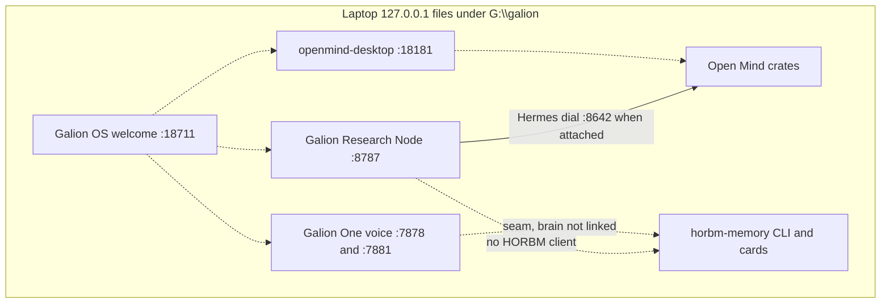

# Deep dive

Phase 2 reading for Galion OS. The short map is [../STACK-MAP.md](../STACK-MAP.md). A claim here cites a path in one of the commits below. **UNVERIFIED** means those trees do not show it. These files copy no secrets, tokens, or server addresses.

The operating system is named Galion OS. On a voice call the owner said "Battalion operational system". That phrase means Galion OS. It is not a second product name. A search of the cloned trees found no product document that uses it. The only hit was a tokenizer vocabulary token inside a voice-clone scorer, not a name for this system.

## Laptop decision

Processes for this work run in Rust on `127.0.0.1` on the owner's laptop. Laptop files stay under `G:\galion\`. The Titanaxe VPS is out. The owner also called that host Titan X. It expired. This set does not put a Titanaxe box in the diagrams. Files that still name a VPS, RunPod, ngrok, or cloudflared are listed in [../STACK-MAP.md](../STACK-MAP.md). Addresses from those files are not copied here.

Galion OS does not start the other processes. `galion-init` keeps a boot plan in memory. Several pieces are still Node, Python, or an unlinked seam. Those gaps are in the files below and in the stack map.

The owner says the two apps currently in use are Galion Research and Galion One. Galion App is an older secondary tree. The static `site/` pages and the private `galion-app` repository stay documented in the stack map. They are not those two apps.

## Commits read

| Repository | Commit |
| --- | --- |
| `galion-operating-system` | `3a347933d49a7fb66d6f01f2a98323e6f24ee1f0` (merge of the stack map; Galion OS sources are the tree that merge contains) |
| `obsidian-open-mind` | `d7ddf67686fe3c847fcaf10f4ca1c582fbe50bcb` |
| `hermes-research` | `13ff29389c7d7528d7c3d3a667a7abb9e7153081` |
| `galion-one-voice` | `c7179d1b6cd346aa6a9130e4694656143472b46b` |
| `galion-knowledge` | `761a7f225304fc010379219e5b88c6669dd48f40` |

The Open Mind crate index was measured at `de7480e71ce98191d2ee11f018fa15be6c5a1707`. The Pi 5 symphony job still pins `b26ad02e` and `74f9a707`. Those are not the heads above.

An Ubuntu-on-G installer was not in these commits. This set does not add one and does not edit installer files.

## Files

| File | What it covers |
| --- | --- |
| [galion-os.md](galion-os.md) | Galion OS architecture, binaries, boot, desktop handoff, Ubuntu and WSL evidence |
| [openmind-stack.md](openmind-stack.md) | Obsidian Open Mind, the desktop, and every workspace package in the crate index |
| [symphony.md](symphony.md) | Three different uses of "symphony": Galion OS Pi 5 job, Galion One voice, Galion Research |
| [hermes.md](hermes.md) | Hermes in Research, in Galion One, and in Open Mind, with config paths and no secrets |
| [galion-research.md](galion-research.md) | The research desk: app, backend, uploads, local retrieval, HORBM tie-in |
| [horbm.md](horbm.md) | HORBM, the card loader, the diagram, and the voice seam |
| [GLOSSARY.md](GLOSSARY.md) | Names that collide |

## How the pieces sit on the laptop

Solid lines are calls present in the source that was read. Dotted lines are a launch Galion OS does not perform, a planned desktop row, or a client that is absent. There is no Titanaxe box in this diagram.
