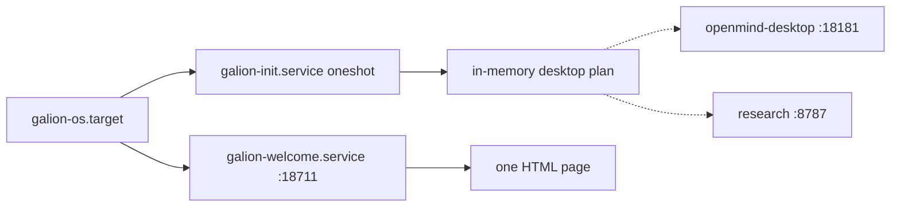

# Galion OS

Read from `galion-operating-system` at `3a347933d49a7fb66d6f01f2a98323e6f24ee1f0`. The operating system is named Galion OS. On a voice call the owner said "Battalion operational system". That phrase means Galion OS.

Laptop decision, restated: Rust processes on `127.0.0.1`, laptop files under `G:\galion\`. The Titanaxe VPS is out. The owner also called that host Titan X. It expired.

## What the tree is

Galion OS in this repository is a seed, a welcome page, a status tool, static site pages, and notes. It is not a disk image and it does not start Open Mind, Galion Research, or Galion One. `docs/PI5-SEED.md` says the seed tarball is `galion-os-pi5-seed-<sha>.tar.gz`, Raspberry Pi OS stays the host OS, and systemd remains PID 1.

The dotted lines are ports recorded in the plan. The init binary does not bind them and does not start those processes (`galion-init/src/handoff.rs`, `galion-init/README.md`).

## Binaries

The crate is `galion-init/` (`galion-init/Cargo.toml`). The package description says it does not replace the host init.

| Binary | Source | What it does | What it refuses |
| --- | --- | --- | --- |
| `galion-init` | `galion-init/src/main.rs` | Prints a voice or desktop plan. `walk` steps the desktop plan in memory. | PID 1 exits 2. `--execute` exits 2 (`cli.rs` `REFUSE_EXECUTE`). The model does not fork, bind, mount, or spawn (`src/lib.rs`, `src/supervise.rs`). |
| `galion-welcome` | `galion-init/src/bin/galion-welcome.rs` | Serves one HTML page and stays in the foreground for systemd. | PID 1 exits 2. Non-loopback sockets are refused. Default port `WELCOME_PORT` is 18711 (`src/welcome.rs`). `GALION_WELCOME_PORT` can override it. |
| `galion-core` | `galion-init/src/bin/galion-core.rs` | Prints `Galion OS. I'm here.\n` and exits. A failed step prints `Galion OS. This step did not finish.` | Opens no socket. |
| `galion-status` | `tools/galion-status/` | Loopback status screen for the ports in `docs/ARCHITECTURE.md`. | `--execute` exits 2. It dials `127.0.0.1` only and does not start services. |

`docs/PI5-SEED.md` says the Pi 5 seed ships `galion-init` and `galion-welcome`. `galion-voiced` and `galion-probe` are not in that seed. `packaging/pi5/install.sh` adds `galion-core.service` only when `/opt/galion/bin/galion-core` is already there. `/opt/galion` is the seed's install prefix. It is not the laptop path. On the laptop, files for this work stay under `G:\galion\`.

`galion-init/prototype.sh` is the shell prototype of the same plans.

### Modules

| File | Role, from the module comment |
| --- | --- |
| `src/lib.rs` | In-memory boot model. Welcome HTML is rendered here. This library does not bind. |
| `src/cli.rs` | Parses `voice`, `desktop`, `walk`, and `--silence`. Refuses `--execute`. |
| `src/boot.rs` | Boot orders and phases. Recording a phase does not perform it. |
| `src/early.rs` | Ordered early desktop steps, recorded only. No host calls. |
| `src/handoff.rs` | Desktop console port 18181, research port 8787, path `/one`. Records a host class. Stores no address literal. Port 18081 is named unused. Probe port 18080 is not the handoff. |
| `src/supervise.rs` | In-memory supervisor. No fork and no `systemctl`. |
| `src/tone.rs` | Planned 432 Hz boot tone. Returns no samples. |
| `src/welcome.rs` | Page text in, HTML out. |

The welcome page embeds `site/assets/tokens.css` and does not load a font, a script, or any other host (`galion-init/README.md`). When Research is up, the name links to `http://127.0.0.1:8787/`. When Open Mind is up, the name links to `http://127.0.0.1:18181/`. Until those units exist, the page says they are not on the machine (`docs/PI5-SEED.md`).

## Boot

`packaging/pi5/galion-os.target` wants `galion-init.service` and `galion-welcome.service`, and is wanted by `multi-user.target`.

`packaging/pi5/galion-init.service` is a oneshot. `ExecStart=/opt/galion/bin/galion-init desktop`. `User=galion`.

`packaging/pi5/galion-welcome.service` is a simple service. `ExecStart=/opt/galion/bin/galion-welcome`. `User=galion`. The unit comment says port 18711 on the IPv4 loopback interface.

`packaging/pi5/install.sh` runs as root, checks `SHA256SUMS`, copies binaries to `/opt/galion/bin/`, copies units to `/etc/systemd/system/`, creates the system user `galion` with a nologin shell, and enables `galion-os.target`. `GALION_SYSROOT` installs into a directory without starting the target. That prefix is the Pi seed layout. A laptop copy of this work uses `G:\galion\`, not `/opt/galion`.

`packaging/pi-seed.sh` packs the aarch64 static binaries. `docs/PI5-SEED.md` says the aarch64 binary is smoke-run under qemu-user. The smoke run is `galion-init desktop` (exit 0, print the plan) and `galion-init --execute` (exit 2, print no plan). A runner check is not a Raspberry Pi 5 result. `docs/PI5.md` says `scripts/pi5-flash-check.sh` and `scripts/pi5/board-report.sh` have not been run on a Pi 5.

## Desktop

This repository does not build `openmind-desktop`. The binary lives in `obsidian-open-mind`. See [openmind-stack.md](openmind-stack.md).

The Pi 5 symphony job is a different thing from the voice symphony. It is documented in [symphony.md](symphony.md). The unit this job installs is `scripts/symphony/openmind-desktop.service`: `openmind-desktop --listen 127.0.0.1:18181 --stack off` as user `galion`. `--stack off` is the Open Mind flag that does not open an upload client. The pins in `scripts/symphony/pins.sh` are still `DESKTOP_SHA=b26ad02e1b1e9084815bb56d3aff9a02888ca8d8` and `RESEARCH_SHA=74f9a7071f1c9672c1fe83e8e96f70e6cbb17318`. The heads read for the deep dive are newer (`d7ddf676` and `13ff2938`).

`desktop/install.sh` only searches XDG paths for desktop entries and icons. Its comment names Raspberry Pi OS Bookworm and Ubuntu. It is not an OS installer.

## Ubuntu and the G: drive

Three different Ubuntu notes exist. None of them is an installer that places Ubuntu on `G:\`.

1. `docs/PACKAGING.md` decides the desktop image base is Ubuntu 26.04 LTS, with that release's kernel and firmware, a squashfs root, Node from `/usr/bin/node`, and `unattended-upgrades` off. The same note says the image still waits, and this change adds no image workflow. `packaging/README.md` says `--build`, `--flash`, and `--publish` exit 2. No ISO is published from the files read here.
2. `galion-one-voice` `voice-stack/linux-package/README.md` at `c7179d1b` is a user install of the Samantha companion for Ubuntu, WSL, and a Galion OS image that runs systemd. It is its own Cargo workspace. The supervisor is loopback, ticks every 80 ms, and reports whether public Vosk and Piper files are on disk. HORBM is not linked. `POST /turn` returns 501. Default paths are `~/.local/bin/galion-samantha`, `~/.local/share/galion/samantha/models/`, and `~/.config/systemd/user/galion-samantha.service`. The note says WSL needs systemd enabled in `/etc/wsl.conf` before `systemctl --user` works, and the script does not edit that file. `--dry-run` writes nothing. Those home paths are what the script writes today. They are not the laptop rule. A laptop layout for this work is `G:\galion\`.
3. `voice-stack/windows-install/README.md` in the same voice commit puts large Samantha files under `G:\galion\samantha` and says `C:` is not used for models, the Cargo registry, or build output. `hermes-research` `scripts/laptop-ci/research-e2e.ps1` at `13ff2938` is installed as `G:\galion\ci\research-e2e.ps1`, reads a mirror at `G:\galion\work\repos\hermes-research`, and logs to `G:\galion\logs\ci\hermes-research-e2e.log`.

Inside this Galion OS repository, the string `wsl` appears in VM detection lists in `scripts/pi5/board-report.sh`, `scripts/pi5-flash-check.sh`, and `scripts/symphony/guest-run.sh`. Those scripts are not an Ubuntu-on-G installer.

**UNVERIFIED:** the contents of any Ubuntu-on-G installer that is not in the commits above. This file does not add installer scripts.

The voice README at `c7179d1b` says the development machine for that program is a WSL Ubuntu laptop with an NVIDIA GeForce RTX 4060 (8 GB) and CUDA. That sentence is a machine description in that README. `docs/galion-voice-v2/symphony/CPU.md` in the same repo says the symphony runs CPU only, no GPU, and that its tables were not measured on that host. The laptop decision for this work stays CPU, loopback, and `G:\galion\`.
