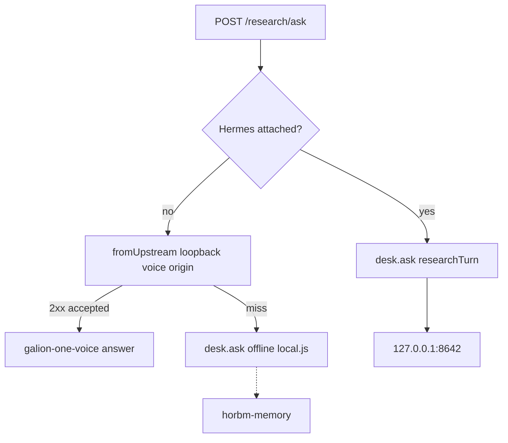

# Galion Research

Repository `galion-studio/hermes-research` at `13ff29389c7d7528d7c3d3a667a7abb9e7153081`. The README calls it a PhD-level research workspace for `research.galion.app`, separate from Galion One, with its own memory, and not a copy of the One page.

Laptop decision, restated: the target is Rust on `127.0.0.1` with files under `G:\galion\`. This desk is Node. That is a gap. The Titanaxe VPS, also called Titan X by the owner, is out.

The dotted line is absent. A search of this repository found zero `horbm` matches. The branch is the code in `src/server.js` around the `/research/ask` handler and `src/desk.js` `run`.

## App and backend

Language: Node.js `>= 22` (`package.json` `engines`). The root `package.json` has no `dependencies` field. `npm start` is `node src/server.js`. `e2e/package.json` has Playwright dev dependencies for tests (`@playwright/test` 1.65.1 and `@axe-core/playwright` 4.14.0). There is no Rust server in this repository.

`src/server.js`: `BIND_HOST = "127.0.0.1"`, `DEFAULT_PORT = 8787`. `PORT` changes the port only. The host argument cannot move the bind. `GET /health` body is `{"ok":true,"service":"galion-research","bind":"127.0.0.1"}`. The README says that probe sets no cookie, is not counted by the rate limit, and does not dial Hermes or a research origin.

The page is served by this process. Ultra at $220 / €220 is copy in the README. The README says that line is not a checkout. Ink, Ice, Sky, and Ocean are named as colours. Silence and `?silence=1` keep the 432 Hz cues quiet. Those cues are definitions in `src/cues.js`.

`GET /one` redirects to `GALION_ONE_URL` or, by default, `https://galion.app/one` (`oneTarget` in `src/server.js`). `.env.example` sets `GALION_ONE_URL=https://galion.app/one`. That default leaves the machine. A localhost run needs a loopback `GALION_ONE_URL`. The README says this repo does not draw the One dot.

### Ask path

`POST /research/ask` takes `{ "question": "..." }`. The JSON shape the README names is `galion-research/1`: `status`, `reply`, `citations` as `{ "n", "text" }`, plus `found`, `inferred`, and `unknown`.

Order for `POST /research/ask` in `src/server.js`, then `src/desk.js` `run`:

1. If Hermes is not attached, `fromUpstream` posts the question to the voice origin. `GALION_VOICE_URL` wins when it is set. Otherwise `GALION_RESEARCH_URL` is the legacy name. `loopbackOrigin` accepts `http` on a loopback host and refuses anything else. A unit test asserts `https://galion.app` is `refused` and that the forward is null. A 2xx body that passes `acceptedJson` is the answer. `GET /research/hermes` and `GET /research/history` use the same upstream helper.
2. If Hermes is attached, that upstream call is skipped (`proxied` is null).
3. Otherwise `desk.ask` runs. When Hermes is not attached, `run` returns the offline local result. When Hermes is attached, `run` calls `researchTurn` on the loopback gateway. See [hermes.md](hermes.md).

When the voice origin is unset, refused, or down, and Hermes is not attached, the desk continues from local knowledge and marks the answer `Offline`. Citations stay empty. If a response body would contain the gateway key, the handler replaces it with `localKnowledge("")` and empty citations.

The README still says to set `GALION_RESEARCH_URL` to `https://galion.app` for the live page. The forward function refuses that origin. `.env.example` leaves `GALION_RESEARCH_URL` commented out.

`GALION_OPENMIND_URL` is a separate loopback origin. `OPENMIND_PORT` in `src/forward.js` is 18181, the desktop listen port. `loopbackOrigin("http://127.0.0.1:18181")` is accepted by the unit test.

Limits in the README: a request body over 32768 bytes, or a question over 2000 characters, is `413`. An empty question or a non-JSON body is `400`. An unknown path is `404`. The wrong method on a known path is `405`. More than 30 questions, or more than 240 requests, from one session in 60 seconds is `429`. `GET /health` is not one of those requests. `GALION_ASK_RATE` and `GALION_RATE_LIMIT` override the two caps. Those responses use the same JSON shape with empty citations. The README says the reply is the limit, not an answer, and the question is not stored.

Timeouts are in [symphony.md](symphony.md). They are client deadlines, not a measured voice latency.

The research README says the desk does not invent a paper, a URL, a date, or a measurement. The same rule is in the prompt string in `src/hermes.js`.

## Uploads

`src/uploads.js`:

| Constant or rule | Value |
| --- | --- |
| `EXCERPT_BYTES` | 1024 |
| `HANDED_BYTES` | 32 * 1024 |
| Type list | none. The header comment says any name, including a dotfile. |
| Size cap | none in that comment. The README agrees. |
| Directory | `GALION_UPLOAD_DIR` when it resolves outside the repo. Otherwise `tmpdir()/galion-research-uploads`. |

The turn hears the name, the size, and a short text prefix. The README and `docs/swarm-9/2026-11-15/research/uploads.md` say that prefix is not a citation. Citations are not invented from the file.

On the laptop, point `GALION_UPLOAD_DIR` at a directory under `G:\galion\`, outside the git checkout. This file does not create that directory.

## Retrieval

Two different stores get called "memory" in the notes. Only one of them is in this process.

### Local facts in the desk

`src/local.js` is what an offline answer may say. The comment says offline answers use only these lines and a citation is never added here. `localKnowledge` returns `citations: []`. The fact strings match a few question shapes:

| Question shape | String the function can return |
| --- | --- |
| who / what are you, or the research name | Galion Research is a PhD-level workspace, separate from Galion One, with its own memory. The same string says "Built in Rust". |
| galion one | The two products are different. The desk can hand a voice across. It is not a copy of the One page. |
| price | Ultra is $220/€220 per month. |
| citation | A citation is named only when a source was handed to this desk. |
| colour words | Ink `#0B0F14`, Ice `#B8E8FF`, Sky `#58C4FF`, Ocean `#0B5FA5`. |
| hermes or the gateway key | The engine runs on this machine. The key stays in the server environment. |

The "Built in Rust" words are a canned sentence in `src/local.js`. The process that serves them is `node src/server.js`. The Rust crates named `hermes-rs` and `hermes-gateway` live in `obsidian-open-mind`, not in this repo.

The README's offline paragraph says what this process already knows is the voice, the price, the palette, and the connection to Galion One. A local line is labelled `Local` in that session's sources. It is not a citation.

### HORBM

This server does not import `horbm-memory` and does not read `G:\galion\horbm\`. The link the other way is a string inside `galion-knowledge` at `761a7f22`: `advice_for` in `v2/memory/src/stack.rs` returns the label `ask_galion_research` with the text "Ask Galion Research. Write a card for this query." when an index is loaded and nothing nearer was found, and "Ask Galion Research. No knowledge index is loaded." when the index is not loaded. That is advice text. It does not open a socket to port 8787.

A persona card `v2/data/cards/horbm/horbm-persona-galion-research.json` is in the knowledge repo. The research server does not load it.

`v2/docs/MEMORY_STACK.md` says the crate is what HORBM and Galion Research search. That sentence is in the knowledge repo. The research server has no matching client. See [horbm.md](horbm.md).

## Laptop paths and deploy

`scripts/laptop-ci/research-e2e.ps1` uses `G:\galion\work\repos` as the mirror, installs itself as `G:\galion\ci\research-e2e.ps1`, keeps state under `G:\galion\ci\state\`, and logs to `G:\galion\logs\ci\hermes-research-e2e.log`. The script header says it uses a scratch clone, WSL Node 22, a stub Hermes on `127.0.0.1`, no paid calls, and it does not push.

Deploy scripts that refuse `--execute`, by path: `scripts/deploy/release-dryrun.sh`, `scripts/check-health.js`, and `scripts/pi-seed/build.js`, `lib.js`, `pack.js`, `smoke.js`. The Pi 5 seed is one executable of the same desk (`docs/PI5-SEED.md` in that repo). Nothing in those scripts, as read here, changes DNS.

`/opt/galion/research/current` is the systemd working directory in `deploy/systemd/galion-research.service`. For this laptop, the checkout and the upload directory stay under `G:\galion\`.

## Gaps against the laptop decision

1. The desk is Node, not Rust. `galion-init` does not start it.
2. Default `GET /one` leaves the machine.
3. The README's public `GALION_RESEARCH_URL` is refused by the forward code, so the sentence and the function disagree.
4. There is no client from this desk into HORBM.
5. Offline "Built in Rust" is a fact string, not the runtime of this process.
6. Unit files still use `/opt/galion` and `/etc/galion`.
