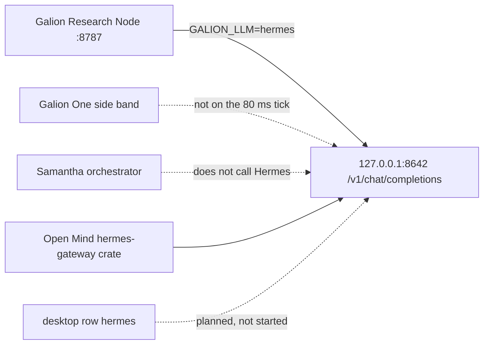

# Hermes

Hermes is a loopback chat gateway and a set of crates that talk to it. It is not a second research desk and not the HORBM brain. No key, token, or server address is copied here. Config is cited as paths and variable names.

Laptop decision, restated: Rust on `127.0.0.1`, files under `G:\galion\`. The Titanaxe VPS, also called Titan X by the owner, is out. Units that still use `/opt/galion` or `/etc/galion` are the layouts in those files. They are not the laptop paths for this work.

The research arrow is the client in `hermes-research` `src/hermes.js` at `13ff2938`. The Open Mind crates that can serve or snap that API are in `obsidian-open-mind` at `d7ddf676`. This map did not start the gateway.

## What the research desk calls

`hermes-research` `src/hermes.js`:

| Item | Value in that file |
| --- | --- |
| Default URL | `http://127.0.0.1:8642/v1/chat/completions` |
| Other hosts | `parseLoopbackChatUrl` returns null. The turn is refused. The key is not sent off the machine. |
| Attach | `GALION_LLM=hermes`, or a set URL with no mode |
| Stay off | `canned`, `echo`, `mock` |
| Model | `GALION_LLM_MODEL`, default `hermes-agent` |
| Timeout | `GALION_LLM_TIMEOUT_MS`, default 3000, clamp 50 to 95000 |
| Key | `GALION_LLM_KEY`, or `GALION_LLM_KEY_FILE` plus `GALION_LLM_KEY_NAME` |

Responses say the key is `set` or `none`. The README says the key stays on the server and is never written into a response. A bare filename for the key file is read from `CREDENTIALS_DIRECTORY` when that directory is absolute. A relative path is ignored. This file does not print a key value and does not name a secret that was found in a file.

The research README says the engine crates are still named `hermes-rs` and `hermes-gateway`. Those Rust crates are not in the Node repository. They are in Open Mind, below. The desk does not start the gateway.

When Hermes is attached, the question goes to that loopback gateway. Citation lines are the `[n]` lines the model returned. If there is no source, the reply says so and the citation list stays empty (`hermes-research` README). The prompt in `src/hermes.js` tells the model not to invent a paper, a URL, a date, or a measurement.

## Where Research config lives

Paths only.

| Path | Role |
| --- | --- |
| `hermes-research/.env.example` | Example variable names. `GALION_ONE_URL` is set to `https://galion.app/one` in that example. `GALION_RESEARCH_URL` is commented out. |
| `hermes-research/deploy/research.env.example` | Host copy of the same idea. |
| `hermes-research/deploy/systemd/galion-research.service` | `WorkingDirectory=/opt/galion/research/current`. `EnvironmentFile=-/etc/galion/research.env`. |
| `hermes-research/deploy/systemd/galion-research-pi5.service` | `ExecStart=/opt/galion/research/current/galion-research`. |
| README `LoadCredential` example | `hermes-env:/opt/galion/hermes/.env`, with `GALION_LLM_KEY_FILE=hermes-env` and `GALION_LLM_KEY_NAME=API_SERVER_KEY`. The README says that path is not in the committed unit. |

`/opt/galion` and `/etc/galion` are the unit layout. For the laptop, keep env files under `G:\galion\`, for example a private file under `G:\galion\hermes\` that is not committed. This document does not create that file and does not read one.

`src/forward.js` is a different client. It forwards research routes to a galion-one-voice origin only when that origin is loopback `http`. `https://galion.app` is refused (`test/unit/forward.test.js`). The README still tells an operator to set `GALION_RESEARCH_URL` to `https://galion.app` for the live page. The sentence and the function disagree. See [galion-research.md](galion-research.md).

## How Galion One uses it

`galion-one-voice` at `c7179d1b`.

`crates/galion-openmind/src/handoff.rs`: `CortexHandoff::offer` goes to a `galion-sideband` thread. The comment says it must not be called from `Heartbeat::step`. The poll cap named in that area is `RETRIEVAL_CAP` of 3 seconds. `docs/galion-voice-v2/OPENMIND-NERVE-CORTEX.md` calls Hermes the analytical side band.

`voice-stack/pipeline-orchestrator` does not call Hermes. `voice-stack/ARCHITECTURE.md` says the Samantha stack does not call Hermes. A phone lane `GALION_LLM=hermes` is a different process. The stage unit template is cited from that architecture note as `deploy/systemd/templates/galion-voice-stage.service`. The gateway port 8642 is also named in `voice-stack/ARCHITECTURE.md`.

`GALION_NERVE_URL` is a separate dial, numeric loopback only, example `http://127.0.0.1:8670`. Unset, the seam posts nothing. That is nerve, not Hermes.

## Open Mind crates and the desktop row

`obsidian-open-mind` at `d7ddf676`. Index descriptions at `de7480e` (`docs/crate-index.md`):

| Crate | Index description, shortened to the role |
| --- | --- |
| `hermes-rs` | Rust port of the parts of hermes-agent the stack uses: OpenAI-compatible API, agent loop, sessions. |
| `hermes-gateway` | The Rust Hermes API server binary. |
| `hermes-tools` | Sandboxed coding tools through `openmind-sandbox`. The index says git push is not one of them. |
| `hermes-bench` | Benchmark adapters. The index says local mock and paper only. |
| `desk-hermes` | Rust port of a mind snap. The index says it was a Python program under `/opt/galion/bin/`. |
| `link-watch` | Link watcher. `docs/bind-defaults.md` says it dials Ollama at `http://127.0.0.1:11434` and Hermes at `http://127.0.0.1:8642`. It does not listen. |

The desktop row `hermes` is `planned` in `crates/openmind-desktop/src/stack.rs`. The page does not start it. Look probes can dial 8642. That probe is not the gateway process.

`deploy/staged/hermes-rs.service` has no `[Install]` section. The comment says it is a proposal and nothing in production points at it. The same comment mentions a mock flag until a paid shadow is approved. This deep dive did not enable that unit.

`stack/hermes/SOUL.md` is inside the 2026-10-18 VPS file copy (`stack/INDEX.md`). It still talks about a TitanAxe server. It is not the laptop config. The address in that tree is not copied here.

## What is not Hermes

HORBM does not call this gateway. `galion-knowledge` `v2/docs/MEMORY_STACK.md` says `horbm-memory` does not call an API model. The research server has no `horbm` string, so the desk does not ask HORBM to stand in for Hermes either. See [horbm.md](horbm.md).
