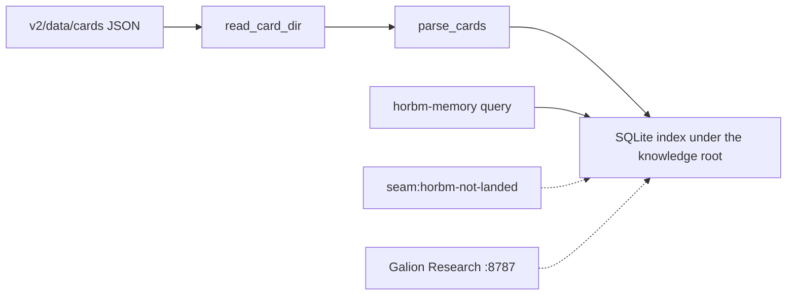

# HORBM

Written name in the repositories: HORBM. On a voice call the owner said "HRRVM". A search of the cloned trees found no `HRRVM` string. No second expansion is invented here.

Repository `galion-knowledge` at `761a7f225304fc010379219e5b88c6669dd48f40`. The voice seam is `galion-one-voice` at `c7179d1b6cd346aa6a9130e4694656143472b46b`.

Laptop decision, restated: Rust on `127.0.0.1`, files under `G:\galion\`. The Titanaxe VPS, also called Titan X by the owner, is out. The runnable Rust piece is `horbm-memory`. It is a library and a CLI. It does not listen on a port in the files read here. The retrieval brain crate named `horbm` is not in either tree.

The seam and the research desk do not call the loader. `import` and `rebuild` do.

## Names

| Form | Where |
| --- | --- |
| Heuristic Open Retrieval Brain Models | `v2/src/horbm/interactive/horbm.json` lead, `v2/docs/HORBM_INTERNAL.md` |
| Heuristic Open Retrieval Brain Model | `v2/src/horbm-layers.njk`, `v2/docs/HORBM_CARDS_OUTLINE.md` |

`HORBM_CARDS_OUTLINE.md` says HORBM is Galion's retrieval-based, non-LLM brain, and that the lane is `v2/data/cards/horbm/` only.

The owner's decision for this map: existing cards are read-only, core knowledge-base development is paused, and the core will be built later with external APIs. That decision is the owner's. No `paused` switch was found in the crate. `import_dir` and `rebuild_dir` still write an index. `v2/docs/MEMORY_STACK.md` says the crate does not call an API model. Which external APIs would be used later is **UNVERIFIED**. The crate names none.

## What is on disk

Counted with `find` on `v2/data/cards` at `761a7f22`:

| Directory | JSON files |
| --- | --- |
| `v2/data/cards/horbm` | 90 |
| `v2/data/cards/world` | 1416 |
| Total | 1506 |

`v2/docs/HORBM_INTERNAL.md`, note dated 18 November 2026, says the HORBM cards are a seed for how the brain talks, and that the note does not design the retriever, ranker, diary, or mouth. Card status in that note was `sourced - needs review` or `draft`. Nothing in that note was `published`. Categories named there: conversation, honesty, affect, persona, culture, safety, memory.

`v2/docs/MEMORY_STACK.md` says the target size is about 50,000 to 200,000 cards, not 100 million. `v2/docs/CORE_PACK.md` says that band is the owner's target for the core, not a count of cards that exist, and that the first tranche in that pull request is 133 cards. 133 is the tranche that document describes. It is not the 1506 JSON files counted above. The two numbers are different counts in different files.

## Card loader

Crate `v2/memory`, name `horbm-memory`, version 0.1.0, `rust-version` 1.83, `rusqlite` bundled, binary `horbm-memory` (`v2/memory/Cargo.toml`). The README says memory (what the user told the system) and knowledge (world cards) stay in two lists. A query returns at most four hits. A miss on the cards answers `I don't know`.

| Symbol | File | Role |
| --- | --- | --- |
| `read_card_dir` | `v2/memory/src/stack.rs` | Walks a directory, collects `.json` files, sorts them, reads each file as text, parses JSON. |
| `collect_json` | same file | Recurses into subdirectories. Keeps files whose extension is `json`. |
| `parse_cards` | `v2/memory/src/card.rs` | Turns one JSON value into cards. `read_card_dir` calls it for every file. |
| `Stack::import_dir` | `stack.rs` | Calls `read_card_dir`, then `import_cards` with `force` false. Same content is a no-op. |
| `Stack::rebuild_dir` | `stack.rs` | Same read, then `import_cards` with `force` true. The comment says the index is rebuilt even when every hash matches. |
| `Stack::import_cards` | `stack.rs` | Writes the core pack and the shards. Changed content appends the previous document to the revision archive. A card that left the set is archived the same way. |
| `Stack::query` | `stack.rs` | Returns a `QueryResponse`. `MAX_HITS` is 4 (`v2/memory/src/store.rs`). |
| `ANSWER_UNKNOWN` | `stack.rs` | `"I don't know"`. |
| `advice_for` | `stack.rs` | Can return the label `ask_galion_research`. That string is not an HTTP client. |

Default database in the CLI help and `take_db` is `./horbm-memory.sqlite`. The README's examples use `/tmp/horbm-knowledge` and `/tmp/horbm.sqlite`. Those are the README's examples. For the laptop, the voice bridge already names `G:\galion\horbm\memory.db`, `G:\galion\horbm\knowledge`, and `G:\galion\horbm\cases` (`voice-stack/horbm-bridge/README.md`). This deep dive does not create those directories and does not run `import`.

`import_cards` writes. That is why the owner's read-only rule is not what the CLI does today. A read-only laptop use is `query` against an index that already exists, without `import` or `rebuild`. The crate does not enforce that.

## Diagram

`v2/src/horbm/interactive/horbm.json` version 1.2.0, `updated` `2026-11-19T18:54:00+01:00`. The interactive README says the numbers shipped on 19 November 2026 are a starting snapshot, not a live formula, and that no agent or pull request was assigned. Chip status `B` means Built, `A` means Accepted, `R` means Recommended, `C` means If needed. "Built" on a chip is a label in this JSON. It is not a linked brain in `galion-one-voice`.

| n | Title | Snapshot state | Percent in that JSON |
| --- | --- | --- | --- |
| 0 | North star (guide, not a step) | planned | 25 |
| 1 | Voice and senses | in progress | 38 |
| 2 | Persona and inner life | in progress | 38 |
| 3 | Empathy | planned | 25 |
| 4 | Dialogue manager and policy | in progress | 38 |
| 5 | Core chat engine | in progress | 50 |
| 6 | Skills | in progress | 38 |
| 7 | Memory and relationship | in progress | 63 |
| 8 | Knowledge and truth | in progress | 75 |
| 9 | Safety and ethics | planned | 25 |
| 10 | Evals and metrics | planned | 25 |
| 11 | Machines and infrastructure | in progress | 38 |

The lead calls this twelve layers. The objects above are `n` 0 through 11. The admin board `/horbm/interactive/admin/` is read-only: no token and no edit control. That is the diagram board. It is not the card writer.

The V2 site is Eleventy. The knowledge README says the V1 Next.js app in `src/` stays the live app until V2 is deployed. `cd v2 && npm run dev` uses port 3016. `python3 serve.py` binds 3015 for the built static site. The truth gate is Rust, `v2/tools/truth-gate`. The diagram check is Rust, `v2/tools/horbm-diagram`. The site itself is not the Rust launcher.

## How Galion One and Research plug in

Galion One, Samantha path, package `galion-sam-horbm` in `voice-stack/horbm-bridge`:

- `FakeEngine` is the stand-in. `say` stays on it when the HORBM env vars are unset.
- Feature `horbm` links `seam/horbm`. The README says Cargo 1.83 resolves that optional path even when the feature is off, so a missing `../../horbm/crates/horbm/Cargo.toml` fails `cargo test`. `build.rs` warns if that landing file appears.
- `seam/horbm/src/lib.rs` returns source `seam:horbm-not-landed` and an empty line.
- The tick is empty. The README says `horbm` has no tick in the brief.
- `voice-stack/local-server/PROTOCOL.md` says that with no brain linked the turn error is `brain-unlinked` and the resting pad is arousal 0.3, valence 0.25, dominance 0.5.
- `voice-stack/pipeline-orchestrator` names this knowledge revision `761a7f225304fc010379219e5b88c6669dd48f40` and does not fetch it.

`galion-openmind` does not call HORBM. It posts to nerve only when `GALION_NERVE_URL` is set.

Research: zero `horbm` matches in `hermes-research` at `13ff2938`. The persona card is `v2/data/cards/horbm/horbm-persona-galion-research.json` in the knowledge repo. The research server does not load it. The gap string `ask_galion_research` does not open port 8787.

`voice-stack/linux-package/README.md` also says HORBM is not linked and `POST /turn` returns 501.
