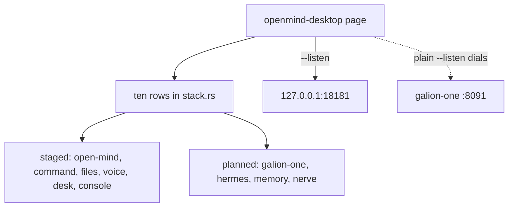

# OpenMind stack

Repository `galion-studio/obsidian-open-mind` at `d7ddf67686fe3c847fcaf10f4ca1c582fbe50bcb`. The README's short name is Open Mind. Crate names are `openmind-*`. It is a Rust workspace for a CPU box. It is not the Obsidian note app. The README says the processor runs the loop and keeps the memory and the keys, a GPU is one more provider row, and heavy model inference is sent to external providers. The banner alt text says "Rust on CPU." The README's status stamp still names `de7480e` as `main`. The checkout read here is `d7ddf676`.

Laptop decision, restated: Rust on `127.0.0.1`, files under `G:\galion\`. The Titanaxe VPS, also called Titan X by the owner, is out. The directory `stack/` is a copy of files from a remote host. It is not this component list, and its addresses are not copied here.

The inventory below is `docs/crate-index.md` as revised against git `de7480e71ce98191d2ee11f018fa15be6c5a1707`. That file says `cargo metadata --locked --offline` returned 75 packages and 75 workspace members. `main` is now `d7ddf676`. This deep dive did not re-run `cargo metadata`. Descriptions are the index's `description` field, not a runtime test.

## Workspace

Root `Cargo.toml` members are `crates/*`, excluding `contrib` and `vendor`. There is no `rust-version` in that manifest and no `rust-toolchain.toml`. The README says a 1.83 toolchain failed on `galion-common` and a local desktop build used rustc 1.100.0.

`edge/openmind-node` is outside the workspace. Its own manifest describes the binary `omnode`. The index copies that description, which still says "Obsidian Open Mind Stack". The index says the brand spelling in prose is "Open Mind".

`openmind-schema` (`crates/openmind-schema`) is the contract crate. The index description says the processor runs the stack and the card only runs the model.

The page does not start the planned rows. Plain `--listen` still dials `127.0.0.1:8091` unless `--stack off`.

## Desktop

Binary `openmind-desktop`, crate `crates/openmind-desktop`.

| Constant | Value | File |
| --- | --- | --- |
| `DEFAULT_PORT` | 18181 | `src/lib.rs` |
| `DEFAULT_BIND` | `127.0.0.1:18181` | `src/lib.rs` |
| `PORT_ENV` | `OPENMIND_DESKTOP_PORT` | `src/lib.rs` |
| `DEFAULT_STACK` | `127.0.0.1:8091` | `src/files.rs` |

Port 18081 is named as the staging page beside the console on 18080. The desktop does not bind 18081. A non-loopback listen address is refused before the socket opens. The content-security policy in `src/page.rs` includes `connect-src 'self'`. Tests assert the `/one` and `/research` entry pages contain no `https://` URL. Those pages are not the research desk and not Galion Voice.

`src/cli.rs` says `--stack off` does not open a client. If `--stack` is omitted on a listen, the default is `DEFAULT_STACK`.

`src/stack.rs` `LAYERS` at `d7ddf676`. States are `staged` (built, not switched on) or `planned` (not started by this page). Nothing is marked live. The test is `open_mind_leads_and_nothing_is_live`.

| id | state | role in `stack.rs` |
| --- | --- | --- |
| open-mind | staged | Main presence on this desktop |
| command | staged | Centre field. Text stays on this page |
| files | staged | Plus picks files. Read and upload stay on loopback |
| voice | staged | Opt-in microphone on loopback. Audio is not saved |
| galion-one | planned | Voice surface. Not started by this page |
| hermes | planned | Engine. Not started by this page |
| memory | planned | Long-term store. Not started by this page |
| nerve | planned | Health monitor. Not started by this page |
| desk | staged | Read-only pod endpoint, separate program |
| console | staged | Operator rooms, separate program |

Look probes dial 8670, 8674, 18080, 8642, 8002, 8646, 8420, and 8091 (`src/probe.rs`). Those dials are not listeners inside the desktop process.

`.github/workflows/release.yml` packages `galion-one`, `galion-desk`, `room`, `desk-hermes`, and `link-watch` when the binaries exist. `openmind-desktop` is not in that copy list. `.github/workflows/openmind-desktop.yml` builds the desktop separately.

`deploy/galion-one.service` has no `[Install]` section. The comment says it is not enabled until an approval. This `galion-one` crate is ear, mind, and mouth on ports 8091 and 8002 (`docs/bind-defaults.md`). It is not the Galion One voice app in `galion-one-voice`. See [GLOSSARY.md](GLOSSARY.md).

## Bind defaults

From `docs/bind-defaults.md` at `d7ddf676`.

| Binary | Port | Role |
| --- | --- | --- |
| `galion-one` | 8091 and mouth 8002 | listen |
| `galion-desk` | 8646 | listen. Dials Ollama at `127.0.0.1:11434`. Does not listen on 11434. |
| `link-watch` | 11434 and 8642 | dial only |
| `tuner` | 8650 | listen |
| `room` | 4020 | listen when `ROOM_BIND` is unset, and only with `--listen` |
| `openmind-desktop` | 18181 | listen with `--listen`. Dials 8091. Does not bind 8091. |

`openmind-memory` defaults to port 8420 in `crates/openmind-memory/src/config.rs`. `openmind-nerve` defaults to `127.0.0.1:8670` (`NERVE_ADDR` in `crates/openmind-nerve/src/main.rs`). A crate comment says the nerve binary is live as `galion-nerve.service` on that port. This deep dive did not probe a machine. The desktop nerve row is planned. `crates/openmind-nerve/src/config.rs` still has `KNOWN_PORTS_VPS` and rejects `0.0.0.0`.

## Every workspace package in the index

The table is the index at `de7480e`. A description that says "never", "dry-run", "no network", or "paper" is that crate's own metadata line. It is not a new test run for this file.

| name | version | manifest | description |
| --- | --- | --- | --- |
| bench-banking | 0.1.0 | crates/bench-banking/Cargo.toml | B1 banking benchmark: a local Revolut-shaped mock bank, a local-only client, a draft-only Hermes tool layer and the per-axis scorer. Never talks to a live bank. |
| bench-scoreboard | 0.1.0 | crates/bench-scoreboard/Cargo.toml | Renders docs/bench/SCOREBOARD.md from the B1/B2/B3 galion-bench score JSONs; missing scores stay PENDING. |
| cgroup-detect | 0.1.0 | crates/cgroup-detect/Cargo.toml | Read-only cgroup v2 delegation probe. Reports whether a per-run cgroup is possible. Never creates a cgroup. |
| console-static | 0.1.0 | crates/console-static/Cargo.toml | Production front for the Galion console (B61): serves console-dist/static (or SPA client), optional --local-api health/session gate, Rust UI pages, and proxies remaining /api/* to a loopback upstream. Alias binary: galion-console-serve. |
| console-ui | 0.1.0 | crates/console-ui/Cargo.toml | Server-rendered Rust UI for the Galion console: HTML pages, a CSS sheet generated from Rust, the phone/host gate, and a loopback API client. std only, no JavaScript. |
| desk-hermes | 0.1.0 | crates/desk-hermes/Cargo.toml | Rust port of the desk-hermes mind snap (was /opt/galion/bin/desk-hermes.py) |
| gaia | 0.1.0 | crates/gaia/Cargo.toml | Gaia CLI: wires GAIA core to its nine subordinate functions; status, tick, the deterministic Faro-plague scenario (with --full-power), status --live (read-only) and heal-tick (approval-gated restart of box-local test services, nerve-recorded), JSON out. |
| gaia-aether | 0.1.0 | crates/gaia-aether/Cargo.toml | Gaia AETHER: communications (messaging, nerve, voice relay frame budget, Wi-Fi identity, LAN discovery of private peers, tunnel plans, origin, Zagreb clock). No network I/O. |
| gaia-apollo | 0.1.0 | crates/gaia-apollo/Cargo.toml | Gaia APOLLO: bounded in-memory knowledge archive (memory-gateway, link-watch intake, TEACHER docs, session history, stack schema). No purge without HADES. |
| gaia-artemis | 0.1.0 | crates/gaia-artemis/Cargo.toml | Gaia ARTEMIS: agent population (Hermes agents, boss node, room, spawning, retirement, census) with a hard population cap. |
| gaia-core | 0.1.0 | crates/gaia-core/Cargo.toml | Gaia core: central orchestrator (subordinate-function trait, signal-tower bus, registry, master override, lifecycle, containment, lineage, deterministic ticks). |
| gaia-cortex | 0.1.0 | crates/gaia-cortex/Cargo.toml | Event-driven Gaia cortex: the decision layer above the event-driven nerve. Coalesces event bursts into incidents (openmind-nerve correlate), runs deterministic rules (restart via the nerve allowlist, circuit breaker, protected never-act), alert sink, escalate-to-human queue, optional OFF-by-default LLM advisor with a hard USD budget. Idle = zero work. |
| gaia-demeter | 0.1.0 | crates/gaia-demeter/Cargo.toml | Gaia DEMETER: environment health (survival decide/degrade, non-destructive healer, tuner, config health, guardian-tick cycle, boot units); regrows the world after the swarm. |
| gaia-eleuthia | 0.1.0 | crates/gaia-eleuthia/Cargo.toml | Gaia ELEUTHIA: birth of personas and agents from seed files (Persona Plex, Galion One/Samantha, Gaia seeds) with lineage. |
| gaia-hades | 0.1.0 | crates/gaia-hades/Cargo.toml | Gaia HADES: guarded teardown, rollback, kill switch, heal-apply and secret-rotation PLANS. Dry-run by default; approval token required; never executes or deletes. |
| gaia-hephaestus | 0.1.0 | crates/gaia-hephaestus/Cargo.toml | Gaia HEPHAESTUS: fabrication plans (cargo builds for the UNIVERSAL-CPU targets, release artifacts, sandboxed terminal command review, desk tools, console, deploy switch). Never runs a process. |
| gaia-live | 0.1.0 | crates/gaia-live/Cargo.toml | Gaia live: read-only health of the stack (M1) and an approval-gated, rate-capped restart path for box-local test services that records to the nerve (M2). |
| gaia-minerva | 0.1.0 | crates/gaia-minerva/Cargo.toml | Gaia MINERVA: security audit (repo-check, secret scan), guardian watchdog and alerting, vision decoding, sandbox policy review; cracks the rogue swarm's code. |
| gaia-poseidon | 0.1.0 | crates/gaia-poseidon/Cargo.toml | Gaia POSEIDON: compute resources (VRAM pool, CPU/RAM/disk quotas, bounded queues with backpressure, budget caps). Stand-in or the real openmind-queue backend (read-only for budget, never spends). No real-money access. |
| galion-backup | 0.1.0 | crates/galion-backup/Cargo.toml | Periodic Galion backup (Rust port of galion-backup.sh: SQLite online snapshots, files tar, SHA256SUMS, 0600 tar.gz, rotation) plus the snapshot/verify/schema/migrate-baseline helpers. |
| galion-bench | 0.1.0 | crates/galion-bench/Cargo.toml | Shared benchmark harness: std-only mock HTTP server driven by JSONL fixtures, a std HTTP client, and 0-100 scorecards. Mock-only: never talks to a real bank or broker. |
| galion-boot | 0.1.0 | crates/galion-boot/Cargo.toml | Boot/keep tool replacing keep.sh, stack-boot.sh, persist-boot.sh and hardware.sh: hardware probe, age-bundle secret restore, tunnel env file, systemd unit renderer, plain supervisor fallback, status. |
| galion-chatterbox | 0.1.0 | crates/galion-chatterbox/Cargo.toml | Chatterbox TTS (T3 + S3Gen + HiFT, voice cloning from a reference clip) on candle, CPU only. |
| galion-common | 0.1.0 | crates/galion-common/Cargo.toml | Shared std-only helpers: SHA-256, hex, base64, CPython-compatible JSON escaping, Europe/Zagreb RFC 3339 time and a small hardened HTTP/1.1 server and client. |
| galion-deploy | 0.1.0 | crates/galion-deploy/Cargo.toml | Backup -> atomic install -> restart -> health check -> automatic rollback, for one systemd (or simsup) unit. Rust replacement for deploy/foundation/galion-deploy. |
| galion-desk | 0.1.0 | crates/galion-desk/Cargo.toml | galion-desk: the operator's desk endpoint. Reads the pod, never writes it. |
| galion-feature-pin | 0.1.0 | crates/galion-feature-pin/Cargo.toml | Code-free feature pin (hand-kept workspace-hack): makes `cargo build -p X` and the full release -p set compile shared dependencies with the same features. |
| galion-guard | 0.1.0 | crates/galion-guard/Cargo.toml | Rust SSH ban daemon (replaces the VPS fail2ban sshd jail): journald/auth.log tailing, sshd filter, findtime/maxretry/bantime with increment, nftables timeout sets, persistent state, fail-safe allowlist. |
| galion-health | 0.2.0 | crates/galion-health/Cargo.toml | Loopback health dashboard: polls service ports + systemd states, serves HTML/JSON. std only. |
| galion-jsonout | 0.1.0 | crates/galion-jsonout/Cargo.toml | CPython json.dumps compatible writer over serde_json::Value (was galion-common feature serde-json). |
| galion-one | 0.1.0 | crates/galion-one/Cargo.toml | Galion One: the operator's own ear, mind and mouth on one box. |
| galion-origin | 0.1.0 | crates/galion-origin/Cargo.toml | Slim Rust port of galion-light origin.py: grinder static page, desk notes viewer, link.json, host splash. Std only, loopback by default. |
| galion-realtest | 0.1.0 | crates/galion-realtest/Cargo.toml | Platform-wide real-life test harness: boots the whole stack on spare ports, runs scenarios, writes JUnit + Markdown; plus a read-only live probe. |
| galion-tar | 0.1.0 | crates/galion-tar/Cargo.toml | Shared std-only tar writer + reader: GNU-format tree writer (byte-identical to GNU tar 1.35 `tar -c`, used by galion-backup), POSIX ustar entry writer/reader (used by galion-deploy), and a streaming reader for both formats. |
| galion-vending | 0.1.0 | crates/galion-vending/Cargo.toml | Deterministic long-horizon vending-machine business sim (benchmark B3): inventory truth, pricing, restock, cash drawer, theft/spoilage, durable log, score formula. |
| galion-voice-core | 0.1.0 | crates/galion-voice-core/Cargo.toml | Galion voice-to-voice core: framing, energy VAD, jitter buffer, full-duplex session state machine with barge-in, pluggable backends. |
| galion-voice-cpu | 0.1.0 | crates/galion-voice-cpu/Cargo.toml | Galion voice M2: on-device CPU pipeline (Whisper-tiny STT via candle, pluggable text model and TTS) as a galion-voice-core backend. |
| galion-wallstreet | 0.1.0 | crates/galion-wallstreet/Cargo.toml | B2 Wall Street bench: a PAPER broker on delayed fixture market data with risk limits, kill switch, backtest replay, news tagging and compliance refusals. No live brokerage, no real orders, no money. |
| galleon-arena | 0.1.0 | crates/galleon-arena/Cargo.toml | Read-only paper arena: list seed gladiators and score a match. Paper integers only. No network. |
| guardian-tick | 0.1.0 | crates/guardian-tick/Cargo.toml | Guardian tick: report-only by default; `heal` adds classify, repair plan, allow-listed dry-run-by-default restarts (reflex cap 3/unit/hour), an append-only Zagreb-stamped incident store and nerve events; `classify` plans over a captured galion-health status.json. |
| hades-gate | 0.1.0 | crates/hades-gate/Cargo.toml | Admin approval gate. Dry-run by default. Signed (Ed25519), expiring, single-use approval tokens scoped to one action, target and plan hash; fsynced replay ledger; hard admin-safety rule. WouldApply is a decision only and never runs a command. kill and rotate are always refused. journal: one JSON record per decision. |
| hermes-bench | 0.1.0 | crates/hermes-bench/Cargo.toml | hermes-rs adapters for the B1 banking / B2 Wall Street / B3 vending benchmark tool sets, and a `hermes-bench` runner with a pluggable agent (scripted, mock LLM, opt-in OpenRouter). Local mock / paper / sim only; no money-moving tool exists. |
| hermes-gateway | 0.1.0 | crates/hermes-gateway/Cargo.toml | hermes-gateway: the Rust Hermes API server binary (shadow of hermes.service). |
| hermes-rs | 0.1.0 | crates/hermes-rs/Cargo.toml | Rust port of the parts of hermes-agent 0.21.4 Galion uses: OpenAI-compatible API, agent loop, delegate_task caps, sessions, cron, stdio MCP, spend. |
| hermes-tools | 0.1.0 | crates/hermes-tools/Cargo.toml | Sandboxed coding tools for hermes-rs: worktree-only file read/write, git status/diff/commit (never push), cargo build/test/clippy, all run through openmind-sandbox with an allowlist, an audit log and spend caps. |
| link-watch | 0.1.0 | crates/link-watch/Cargo.toml | Rust port of the laptop link watcher (was /opt/galion/galion-light/scripts/link-watch.py) |
| nerve-client | 0.1.0 | crates/nerve-client/Cargo.toml | Optional fire-and-forget signal push to the nerve (POST /signal over loopback HTTP): bounded queue, one worker, drop-on-full counted. std only; no-op when NERVE_URL is unset. |
| nerve-cortex-contract | 0.1.0 | crates/nerve-cortex-contract/Cargo.toml | Wire contract between the event-driven nerve and the cortex: B33 event envelope + event kinds (nerve -> cortex), action request/result (cortex -> nerve). serde + serde_json only. |
| one-defence | 0.1.0 | crates/one-defence/Cargo.toml | Read-only port of galion-light/one/defence.py: newest health_checks row per service. |
| one-set-model | 0.1.0 | crates/one-set-model/Cargo.toml | Validate a plan or action lane and return the modes JSON set-model.py would write. Reads a caller path. Writes nothing. |
| one-talk | 0.1.0 | crates/one-talk/Cargo.toml | Hear/reply request shapes from talk.py, and the warm.py lock path plus synthesize body. No pairing, no secret files, no Hermes state.db. |
| openmind-config | 0.1.0 | crates/openmind-config/Cargo.toml | One small config loader for OpenMind binaries: TOML file, then env overrides, loopback defaults. |
| openmind-desktop | 0.1.0 | crates/openmind-desktop/Cargo.toml | Local control console for the Open Mind desktop: command field, stack view, file pick/read/upload, read-only health probes, and a 432 Hz seven-tone set. No model call. Loopback only. |
| openmind-discovery | 0.1.0 | crates/openmind-discovery/Cargo.toml | LAN device discovery: mDNS/DNS-SD browse and announce, an opt-in rate-limited /24 port probe, and pending OpenMind Provider rows that only an admin approve can admit. |
| openmind-exo | 0.1.0 | crates/openmind-exo/Cargo.toml | Parse exo fixture bodies for an OpenAI-compatible /v1/models and /health. No sockets and no GPU. |
| openmind-llama | 0.1.0 | crates/openmind-llama/Cargo.toml | Parse llama.cpp llama-server fixture bodies for /health and /v1/models. No sockets and no GPU. |
| openmind-mcp-notes | 0.1.0 | crates/openmind-mcp-notes/Cargo.toml | Stdio MCP for a research vault. Search, read, list recent, tag search and backlinks are read-only. Writes go only under drafts/. No sockets. |
| openmind-mcp-stack | 0.1.0 | crates/openmind-mcp-stack/Cargo.toml | OpenMind stdio MCP server: memory search/recall/save over the loopback openmind-memory gateway, and a read-only Obsidian vault (list, read, search). |
| openmind-memory | 0.1.0 | crates/openmind-memory/Cargo.toml | API-compatible Rust replacement for the TencentDB tdai memory gateway (the endpoints Hermes uses): SQLite FTS5 BM25 recall, offline, std HTTP. |
| openmind-nerve | 0.1.0 | crates/openmind-nerve/Cargo.toml | NERVE + CORTEX: the Galion signals hub. Pull probes (health endpoints, systemd, journald, access logs) and POST /signal ingest, incident correlation, cortex view (vulnerabilities, bleeding, DDoS rate anomalies), self-eval scoring, one loopback JSON API and a dashboard. Also the append-only JSONL nerve writer. std + serde + serde_json + zagreb-time. |
| openmind-persona | 0.1.0 | crates/openmind-persona/Cargo.toml | Persona Plex: load, validate and render Galion persona files (role prompt, voice prompt reference, per-channel style rules, changelog). Std only. |
| openmind-provider | 0.1.0 | crates/openmind-provider/Cargo.toml | ComputeProvider trait, a JSON registry of approval state (Pending, Approved, Rejected), the fallback policy and route (folded in from openmind-fallback and openmind-route). |
| openmind-queue | 0.1.0 | crates/openmind-queue/Cargo.toml | POSEIDON systems for Gaia: a durable job queue (priorities, leases, retries, DLQ), per-agent quotas, hard-stop spend caps (numbers only) and a VRAM-pool registry with GPU -> LAN -> CPU routing. std HTTP, no async runtime. |
| openmind-sandbox | 0.1.0 | crates/openmind-sandbox/Cargo.toml | Run one command under rlimits, a cleared env, a fixed workdir, a wall timeout and (when the kernel has it) Landlock. |
| openmind-schema | 0.1.0 | crates/openmind-schema/Cargo.toml | Galion Open Mind stack contract. The processor runs this. The card only runs the model. |
| openmind-speech | 0.1.0 | crates/openmind-speech/Cargo.toml | Parse whisper.cpp and piper fixture outputs on CPU. No process, no download, no GPU. |
| openmind-survival | 0.1.0 | crates/openmind-survival/Cargo.toml | Std-only read-only survival probes (HTTP, systemctl is-active, disk, /proc, freshness), pure incident logic, and suggestion-only healer decisions with graceful degradation. |
| openmind-tulu | 0.1.0 | crates/openmind-tulu/Cargo.toml | Parse a DR Tulu llama-server fixture TOML. No process, no socket, no GPU. |
| persona-plex-relay | 0.1.0 | crates/persona-plex-relay/Cargo.toml | Persona Plex v2: VPS relay scaffold for the voice-to-voice channel (auth, session, speaker verification policy; no inference). |
| repo-check | 0.1.0 | crates/repo-check/Cargo.toml | Repo self-evaluation lint: LICENSE, SPDX headers, CJK, no Python, Zagreb time, secret shapes, hard-coded hosts, portable (universal CPU) code, pinned serde_json features. Std only plus zagreb-time. |
| room | 0.1.0 | crates/room/Cargo.toml | room: a read-only view of the operator's files as one page. |
| tuner | 0.1.0 | crates/tuner/Cargo.toml | Ukulele tuner static server. Bind and root are config-driven; defaults match the live tuner. |
| tunnel-lint | 0.1.0 | crates/tunnel-lint/Cargo.toml | Read-only linter for a cloudflared ingress config.yml: flags routes to local ports where nothing listens. |
| xtask | 0.1.0 | crates/xtask/Cargo.toml | CI task runner (cargo xtask). std only; shells out only to cargo. This branch carries one task (replay-corpus, cortex T5.3); swarm/ci-workflow-rust 38a26cb has the full runner and takes this task as one more module. |
| zagreb-time | 0.1.0 | crates/zagreb-time/Cargo.toml | Europe/Zagreb time helpers: every timestamp in the stack is RFC 3339 with an explicit offset, never Z. |

## Not workspace packages

The index lists names that were rows on 2026-10-19 and are absent from the 75-package metadata: `gaia-registry`, `galleon-voice`, `hades-journal`, `openmind-boot`, `openmind-fallback`, `openmind-origin`, `openmind-route`, `openmind-units`. It says `openmind-provider` folded in the fallback and route crates, and that this refresh did not trace every absent name.

Manifests in the tree that the metadata run did not return as workspace packages include `edge/openmind-node` (`omnode`), `contrib/grokbot/mcp/vps-mcp` (name `vps-mcp`, no description), `sim/deploy-sim`, spike crates, and vendored `candle-core`. `vps-mcp` is outside the workspace and its path names a remote host. No address from that tree is copied here.

`stack/INDEX.md` titles that directory as copies of a live stack, taken from a remote host, with secrets redacted. It is a snapshot that still assumes that host. It is not the crate list above.

## Still aimed off the laptop

These paths still name a VPS, a relay, or a tunnel. Addresses are omitted.

- `stack/` and `stack/hermes/SOUL.md`
- `crates/galion-guard` (the index calls it an SSH ban daemon that replaces a VPS jail)
- `crates/persona-plex-relay` (the index calls it a VPS relay scaffold with no inference)
- `crates/tunnel-lint` (cloudflared ingress lint)
- `contrib/grokbot/mcp/vps-mcp`
- `docs/cortex/protected-hosts.md` and the crates that test those host strings
- `deploy/staged/` units whose comments still say VPS or a public tunnel

The laptop target does not use those paths. Open Mind on this laptop is the desktop on `127.0.0.1:18181` with `--stack off` until a loopback `galion-one` is actually running, plus only the other binaries a person starts by hand on `127.0.0.1`.
