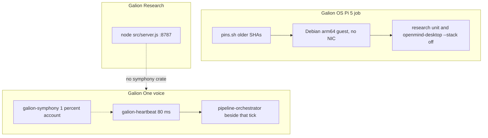

# Symphony

The word is used for three different setups. They do not share a process.

Laptop decision, restated: Rust on `127.0.0.1`, files under `G:\galion\`. The Titanaxe VPS, also called Titan X by the owner, is out. Staging notes that still put a public HTTPS name in front of loopback are plans in the voice repo. They are not the laptop target.

## 1. Galion OS Pi 5 symphony

Repository `galion-operating-system` at `3a347933`. The note is `docs/PI5-SYMPHONY.md`. The workflow is `.github/workflows/pi5-symphony.yml`. It calls `scripts/pi5-seed-boot.sh` and does not start a second emulator.

`scripts/symphony/pins.sh` pins hermes-research `74f9a7071f1c9672c1fe83e8e96f70e6cbb17318` and obsidian-open-mind `b26ad02e1b1e9084815bb56d3aff9a02888ca8d8`. `scripts/symphony/fetch-seeds.sh` clones those commits and builds the desktop for `aarch64-unknown-linux-musl`. `docs/PI5.md` says pull request 100 of Open Mind shipped the desktop binary and no systemd unit. The unit this job installs is `scripts/symphony/openmind-desktop.service`: `openmind-desktop --listen 127.0.0.1:18181 --stack off` as user `galion`.

`scripts/symphony/guest-run.sh` runs as root inside the guest after the OS seed and does not fetch. `docs/PI5.md` says the guest is Debian's arm64 Bookworm image under qemu, with no network interface, and that a PASS on the health table is an emulator reading. The guest is Debian, not Raspberry Pi OS. The script has not been run on a Pi 5. `scripts/symphony/health-table.sh` writes `pi5-health-table.txt`. On a board the table's `contract:` stays `failed`, because that contract requires the offline emulator (`docs/ARCHITECTURE.md`).

`docs/ARCHITECTURE.md` says the symphony emulator also answers six probe URLs with static stand-ins on ports 8670, 8674, 18080, 8642, 8002, and 8646. Those stand-ins are not nerve, cortex, the console, Hermes, voice, or desk. The voice stand-in uses port 8002, which is also the Open Mind `galion-one` mouth default. The stand-in is not that process.

This job installs Research and the desktop beside the Galion OS seed. It does not run the 80 ms voice clock.

## 2. Galion One voice symphony

Repository `galion-one-voice` at `c7179d1b6cd346aa6a9130e4694656143472b46b`. The index is `docs/galion-voice-v2/symphony/README.md`, dated 2026-11-03 in that file. It says the product spelling is Galion, the product in that page is Galion Voice, and the champion line is that a conversation is one heartbeat, not a pipeline: one 80 ms clock and three bands named you, me, and feeling.

`LOCKS.toml` in that commit:

| Key | Value |
| --- | --- |
| `program` | `Galion Voice` (the comment on that line says not Galion One) |
| `clock.frame_ms` | 80, `configurable = false` |
| `clock.frame_hz` | 12.5 |
| `clock.frame_budget_p95_ms` | 60 |
| `bands.names` | you, me, feeling |
| `gates.barge_in_max_ms` | 200 |
| `formats.forbidden_runtimes` | candle, ort, tract, burn, llama, ggml |

The 24 kHz sample rate and 1920 samples per frame are in `docs/galion-voice-v2/symphony/80MS.md`, which says the 80 ms frame is the existing lock and is not a latency that page measured. The clock table in `LOCKS.toml` does not itself store 24000.

### Who runs the loop

`docs/galion-voice-v2/symphony/HEARTBEAT.md` points at `Heartbeat::step` in `crates/galion-heartbeat`. That is the 80 ms frame for you, me, and feeling.

`crates/galion-symphony/src/lib.rs` is not that loop. The module comment calls it the V6 one-percent engine account for the 80 ms tick. It defines P1 as non-inference CPU at most 1 percent of the tick, and it states that 1 percent of 80 ms is 800 µs. P3's hard check in that comment is `p99 < 800 µs`. `product_claim` is false: a local `Instant` and a local process-CPU span are not a hosted SKU result. Stub samples never flip a measured claim. The design note is `docs/galion-voice-v2/symphony/ONE-PERCENT.md`.

`voice-stack/pipeline-orchestrator` (package `galion-sam-orch`) is the Samantha turn loop. Its README says mood advances on that tick and `Heartbeat::step` is not called. `Brain::open` returns `Err("horbm is not linked; Brain::open stays in crate horbm")`. The crate does not call Hermes and does not link Piper, Vosk, or Chatterbox.

`voice-stack/ARCHITECTURE.md` says the file is a design, not a latency result, and that crate `horbm` is not in the repository. Sectors in that file:

| Sector | Role in that design |
| --- | --- |
| S01 | Microphone and resample |
| S02 | VAD and endpointer |
| S03 | Vosk ASR |
| S04 | `Brain` trait. No `horbm` crate in the tree |
| S05 | Piper stream |
| S06 | Offline clone |
| S07 | Prosody from `Pad` |
| S08 | Affect and consent in |
| S09 | Orchestrator. The turn runs beside `Heartbeat::step` |
| S10 | Loopback server |
| S11 | One-dot UI |
| S12 | Latency harness |
| S13 | Eval golden |
| S14 | Windows files under `G:\galion` when `GALION_HOME` is unset |
| S15 | Linux package unit |
| S16 | This contract |

The same design names neighbour ports 7878 (one-dot), 7879 (`GALION_HARD_ADDR`), 7880 (`GALION_CBX_ADDR`), 8642 (Hermes), and 8766 (nebula, a different schema). The Samantha WebSocket binds `127.0.0.1:7881`. `voice-stack/vad` is excluded from the nested workspace because it depends on `ort`, which `LOCKS.toml` forbids inside workspace members.

Speech order, from `docs/galion-voice-v2/symphony/COMPILER.md` for `GALION_SPEECH=auto`: the clone when it is ready, otherwise Piper when the A21 pack is on disk, otherwise Flite. Modes named there are `clone`, `a21`, `flite`, and `off`. `detect` does not download a pack. That matches `crates/galion-ml-voice` as read for the stack map.

### CPU-first, and what is not a measurement

`docs/galion-voice-v2/symphony/CPU.md` says the symphony runs CPU only, no GPU, and that the tables below that sentence are planning data, not measured on that host, and not an EPYC or hosted-class benchmark. `docs/galion-voice-v2/symphony/README.md` says the host plan is CPU only, no GPU. The one-percent gate row in the index is still the template tokens PASS / FAIL / BLOCKED. A blank template is not a score. The index says a finished row is copied into `SELF-EVAL.md`. This deep dive did not treat the template as a result. Which rows of `SELF-EVAL.md` are PASS is **UNVERIFIED** here.

`voice-stack/ARCHITECTURE.md` points at a 240 ms plan in `docs/galion-voice-v2/sprint-v2/latency-240/BUDGET.md` and says this stack does not replace that plan and does not report a new end-to-end number.

`docs/galion-voice-v2/symphony/STAGING.md` describes public HTTPS in front of loopback. That is a remote-edge plan. The laptop target is loopback only.

The index lists these owned sections, each with its own file under `docs/galion-voice-v2/symphony/`: compiler, clone, emotion blend, articulation, lungs, MnE contract, feeling, throat, sound out, mouth, nose, listen-back, persona, one-dot, runbooks, 80 ms, self-eval, eureka, Plus / Ultra / Research, Rust translation, Jarvis texture, Samantha emotions, one-percent, heartbeat, clip store, auto-workflow, and TTFA. A section is complete only when its gate is PASS and the row has been copied into `SELF-EVAL.md`. The directory also holds `STAGING-CPU.md`, `PLAN-PLUS.md`, `PLAN-ULTRA.md`, `PLAN-RESEARCH-CONSOLE.md`, `LOCAL-DEMO.md`, and others. Those files are the index's design set. This deep dive does not promote a design sentence into a measured latency.

## 3. Galion Research

Repository `hermes-research` at `13ff29389c7d7528d7c3d3a667a7abb9e7153081` has no symphony crate and no symphony subsystem. A search found the word only as a metaphor in `docs/swarm-9/2026-11-15/research/PLAN.md` and as a scope exclusion in `docs/swarm-9/2026-11-15/research/desk-hardening.md` ("Voice, symphony, and billing were out of scope").

Research orchestration is `src/server.js`. The process binds `127.0.0.1` and defaults to port 8787. `POST /research/ask` uses the Hermes client when Hermes is attached, otherwise tries `src/forward.js`, otherwise the local engine. Details are in [galion-research.md](galion-research.md) and [hermes.md](hermes.md).

Timeouts that are in code, not a voice latency result:

| Knob | Value in code | File |
| --- | --- | --- |
| `GALION_LLM_TIMEOUT_MS` | default 3000, clamp 50 to 95000 | `src/hermes.js` |
| `GALION_ASK_TIMEOUT_MS` | default 90000, max 95000 | `src/forward.js` |
| `GALION_UPSTREAM_TIMEOUT_MS` | default 4000, clamped to 4000 | `src/forward.js` |

`src/forward.js` comments that a research ask stays under a 100 second origin limit associated with Cloudflare. That comment still assumes a public edge. The laptop target does not.

The voice repo's research papers are plans, not the Node desk:

- `docs/galion-voice-v2/symphony/PLUS-ULTRA-RESEARCH.md` is a hosted plan. The symphony README says hosted figures are capacity notes until a benchmark records them.
- `docs/galion-voice-v2/symphony/PLAN-RESEARCH-CONSOLE.md` says the console is not built in that tree, that the desk UI is not in that tree, and that transport today is `NullTransport` to Unreachable. `HermesTransport` is named as a later human step.

The Galion OS symphony job can install the research seed beside the desktop. That install is the Pi 5 emulator path in section 1. It is not the 80 ms voice clock, and it is not a Rust replacement for `node src/server.js`.
