# Galion Ubuntu on G: (WSL2)

G.A.L.I.O.N. — General Autonomous Local Intelligence Open Network
Developed and distributed by Galion Labs
Perpetual Open MIT License
Copyright © 2026 Galion Labs. All rights reserved.

The licence text is [LICENSE](../../../LICENSE). This page does not restate it.

The owner entry is [Install-GalionUbuntuOnG.cmd](Install-GalionUbuntuOnG.cmd). It imports one WSL2 distro, `Galion-Ubuntu`, onto `G:\galion\wsl\Galion-Ubuntu`, then runs the Linux provisioner, the Open Mind desktop installer, and the voice installer. It does not delete the existing `Ubuntu` distro or `docker-desktop`.

This is not the Galion OS image. The image plan in [docs/PACKAGING.md](../../../docs/PACKAGING.md) is Ubuntu 26.04, and it still waits on `galion-init`. Ubuntu 24.04.5 is the rootfs Canonical publishes for WSL. The laptop's existing `Ubuntu` distro is a separate install. The owner reports that distro as Ubuntu 26.04.1 stored under `G:\galion\wsl\ubuntu`. This installer was not run on that laptop, and it did not probe that distro's version.

```mermaid
flowchart LR
  cmd["Install-GalionUbuntuOnG.cmd"] --> ps1["Install-GalionUbuntuOnG.ps1"]
  ps1 --> pre["preflight: admin, WSL2, G:, free space, Ubuntu, docker-desktop"]
  pre --> cache["rootfs cache on G:"]
  cache --> imp["wsl --import Galion-Ubuntu"]
  imp --> cfg["merge .wslconfig, keep debugConsole, swap on G:"]
  cfg --> w2["provision-galion-ubuntu.sh"]
  w2 --> w3["scripts/install-wsl-ubuntu.sh"]
  w3 --> w4["voice-stack/linux-package/wsl/install.sh :7881"]
```



## Command the owner runs

Use an elevated PowerShell. A checkout on `G:\galion\src\galion-operating-system` keeps the repository with the rest of the data. A checkout on `C:` is only read by this installer, and that read is allowed.

```text
cd G:\galion\src\galion-operating-system
.\packaging\windows\wsl-on-g\Install-GalionUbuntuOnG.cmd
```

Dry run, which prints the plan and writes nothing:

```text
.\packaging\windows\wsl-on-g\Install-GalionUbuntuOnG.cmd -DryRun
```

Remove only `Galion-Ubuntu`. The cache, the logs, `swap.vhdx`, and `.wslconfig` stay:

```text
.\packaging\windows\wsl-on-g\Install-GalionUbuntuOnG.cmd -Uninstall -Confirm
```

Without `-Confirm`, a non-interactive run exits 2. On an interactive Windows console the script asks for the phrase `UNREGISTER Galion-Ubuntu`.

Check the distro afterwards. Administrator is not required:

```text
powershell -NoProfile -ExecutionPolicy Bypass -File .\packaging\windows\wsl-on-g\Test-GalionUbuntuOnG.ps1
```

Exit 0 is the plan printed, or the install finished. Exit 1 is a refusal or a failed command. Exit 2 is a bad pin or a missing confirmation.

## What the entry does

1. Refuses to run unless the process is Administrator, `wsl --status` reports `Default Version: 2`, and `G:` exists and is writable. It does not enable Windows features. The WSL platform binaries stay on `C:` because they are a Windows component.
2. Refuses when free space on `G:` is below 20 GiB (21474836480 bytes) and a download, import, provision, desktop build, or voice build will run. That number is a policy threshold. It is not a measurement of this laptop.
3. Lists registered distros. `Ubuntu` whose disk is under `G:\galion\wsl\ubuntu`, and any name that starts with `docker-desktop`, are protected. The script never unregisters them and never writes inside their disks. If `Galion-Ubuntu` is already registered at a different path, the script stops and does not unregister it. If `G:\galion\wsl\Galion-Ubuntu` already has files and the name is not registered, the script stops and does not delete those files.
4. Sets `TEMP` and `TMP` to `G:\galion\tmp\win` for this process only. It also points the Windows process `CARGO_HOME`, `RUSTUP_HOME`, `CARGO_TARGET_DIR`, npm cache, pip cache, and `HF_HOME` at directories under `G:\galion\cache`. It does not call `setx`. Before every `wsl.exe` command it removes those toolchain variables from the child so they do not leak into the distro. Linux caches stay inside the distro disk at `G:\galion\wsl\Galion-Ubuntu\ext4.vhdx`, which is what the provisioner requires.
5. Downloads `https://releases.ubuntu.com/24.04/ubuntu-24.04.5-wsl-amd64.wsl` into `G:\galion\wsl\cache` and checks SHA-256 `bb415d824822c4b878125729af451a5d18fb13d1cf5cbed9a7393ad64ac6039e`. That line was read from `SHA256SUMS` on 2026-11-21. The rootfs file itself was not downloaded in the workspace that wrote this installer. The sector script records the length `388975696`. The owner entry does not check that length, and this workspace did not measure the file. A hard link named `ubuntu-24.04.5-wsl-amd64.tar.gz` is what `wsl --import` receives, because import wants a tar name.
6. Imports:

```text
wsl.exe --import Galion-Ubuntu G:\galion\wsl\Galion-Ubuntu G:\galion\wsl\cache\ubuntu-24.04.5-wsl-amd64.tar.gz --version 2
```

7. Backs up `%USERPROFILE%\.wslconfig` to `G:\galion\wsl\backups\.wslconfig-<stamp>` when the file already exists, then merges `swap=4GB` and `swapFile=G:\\galion\\wsl\\swap.vhdx` into `[wsl2]`. `debugConsole=true` stays. `memory` and `processors` stay when they are already present, and they are not added when they are absent. The merged text is also copied to `G:\galion\wsl\.wslconfig`. Windows reads the profile file. The profile file is the one allowed write on `C:`, and only while its UTF-8 length stays under 65536 bytes. The script does not replace that file with a symbolic link, and it does not run `wsl --shutdown`.
8. Runs `sudo bash packaging/wsl/provision-galion-ubuntu.sh` inside the new distro, as root. Then it runs `wsl.exe --terminate Galion-Ubuntu` so the next start reads `systemd=true`. It does not stop `Ubuntu` or `docker-desktop`. `loginctl enable-linger galion` is best-effort.
9. Writes `/etc/profile.d/galion-research-port.sh` with `GALION_RESEARCH_PORT=8797` and `GALION_HORBM_PREVIEW_PORT=8787`. It does not export `PORT`.
10. Checks out `obsidian-open-mind` at `272060c8b9559b0f517721baaebcd45685b0537a` under `/opt/galion/src/obsidian-open-mind` and runs `scripts/install-wsl-ubuntu.sh` as root. That installer refuses a checkout on `/mnt/<letter>`, so the tree lives on the distro disk. Cargo uses `/opt/galion/cargo` and `/opt/galion/rustup` from the provisioner. Their script leaves `openmind-desktop --listen 127.0.0.1:18181` running, and adds `--stack off` when nothing accepts `127.0.0.1:8091`.
11. Checks out `galion-one-voice` at `363cd4b77a87f036d31caf413941fc5c184e5685` under `/mnt/g/galion/src/galion-one-voice` and runs `voice-stack/linux-package/wsl/install.sh` as user `galion`. `GALION_SAMANTHA_REF` is unset. No voice clone and no reference WAV are downloaded by this step. Public Vosk, Piper, and Silero files are fetched by that installer into its own `var/` directory.

`-Repair` repeats provision, the desktop step, and the voice step even when their stamps exist. It does not reimport a distro that is already registered at `G:\galion\wsl\Galion-Ubuntu`.

## Decisions where the sectors disagreed

| Topic | Decision |
|---|---|
| Entry | `Install-GalionUbuntuOnG.cmd`. [Install-GalionWSL.ps1](Install-GalionWSL.ps1) stays in the tree for its own dry-run tests. The owner entry does not call it. |
| Rootfs | Ubuntu 24.04.5 from `releases.ubuntu.com`, cached under `G:\galion\wsl\cache`, imported through a `.tar.gz` hard link. |
| `.wslconfig` | Merge the existing file in place. Keep `debugConsole=true`. Do not add `memory` or `processors`. Do not create a symlink. Do not enable Windows features with DISM. |
| Other distros | Never `wsl --shutdown`. Terminate only `Galion-Ubuntu` after provision. |
| Caches | Linux toolchains stay inside the distro disk, as the provisioner requires. Windows process caches for this installer stay under `G:\galion` and are stripped before `wsl.exe`. |
| Node and Rust | The provisioner installs the current Node.js LTS and a stable Rust toolchain. This entry does not pin those versions. |
| Desktop | Open Mind `openmind-desktop`, not the proprietary Obsidian.md application. W3's launcher uses `--listen`, which dials `127.0.0.1:8091`. This repository's desktop entry uses `--listen --stack off`. This entry does not patch W3's launcher. Verify probes with `--listen --stack off` and expects `127.0.0.1:18181`. |
| Voice | W4's `voice-stack/linux-package/wsl/install.sh`, not the older Linux package entry and not the Windows-native Samantha installer. |
| Research port | 8797 on this laptop. 8787 stays the Pi 5 desktop entry and is left for the owner's HORBM preview. |

The voice pin is the merged head of galion-one-voice pull request #236. The desktop pin is the open head of obsidian-open-mind pull request #126, read on 2026-11-21. That pull request was still a draft. A later fetch of the desktop commit works only while GitHub still advertises it.

## Ports

[docs/STACK-MAP.md](../../../docs/STACK-MAP.md) is the piece map. This installer does not start Galion Research, a HORBM preview, Hermes, or nerve.

| Port | Piece | What this installer does |
|---|---|---|
| 18181 | `openmind-desktop --listen` | W3 installs the binary. Plain `--listen` dials `127.0.0.1:8091`. `--stack off` does not open that client. |
| 8091 | Open Mind `galion-one` | Not started here. W3's menu entry dials it. |
| 8787 | Galion Research, Node, `BIND_HOST` `127.0.0.1` | Left for the owner's HORBM preview. The Pi 5 desktop file still sets `PORT=8787`. |
| 8797 | Laptop research port | Written as `GALION_RESEARCH_PORT`. The owner starts the desk later with `PORT=8797 npm start`. 8797 is not in the stack-map table. |
| 7881 | Samantha / `galion-one-voice` | W4's unit binds `127.0.0.1:7881`. Health is `GET /health`. |
| 7878 | one-dot | Left alone. |
| 7879 | hard loop | Left alone. |
| 7880 | clone | Left alone. |
| 8642 | Hermes | Left alone. Research dials `http://127.0.0.1:8642` when it is started separately. |
| 8670 | nerve | Numeric loopback only. The hostname `localhost` is refused by that client. Not started here. |
| 3015, 3016 | galion-knowledge V2 site | Not started here. |

`docs/deep-dive/horbm.md` says `horbm-memory` is a library and a CLI in galion-knowledge `v2/memory`, and that the files it read give that crate no listen port. The retrieval crate named `horbm` does not exist yet. The owner says a HORBM preview uses 8787, so this laptop's research desk is moved to 8797. This installer does not clone `horbm`, does not create `G:\galion\horbm`, and does not import cards.

## Layout

```text
G:\galion\tmp\win\                         this process's TEMP and TMP
G:\galion\cache\cargo\                     Windows-process Cargo home, not passed into WSL
G:\galion\cache\rustup\
G:\galion\cache\cargo-target\
G:\galion\cache\npm\
G:\galion\cache\pip\
G:\galion\cache\huggingface\
G:\galion\wsl\cache\                       Ubuntu rootfs
G:\galion\wsl\Galion-Ubuntu\ext4.vhdx      the distro, including Linux toolchain caches
G:\galion\wsl\swap.vhdx                    named by .wslconfig; created by WSL, not by this script
G:\galion\wsl\.wslconfig                   copy of the merged body
G:\galion\wsl\backups\                     original .wslconfig bytes
G:\galion\logs\wsl\install.log             append-only UTF-8 log
G:\galion\logs\wsl\c-users-before.tsv      profile snapshot taken before the install writes
/opt/galion/src/obsidian-open-mind/       desktop checkout, inside the distro disk
G:\galion\src\galion-one-voice\            voice checkout, seen in the distro as /mnt/g
```

Apt package lists stay inside the distro disk. The provisioner refuses cache paths on `/mnt/<drive>`.

## Sector script

[Install-GalionWSL.ps1](Install-GalionWSL.ps1) is not the laptop entry. The owner entry does not call `Install-GalionWslOnG`. If someone runs the sector script on its own, it downloads the same rootfs into `G:\galion\wsl\downloads` and checks the length it recorded, `388975696`. It merges an existing `.wslconfig`, keeps `debugConsole=true`, and still writes `memory` and `processors`. It then replaces the profile file with a symbolic link to `G:\galion\wsl\.wslconfig`. It can enable the Windows WSL features with DISM, and it runs `wsl --shutdown` unless `-SkipShutdown` is passed. Its guest script creates user `galion` and a partial `wsl.conf`. Do not run it as the way to install this laptop. Its Pester file still checks that sector, and a green run of that file is not a Windows install.

## Known limits

These limits are the state of the workspace that wrote this page. They are not a hardware result.

- The installer was not run on GALION-STUDIO. No WSL distro was imported here. systemd's user bus, a WSLg window, and a process listening on `127.0.0.1:7881` were not exercised. `Test-GalionUbuntuOnG.ps1` on a non-Windows host exits 1 and says the host was not measured.
- A display variable inside the distro does not prove that a window painted pixels. The verify script says so.
- `wsl --shutdown` is not used, so the new swap file may not be created until the owner restarts WSL. The provisioner's success text mentions `wsl --shutdown`. This entry does not follow that sentence, because a shutdown stops `Ubuntu` and `docker-desktop`.
- `systemd=true` applies the next time `Galion-Ubuntu` starts. Terminating that distro does not restart the others.
- Windows itself can write under the user profile during a long install. The verify check then fails and names the new path. The only path it allows to appear or change is `.wslconfig`, and only under 65536 bytes.
- The 20 GiB free-space figure is a policy. The sector script records the rootfs length as 388975696. This workspace did not measure that length, and the owner entry checks the SHA-256 line rather than the length.
- Ubuntu 26.04.1 for the existing `Ubuntu` distro is the owner's report.
- Apt package names were confirmed with `apt-cache` on an Ubuntu 24.04.5 virtual machine, not inside a WSL distro and not on the laptop.
- The desktop checkout is inside the distro disk because that installer refuses `/mnt/<letter>`. The voice checkout is on `/mnt/g`. Neither build was executed here. W3's own smoke was W3's run, not this one.
- Fetch-by-SHA for the two pinned commits depends on GitHub still serving those objects.
- The first 16 bytes of the rootfs URL were read in an earlier check and began with the gzip magic `1f 8b`. The file was not saved, and its SHA-256 was not computed locally. CI re-reads the publisher's `SHA256SUMS` line and does not download the rootfs.

## Tests

[tests/GalionUbuntuOnG.Tests.ps1](tests/GalionUbuntuOnG.Tests.ps1) is the Pester check for this entry. [steps/test-steps.sh](steps/test-steps.sh) checks the bash steps' dry runs. The workflow is [.github/workflows/wsl-integrator.yml](../../../.github/workflows/wsl-integrator.yml). A green run is not a GALION-STUDIO result and not a WSL result.
